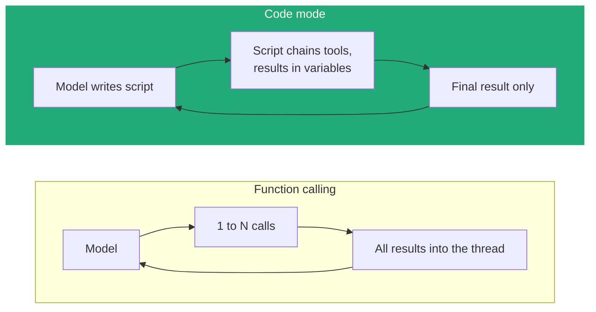
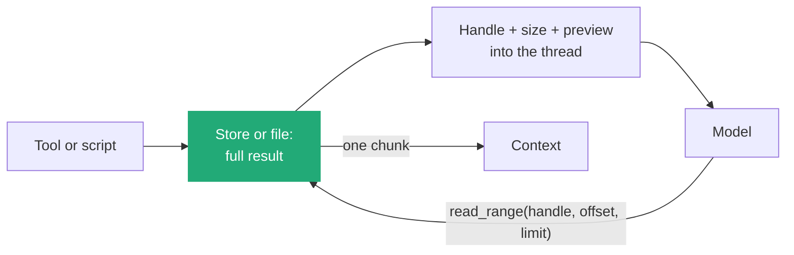

# 25. Run tools from a script and keep results out of the thread: the model reads a chunk, the rest stays in memory

> Instead of one model round trip per tool call, the model can write one script that chains the tools, keeps intermediate results in variables and returns a small result, and large results go to a file or store that the model reads by handle one chunk at a time, which is how memory binds to context; vendors ship this, but it needs a sandbox and a measurement against plain calls.

Related: [07 Tools: awareness, discovery, gateway](07_Context_Tool_Awareness_Avoids_Compression.md) · [06 Context window and compaction](06_Context_Window_And_Compaction.md) · [10 Memory](10_Memory.md) · [12 Audit ledger](12_Memory_Audit_Ledger_In_Memory_Or_State.md) · [20 Loop hooks declared](20_Loop_Hooks_Declared.md) · [14 Tool approval, durable waits](14_Tool_Approval_Durable_Waits.md) · [04 HITL and execution isolation](04_HITL_And_Execution_Isolation.md) · [Lecture 1: 10 Code mode](../Lecture_1_Mechanics_Behind_Generative_AI/10_code_mode.md) · [Lecture 2: 10 Tool results to file and back](../Lecture_2_Context_Agents_md_Skills_Tools/10_tool_results_context_to_file_and_back.md) · [26 Agent-made packages](26_Packages.md) · [W2L3 13 MCP tools loading and code mode with many servers](../Week2_Lecture_3_MCP_MCP+Resources_Skills/13_MCP_Tools_Loading_And_Code_Mode_With_Many_Servers.md)

Source: S02E01 article, "Agentic Loop" (tools paragraph, figures 12 and 13). Anthropic, OpenAI, Cloudflare, Pi and DeepSeek documentation read through fetch agents on 2026-11-15. The optimization ideas in section 6 are my own. See [Fact-check](#fact-check).

## Glossary

| Term | What it means here | Same thing elsewhere | Not to be confused with |
|---|---|---|---|
| Function calling | The model emits a structured call per tool and every result returns to the model | OpenAI function calls, DeepSeek `tool_calls` | Code mode |
| Code mode | The model writes one script that calls tools and keeps results in variables | Anthropic and OpenAI programmatic tool calling, Cloudflare Code Mode, Pi `pi-codemode` | A code interpreter used for analysis only |
| Parallel tool calls | Several independent calls in one assistant message | OpenAI `parallel_tool_calls`, Pi `toolExecution: "parallel"` | A script, which can chain dependent calls |
| `allowed_callers` | Per-tool setting of who may call it: the model directly, a program, or both | Anthropic and OpenAI | A security boundary |
| Result handle | A reference to a stored result with its size and a preview | DeepSeek TUI `var_handle`, a file path | The result itself |
| Intermediate result | Output of one tool that only feeds the next | A script variable | A final result |

## 1. The problem

My loop calls 1 to N tools, collects their responses, reasons over them, and then retries or moves on. Every result passes through the model and the thread. **Can I shorten that route by running the chain as code, what do the vendors, Pi and DeepSeek actually do, and how do large results bind to memory instead of filling the context?**

## 2. Two routes


Source: S02E01 article, figure 12. Caption: "In code mode, the model writes one script that chains the tools. Each result stays in a variable. Only the final result goes into the thread."



| Axis | Function calling | Code mode |
|---|---|---|
| Round trips | One per batch of calls | One per script |
| What enters the context | Every result | The final result |
| Dependent calls | A new model turn each | Inside the script |
| Filtering, loops, retries | Model turns | Code |
| Approval and audit | A hook per call | Calls inside the program need hooks too |
| Cost | Tokens | A sandbox, limits and monitoring |

## 3. What exists

| Who | What | Notes |
|---|---|---|
| [Anthropic](https://platform.claude.com/docs/en/agents-and-tools/tool-use/programmatic-tool-calling) | Tools opt in with `allowed_callers: ["code_execution_20260120"]`. "intermediate results are not loaded into Claude's context window" | The docs say it is not a hard block on direct calls |
| [OpenAI](https://developers.openai.com/api/docs/guides/tools-programmatic-tool-calling) | Hosted tool `programmatic_tool_calling`: the model "write[s] and run[s] JavaScript that coordinates its tools". `allowed_callers`: direct, programmatic or both. A fresh V8 runtime with no network, filesystem or state. My app runs the client functions | MCP `require_approval` can pause the program. The docs say the effect "depends on the task" and to compare with direct calls |
| [Cloudflare Code Mode](https://blog.cloudflare.com/code-mode/) | Code in a V8 isolate, tools through bindings | Training-data argument: models have seen more code than tool-call tokens |
| [Pi](https://github.com/earendil-works/pi/blob/main/packages/agent/README.md) | `pi-codemode` "runs model-written JavaScript that calls tools" through `runToolCall()`, which applies the same hooks and permission checks as a model call. Default `toolExecution` is parallel, one sequential tool forces the batch sequential | The script runs in QuickJS compiled to WebAssembly with no network, timers or `process`; the walls are in [Lecture 2: 12](../Week2_Lecture_2_Building_an_Agent/12_Sandbox_For_Agent_Code_Pi_And_Search_Execute.md). The 2025 article says "pi does not and will not support MCP", the current README lists `pi-mcp` |
| [DeepSeek API](https://api-docs.deepseek.com/guides/tool_calls) | "The model itself does not execute specific functions": the caller does. With thinking, `reasoning_content` must be passed back or the API returns 400 | No programmatic tool calling or code interpreter found. V3.2 is "first ... to integrate thinking directly into tool-use" |
| DeepSeek TUI (community) | Sandboxed Python REPL tools, sub-agent transcripts "parked behind `var_handle` references" | Not official |

"DeepSeek" here means three things: the API and models (official), the "DeepSeek Harness" paper (a composability paper, no tool execution content, see [19](19_Pi_LangGraph_DeepSeek_Harnesses.md)) and the community TUI.

## 4. Parallel calls are not scripts

OpenAI's `parallel_tool_calls: false` gives "exactly zero or one tool". Pi runs a batch concurrently after sequential preflight. DeepSeek's guide never says "parallel". A batch removes round trips between independent calls. A script also removes the round trips between dependent ones and moves filtering and loops out of the model.

## 5. Large results: read a chunk, the rest stays in memory

The lecture's figure 13: a script writes a big report to a file, the model gets a reference, reads a fragment, shows it or passes it on. This is how memory binds to context: the thread holds a handle and a preview, the store holds the result.


Source: S02E01 article, figure 13. Caption: "Code mode writes a big result to a file. The model gets only a reference to the file, so it can read a fragment, display the file or pass it to another tool." Example text: `Result saved to file: results/report.md`.

The idea is pass by reference instead of by value. The reference passes through the model, the content does not: the user's screen and the email tool resolve the reference themselves, so the model never copies the report and cannot alter it on the way (my reading). Risks: the tool must check that the caller owns the reference (identity from the session, [04](04_HITL_And_Execution_Isolation.md)), a reference can dangle after cleanup, and a chunk read into context is still untrusted text.



```text
tool_result: report stored as handle rpt_91 (412 KB, 3,100 lines). Preview: first 12 lines.
Read a range with read_range(rpt_91, offset, limit) or pass rpt_91 to mail.send(attachment).
```

- **Where it lives:** a file in the workspace, or a store namespace ([10](10_Memory.md)). Not a LangGraph state channel: checkpoints write the full value of every channel at each super-step, so a large result there is copied at every step ([12](12_Memory_Audit_Ledger_In_Memory_Or_State.md)).
- **Evidence:** Anthropic: filter or aggregate in the environment and write files. Pi: the `read` tool defaults to the first 2,000 lines with offset and limit (2025 article), and a tool result separates `content` for the model from `details` for UI. DeepSeek TUI parks transcripts behind handles (community).
- **Cost:** a handle outlives the thread only if I store it so. Its lifetime and access follow the rules in [04](04_HITL_And_Execution_Isolation.md).

## 6. What I would review (my reasoning)

| Idea | Gain | Risk | How I test it |
|---|---|---|---|
| Batch independent calls | Fewer turns | Mixed writes | Already parallel in Pi and OpenAI |
| Script for dependent chains | One turn for N steps | Sandbox, harder debugging | Same task both ways on the golden set |
| Filter before return | Smaller context | Script hides detail | Compare answers and tokens |
| Handles and chunk reads | Large results stay out | Handle lifetime, access | Count tokens per task |
| Writes and approvals stay direct | Human gate stays | Less saving | OpenAI advises direct calls by default |
| Hooks inside scripts | Guards still apply | A path that skips them | Pi's `runToolCall` does this |

## Summary

Code mode replaces round trips with one script and keeps intermediate results out of the thread. Large results are stored and read by handle in chunks, which binds memory to context. Vendors and Pi support it, DeepSeek's official docs show only function calling. I measure it against plain calls before I adopt it, and keep writes and approvals as direct calls.

## Open questions

- Which of my current tool chains are dependent chains a script would shorten?
- What does my sandbox allow a script to reach, and where do the result handles live?

## Fact-check

| # | Claim | Verdict | Source | Checked |
|---|---|---|---|---|
| 1 | Modern agents write code that chains tools and keeps results in variables | **Agrees** | Anthropic and OpenAI pages above, [Cloudflare](https://blog.cloudflare.com/code-mode/) | 2026-11-15 |
| 2 | OpenAI Programmatic Tool Calling: V8 runtime, `allowed_callers`, app runs client functions | **Agrees** | [OpenAI guide](https://developers.openai.com/api/docs/guides/tools-programmatic-tool-calling), read in full. Supported model list not stated | 2026-11-15 |
| 3 | Anthropic `allowed_callers` is not a hard block | **Agrees** | [Anthropic docs](https://platform.claude.com/docs/en/agents-and-tools/tool-use/programmatic-tool-calling) | 2026-11-15 |
| 4 | Pi has code mode | **Agrees** | [Pi README](https://github.com/earendil-works/pi/blob/main/packages/agent/README.md): `pi-codemode`. Sandbox details in Lecture 2 note 12 | 2026-11-15 |
| 5 | Pi executes a batch in parallel by default | **Agrees** | `types.ts`: `Default: "parallel"`. [agent-loop.ts](https://github.com/earendil-works/pi/blob/main/packages/agent/src/agent-loop.ts) | 2026-11-15 |
| 6 | Pi does not support MCP | **Outdated** | The 2025-11-30 article says so, the current README lists `pi-mcp` ([Zechner](https://mariozechner.at/posts/2025-11-30-pi-coding-agent/)) | 2026-11-15 |
| 7 | DeepSeek's official docs offer programmatic tool calling | **Not found** | [Tool calls](https://api-docs.deepseek.com/guides/tool_calls), [thinking mode](https://api-docs.deepseek.com/guides/thinking_mode). V3.2 tech report not read | 2026-11-15 |
| 8 | Large results should stay out of the thread and be read in chunks | **Agrees** | Anthropic code-execution article, Pi `read` limits, lecture figure 13. Summary-only items: Pi's 50 KB limit | 2026-11-15 |
| 9 | Code mode reduces tokens | **Differs** in strength | OpenAI: "depends on the task". Measure | 2026-11-15 |
| 10 | A large result in a state channel is copied into every checkpoint | **Agrees** | [LangGraph checkpointers](https://docs.langchain.com/oss/python/langgraph/checkpointers.md), see [12](12_Memory_Audit_Ledger_In_Memory_Or_State.md) | 2026-11-15 |

## Sources

- S02E01 article, figures 12 and 13.
- [Anthropic programmatic tool calling](https://platform.claude.com/docs/en/agents-and-tools/tool-use/programmatic-tool-calling) · [OpenAI programmatic tool calling](https://developers.openai.com/api/docs/guides/tools-programmatic-tool-calling) · [Cloudflare Code Mode](https://blog.cloudflare.com/code-mode/)
- [Pi README](https://github.com/earendil-works/pi/blob/main/packages/agent/README.md) · [Pi extensions](https://docs.pi.dev/latest/extensions.md) · [Zechner, 2025-11-30](https://mariozechner.at/posts/2025-11-30-pi-coding-agent/)
- [DeepSeek tool calls](https://api-docs.deepseek.com/guides/tool_calls) · [thinking mode](https://api-docs.deepseek.com/guides/thinking_mode) · [DeepSeek TUI](https://github.com/wcong/DeepSeek-TUI) (community)
- My own reasoning: section 6 and the memory-to-context binding in section 5.
