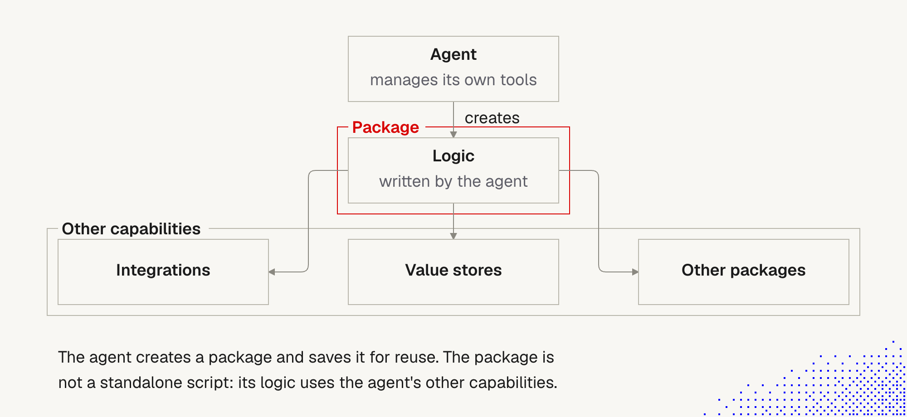
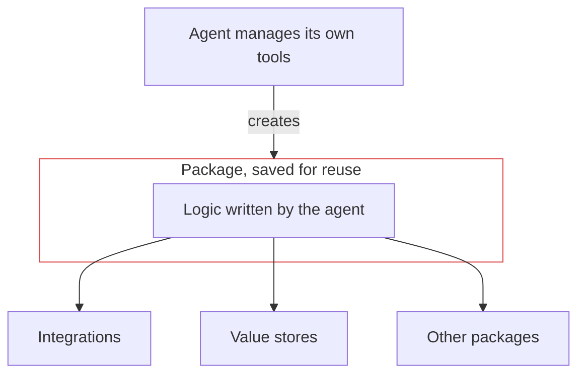

# 26. An agent-made package is reusable logic that calls the agent's other capabilities, so it needs the same guards as any tool

> A reusable tool is not a standalone script: the agent writes logic once, saves it as a package, and that logic imports the agent's integrations, value stores and other packages; Anthropic's code-execution pattern and Voyager's skill library show the same shape, and the price is that a package inherits the authority of everything it imports, so saving needs verification, review and the harness's approval path.

Related: [23 Self-configuring harness](23_Self_Configuring_Harness.md) · [25 Tool execution instead of tool calls](25_Tool_Execution_Instead_Of_Tool_Calls.md) · [02 Rethinking the skills](02_Rethinking_The_Skills.md) · [07 Tools: awareness, discovery, gateway](07_Context_Tool_Awareness_Avoids_Compression.md) · [08 Tool search instead of many tools](08_Tool_Search_Instead_Of_Many_Tools.md) · [04 HITL and execution isolation](04_HITL_And_Execution_Isolation.md) · [14 Tool approval and durable waits](14_Tool_Approval_Durable_Waits.md) · [Lecture 5: 05 Agents maintain the tools I review](../Lecture_5_Workflows_not_tool_sets/05_Agents_Maintain_The_Tools_I_Review.md)

Source: S02E01 article, "Tools", the Reusability bullet and figure 27 (the transcript does not cover it). Anthropic's code-execution post, Anthropic's Agent Skills docs and the Voyager paper, read through fetch agents on 2026-11-15. Sections 4 and 5 are my own reasoning. See [Fact-check](#fact-check).

## Glossary

| Term | What it means here | Same thing elsewhere | Not to be confused with |
|---|---|---|---|
| Package | Logic the agent wrote, saved for reuse, that uses other capabilities | Anthropic "skill" saved under `./skills/`, Voyager "skill" | A standalone script that runs alone |
| Integration | A connection to an outside system: an MCP server or a custom integration the agent wrote | MCP tool wrapper | The package itself |
| Value store | A place the package reads and writes values. The lecture does not define it. My reading: key-value store, file or database | Workspace files (`./workspace/`) | Conversation memory |
| Other packages | Earlier packages the new one imports | Voyager "composing simpler programs" | A third-party library |
| Skill | Folder of instructions, scripts and resources the model loads on demand | Agent Skills `SKILL.md` | A package, which is code first |

## 1. The problem

The lecture says an agent may create tools and save them for reuse once tested. **What makes such a tool reusable and safe, instead of a script that works once?** The article's answer in one line: "it's not only about making an agent create tools, but also connect this with its other capabilities".

## 2. The lecture's picture

Important: the package is logic plus its imports, so a saved package is also a dependency graph. Not important: the file layout, because the figure marks import lines as an example.

## 3. How it maps to industry practice

| Source | What it says | Match with the lecture |
|---|---|---|
| Anthropic, code execution with MCP (published 2025-11-04) | "Agents can also persist their own code as reusable functions", saved at `./skills/save-sheet-as-csv.ts` and imported in a later run. MCP tools are files under `./servers/`, called through a shared `callMCPTool` client. `./workspace/` keeps state across runs. A `SKILL.md` makes the saved function "a structured skill" | Same shape: logic, integrations (MCP wrappers), value store (workspace files), other packages (imports of saved functions) |
| Voyager (2023, Minecraft, GPT-4) | A skill library of "executable code", each program indexed by "the embedding of its description". New skills are composed from simpler ones. A program is committed only after a second model confirms the task is done. After 4 failed rounds the task is dropped | Same reuse and composition. Adds verification before saving, retrieval by description |
| Anthropic Agent Skills docs | Skills bundle scripts the model runs through bash; only the output enters context. Use skills only from trusted sources, since a malicious skill can run code that does not match its purpose | Same carrier for scripts. Docs describe people creating skills; an agent saving its own is not documented there |

The Anthropic post states the cost itself: running agent-generated code needs sandboxing, resource limits and monitoring, and these "add operational overhead and security considerations that direct tool calls avoid". It states no review, versioning or trust model for saved code, and its reuse example is a hard-coded import, not automatic discovery.

## 4. What I would add (my reasoning)

| Risk | Rule |
|---|---|
| A package inherits the authority of what it imports | Packages call integrations through the harness, so approval, audit and limits from [14](14_Tool_Approval_Durable_Waits.md) still apply on every call |
| Credentials end up inside saved code | Packages hold no secrets; the integration layer injects them |
| A package that worked once may be wrong | Save only after a test run and a check by a second model or a person, as Voyager does |
| The agent edits a package that other packages import | Version packages and review the diff before a changed one replaces the saved one ([Lecture 5: 05](../Lecture_5_Workflows_not_tool_sets/05_Agents_Maintain_The_Tools_I_Review.md)) |
| Packages pile up and the agent cannot find the right one | Describe each package so [tool search](08_Tool_Search_Instead_Of_Many_Tools.md) can retrieve it, and prune unused ones |
| One user's package reaches another user's data | Keep packages and value stores inside the user's own workspace ([04](04_HITL_And_Execution_Isolation.md)) |

Mapping to my frameworks is my inference and not verified: a package is close to a LangChain tool or a Semantic Kernel plugin, the value store is the LangGraph Store or the platform's own store, and the harness path is the tool-call hook. Verify before presenting.

## Summary

- A package is logic plus imports of integrations, value stores and other packages.
- Anthropic and Voyager show the same pattern; neither covers review or authority.
- I save a package only after verification, route its calls through the harness, keep secrets out of it and keep it per user.

## Open questions

- What does the lecturer mean by "value stores": key-value, files or a database?
- How does a package declare which capabilities it needs, so the harness can grant exactly those?
- Who approves a package before it replaces a saved one: a person, a second model or a test suite?

## Fact-check

| # | Claim | Verdict | Source | Checked |
|---|---|---|---|---|
| 1 | Agents can save their own code for reuse and combine it with other capabilities | **Agrees** | [Anthropic: code execution with MCP](https://www.anthropic.com/engineering/code-execution-with-mcp), fetched page, quotes in section 3 | 2026-11-15 |
| 2 | Skills hold scripts the agent reuses | **Agrees** | [Agent Skills overview](https://platform.claude.com/docs/en/agents-and-tools/agent-skills/overview), read in full | 2026-11-15 |
| 3 | Tested saved code is the right gate | **Agrees** with Voyager | [Voyager](https://arxiv.org/abs/2305.16291): commit only after self-verification; removing it cost 73% of discovered items. Method read in the paper HTML (first 40k of 150k characters verbatim) | 2026-11-15 |
| 4 | An agent may author and save its own skill | **Unverified** | Skills docs describe human authoring; the Anthropic post shows the pattern in an example only | 2026-11-15 |
| 5 | "Package" and "value store" as named terms | **Lecture-specific** | Neither term is in the vendor pages I read | 2026-11-15 |
| 6 | Mapping to LangChain tools, SK plugins and LangGraph Store | **Unverified**, my inference | Not checked against their docs | 2026-11-15 |

## Sources

- Lecture: S02E01 article, "Tools", Reusability bullet, figure 27.
- [Anthropic: code execution with MCP](https://www.anthropic.com/engineering/code-execution-with-mcp) · [Agent Skills overview](https://platform.claude.com/docs/en/agents-and-tools/agent-skills/overview) · [Voyager, arXiv 2305.16291](https://arxiv.org/abs/2305.16291)
- My own reasoning: sections 4 and the framework mapping.
