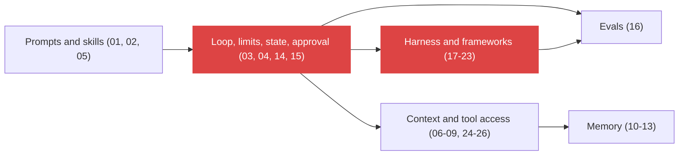

# Week 2, Lecture 1: Agent primitives

> The parts every agent is built from: prompts and skills, the loop with its limits and approvals, context and tool access, memory, evals, and the harness around the loop.

Source: S02E01 article (primary), S02E01 transcript (a retail-agent demo, used only as a worked example) and web research. Every note opens with a Glossary, stays within 150 lines and links to its sources. Pictures are in `img/`. Related: [Lecture 5: Workflows, not tool sets](../Lecture_5_Workflows_not_tool_sets/README.md) · [Week 2, Lecture 2: Building an agent](../Week2_Lecture_2_Building_an_Agent/README.md) · [root README](../README.md)

## What this lecture covered

## Notes

### Prompts and skills

| File | Name | What it covers | Keywords |
|---|---|---|---|
| [01_Advanced_Prompt_Techniques.md](01_Advanced_Prompt_Techniques.md) | Modern system prompts leave steps to the model | Vendor prompts converge on fewer step rules, judgement over rules and explicit autonomy and stop-or-ask guidance, which matters most with no human present | system prompt, named section, unattended run, progressive disclosure |
| [02_Rethinking_The_Skills.md](02_Rethinking_The_Skills.md) | Rethinking skills for newer models | OpenAI guidance: short skill descriptions that say when to use, a router skill, no recipes, a re-test on every model change | skill, description, router skill, skill listing, overconstraining |
| [05_Instructions_Five_Parts_And_Enforcement.md](05_Instructions_Five_Parts_And_Enforcement.md) | Instructions: five parts and enforcement | The system prompt says who the agent is, where it works, what exists, how to look and what is off limits, and only some parts need code | instructions, boundary, enforcement, unattended agent, archetype |

### Loop, limits, state and approval

| File | Name | What it covers | Keywords |
|---|---|---|---|
| [03_Agent_Loop_Stop_Limits_Recovery.md](03_Agent_Loop_Stop_Limits_Recovery.md) | Agent loop exits, limits and recovery | A loop ending on no tool calls is correct but not production-safe, so a routing function with several exits, limits and recovery makes it safe | stop condition, routing function, idempotent retry, checkpoint |
| [04_HITL_And_Execution_Isolation.md](04_HITL_And_Execution_Isolation.md) | What a harness stores and who touches it | A harness persists threads, artifacts and permissions, each needing its own access rule, and keeps users apart | thread, session, checkpoint, store, sandbox |
| [14_Tool_Approval_Durable_Waits.md](14_Tool_Approval_Durable_Waits.md) | Tool approval and durable waits | The model only asks for an irreversible call, and the harness stops, saves the run, asks a human and executes in code | approval, permission grant, run state, idempotency key |
| [15_Trace_A_Run_And_Size_Its_Step_Limit.md](15_Trace_A_Run_And_Size_Its_Step_Limit.md) | Trace a run, size its step limit | A trace shows whether a tool returned the wrong thing or the model misused the right one, and measured steps size the limit | trace, step, superstep, step limit, debugging rule |

### Context and tool access

| File | Name | What it covers | Keywords |
|---|---|---|---|
| [06_Context_Window_And_Compaction.md](06_Context_Window_And_Compaction.md) | Context window: small, on demand, compacted | Keep context small by loading tools and results on demand and compacting, with durable instructions kept where compaction cannot lose them | context window, compaction, reactivation, stable front |
| [07_Context_Tool_Awareness_Avoids_Compression.md](07_Context_Tool_Awareness_Avoids_Compression.md) | Tool awareness without loading everything | An agent keeps a short capability list plus a way to load details on demand, by a search tool or by files | awareness, discovery, function calling, gateway |
| [08_Tool_Search_Instead_Of_Many_Tools.md](08_Tool_Search_Instead_Of_Many_Tools.md) | Tool search instead of many tools | A large tool catalog costs context and hurts selection, so the harness sends names plus one search tool | tool search, deferred tool, native tool, capability list |
| [09_Tool_Search_And_Proxy_Gateway.md](09_Tool_Search_And_Proxy_Gateway.md) | Proxy gateway in front of thousands of tools | At thousands of tools the problem is ownership, authorization and rollout, and a proxy gateway gives one door | control plane, data plane, registry, proxy, default off |
| [24_KV_Cache_And_Prompt_Caching.md](24_KV_Cache_And_Prompt_Caching.md) | Prompt caching and KV cache | Providers reuse stored key-value state for an identical prefix, so static content goes first and a breakpoint marks the end | kv cache, prefill, prefix caching, cache breakpoint, ttl |
| [25_Tool_Execution_Instead_Of_Tool_Calls.md](25_Tool_Execution_Instead_Of_Tool_Calls.md) | Run tools from a script, not calls | One model-written script chains the tools and keeps intermediate results in variables | code mode, parallel tool calls, result handle |
| [26_Packages.md](26_Packages.md) | Agent-made packages need tool guards | A reusable package is logic the agent writes once that imports its other capabilities, so it needs the same guards as any tool | package, integration, value store, skill |

### Memory

| File | Name | What it covers | Keywords |
|---|---|---|---|
| [10_Memory.md](10_Memory.md) | Memory: relations, placement, immutability | Modern agent memory keeps an immutable raw layer, derives linked facts that are superseded and loads a small set | memory, raw layer, derived layer, relation, supersede |
| [11_Memory_Known_Problems.md](11_Memory_Known_Problems.md) | Memory fails in three known ways | Contradiction, duplication and ambiguity are the hard part, and the lecturer's extraction example counts each | contradiction, duplication, ambiguity, replace-by-key |
| [12_Memory_Audit_Ledger_In_Memory_Or_State.md](12_Memory_Audit_Ledger_In_Memory_Or_State.md) | Audit ledger in state, not memory | A per-run append-only ledger fits LangGraph state better than Store memory, but state alone is not a tamper-evident log | ledger, state channel, reducer, store, write-ahead entry |
| [13_Memory_Operations.md](13_Memory_Operations.md) | Memory operations beyond search and insert | Hindsight adds retain, recall, reflect and a consolidating background worker | retain, recall, reflect, consolidation, quality gate |

### Evals

| File | Name | What it covers | Keywords |
|---|---|---|---|
| [16_Evals_For_Agent_Changes.md](16_Evals_For_Agent_Changes.md) | Behaviour evals for agent changes | A small behaviour-based eval set rerun after every change shows whether anything broke and picks the smallest model that passes | eval case, golden set, llm judge, held-out set |

### Harness and frameworks

| File | Name | What it covers | Keywords |
|---|---|---|---|
| [17_Extend_Adjust_Or_Leave_The_Framework.md](17_Extend_Adjust_Or_Leave_The_Framework.md) | Extend, adjust or leave the framework | Knowing the loop turns an improvement into one of three moves: add a tool, adjust the harness, or leave the framework | framework, harness, extension point, middleware |
| [18_Harness_Around_The_Loop.md](18_Harness_Around_The_Loop.md) | Harness drawn around a small loop | A run is woken by an external event, intercepted by hooks at six points and bounded by limits | harness, external event, hook, caller, limits frame |
| [19_Pi_LangGraph_DeepSeek_Harnesses.md](19_Pi_LangGraph_DeepSeek_Harnesses.md) | Who owns the loop: Pi, LangGraph, DeepSeek | LangGraph lets a graph own the loop, Pi runs one small fixed loop extended by events, and the DeepSeek paper defines no loop | orchestration runtime, composition layer, steering |
| [20_Loop_Hooks_Declared.md](20_Loop_Hooks_Declared.md) | Hooks as callbacks at fixed loop points | The lecture's three hooks are an illustration, and Pi's loop declares different ones with defined behaviours | hook, beforetoolcall, fail-open, fail-closed |
| [21_AI_SDK_Or_Official_SDKs.md](21_AI_SDK_Or_Official_SDKs.md) | AI SDK or official SDKs | The Vercel AI SDK could replace adapters only if it keeps the provider features I rely on | adapter, official sdk, ai sdk, parity check |
| [22_Threads_Vs_A2A_Subagents.md](22_Threads_Vs_A2A_Subagents.md) | Sub-thread subagent vs A2A peer | An in-process subagent shares process, store and deadline, and an A2A peer differs in whose context and lifetime it has | sub-thread, a2a peer, task, contextid |
| [23_Self_Configuring_Harness.md](23_Self_Configuring_Harness.md) | Self-configuring harness needs an outside guard | Claude Code, OpenCode and Pi load settings, skills or extensions from watched files, so the guard sits outside what the agent can edit | self-configuration, hot reload, managed settings |

## Related review reminders

All reminders for this episode, in note order. The index by episode is [notes_for_later_use/README.md](../notes_for_later_use/README.md).

| File | Name | What to review | Keywords |
|---|---|---|---|
| [2026-11-15-recall-first-prompt-step-s02e01-note-01.md](../notes_for_later_use/2026-11-15-recall-first-prompt-step-s02e01-note-01.md) | Recall-first step before answering | Ask the model to recall what it knows, which methods apply and what the answer must satisfy before it acts | recall, latent space activation, prompt step |
| [2026-11-15-agent-code-sandboxing-s02e01-note-04.md](../notes_for_later_use/2026-11-15-agent-code-sandboxing-s02e01-note-04.md) | Sandboxing for agent-run code | Let the agent write and run Python or CLI code in a sandbox without getting out of control | sandbox, agent code, python, cli |
| [2026-11-15-agent-boundaries-s02e01-note-05.md](../notes_for_later_use/2026-11-15-agent-boundaries-s02e01-note-05.md) | Review the boundary structure | Review how boundaries, meaning what the agent must not do, are structured in my agents | boundaries, system prompt, must not do |
| [2026-11-15-review-compression-tools-and-prompt-s02e01-note-07.md](../notes_for_later_use/2026-11-15-review-compression-tools-and-prompt-s02e01-note-07.md) | Review my compression mechanism | Make sure compression never compresses tool definitions and other critical prompt pieces | compression, tool definitions, stable front, compaction |
| [2026-11-15-tool-search-instead-of-many-tools-s02e01-note-08.md](../notes_for_later_use/2026-11-15-tool-search-instead-of-many-tools-s02e01-note-08.md) | Tool search instead of many tools | Let the agent know its capabilities without loading every schema and decide which tools stay always available | tool search, schemas, awareness |
| [2026-11-15-manage-many-tools-gateway-s02e01-note-09.md](../notes_for_later_use/2026-11-15-manage-many-tools-gateway-s02e01-note-09.md) | Proxy gateway for many tools | A gateway with a disabled-by-default registry, discovery, authorization and description-change approval | gateway, registry, authorization, approval |
| [2026-11-15-memory-projects-mem0-supermemory-hindsight-s02e01-note-10.md](../notes_for_later_use/2026-11-15-memory-projects-mem0-supermemory-hindsight-s02e01-note-10.md) | Review Mem0, supermemory, Hindsight | Re-review the three memory projects I compared before choosing my approach | mem0, supermemory, hindsight, memory |
| [2026-11-15-memory-redisearch-bm25-review-s02e01-note-10.md](../notes_for_later_use/2026-11-15-memory-redisearch-bm25-review-s02e01-note-10.md) | Revisit my memory design | Compare my flat RediSearch BM25 memory with relations, placement and append-only pieces | redisearch, bm25, relations, append-only |
| [2026-11-15-audit-ledger-review-s02e01-note-12.md](../notes_for_later_use/2026-11-15-audit-ledger-review-s02e01-note-12.md) | Review my audit ledger | Review keeping the audit log in graph state instead of memory, and its implementation | ledger, audit log, graph state |
| [2026-11-15-memory-operations-reflect-s02e01-note-13.md](../notes_for_later_use/2026-11-15-memory-operations-reflect-s02e01-note-13.md) | Memory operations: reflect and maintenance | My memory has search, update and insert but no reflect; consider reflect, consolidation and maintenance loops | reflect, consolidation, maintenance, hindsight |
| [2026-11-15-review-pi-langgraph-deepseek-harnesses-s02e01-note-19.md](../notes_for_later_use/2026-11-15-review-pi-langgraph-deepseek-harnesses-s02e01-note-19.md) | Review Pi, LangGraph, DeepSeek harnesses | How the three harnesses differ and what each teaches about who owns the loop | pi, langgraph, deepseek, loop ownership |
| [2026-11-15-loop-hooks-next-goal-s02e01-note-20.md](../notes_for_later_use/2026-11-15-loop-hooks-next-goal-s02e01-note-20.md) | Hooks as my next goal | Which hook points to expose in my harness, what each may do, and fail-open or fail-closed | hooks, loop, fail-open, fail-closed |
| [2026-11-15-ai-sdk-replace-adapters-s02e01-note-21.md](../notes_for_later_use/2026-11-15-ai-sdk-replace-adapters-s02e01-note-21.md) | Replace my adapters with the AI SDK | Consolidate two adapters and two official SDKs into one layer, after a parity check | ai sdk, adapters, official sdks, parity check |
| [2026-11-15-a2a-peer-context-and-cancel-s02e01-note-22.md](../notes_for_later_use/2026-11-15-a2a-peer-context-and-cancel-s02e01-note-22.md) | What an orchestrator passes to an A2A peer | Decide between a decision summary and the full trace for a disposable peer, and handle task cancel | a2a, peer, decision summary, task cancel |
| [2026-11-15-self-configuration-s02e01-note-23.md](../notes_for_later_use/2026-11-15-self-configuration-s02e01-note-23.md) | Self-configuration of my harness | An agent that changes its own settings, tools and UI at runtime, and the guard around it | self-configuration, settings, runtime, guard |
| [2026-11-15-self-evolving-software-everything-is-a-plugin-s02e01-note-23.md](../notes_for_later_use/2026-11-15-self-evolving-software-everything-is-a-plugin-s02e01-note-23.md) | Self-evolving software, everything a plugin | Software that changes its own components at runtime and the everything-is-a-plugin architecture | self-evolving, plugin, opencode |
| [2026-11-15-pass-results-by-reference-s02e01-note-25.md](../notes_for_later_use/2026-11-15-pass-results-by-reference-s02e01-note-25.md) | Pass results by reference | Use a reference to a stored result instead of copying content into context | reference, memory segment, big results |
| [2026-11-15-tool-execution-instead-of-tool-calls-s02e01-note-25.md](../notes_for_later_use/2026-11-15-tool-execution-instead-of-tool-calls-s02e01-note-25.md) | Run tools from a script | Replace one call per tool with running the tool chain as code | code mode, tool chain, script |

## Where to look for what

| If I want to know | Go to |
|---|---|
| What current vendor system prompts look like and what an unattended agent needs in its prompt | [01](01_Advanced_Prompt_Techniques.md) |
| How to write and trim skills and AGENTS.md for newer models | [02](02_Rethinking_The_Skills.md) |
| Tool search: names first, schemas on demand, which tools stay native | [08](08_Tool_Search_Instead_Of_Many_Tools.md) |
| A proxy gateway for many tools: registry, authorization, one door | [09](09_Tool_Search_And_Proxy_Gateway.md) |
| What ends a run, how a loop is capped, how it recovers | [03](03_Agent_Loop_Stop_Limits_Recovery.md) |
| What a harness draws around the loop: callers, hooks, limits | [18](18_Harness_Around_The_Loop.md) |
| How Pi, LangGraph and the DeepSeek paper differ | [19](19_Pi_LangGraph_DeepSeek_Harnesses.md) |
| Which hooks a loop declares and what each may change | [20](20_Loop_Hooks_Declared.md) |
| Whether the AI SDK can replace my adapters and official SDKs | [21](21_AI_SDK_Or_Official_SDKs.md) |
| Whether an audit ledger belongs in graph state or in memory | [12](12_Memory_Audit_Ledger_In_Memory_Or_State.md) |
| What a self-configuring harness can change and what guards it | [23](23_Self_Configuring_Harness.md) |
| Whether to add a tool, adjust a harness or leave a framework | [17](17_Extend_Adjust_Or_Leave_The_Framework.md) |
| What a harness stores and how users are separated | [04](04_HITL_And_Execution_Isolation.md) |
| Threads, sessions, and subagent in-process versus over A2A | [22](22_Threads_Vs_A2A_Subagents.md) |
| What belongs in instructions and what code must enforce | [05](05_Instructions_Five_Parts_And_Enforcement.md) |
| How to keep context small and not lossy: window, compaction, what survives | [06](06_Context_Window_And_Compaction.md) |
| What the KV and prompt cache is, which attributes control it, what to cache | [24](24_KV_Cache_And_Prompt_Caching.md) |
| How to organize memory: relations, placement, search, immutable and append-only pieces | [10](10_Memory.md) |
| Memory known problems and how to count and beat them | [11](11_Memory_Known_Problems.md) |
| Memory operations: search, update, insert, reflect, consolidate, maintain | [13](13_Memory_Operations.md) |
| How an agent knows its tools and finds them at scale | [07](07_Context_Tool_Awareness_Avoids_Compression.md) |
| Running tools from a script, and keeping large results in memory | [25](25_Tool_Execution_Instead_Of_Tool_Calls.md) |
| What makes an agent-made tool reusable, and what guards it needs | [26](26_Packages.md) |
| How a run waits days for approval and resumes | [14](14_Tool_Approval_Durable_Waits.md) |
| How to find a wrong answer's source and size the step limit | [15](15_Trace_A_Run_And_Size_Its_Step_Limit.md) |
| How to check a change did not break behaviour, and pick the smallest model | [16](16_Evals_For_Agent_Changes.md) |

## Images

| File | Used in |
|---|---|
| [direct-work-vs-agent-without-us.png](img/direct-work-vs-agent-without-us.png) | 01 |
| [claude-behavior-system-prompt-sections.png](img/claude-behavior-system-prompt-sections.png) | 01 |
| [agentic-memory-four-parts.png](img/agentic-memory-four-parts.png) | 10 |
| [memory-profile-updated-from-thread.png](img/memory-profile-updated-from-thread.png) | 10 |
| [memory-known-problems-contradiction-duplication-ambiguity.png](img/memory-known-problems-contradiction-duplication-ambiguity.png) | 11 |
| [hindsight-three-calls-and-worker.png](img/hindsight-three-calls-and-worker.png) | 13 |
| [agent-loop-state-model-tools-hooks.png](img/agent-loop-state-model-tools-hooks.png) | 03 |
| [agent-harness-loop-hooks-limits.png](img/agent-harness-loop-hooks-limits.png) | 18 |
| [agent-logic-to-harness-or-tools.png](img/agent-logic-to-harness-or-tools.png) | 17 |
| [naive-loop-with-hooks-code.png](img/naive-loop-with-hooks-code.png) | 20 |
| [code-mode-chained-tools-final-result.png](img/code-mode-chained-tools-final-result.png) | 25 |
| [mcp-gateway-control-plane-data-plane.png](img/mcp-gateway-control-plane-data-plane.png) | 08, 09 |
| [large-result-file-reference.png](img/large-result-file-reference.png) | 25 |
| [threads-sessions-subagent-thread.png](img/threads-sessions-subagent-thread.png) | 22 |
| [harness-storage-agent-artifacts-permissions.png](img/harness-storage-agent-artifacts-permissions.png) | 04 |
| [agent-configures-settings-and-ui.png](img/agent-configures-settings-and-ui.png) | 23 |
| [agent-creates-package-reusing-capabilities.png](img/agent-creates-package-reusing-capabilities.png) | 26 |

Personal review reminders live in [notes_for_later_use](../notes_for_later_use/). The form of every note is set by [.claude/rules/note-format.md](../.claude/rules/note-format.md). State of the work: [CHANGELOG.md](../CHANGELOG.md).

The form of every note is set by [.claude/rules/note-format.md](../.claude/rules/note-format.md). State of the work: [CHANGELOG.md](../CHANGELOG.md).
