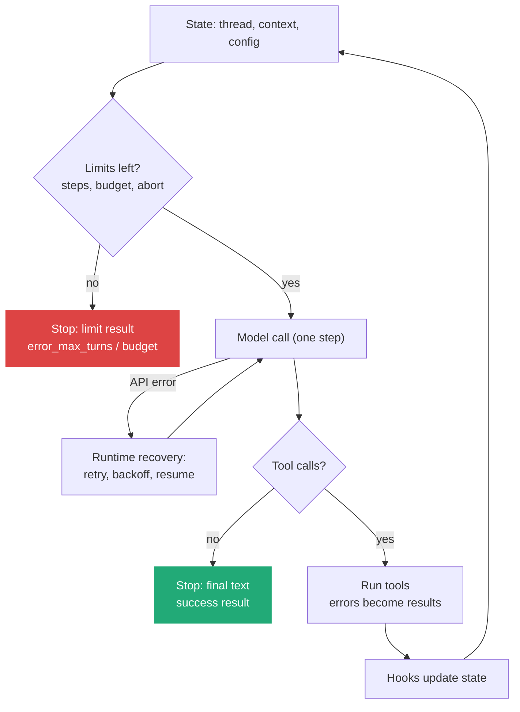
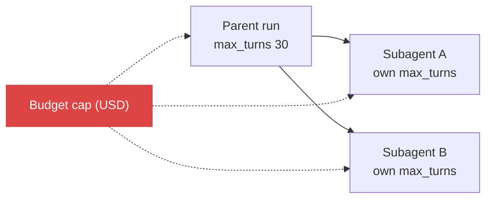

# 1. The agent loop is the easy part: stop condition, limits and recovery make it safe

> A loop that ends when the model returns no tool calls is correct but not production-safe: I add a hard step cap, a budget, error recovery and a defined result for every way the run can end, and I keep those as runtime responsibilities outside the model.

Related: [02 Threads, persistence and isolation](draft_02_Threads_Persistence_Isolation.md) · [07 Tool approval and durable waits](draft_07_Tool_Approval_Durable_Waits.md) · [08 Evals and traces for agent changes](draft_08_Evals_And_Traces_For_Agent_Changes.md) · [04 Context window, cache, compaction](draft_04_Context_Window_Cache_Compaction.md) · [Lecture 4: 02 Agent runner portability](../Lecture_4_Harness/02_Agent_Runner_Portability.md) · [Lecture 4: 07 Multi-agent coordination](../Lecture_4_Harness/07_Multi_Agent_Coordination.md)

Source: S02E01 article, section "Agentic Loop" (figures 1 to 7), S02E01 transcript (retail-agent demo: step limit and trace, used only as a worked example). Pi `agent-loop.ts`, Claude Code and Agent SDK docs, Goose docs, LangGraph and Semantic Kernel docs checked on 2026-11-15, see [Fact-check](#fact-check).

## 1. The problem

The lecture says an agent is a loop that runs until the model "decides not to use any tools and instead returns text". That sentence is the happy path. What happens when the model never stops, when the provider returns a 529 on model call 2 of 6, when a tool hangs, or when the run hits a budget? **Which mechanisms turn the naive loop into something I can run unattended, and which of them belong to the runtime, not to the prompt?**

## 2. Words

| Term | What it means here | Not to be confused with |
|---|---|---|
| Step / turn | One model call, which may request several tools. The result of all those tools feeds the next step | One tool call. Five steps can be fifteen tool calls |
| Super-step (LangGraph) | One tick of the graph: all nodes that are ready run once. A ReAct agent needs about two super-steps per tool round (model node, tool node) | A model call. `recursion_limit` counts super-steps, so the same number allows fewer tool rounds |
| Stop condition | The rule that ends the loop normally: the model returns no tool calls | A limit. A limit ends the run abnormally |
| Limit | A cap set by the runtime: steps, spend, wall-clock, tokens | A timeout of one API call |
| Recovery | The runtime handles a failure and the run continues | Retry only. Recovery also covers tool errors fed back to the model |
| Result type | The named outcome of a run (success, max turns, max budget, error) | The final text |

## 3. The loop and its two exits

The lecture's loop has four parts: state, model, tools, hooks. The only exit is "no tool calls". Production runtimes add exits the model does not control.

Pi's `agent-loop.ts` has the same shape: the inner loop runs while the last response held tool calls, and it exits when none are pending. The same file also has exits the lecture figure does not show: a `finishTurn` hook can force `"end"` or `"continue"`, a batch where every tool result is flagged `terminate` ends the loop, and an `error` or `aborted` stop reason ends the run. It has no step counter, so the cap lives in the caller or in a hook.

Lecturer, article: "agents, at their core, are **loops** that keep working until the LLM decides not to use any tools and instead returns text and finishes the task."

## 4. Step limit: a cap the model cannot argue with

A step limit bounds cost and time when the model loops, repeats a failing call or never converges. It is enforced by the runtime, and it ends the run with a named result, not with silence.

| Runtime | Limit | Default | When the limit hits |
|---|---|---|---|
| Mastra (lecture demo) | `maxSteps` in agent options | Set to 5 in the demo | Run ends after five model steps |
| Claude Agent SDK | `max_turns`, `max_budget_usd` | No limit for both | `ResultMessage` with subtype `error_max_turns` or `error_max_budget_usd`, no final text |
| LangGraph | `recursion_limit` in config | 10,007 super-steps (1.1.4 and later) | Raises `GraphRecursionError` |
| Semantic Kernel | Auto function invocation: maximum auto-invoke attempts per connector, iteration counters in the filter context | Per connector. 128 reported for .NET OpenAI, verify before presenting | Auto-invocation stops and the call returns, see section 5 |
| Goose | `GOOSE_MAX_TURNS` (turns without user input), `GOOSE_SUBAGENT_MAX_TURNS` | 1000 and 25 | Agent stops and asks the user |
| Pi | none in `agent-loop.ts` | none | Caller or hook enforces it |

Worked example from the demo (the lecturer's, used only as an example): the agent has `maxSteps: 5`. "A step is a call to the model and that call can request more than one tool." A lookup run of two steps (model asks for `getOrder`, model answers) is well inside the limit. A model that keeps retrying the same tool burns all five steps and stops.

Three things I take from the table:

- **The unit differs.** Mastra and the Agent SDK count model turns, LangGraph counts super-steps, Goose counts turns per user input. A "limit of 25" is not portable across them.
- **Defaults differ by orders of magnitude.** LangGraph's default of 10,007 and the Agent SDK's "no limit" are not safety limits. I set my own.
- **A limit needs a result type.** The Agent SDK returns `error_max_turns` and the session can be resumed with a higher limit. A run that just stops leaves me guessing whether it finished.

## 5. Beyond steps: budget, wall-clock and who owns the cap

Step count is a proxy. Cost and time are the real constraints, and subagents multiply them.

- **Budget.** The Agent SDK budget cap includes subagent spend. Once spend reaches the cap, spawning another subagent fails and background subagents are stopped. The cap is checked after a response arrives, so spend can pass it by one response.
- **No wall-clock.** The Agent SDK hosting guide lists "no top-level session timeout" and "no per-subagent wall-clock deadline" as known limits. A stall watchdog exists for subagents, but it is not a total-runtime deadline. I add a deadline in the host.
- **Semantic Kernel.** The auto function invocation filter sees chat history, the planned functions and iteration counters, and can set `Terminate`. This is the place for a custom cap (cost, repeated identical call, deadline), the SK equivalent of a hook.
- **LangGraph.** Limits can be reached by routing too: a conditional edge can send the run to an end node when a counter in state is exceeded. `recursion_limit` is the backstop, not the design.

## 6. Error recovery: three layers, three owners

The article figure 5 shows a run where model call 2 gets an API error and the loop "has no path for the error", so the task stops mid-turn. I split recovery into three layers, because they have different owners and different safe behavior.

| Layer | Failure | Safe handling | Owner |
|---|---|---|---|
| Transport | 5xx, 529 overloaded, timeout, dropped connection, temporary 429 | Retry with exponential backoff and jitter | Runtime |
| Run | Process dies, container restarts, wait of days | Resume from persisted state, not from scratch | Runtime plus storage, see [02](draft_02_Threads_Persistence_Isolation.md) |
| Tool | Tool throws, bad arguments, access denied | Return an error result to the model so it can adapt | Loop |

Evidence from the three runtimes:

- **Claude Code** retries transient failures up to 10 times with exponential backoff, and does not retry a failure that arrives after a completed text block or tool call, because a re-run "could execute the same tool calls twice". It keeps the completed output, runs the finished tool calls and continues. For unattended jobs `CLAUDE_CODE_RETRY_WATCHDOG=1` retries 429 and 529 indefinitely. Spend-limit 429s are not retried.
- **Pi** turns every tool failure into a result with `isError: true` that goes back to the model. A model-level `error` stop ends the run and the file has no retry, so transport retry lives in the layer below.
- **LangGraph** retries per node: `RetryPolicy` defaults to 3 attempts, 0.5 s initial interval, factor 2.0, max interval 128 s, jitter on. A checkpointer gives run-level recovery.
- **Semantic Kernel** has no loop-level retry. I use the HTTP client or connector resilience policy for transport and a function invocation filter for tool errors.

The rule behind the Claude Code behavior is the one I keep: **retry only what is idempotent.** A failed model call is safe to repeat. A completed tool call with a side effect is not.

Lecturer, article: "Harnesses such as Claude Code or Codex aim to address as many of these issues as possible, so the agents can **recover** from most errors on their own."

## 7. Runtime responsibilities, mapped

The article lists what a harness does besides the loop. For this note I keep the ones that decide whether the run ends well.

| Responsibility | What it means for the loop | LangGraph | Semantic Kernel | Claude Code / Pi / Goose |
|---|---|---|---|---|
| Stop condition | No tool calls ends the run | Edge to `END` | Auto-invoke returns when no calls | Same in all three |
| Hard limit | Cap the run | `recursion_limit` | Max auto-invoke attempts, filter `Terminate` | `max_turns`, `GOOSE_MAX_TURNS`, caller in Pi |
| Provider connection | Adapters, official SDKs | LangChain chat models | Connectors | Pi and Goose adapters |
| Recovery | Layers in section 6 | `RetryPolicy`, checkpointer | Connector policy, filters | Built-in retry, tool errors as results |
| Interception | Hooks between steps | Node wrappers, interrupts | Function and auto-invocation filters | `PreToolUse`, `Stop`, `beforeToolCall` |
| Observability | One trace per run | LangSmith or OTEL | OTEL in the kernel | OTEL export in Claude Code |

Observability closes the loop on limits. The lecturer's demo opens a trace to check "whether the agent called the right tool and whether that tool returned the information that it needed". A run that hits a limit without a trace cannot be diagnosed. See [08](draft_08_Evals_And_Traces_For_Agent_Changes.md).

Not important in the lecture: the exact hook names and the naive JavaScript snippet in figure 3. Important: the highlighted stop condition and the missing error path in figure 5.

## Summary

The stop condition ends a correct run. Limits, recovery and a named result for every exit make it safe. I set a step cap and a budget myself, split recovery into transport, run and tool layers, retry only idempotent work, and keep each as runtime code, not as prompt text.

## Fact-check

| # | Claim | Verdict | Source | Checked |
|---|---|---|---|---|
| 1 | Pi `agent-loop.ts` implements the same loop as the lecture (runs while tool calls exist) | **Agrees** | [agent-loop.ts](https://github.com/earendil-works/pi/blob/main/packages/agent/src/agent-loop.ts), read through a fetch summary, not line by line. It also has `finishTurn`, terminate-batch and abort exits | 2026-11-15 |
| 2 | Goose implements the same loop | **Unverified** | Only the lecture links the [Goose repo](https://github.com/aaif-goose/goose). I did not read its loop source. Goose docs show turn limits, which implies a loop. Verify before presenting | 2026-11-15 |
| 3 | The loop ends when the model returns no tool calls | **Agrees** | [Agent SDK loop](https://code.claude.com/docs/en/agent-sdk/agent-loop): "until it produces a response with no tool calls". Pi file as in row 1 | 2026-11-15 |
| 4 | Harnesses such as Claude Code recover from API errors | **Agrees** | [Claude Code errors](https://code.claude.com/docs/en/errors): 10 retries with backoff, `CLAUDE_CODE_MAX_RETRIES` capped at 15, retry watchdog. First 100,000 characters read, page is longer | 2026-11-15 |
| 5 | Codex recovers the same way | **Unverified** | I did not find Codex retry docs. Verify before presenting | 2026-11-15 |
| 6 | A step is one model call that may request several tools (demo) | **Agrees** | [Agent SDK loop](https://code.claude.com/docs/en/agent-sdk/agent-loop): a turn is one model output plus its tool calls. LangGraph differs, see row 7 | 2026-11-15 |
| 7 | LangGraph `recursion_limit` caps super-steps, default 10,007 | **Agrees** | [Graph API docs](https://docs.langchain.com/oss/python/langgraph/graph-api) via Context7. Default is 10,000 from 1.0.6 to 1.1.3. Counts super-steps, not model calls | 2026-11-15 |
| 8 | Agent SDK has no default turn or budget cap | **Agrees** | [Agent SDK loop](https://code.claude.com/docs/en/agent-sdk/agent-loop), table "Turns and budget": no limit for both | 2026-11-15 |
| 9 | Semantic Kernel default max auto-invoke attempts is 128 | **Unverified** | Only a GitHub issue mirror (microsoft/semantic-kernel #13205, search summary) says 128 for .NET OpenAI and 5 in Python. Official [filters page](https://learn.microsoft.com/en-us/semantic-kernel/concepts/enterprise-readiness/filters) confirms iteration counters and `Terminate` only. Verify before presenting | 2026-11-15 |
| 10 | Goose `GOOSE_MAX_TURNS` default 1000, subagent default 25 | **Unverified** | [Goose environment variables](https://block.github.io/goose/docs/guides/environment-variables), search summary, page not read in full | 2026-11-15 |
| 11 | Retry only before a tool call completed | **Agrees** | [Claude Code errors](https://code.claude.com/docs/en/errors): failures after a completed tool call are not retried | 2026-11-15 |
| 12 | A cap on the parent run is enough to bound a multi-agent run (implied by the single loop picture) | **Differs** | [Agent SDK loop](https://code.claude.com/docs/en/agent-sdk/agent-loop): budget includes subagents, but [hosting](https://code.claude.com/docs/en/agent-sdk/hosting) says there is no per-subagent wall-clock deadline | 2026-11-15 |

## Sources

- Lecture: S02E01 article "Agentic Loop", figures 2, 3, 5, 6. S02E01 transcript, step-limit and trace segments (worked example only).
- [Pi agent-loop.ts](https://github.com/earendil-works/pi/blob/main/packages/agent/src/agent-loop.ts)
- [Claude Agent SDK: how the agent loop works](https://code.claude.com/docs/en/agent-sdk/agent-loop)
- [Claude Code error reference and retries](https://code.claude.com/docs/en/errors)
- [Hosting the Agent SDK](https://code.claude.com/docs/en/agent-sdk/hosting)
- [LangGraph Graph API: recursion limit](https://docs.langchain.com/oss/python/langgraph/graph-api) and [fault tolerance: RetryPolicy](https://docs.langchain.com/oss/python/langgraph/fault-tolerance), read through Context7
- [Semantic Kernel filters](https://learn.microsoft.com/en-us/semantic-kernel/concepts/enterprise-readiness/filters) and [function invocation](https://learn.microsoft.com/en-us/semantic-kernel/concepts/ai-services/chat-completion/function-calling/function-invocation)
- [Goose environment variables](https://block.github.io/goose/docs/guides/environment-variables)
- My own reasoning: the three recovery layers, the idempotency rule, the portability warning about limit units.
