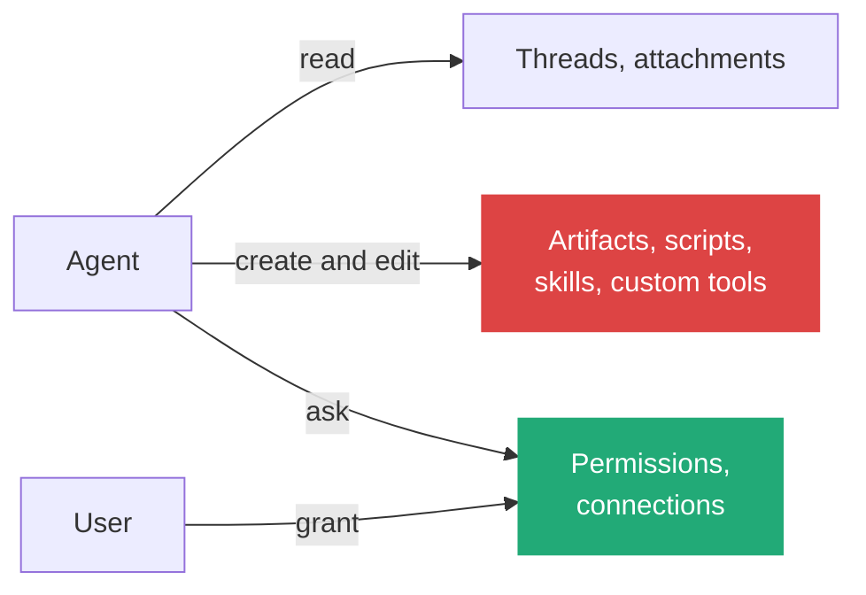
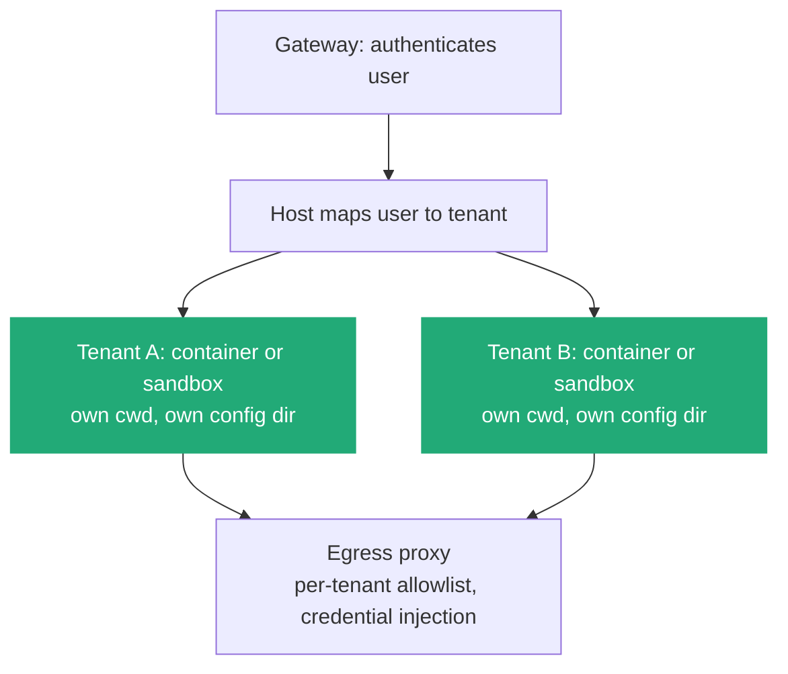

# 2. What a harness stores, who may touch it, and how users are kept apart

> A harness persists threads, artifacts, permissions and more, and each kind needs its own access rule (agent reads, agent writes, user grants); once more than one user shares the runtime, the filesystem is not a boundary, so isolation has to be enforced by the sandbox and the host, not by the agent.

Related: [01 Agent loop, limits and recovery](01_Agent_Loop_Stop_Limits_Recovery.md) · [03 Instructions: five parts and enforcement](03_Instructions_Five_Parts_And_Enforcement.md) · [05 Agentic memory: extraction and retrieval](draft_05_Agentic_Memory_Extraction_Retrieval.md) · [07 Tool approval and durable waits](draft_07_Tool_Approval_Durable_Waits.md) · [Lecture 4: 04 Computers.md fleet infrastructure](../Lecture_4_Harness/04_Computers_md_Fleet_Infrastructure.md) · [Lecture 4: 07 Multi-agent coordination](../Lecture_4_Harness/07_Multi_Agent_Coordination.md)

Source: S02E01 article, sections "Threads and sessions" and "Persistence" (figures 7, 8, 10). S02E01 transcript only for the worked example of a deterministic access check inside a tool. Claude Agent SDK hosting and sandboxing docs, Pi session docs, LangGraph persistence docs checked on 2026-11-15, see [Fact-check](#fact-check).

## Glossary

| Term | What it means here | Same thing elsewhere | Not to be confused with |
|---|---|---|---|
| Thread | The record of one interaction line: messages, tool calls, results. Can span several sessions | - | A process or an OS thread |
| Session | One continuous run of the harness on a thread, from start to exit | - | A thread. One thread has many sessions |
| Subagent thread | A separate thread an agent opens to delegate. Only the answer returns to the parent | A2A: a task under its own `contextId`, in another process | A parallel tool call inside one thread |
| Checkpoint (LangGraph) | A snapshot of graph state at a super-step, keyed by `thread_id` | - | A saved file the agent can read |
| Store (LangGraph) | Cross-thread key-value memory with namespaces | - | A checkpointer. The checkpointer is per thread |
| Sandbox | An OS-enforced boundary around code the agent runs | - | A permission rule. Rules decide, the sandbox enforces |
| Workspace | The directory (or volume) one user or task works in | - | The sandbox. A workspace is data, a sandbox is a wall |

## 1. The problem

On my laptop an agent reads and writes my files freely, and that is fine. In a team or production product the same agent serves many users from one runtime. **What does the harness have to persist, who is allowed to read, write or grant each kind of state, and what keeps user A's data away from user B's agent?**

## 2. Threads, sessions and subagents

The article defines it this way: a thread "can span multiple sessions and involve more than one agent (`subagents`)". Figure 7: a main thread with two sessions, and in session 2 the agent asks a subagent that lives in its own subagent thread.

Source: S02E01 article, figure 7. Caption: "The user comes back, and the main thread goes on in a new session. In session 2, the main thread connects with a subagent thread."

How the real systems store it:

| System | Thread unit | Where it lives | Subagent thread |
|---|---|---|---|
| Claude Code / Agent SDK | Session, resumable by ID, forkable | JSONL transcripts under `~/.claude/projects/` (or `CLAUDE_CONFIG_DIR`), one process per session | Separate transcript file per subagent. Community docs describe `subagents/agent-<id>.jsonl`, verify before presenting |
| Pi | Session file, tree of entries linked by `id` and `parentId` | JSONL under `~/.pi/agent/sessions/`, grouped by working directory ([session format](https://docs.pi.dev/latest/session-format)) | Not described in the docs I read |
| LangGraph | `thread_id` in `config["configurable"]`, primary key for checkpoints | Checkpointer backend (SQLite, Postgres, Redis) | Subgraph checkpointer mode: per-invocation (default), per-thread or stateless |
| Semantic Kernel | `ChatHistory` object or an agent thread abstraction | In memory unless I persist it | My own design |
| A2A | Task `id` per task, `contextId` groups tasks and messages of one conversation | The remote agent's own store, opaque to the caller | Another process behind its own `contextId` |

**Subagent: sub-thread or separate process?** In my harness a subagent is a peer reached over A2A, a separate process, not a sub-thread inside the parent's process (my design, not the lecture's figure). In the cloud each agent then has its own lifetime, limits, scaling and failure, which an in-process sub-thread does not: the Agent SDK has no per-subagent wall-clock deadline ([01](01_Agent_Loop_Stop_Limits_Recovery.md)). A2A fits the thread model: a `contextId` groups related tasks and messages into one conversation, the server creates the Task `id`, and clients treat `contextId` as opaque ([A2A spec](https://a2a-protocol.org/latest/specification/), search summary, field names differ across spec versions). The parent keeps its own history and the subagent's thread lives behind its own `contextId`. The cost: the parent cannot read the subagent's history from disk, and model routing stops at the A2A boundary ([Lecture 2: 12](../Lecture_2_Context_Agents_md_Skills_Tools/12_subagents_vs_workers.md)).

Two architect points:

- **Files are a design choice, not a law.** The lecture says history is "often stored in text files agents can easily read using **bash**". That is true for Claude Code and Pi and it gives the agent cheap self-inspection and search. LangGraph and SK keep state in a database or in objects, which is better for multi-host runs but needs a tool to expose history to the agent. The lecture adds "**not every harness** supports subagents and easy access to threads", which is a fair warning.
- **Local disk is ephemeral in production.** The Agent SDK hosting guide says transcripts, `CLAUDE.md` memory and working-directory artifacts live on the container filesystem and "none of them survive a container restart, a scale-down, or a move to a different node". Transcripts need a `SessionStore` adapter. The store mirrors transcripts only, not memory files or artifacts.

## 3. What else is persisted, and who may touch it

The article names more than threads: "attachments, generated artifacts, scripts, skills, permissions, connections, integrations, custom tools". Figure 8 groups them by access level. The grouping is the lecturer's example, and I keep it because it makes the rule explicit.

| Level | Items | Agent may | Danger if wrong |
|---|---|---|---|
| Agent reads | Threads, attachments | Read only | History or uploads edited by the agent hide what happened |
| Agent creates and edits | Artifacts, scripts, skills, custom tools | Read and write | Highlighted red in the figure: the agent changes the behavior of future runs. A generated script or skill is executable influence |
| Agent asks, user grants | Permissions, connections, integrations | Request only | Self-granted permission removes the human from the loop |

Evidence in the lecture: generated images should be available to the agent "so it can handle follow up tasks", and if an integration needs a permission "the agent should be able to show us the settings where we can grant it permission". That means the agent needs a tool to find its own artifacts and a tool to point the user to a grant screen, not a tool to grant.

Mapping to LangGraph: the checkpointer holds thread state, the **store** holds cross-thread data such as user preferences and facts, with namespaces I can scope per user. Permissions and grants are not part of either, so I keep them in my own service. Mapping to Semantic Kernel: function invocation filters are the place where a grant check runs before every call.

## 4. Where the access rule lives: inside the tool

The transcript demo gives the cleanest example. The retail agent looks up an order, and the check that the order belongs to the caller sits **in the tool code**, not in the prompt. The lecturer's point, as I read it: the model decides to call `getOrder`, the function decides whether the data may leave the database.

| Check placed in | What it relies on | Fails when |
|---|---|---|
| Prompt ("only show the user's own orders") | The model obeying | Prompt injection, long context, a different model |
| Tool code (user ID from the session, not from the model's arguments) | Deterministic code | The tool takes the user ID as a model-supplied argument |
| Sandbox / network layer | OS or proxy enforcement | Misconfiguration, escape hatches |

My rule: identity comes from the authenticated session, never from a tool argument the model fills in. The Agent SDK hosting guide gives the same direction for secrets: put authentication at a gateway in front of the agent, and keep tool credentials out of the agent environment behind a proxy that injects them. Detail on enforcement is in [03](03_Instructions_Five_Parts_And_Enforcement.md).

## 5. Separating users: sandbox, workspace, config

The article: "once we go beyond [a single user's machine] ... things get much harder without sandboxes and proper permission management." It does not say how. These are the mechanisms I can verify.

| Layer | Mechanism | Source behavior |
|---|---|---|
| Process / filesystem | One subprocess and one working directory per session. Distinct `cwd` per tenant | Agent SDK default: all sessions inherit the app's directory, so I must pass `cwd` on every call |
| Shared container | `settingSources: []`, `CLAUDE_CODE_DISABLE_AUTO_MEMORY=1`, per-tenant `CLAUDE_CONFIG_DIR` | Default settings and memory files can leak one tenant's context into another's session |
| Hard isolation | Container per task, gVisor or Firecracker for stronger walls | Hosting guide: ephemeral, long-running, hybrid and multi-agent patterns |
| Shell sandbox | Seatbelt on macOS, bubblewrap on Linux and WSL2, network via proxy with domain allowlist | Off by default. Native Windows runs unsandboxed. Built-in Read, Edit, Write, WebFetch, hooks and local MCP servers are not covered |
| Network | Egress proxy per tenant, credentials injected outside the container | A compromised tenant cannot use another tenant's policy |
| LangGraph | `thread_id` plus store namespaces per user | These are data scoping, not a security boundary. The graph process still sees everything |
| Semantic Kernel | One `Kernel` per request with that user's plugins and filters | Same: scoping in the process, walls need the host |

The point of the last two rows: **LangGraph threads and SK kernels separate data logically, containers separate it physically.** I need both when the tools can run code.

Agents get around boundaries. The Claude Code sandbox docs describe an "escape hatch": when a command fails inside the sandbox, Claude may retry it with `dangerouslyDisableSandbox`, which runs outside it. Whether that needs approval depends on the permission mode (`bypassPermissions` runs it without a prompt, `dontAsk` denies it). Controls: `allowUnsandboxedCommands: false`, an ask rule on `Bash(dangerouslyDisableSandbox:true)`, `failIfUnavailable: true`, and managed settings that developers cannot loosen. An `excludedCommands` entry runs with full access, so a broad pattern such as `docker *` widens the hole. This is vendor documentation, so it supports the lecture's warning with a concrete case.

## Summary

A harness persists threads (often as text files), artifacts and scripts the agent may write, and permissions only the user may grant. I give each kind its own access rule, put identity checks in tool code, and isolate users with per-tenant workspaces, containers or sandboxes and an egress proxy. Logical scoping such as `thread_id` or a store namespace is not a security boundary.

## Fact-check

| # | Claim | Verdict | Source | Checked |
|---|---|---|---|---|
| 1 | A thread can span sessions and involve subagents with their own thread | **Agrees** | [Agent SDK sessions and subagents](https://code.claude.com/docs/en/agent-sdk/agent-loop): resume and fork by session ID, a subagent returns only its final response. LangGraph: [subgraph persistence](https://docs.langchain.com/oss/python/langgraph/use-subgraphs), via Context7 | 2026-11-15 |
| 2 | History is stored as text files agents can read with bash (Claude Code) | **Agrees** | [Hosting the Agent SDK](https://code.claude.com/docs/en/agent-sdk/hosting): "JSONL session transcripts on local disk", `~/.claude/projects/` | 2026-11-15 |
| 3 | Subagent transcripts are separate files named `agent-<id>.jsonl` in a `subagents/` folder | **Unverified** | Community docs only (search summary, for example [claude-dev.tools](https://claude-dev.tools/docs/transcripts)). Not in the official pages I read. Verify before presenting | 2026-11-15 |
| 4 | Pi stores sessions as JSONL trees under `~/.pi/agent/sessions/` | **Agrees** | [Session format](https://docs.pi.dev/latest/session-format), read: JSONL, entries form a tree via `id` and `parentId`, grouped by working directory. Crash resume is not described | 2026-11-15 |
| 5 | Not every harness supports subagents and easy thread access | **Lecture-specific** | Lecture states it without naming harnesses. Consistent with LangGraph and SK, which store state in backends and need a tool to expose it | 2026-11-15 |
| 6 | Local state does not survive restarts, so transcripts need external storage | **Agrees** | [Hosting the Agent SDK](https://code.claude.com/docs/en/agent-sdk/hosting), `SessionStore`, "transcripts only" | 2026-11-15 |
| 7 | LangGraph checkpointer is per thread, store is cross-thread | **Agrees** | [Persistence](https://docs.langchain.com/oss/python/langgraph/persistence), comparison table, via Context7 | 2026-11-15 |
| 8 | Access grouping (agent reads / creates and edits / asks, user grants) | **Lecture-specific** | Figure 8 labels it an example. No standard found. It matches the permission model of Claude Code (allow, ask, deny rules), which I did not map in full | 2026-11-15 |
| 9 | Multi-user agents need sandboxes and permission management | **Agrees** | [Hosting: multi-tenant isolation](https://code.claude.com/docs/en/agent-sdk/hosting) and [Sandboxing](https://code.claude.com/docs/en/sandboxing). Sandboxing page read up to 100,000 of about 110,890 characters | 2026-11-15 |
| 10 | Agents get around boundaries | **Agrees** | [Sandboxing](https://code.claude.com/docs/en/sandboxing): `dangerouslyDisableSandbox` retry and `excludedCommands` described as escape hatches | 2026-11-15 |
| 11 | Sandbox covers the agent's file tools | **Differs** | Sandbox covers Bash, PowerShell and Monitor processes. Built-in Read, Edit, Write and WebFetch are not covered, see [Sandboxing](https://code.claude.com/docs/en/sandboxing). The lecture says only "sandboxes" | 2026-11-15 |
| 12 | Default Agent SDK sessions are isolated per user | **Differs** | [Hosting](https://code.claude.com/docs/en/agent-sdk/hosting): sessions inherit the app's working directory and read shared settings and memory unless configured | 2026-11-15 |
| 13 | An A2A `contextId` groups tasks and messages of one conversation, opaque to clients | **Agrees**, search summary | [A2A specification](https://a2a-protocol.org/latest/specification/): field names and bindings differ across v0.2.6, v0.3.0 and v1.0. Verify before presenting | 2026-11-15 |
| 14 | A subagent is a sub-thread in the parent's process | **Differs** in my design | The lecture draws a subagent thread. My harness runs subagents as separate A2A processes, easier to manage in the cloud | 2026-11-15 |

## Sources

- Lecture: S02E01 article, "Threads and sessions", "Persistence", figures 7, 8, 10. S02E01 transcript, order lookup with the access check in the tool (worked example only).
- [Hosting the Agent SDK](https://code.claude.com/docs/en/agent-sdk/hosting)
- [Claude Code sandboxing](https://code.claude.com/docs/en/sandboxing)
- [Claude Agent SDK: how the agent loop works](https://code.claude.com/docs/en/agent-sdk/agent-loop)
- [LangGraph persistence](https://docs.langchain.com/oss/python/langgraph/persistence) and [subgraphs](https://docs.langchain.com/oss/python/langgraph/use-subgraphs), read through Context7
- [Pi session format](https://docs.pi.dev/latest/session-format) · [A2A specification](https://a2a-protocol.org/latest/specification/)
- My own reasoning: the identity-from-session rule, the logical versus physical isolation split, the Semantic Kernel mappings.
