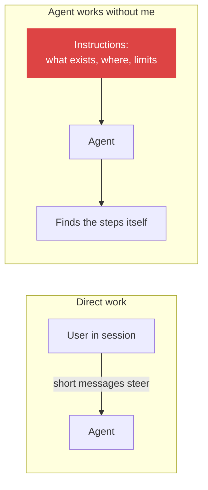
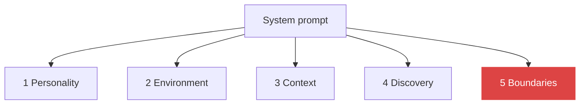
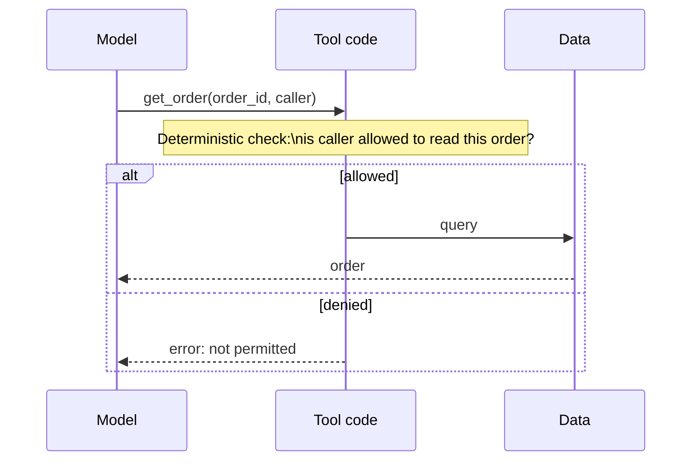
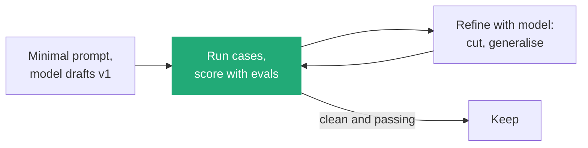

# 3. Instructions: five parts, and what code must enforce

> The system prompt tells the agent who it is, where it works, what exists, how to look and what is off limits, but only the first four are guidance I can rely on; every boundary that matters must also be enforced in code, because the model may ignore a prompt.

Related: [04 Context window, cache, compaction](draft_04_Context_Window_Cache_Compaction.md) · [06 Tools awareness, discovery, code mode](draft_06_Tools_Awareness_Discovery_Code_Mode.md) · [07 Tool approval, durable waits](draft_07_Tool_Approval_Durable_Waits.md) · [08 Evals and traces for agent changes](draft_08_Evals_And_Traces_For_Agent_Changes.md) · [01 Agent loop, stop, limits, recovery](draft_01_Agent_Loop_Stop_Limits_Recovery.md) · [Lecture 4: 05 Don't overspecify](../Lecture_4_Harness/05_Dont_Overspecify_Work_At_Assistants_Level.md) · [Lecture 2: 5 Skills](../Lecture_2_Context_Agents_md_Skills_Tools/5_skills.md) · [Lecture 2: 4 Context window](../Lecture_2_Context_Agents_md_Skills_Tools/4_context_window.md)

Source: S02E01 article "Personality and Environmental Awareness" and "Agentic Loop" (Context), takeaways; S02E01 transcript (retail-agent demo, used only as a worked example). Vendor docs read on 2026-11-15, see [Fact-check](#fact-check).

## 1. The problem

Models follow short messages well, and a harness vendor just cut most of its own system prompt. So what still belongs in the instructions of an agent I build, and what must not live there at all? The line I need: **guidance goes in the prompt, guarantees go in code.**

## 2. Words

| Term | Meaning here | Not to be confused with |
|---|---|---|
| Instructions | Text sent to the model on every call (system or developer message) | A skill or AGENTS.md body, which the model loads or reads later |
| Boundary | A thing the agent must not do | An enforced permission. A boundary written in a prompt is a request |
| Enforcement | A check in code, a hook or a sandbox that runs whether or not the model agrees | A guardrail model, which is still a probabilistic check |
| Unattended agent | An agent with no human in the session (automation, background job, app logic) | An interactive coding session |

## 3. Why instructions matter most when no human is present

An interactive user corrects the agent with a short message. An automation has nobody to do that, so the instructions carry everything the human would have said.

The lecturer: harnesses "set a solid system prompt so users can speak with agents more naturally", and once I build my own automations "we become the ones who need to craft that prompt". Anthropic's own guide for unattended agents agrees on the mechanism: a text-only end of turn can stop an unattended loop, so the guide adds a system prompt paragraph for unattended runs and keeps a separate confirmation step for risky actions ([Prompting Opus 5.5](https://platform.claude.com/docs/en/build-with-claude/prompt-engineering/prompting-claude-opus-5-5#unattended-agentic-runs)). Both a prompt and a harness check appear in the same recommendation.

## 4. The five parts

The lecture splits a system prompt into five blocks. This split is the lecturer's, not a vendor standard.

| Part | What it answers | Worked example (abstract) | Failure when missing |
|---|---|---|---|
| Personality | Who am I, whom do I serve | "You are an internal operations agent for the support team" | Wrong tone, wrong assumptions about the reader |
| Environment | Why do I exist, is a human reachable | "No human is available. Do not ask questions, make the safest choice and report it" | Stops to ask, or stops after a progress note |
| Context | What resources exist, or where to find them | "Order data: `orders` tool. Policies: `/policies/` folder" | Claims it cannot do things it can |
| Discovery | How to explore the harness capabilities | "Search tools before saying a capability is missing. Open the process doc fully" | Skips steps of a process because the doc was badly organised |
| Boundaries | What I must not do | "Never read another customer's order" | Only a recommendation, see section 5 |

Compared with vendor guides: Anthropic's and OpenAI's current guides give task-specific patterns (effort, unattended runs, exploring context in multiapp workflows) and not a five-block template. Two of them match the lecture directly:

- Context and Discovery: Anthropic gives a one-sentence system prompt line, "Before taking any action, explore broadly with tool calls ...", and reports more correct runs on multiapp automation tasks ([Prompting Opus 5.5](https://platform.claude.com/docs/en/build-with-claude/prompt-engineering/prompting-claude-opus-5-5#explore-context-in-multi-app-workflows)).
- Boundaries: OpenAI warns that strong "ask first" language written for older models can make a newer model stop where I would be happy for it to continue ([Rethinking skills and prompts](https://developers.openai.com/blog/rethinking-skills-and-prompts-for-gpt-6-astra)). A boundary written in prompt text has a cost in both directions.

## 5. Boundaries: recommendation in the prompt, rule in code

The prompt reaches the model. The tool code reaches the data. Only the second one can refuse.

The transcript demo does exactly this: the access check sits in the tool, not in the prompt, because the rules are already known, the check needs no extra model call, and a wrong answer has one place to debug. The presenter also says plainly: "Instructions don't guarantee that the model will" follow them. Claude Code docs say the same about its own files: CLAUDE.md is "context, not enforced configuration", and to block an action regardless of what Claude decides I use a PreToolUse hook ([Memory](https://code.claude.com/docs/en/memory.md)).

| Control | Strength | Where it lives |
|---|---|---|
| Boundary sentence in the prompt | Recommendation | Instructions |
| Tool argument validation, authorization in tool code | Guarantee | Tool implementation |
| Pre-tool hook, permission rules | Guarantee | Harness |
| Sandbox, per-user workspace, scoped credentials | Guarantee | Infrastructure |
| Approval before an irreversible action | Guarantee, with a wait | [07](draft_07_Tool_Approval_Durable_Waits.md) |

Architect mapping: in LangGraph this is a node or tool wrapper that checks `state` and the caller identity before it runs, plus `interrupt` for approval. In Semantic Kernel it is a function invocation filter (`IFunctionInvocationFilter`) that can cancel or replace the result. I keep the prompt sentence as well, because it lowers how often the model hits the wall, but the wall is the control.

## 6. Start simple, then iterate with evals

The lecturer: start with minimal instructions or let a model draft the first version, then the goal is to make it "right": clean, well generalised, only what is needed, using an iterative loop with verification or evals.

This agrees with vendor advice: Anthropic says to test effort levels "against your own evals rather than carrying over the setting" from the previous model, and OpenAI says to revisit AGENTS.md entries as the model improves. Details of the eval loop are in [08](draft_08_Evals_And_Traces_For_Agent_Changes.md).

## 7. The 80% claim, read at the source

The lecture says Claude Code "had 80% of its system prompt removed for the latest models" and implies clear instructions may even degrade the model. The source says something narrower: Anthropic removed over 80% of Claude Code's system prompt for Claude Opus 5 and Claude Fable 5 "with no measurable loss on our coding evaluations" ([claude.dev blog](https://claude.dev/blog/the-new-rules-of-context-engineering-for-claude-5-generation-models/)). That is a result about one interactive coding harness and its evals. It does not show that instructions degrade performance, and it does not cover an unattended agent in my domain. I still check my own prompt with my own evals.

## Summary

The five parts (personality, environment, context, discovery, boundaries) are a useful checklist, not a standard. Instructions matter most for unattended agents because no human fills the gaps. Boundaries in text are requests: authorization, limits and approvals go into tool code, hooks and infrastructure. I start with a short prompt and shorten it further only when my evals show no loss.

## Open questions

- Which boundaries in my agents are only prompt text today, and what would the code check for each one look like?

## Fact-check

| # | Claim | Verdict | Source | Checked |
|---|---|---|---|---|
| 1 | Claude Code had 80% of its system prompt removed for the latest models | **Agrees, narrower than implied.** Over 80% removed for Opus 5 and Fable 5 with no measurable loss on Anthropic's coding evals. It does not show that instructions degrade performance | [claude.dev blog](https://claude.dev/blog/the-new-rules-of-context-engineering-for-claude-5-generation-models/), read via fetch | 2026-11-15 |
| 2 | A five-part prompt (personality, environment, context, discovery, boundaries) | **Lecture-specific** | Not a vendor template. Vendor guides give task patterns, see [Anthropic](https://platform.claude.com/docs/en/build-with-claude/prompt-engineering/prompting-claude-opus-5-5) and [OpenAI](https://developers.openai.com/blog/rethinking-skills-and-prompts-for-gpt-6-astra) | 2026-11-15 |
| 3 | Unattended agents need explicit instructions about their environment | **Agrees** | Anthropic guide section "Unattended agentic runs" and "Explore context in multiapp workflows" | 2026-11-15 |
| 4 | A boundary in the prompt is only a recommendation | **Agrees** | Claude Code memory docs: "context, not enforced configuration", use a PreToolUse hook to block. Transcript: "Instructions don't guarantee" | 2026-11-15 |
| 5 | Start simple, iterate with evals | **Agrees** | Anthropic guide (test against own evals), OpenAI article (revisit entries as models improve) | 2026-11-15 |
| 6 | Latent Space Activation: prompting is getting the model to recall relevant knowledge before it answers | **Unverified** | The [repo](https://github.com/daveshap/latent_space_activation) exists. Its README (read via fetch summary) shows the idea as an example dialog ("What do I know about Rome that is relevant?") and gives no definition of prompting. The one-line summary is the lecturer's. Verify before presenting | 2026-11-15 |

## Sources

- S02E01 article and transcript (local files). The mapping to LangGraph and Semantic Kernel filters is my own reasoning.
- [Prompting Claude Opus 5.5](https://platform.claude.com/docs/en/build-with-claude/prompt-engineering/prompting-claude-opus-5-5)
- [Rethinking skills and prompts for GPT-6](https://developers.openai.com/blog/rethinking-skills-and-prompts-for-gpt-6-astra)
- [The new rules of context engineering](https://claude.dev/blog/the-new-rules-of-context-engineering-for-claude-5-generation-models/)
- [Claude Code: How Claude remembers your project](https://code.claude.com/docs/en/memory.md)
- [Latent Space Activation](https://github.com/daveshap/latent_space_activation)
