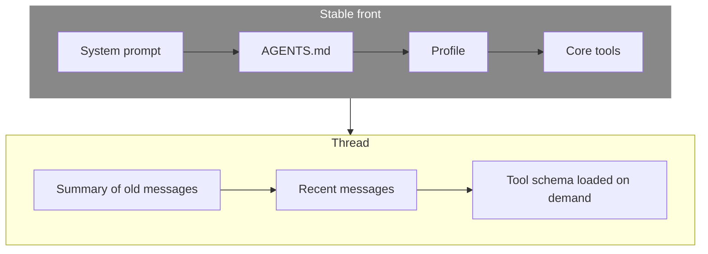

# 4. Context window: keep it small, load on demand, compact without losing what the task needs

> I keep the context small by loading tools and results on demand and compacting the thread, and I keep it not lossy by putting durable instructions in files that are re-read after compaction, because anything said only in chat is gone.

Related: [17 KV cache and prompt caching](draft_17_KV_Cache_And_Prompt_Caching.md) · [03 Instructions: five parts and enforcement](03_Instructions_Five_Parts_And_Enforcement.md) · [05 Agentic memory](draft_05_Agentic_Memory_Extraction_Retrieval.md) · [06 Tools awareness, discovery, code mode](draft_06_Tools_Awareness_Discovery_Code_Mode.md) · [02 HITL and execution isolation](02_HITL_And_Execution_Isolation.md) · [Lecture 2: 4 Context window](../Lecture_2_Context_Agents_md_Skills_Tools/4_context_window.md) · [Lecture 2: 5 Skills](../Lecture_2_Context_Agents_md_Skills_Tools/5_skills.md) · [Lecture 2: 11 Tool upfront vs discovery](../Lecture_2_Context_Agents_md_Skills_Tools/11_tool_upfront_vs_tool_discovery.md) · [Lecture 1: 13 Skills and context](../Lecture_1_Mechanics_Behind_Generative_AI/13_skills_and_context.md)

Source: S02E01 article "Agentic Loop" (Context, the three context columns and the four conclusions); S02E01 transcript (last-20 window and compaction trade-offs, as worked example). Claude Code, LangGraph and Semantic Kernel docs read on 2026-11-15, see [Fact-check](#fact-check).

## Glossary

| Term | What it means here | Same thing elsewhere | Not to be confused with |
|---|---|---|---|
| Context window | The most tokens a model can take in one call | Model limit | The thread, which is what I choose to send |
| Message window | Send only the last N messages | LangGraph `trim_messages`, Semantic Kernel truncation reducer | Compaction, which rewrites older ones |
| Compaction | Replace older messages with a summary, keep recent ones as they are | Claude Code `/compact`, Semantic Kernel summarization reducer | Truncation, which just drops |
| Reactivation | Re-loading a skill body after compaction removed it | Claude Code re-injection of invoked skills | First activation |
| Stable front | The part of the context that does not change between calls | The cacheable prefix, see [17](draft_17_KV_Cache_And_Prompt_Caching.md) | The whole prompt |

## 1. The problem

Every model call resends the whole context. That costs tokens and latency, the window is finite, and the model attends worse to a bloated context. I want it **small** (little sent) and **not lossy** (what the task needs survives trimming). Trimming and summarizing pull against the second goal, and they also change the front of the context, which matters for caching ([17](draft_17_KV_Cache_And_Prompt_Caching.md)).

## 2. The layout the lecture shows

The lecture figure has three columns: session start, after tool discovery, after compaction. The same block sits at the top of each: system prompt, AGENTS.md, profile and core tools. Below it the thread grows with messages and tool schemas loaded when needed, then compaction shrinks it to a summary plus the recent messages.

## 3. Window, compaction and keeping things out

- **Last-N window.** The transcript agent sends up to the last 20 messages. The presenter's trade-off: "an important detail from earlier in the conversation might get left out", and 20 is not a magic number.
- **Compaction.** Older messages are "compressed into shorter notes" kept next to recent ones, and "those notes may leave out some details".
- **Keep it out of the thread.** Tool schemas loaded on demand and large results written to a file, with only a reference returned, keep the thread small. Detail in [06](draft_06_Tools_Awareness_Discovery_Code_Mode.md) and [Lecture 2: 10](../Lecture_2_Context_Agents_md_Skills_Tools/10_tool_results_context_to_file_and_back.md).

| Mechanism | LangGraph | Semantic Kernel | Claude Code |
|---|---|---|---|
| Last N or token window | `trim_messages(strategy="last", max_tokens=...)` in the model node: trims what the model sees, state keeps everything | `ChatHistoryTruncationReducer(targetCount)` | Not used for the main thread |
| Summarize old messages | Summarization node, or `RemoveMessage` with the `add_messages` reducer | `ChatHistorySummarizationReducer` | `/compact`, automatic near the limit |
| What the state keeps | Full history in checkpoints, separate from what the model sees | The reducer returns a new history, the caller replaces the original | The summary replaces the thread |

Sources for the rows: [LangGraph add-memory](https://docs.langchain.com/oss/python/langgraph/add-memory), [Semantic Kernel chat history](https://learn.microsoft.com/en-us/semantic-kernel/concepts/ai-services/chat-completion/chat-history), [Claude Code context window](https://code.claude.com/docs/en/context-window.md). The property worth using in LangGraph: trimming at the model node keeps the full thread in the checkpoint, so nothing is lost for audit when the model sees less.

## 4. What survives compaction in Claude Code

The reference case for "not lossy".

| Item | After compaction |
|---|---|
| System prompt, output style | Still apply |
| Project-root CLAUDE.md, unscoped rules, auto memory | Re-injected from disk |
| Invoked skill bodies | Re-injected, 5,000 tokens per skill and 25,000 total, oldest dropped first, truncation keeps the file start |
| Path-scoped rules, nested CLAUDE.md | Loaded into messages, summarized away, reload on demand |
| Files read or edited | Up to 5 re-read, most recent first, over 5,000 tokens come back as a path |

What I take from it: the lecture's "skills sometimes need to be reactivated" is accurate, and the mechanism is a cap and a drop order, not a bug. The key instructions go at the top of `SKILL.md`. What must persist belongs in a file that is re-read (root AGENTS.md, a skill within the cap), not in the conversation.

## 5. Why a long AGENTS.md hurts

It is sent on every call (tokens and latency), and the model follows it less. The lecture says the model "will ignore most of it". Claude Code docs give a softer, vendor-backed version: target under 200 lines, because "longer files consume more context and reduce adherence", and importing files with `@path` organizes but does not reduce the cost. "Ignores most of it" is the lecturer's strong phrasing, and I have no measurement for the share. Remedy: keep the root file as a router, move detail to skills and path-scoped rules, and put concrete verifiable rules first. An edit to it also changes the front of the context, see [17](draft_17_KV_Cache_And_Prompt_Caching.md).

## Summary

The window and compaction keep the context small, at the price of detail. Durable instructions live in files that are re-read after compaction, skills respect the re-injection cap, and the root AGENTS.md stays short. The cache effect of each choice is in [17](draft_17_KV_Cache_And_Prompt_Caching.md).

## Open questions

- At my typical thread length, does a last-N window or a compaction every K turns lose less of what the task needs?

## Fact-check

| # | Claim | Verdict | Source | Checked |
|---|---|---|---|---|
| 1 | Skills may need reactivation after compaction | **Agrees** | [Claude Code context window](https://code.claude.com/docs/en/context-window.md): invoked skills re-injected with 5,000 per skill and 25,000 total caps, oldest dropped. Skill descriptions re-injected on v2.1.304 or later | 2026-11-15 |
| 2 | A long AGENTS.md is mostly ignored by the model | **Differs**, strong wording | [Claude Code memory](https://code.claude.com/docs/en/memory.md): longer files "reduce adherence", target under 200 lines, no measured share. "Most of it" is opinion | 2026-11-15 |
| 3 | A last-N window and compaction both lose detail | **Agrees** | Transcript trade-offs, plus LangGraph and Semantic Kernel docs describing truncation and summarization as lossy strategies | 2026-11-15 |
| 4 | The stable front is system prompt, AGENTS.md, profile and core tools | **Lecture-specific** | The lecture's figure | 2026-11-15 |

## Sources

- S02E01 article and transcript.
- [Claude Code: explore the context window](https://code.claude.com/docs/en/context-window.md) · [Claude Code: how Claude remembers your project](https://code.claude.com/docs/en/memory.md)
- [LangGraph: add memory](https://docs.langchain.com/oss/python/langgraph/add-memory) · [Semantic Kernel: chat history](https://learn.microsoft.com/en-us/semantic-kernel/concepts/ai-services/chat-completion/chat-history)
- My own reasoning: the framework mapping.
