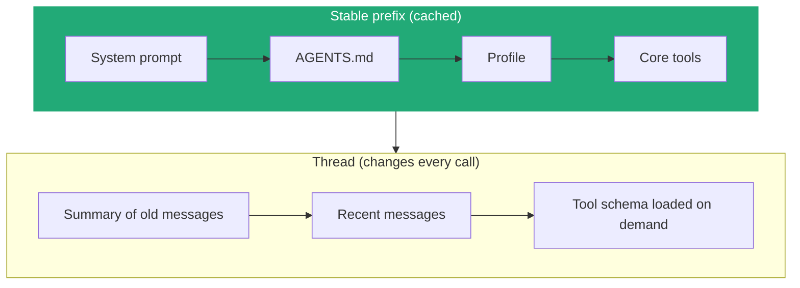
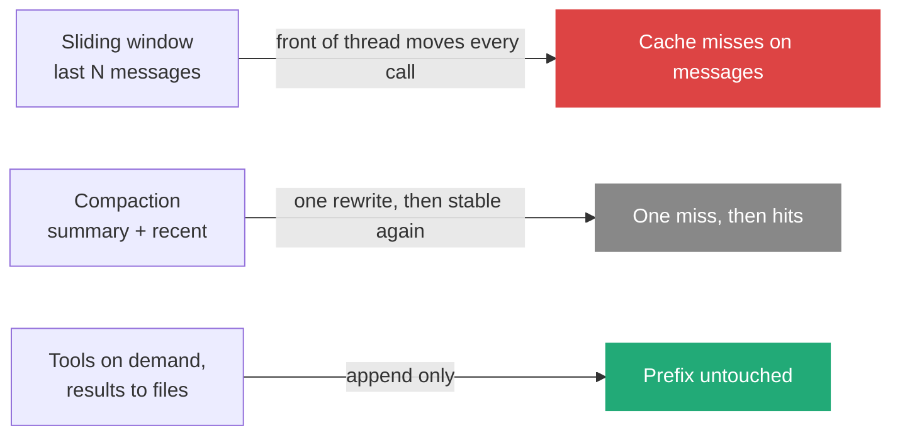

# 4. Context window: stable prefix, on-demand loading, compaction

> I keep context cheap by freezing a stable prefix (system prompt, AGENTS.md, profile, core tools) that the provider can cache, loading everything else on demand, and compacting the thread in a way that does not rewrite the prefix or silently drop what the task needs.

Related: [03 Instructions: five parts and enforcement](03_Instructions_Five_Parts_And_Enforcement.md) · [05 Agentic memory](draft_05_Agentic_Memory_Extraction_Retrieval.md) · [06 Tools awareness, discovery, code mode](draft_06_Tools_Awareness_Discovery_Code_Mode.md) · [02 Persistence, access, isolation](draft_02_Persistence_Access_Isolation.md) · [Lecture 2: 4 Context window](../Lecture_2_Context_Agents_md_Skills_Tools/4_context_window.md) · [Lecture 2: 5 Skills](../Lecture_2_Context_Agents_md_Skills_Tools/5_skills.md) · [Lecture 2: 11 Tool upfront vs discovery](../Lecture_2_Context_Agents_md_Skills_Tools/11_tool_upfront_vs_tool_discovery.md) · [Lecture 1: 13 Skills and context](../Lecture_1_Mechanics_Behind_Generative_AI/13_skills_and_context.md)

Source: S02E01 article "Agentic Loop" (Context, figure of the three context columns, and the four conclusions); S02E01 transcript (last-20 window and compaction trade-offs, as worked example). Vendor docs read on 2026-11-15, see [Fact-check](#fact-check).

## Glossary

| Term | What it means here | Same thing elsewhere | Not to be confused with |
|---|---|---|---|
| Stable prefix | The front of the context that is byte-identical across calls | - | The whole prompt |
| Prompt cache | Provider reuse of the computed prefix (KV state), billed at a discount | - | My own response cache |
| Message window | Send only the last N messages | - | Compaction, which rewrites older ones |
| Compaction | Replace older messages with a summary, keep recent ones as they are | - | Truncation, which just drops |
| Reactivation | Re-loading a skill body after compaction removed it from the thread | - | First activation |

## 1. The problem

Every model call resends the whole context. That costs tokens and latency, the window is finite, and the model attends worse to a bloated context. I want three properties at once: **small** (little sent), **cacheable** (the same bytes at the front each call) and **not lossy** (what the task needs survives trimming). The three pull against each other: trimming and summarizing change the bytes, and changing the bytes breaks the cache.

## 2. The layout: prefix first, thread after

The lecture figure shows three columns (session start, after tool discovery, after compaction). The same red block, the cached prefix, sits at the top of each.



Both vendors build the prefix the same way. Anthropic: order is `tools`, then `system`, then `messages`, and a `cache_control` marker caches everything up to that block. OpenAI: "Cache reuse requires the entire rendered prefix to match", stable content first, dynamic content (timestamps, user details) last ([Anthropic](https://platform.claude.com/docs/en/build-with-claude/prompt-caching), [OpenAI](https://developers.openai.com/api/docs/guides/prompt-caching)).

## 3. Caching: what saves money and what breaks it

The saving exists only while the prefix stays identical. The lecturer's wording: the cache cuts cost and latency "but only if the existing context stays the same". The vendors agree and add numbers (read on 2026-11-15, models and prices change quickly):

| | Anthropic | OpenAI |
|---|---|---|
| Control | Automatic top-level `cache_control`, or explicit breakpoints (up to 4) | Automatic on exact prefix, optional `prompt_cache_key` |
| Minimum prefix | 512 to 4,096 tokens depending on model | 1,024 visible input tokens on GPT-5.6 and later |
| Lifetime | 5 min default (refreshed on read), 1 h option | 30 min default or 12 h on GPT-5.6 and later; older models 5 to 10 min in memory, up to 24 h |
| Read price | 0.1x base for most models (0.05x on some) | 0.1x ordinary input (0.05x on some) |
| Write price | 1.25x for 5 min, 2x for 1 h | 1.25x for 30 min, 2.5x for 12 h on GPT-5.6 and later |
| Where I check a hit | `cache_read_input_tokens` | `usage.input_tokens_details.cached_tokens` |

What invalidates the Anthropic prefix, from the vendor table:

| Change | Tools cache | System cache | Messages cache |
|---|---|---|---|
| Edit a tool definition (name, description, parameters) | lost | lost | lost |
| Change `tool_choice` | kept | lost | lost |
| Add or remove images anywhere | lost | lost | lost |
| Toggle web search or citations | lost | kept | kept |

Rule that follows: **a change at position N invalidates everything after N.** Tools sit first, so adding or removing a tool mid-session costs the most. A timestamp inside the system prompt costs the whole prefix on every call. A lookback of 20 blocks per breakpoint also means a long tool-heavy turn can push the last cache write out of reach, so I place an explicit breakpoint on the last stable block.

Worked example, bad and good:

```text
bad:  system = "You are X. Current time: 2026-11-15T10:42:07Z. ..."   -> new bytes every call, zero hits
good: system = "You are X. ..."  (static)
      last user message = "[time: 2026-11-15T10:42:07Z] ..."          -> prefix stays cached
```

## 4. Window and compaction against the cache

Trimming is needed, but each strategy has a different cache cost.



- **Last-N window.** The transcript agent sends up to the last 20 messages. The trade-off the presenter states: "an important detail from earlier in the conversation might get left out", and 20 is not a magic number. My addition: once the window is full, the oldest message drops on every call, so the messages part of the prefix changes each time and only system and tools stay cached. OpenAI says it directly: append new messages instead of rewriting earlier turns, "since summarization or compaction can change the prefix".
- **Compaction.** The transcript: older messages are "compressed into shorter notes" kept next to recent messages, and "those notes may leave out some details". One rewrite breaks the cache once, then the new prefix is stable again. A cheaper window is only a win if the saved tokens exceed the lost cache discount, which I measure instead of assuming.
- **Keep things out of the thread.** Tool schemas loaded on demand and large tool results written to a file with only a reference returned keep the thread append-only and small. Detail in [06](draft_06_Tools_Awareness_Discovery_Code_Mode.md) and [Lecture 2: 10](../Lecture_2_Context_Agents_md_Skills_Tools/10_tool_results_context_to_file_and_back.md).

Framework mapping:

| Mechanism | LangGraph | Semantic Kernel | Claude Code |
|---|---|---|---|
| Last N or token window | `trim_messages(strategy="last", max_tokens=...)` in the model node: trims the list passed to the model, state keeps everything | `ChatHistoryTruncationReducer(targetCount)` | not used for the main thread |
| Summarize old messages | Summarization node, or `RemoveMessage` with the `add_messages` reducer to delete summarized ones | `ChatHistorySummarizationReducer` | `/compact`, automatic near the limit |
| What the state keeps | Full history in checkpoints (separate from what the model sees) | Reducer returns a new history, original is replaced by caller | Summary replaces the thread |

Sources for rows: [LangGraph add-memory docs](https://docs.langchain.com/oss/python/langgraph/add-memory), [Semantic Kernel chat history docs](https://learn.microsoft.com/en-us/semantic-kernel/concepts/ai-services/chat-completion/chat-history), [Claude Code context window](https://code.claude.com/docs/en/context-window.md). The LangGraph property worth using: trimming at the model node keeps the full thread in the checkpoint, so nothing is lost for audit even when the model sees less.

## 5. What survives compaction in Claude Code

I treat this as the reference case for "not lossy".

| Item | After compaction |
|---|---|
| System prompt, output style | Still apply |
| Project-root CLAUDE.md, unscoped rules, auto memory | Re-injected from disk |
| Invoked skill bodies | Re-injected, 5,000 tokens per skill and 25,000 total, oldest dropped first, truncation keeps the file start |
| Path-scoped rules, nested CLAUDE.md | Loaded into messages, summarized away, reload on demand |
| Files read or edited | Up to 5 re-read, most recent first, over 5,000 tokens come back as a path |

Consequences I take from it: the lecture's "skills sometimes need to be reactivated" is accurate, and the real mechanism is a cap and a drop order, not a bug. Put the key instructions at the top of `SKILL.md`. What must persist belongs in a file that is re-read (root AGENTS.md, a skill within the cap) and not in the conversation. An instruction given only in chat is gone after compaction.

## 6. Why a long AGENTS.md hurts

Three costs. It is sent on every call (tokens, latency, until cached). It sits inside the prefix, so any edit invalidates the cache for the session. And the model follows it less. The lecture says the model "will ignore most of it". Claude Code docs give a softer, vendor-backed version: target under 200 lines, because "longer files consume more context and reduce adherence", and importing files with `@path` organizes but does not reduce the cost. "Ignores most of it" is the lecturer's strong phrasing, I have no measurement for the share. Remedy: keep the root file as a router, move detail to skills and path-scoped rules, and put concrete verifiable rules first.

## Summary

Prefix caching pays only for an unchanged front of the context, so the layout is: static system prompt, AGENTS.md, profile and core tools first, volatile data (time, user details, new messages) last. A sliding window changes the front on every call, compaction changes it once, on-demand tools and file-backed results keep it untouched. Compaction loses what is not in a re-read file or within a cap, so durable instructions live in files and not in the chat.

## Open questions

- At my typical thread length, does a last-N window or a compaction every K turns cost less once the lost cache discount is counted?
- What does my provider do when I change `effort` or thinking settings mid-session: which cache layers are lost?

## Fact-check

| # | Claim | Verdict | Source | Checked |
|---|---|---|---|---|
| 1 | Prefix-based cache saves cost and latency only if the prefix stays identical | **Agrees** | [OpenAI](https://developers.openai.com/api/docs/guides/prompt-caching): "entire rendered prefix to match". [Anthropic](https://platform.claude.com/docs/en/build-with-claude/prompt-caching): exact byte match, order tools, system, messages. Both pages read via fetch tool, which returned summaries of the pages | 2026-11-15 |
| 2 | Stable prefix is system prompt, AGENTS.md, profile and core tools | **Lecture-specific** | Matches vendor advice to put stable content first, but the list is the lecture's figure | 2026-11-15 |
| 3 | Skills may need reactivation after compaction | **Agrees** | [Claude Code context window](https://code.claude.com/docs/en/context-window.md): invoked skills re-injected with 5,000 per skill and 25,000 total caps, oldest dropped. Skill descriptions re-injected on v2.1.304 or later | 2026-11-15 |
| 4 | A long AGENTS.md is mostly ignored by the model | **Differs: strong wording.** Vendor says longer files "reduce adherence", target under 200 lines, no measured share. "Most of it" is opinion | [Claude Code memory docs](https://code.claude.com/docs/en/memory.md) | 2026-11-15 |
| 5 | Last-N window and compaction both lose detail | **Agrees** | Transcript trade-offs, plus LangGraph and Semantic Kernel docs describing truncation and summarization as lossy strategies. The cache cost of a sliding window is my inference from the prefix rule, not a vendor statement | 2026-11-15 |
| 6 | Cache lifetimes and minimum lengths | **Unverified for durability** | Values above are from the vendor pages on the check date, and models, prices and minimums change often. Verify before presenting | 2026-11-15 |

## Sources

- S02E01 article and transcript (local files). The cache cost of a sliding window and the framework mapping are my own reasoning.
- [Anthropic prompt caching](https://platform.claude.com/docs/en/build-with-claude/prompt-caching)
- [OpenAI prompt caching](https://developers.openai.com/api/docs/guides/prompt-caching)
- [Claude Code: explore the context window](https://code.claude.com/docs/en/context-window.md)
- [Claude Code: how Claude remembers your project](https://code.claude.com/docs/en/memory.md)
- [LangGraph: add memory](https://docs.langchain.com/oss/python/langgraph/add-memory)
- [Semantic Kernel: chat history](https://learn.microsoft.com/en-us/semantic-kernel/concepts/ai-services/chat-completion/chat-history)
