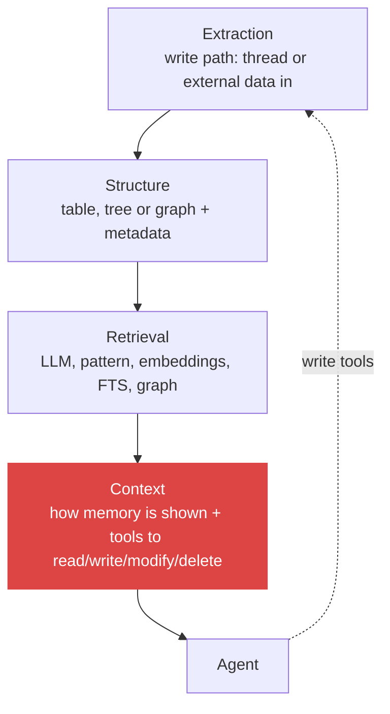
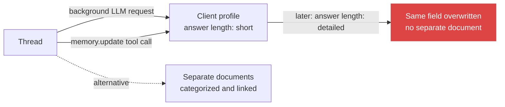
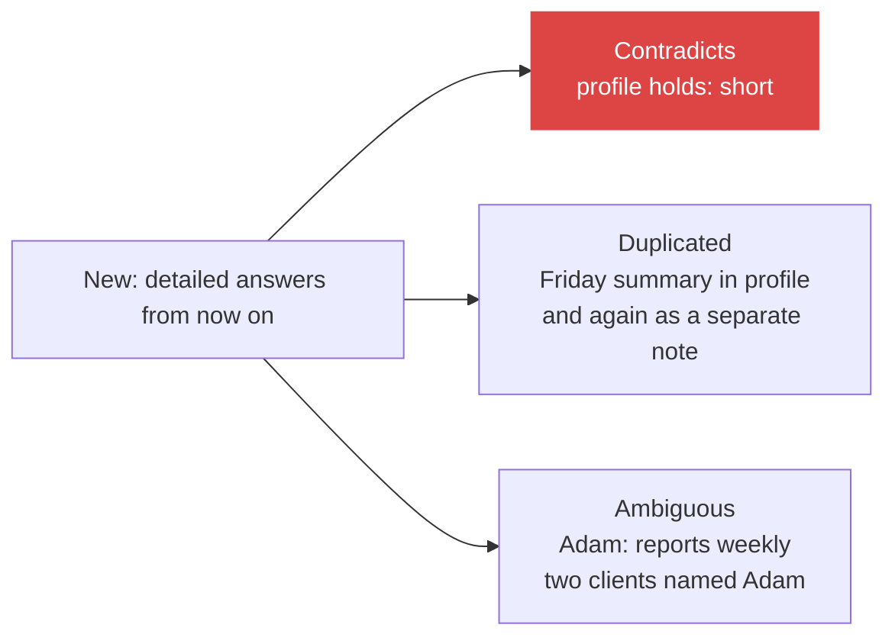
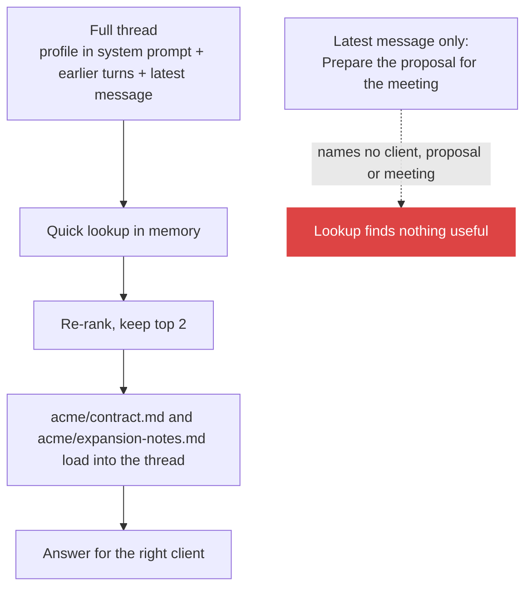
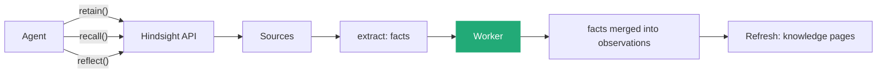

# 5. Agentic memory: extraction is easy, keeping one current value and recalling it in context is hard

> Memory has four parts (structure, extraction, retrieval, context); saving a fact is the easy part, and the hard parts are keeping one current, owned value per fact (contradiction, duplication, ambiguity) and recalling it from the whole thread plus a global profile instead of the last message.

Related: [02 HITL and execution isolation](02_HITL_And_Execution_Isolation.md) · [04 Context window and compaction](draft_04_Context_Window_And_Compaction.md) · [06 Tools: awareness, discovery, gateway](draft_06_Tools_Awareness_Discovery_Gateway.md) · [08 Evals and traces for agent changes](draft_08_Evals_And_Traces_For_Agent_Changes.md) · [Lecture 1: 15 Self-querying](../Lecture_1_Mechanics_Behind_Generative_AI/15_self_querying.md) · [Lecture 1: 16 Self-management](../Lecture_1_Mechanics_Behind_Generative_AI/16_self_management.md) · [18 Tool execution instead of tool calls](18_Tool_Execution_Instead_Of_Tool_Calls.md)

Source: S02E01 article "Agentic Primitives", section "Context and Memory" (figures 19 to 23), plus the Mastra retail-agent demo in the S02E01 transcript used only as a worked example; sources checked 2026-11-15, see [Fact-check](#fact-check).

## Glossary

| Term | What it means here | Same thing elsewhere | Not to be confused with |
|---|---|---|---|
| Thread | The ordered messages of one conversation | - | Memory: a thread is raw history, memory is distilled and cross-thread |
| Retention window | How many recent messages I still send to the model | - | Memory: the window forgets by position, memory forgets by decision |
| Profile | One mutable document of facts about a user or client | - | A collection of separate documents (section 3) |
| Extraction | Turning thread content into stored memory | - | Retrieval: reading it back |
| Recall | Choosing which memories enter this turn's context | - | Search: recall is search plus ranking plus the thread |

## 1. The problem

Users ask for memory more than for most features, yet a model only sees what is in its context window. So the question is: **what has to exist around the model so that something said last week changes today's answer, and stays correct when the user changes their mind?** The article splits it into four parts. Each one fails in its own way.

## 2. Four parts of agentic memory

The lecturer's decomposition: memory is a store, a write path, a read path and a presentation layer. Failures sit in different parts, so I debug them separately.

| Part | Lecture says | LangGraph / LangMem | Semantic Kernel |
|---|---|---|---|
| Structure | Table, tree or graph with metadata | Store: JSON documents under a namespace (folder) and a key (file name) | Provider-owned; Mem0 scopes by application, agent, thread, user |
| Extraction | Background LLM call or explicit tool call | Hot path (agent writes before replying) or background task | Provider extracts from each message added to the thread |
| Retrieval | Agentic search, mixed methods | Store search with semantic search over namespaces | Mem0 queried with the user request on each invocation |
| Context | Presentation plus memory tools | Memory tools (manage and search) over the store | `ContextPrompt` prefixed to injected memories |

Industry check: the four parts map cleanly onto both stacks. Lecture-specific is the emphasis on **context** as its own part; LangMem calls it the memory tools, Semantic Kernel calls it the context prompt.

## 3. Extraction: background call or explicit tool call, profile or documents

Two independent choices. **When and who writes:** a background LLM request after the turn, or a tool call the agent makes itself. **What shape is written:** an update to one profile, or separate categorized documents linked to existing ones.

| Choice | Strength | Cost | Where I see it |
|---|---|---|---|
| Background LLM call | No latency on the turn, memory logic separate from app logic | Extra model cost; I must decide when it fires (schedule, cron, manual) | LangGraph "background" writes; Mem0 provider sends every thread message to the service |
| Explicit tool call | New memory available at once, user sees what was saved | Latency, tool complexity, more load on the agent | LangGraph "hot path"; the Mastra demo's save/read preference tools |
| Profile | One place to look, small | Each update regenerates the document; more error-prone as it grows | LangChain docs: profile is a single JSON document |
| Documents | Narrow, easier to generate, better recall | Hard to delete or update; model over-inserts; whole picture is harder to supply | LangChain docs: collection |

Concrete evidence from the lecture (figure 20): the thread says "I prefer short answers", then later "give me detailed answers from now on". The background call sets `answer length: short`, a tool call sets `summary: email, every Friday`, and the later preference replaces `short` with `detailed`.

Worked example from the transcript (a Mastra demo, used only for the pattern): working memory is off by default; the agent gets explicit save and read preference tools, and storage is per customer. The pattern I keep is the choice to make writes an explicit, visible tool call scoped to one customer, not the framework.

## 4. Three problems: contradiction, duplication, ambiguity

Storing a preference is easy. Keeping one current, single, clearly owned value over time is the hard part. The lecturer's figure 21 shows three failures on one profile.

| Problem | What goes wrong | Mitigation named in the lecture | Mitigation I add from the sources |
|---|---|---|---|
| Contradiction | Old value survives or both are kept | Override rule on connect | Profile: model rewrites in place. Collection: model must update or delete the conflicting item (LangChain notes this is tricky) |
| Duplication | Same fact stored twice, drifts apart | None given | One owner per fact; Hindsight's worker merges duplicates into one observation |
| Ambiguity | Fact attached to the wrong entity | Confidence scores, temporary notes until resolved | Resolve entity before write; keep an unresolved note out of the profile |
| Change over time | I cannot tell what changed | "Keeping track of what changed over time" listed as unsolved | Hindsight keeps history when an observation is updated |

Evidence: the lecture says most of this is unsolved, "partly because of the cost of background processing, but also because the whole process is so complex". The confidence-score idea is lecture-specific practice, not a documented standard.

## 5. Recall: fast, contextual, efficient

Retrieval has to be quick, relevant to the task, and cheap in tokens. The lecturer's point: the latest message alone usually cannot find the right memory, so recall needs **the thread plus a global profile or map**.

Evidence (figure 23): the profile says client Acme Logistics, Enterprise plan, next meeting Thursday; an earlier turn says Acme wants to expand to Germany; the last message says only "Prepare the proposal for the meeting". Only the full thread resolves it.

Industry check: Semantic Kernel's `Mem0Provider` queries Mem0 "for memories matching the provided user request" on each invocation. That is the request-only case the lecture calls insufficient, so a custom provider that builds the query from the thread and a profile is the usual fix. Lecture-specific design advice; I found no vendor doc that states this rule.

## 6. Retention window is not memory

A retention window (last N messages) forgets by position. Memory forgets by decision. A compacted summary sits between them (see [04](draft_04_Context_Window_And_Compaction.md)).

| Mechanism | Scope | Forgets | Survives a new thread |
|---|---|---|---|
| Retention window | One thread | Oldest messages | No |
| Compaction summary | One thread | Detail | No |
| Whiteboard (Semantic Kernel) | One thread | Least valuable items, up to a maximum count | No |
| Memory | User, org or agent namespace | Only by delete or update | Yes |

Semantic Kernel's `WhiteboardProvider` is the clean example of the middle row: it extracts requirements, decisions and actions so they survive chat-history truncation, and it is documented as experimental.

The transcript's demo agent shows the same split inside one framework's `memory` config. Its three options are three different mechanisms, and only one of them is memory in the sense of this note:

| Demo option (value in the demo) | Mechanism | Layer in this note | My stack equivalent |
|---|---|---|---|
| `lastMessages: 20` | Last N messages of the current thread | Retention window | Cache store plus message trimming |
| `semanticRecall: false` | Retrieve past messages by meaning, not keywords | Recall by embedding search | AI Search |
| `workingMemory.enabled: false` | Facts kept across conversations | Memory (profile) | Near-field knowledge store |

The lecturer turned automatic working memory off and registered two explicit tools, `readPreference` and `savePreference`. The save tool takes categories such as shoe size and shirt size, saves only when the customer asks, and stores each category per customer. His reason: a remembered order number could decide which purchase the next request is about. That is an extraction policy (explicit tool call, scoped schema), not a retrieval setting, so it belongs to section 3. MCP tools are external capabilities, not memory (see [06](draft_06_Tools_Awareness_Discovery_Gateway.md)). The option meanings come from the transcript narration only; the demo framework's docs were not read, and its storage backends are verify before presenting.

## 7. Existing projects and what each teaches

The lecturer: most are open source, so I can read their code with an agent. I compare them by the part they own.

| Project | What it is | Part it teaches | Note |
|---|---|---|---|
| mem0 | Memory layer, hosted API and open-source library | Extraction plus scoped retrieval behind an API | Wired into Semantic Kernel as `Mem0Provider` |
| supermemory | Memory API combining memory, RAG and extraction | Memory and ingested documents are different things | Vendor sources only |
| Hindsight | retain, recall, reflect; background worker turns facts into observations; pages | Consolidation as a separate background job | License not stated on the page I read |
| lamarck | CLI reading Claude Code history, writing `MEMORY.md` and topic files | Offline extraction, maturity stages, decay, dedup gates | No runtime recall; Claude Code loads the exported files |
| Joel Hooks' observation pipeline | Observe, reflect, promote to a small curated `MEMORY.md` | Curated memory kept apart from raw logs | Article unreachable; see Fact-check row 7 |
| Anthropic memory tool | Client-side `/memories` directory; the model creates, edits, renames, deletes files | Files as memory, path validation is the host's job | Pairs with compaction and context editing |

## Summary

Four parts, four failure modes. Extraction by background call or tool call is a latency and control trade-off; profile versus documents is a regeneration versus update trade-off. The unsolved core is one current value per fact and recall that reads the thread plus a profile. A retention window is not memory.

## Open questions

- Which extraction trigger fits a long-running agent: per message, per thread end, or on a schedule?
- Where does an unresolved ambiguous fact live until the entity is known?

## Fact-check

| # | Claim | Verdict | Source | Checked |
|---|---|---|---|---|
| 1 | There are no established standards or patterns for agent memory | **Differs** | Documented patterns exist: [LangChain memory concepts](https://docs.langchain.com/oss/python/concepts/memory) (hot path vs background, profile vs collection), [Anthropic memory tool](https://platform.claude.com/docs/en/agents-and-tools/tool-use/memory-tool), [Semantic Kernel agent memory](https://learn.microsoft.com/en-us/semantic-kernel/frameworks/agent/agent-memory). A cross-vendor standard: none found; I did not read the full MCP spec for a memory primitive (**Unverified**) | 2026-11-15 |
| 2 | Most harnesses handle memory naively | **Lecture-specific (opinion)** | No survey found; Semantic Kernel's request-only Mem0 query is one example of the naive case | 2026-11-15 |
| 3 | mem0 exists and extracts memories from messages | **Agrees** | [Semantic Kernel docs](https://learn.microsoft.com/en-us/semantic-kernel/frameworks/agent/agent-memory): each message is sent to Mem0 to extract memories | 2026-11-15 |
| 4 | supermemory exists as a memory service | **Agrees** | Search summary of [supermemory blog](https://supermemory.ai/blog/best-memory-apis-stateful-ai-agents/) and docs; vendor-written, benchmark claims not checked | 2026-11-15 |
| 5 | Hindsight exposes retain, recall, reflect and a worker consolidates facts into observations | **Agrees** | [hindsight.vectorize.io](https://hindsight.vectorize.io/) (page fetched); license not stated there, check the repo before presenting | 2026-11-15 |
| 6 | lamarck is a source of inspiration for memory | **Agrees, with scope** | [lamarck README](https://github.com/johnlindquist/lamarck): offline CLI that writes `MEMORY.md`; it does not recall at runtime | 2026-11-15 |
| 7 | Joel Hooks built an observation pipeline so his AI remembers yesterday | **Unverified** | [joelclaw.com article](https://joelclaw.com/observation-pipeline-persistent-ai-memory) did not resolve; only search summaries of his repo's memory-system skill (observe, reflect, promote); verify before presenting | 2026-11-15 |
| 8 | Extraction runs as a background LLM request or as explicit tool calls | **Agrees** | [LangChain memory concepts](https://docs.langchain.com/oss/python/concepts/memory): hot path and background | 2026-11-15 |
| 9 | Memories are stored as profile updates or as separate documents | **Agrees** | Same page: profile vs collection, with the trade-offs in section 3 | 2026-11-15 |
| 10 | Recall needs the thread and a global profile, not the last message alone | **Lecture-specific (opinion)** | Lecture figure 23; consistent with the request-only query in the Semantic Kernel Mem0 provider | 2026-11-15 |
| 11 | Confidence scores or temporary notes handle ambiguity | **Lecture-specific (opinion)** | Lecture text; no vendor doc read. Search summary says Hooks' pipeline stores a write confidence per observation, unverified | 2026-11-15 |

## Sources

- Lecture: S02E01 Agentic Primitives, "Context and Memory"; transcript demo for the explicit-tool example.
- [LangChain: memory concepts](https://docs.langchain.com/oss/python/concepts/memory)
- [Semantic Kernel: adding memory to agents](https://learn.microsoft.com/en-us/semantic-kernel/frameworks/agent/agent-memory)
- [Anthropic: memory tool](https://platform.claude.com/docs/en/agents-and-tools/tool-use/memory-tool)
- [Hindsight](https://hindsight.vectorize.io/) · [mem0](https://mem0.ai/) · [supermemory](https://supermemory.ai/) · [lamarck](https://github.com/johnlindquist/lamarck)
- My own reasoning: the retention-window table in section 6 and the mapping tables in sections 2 to 4.
