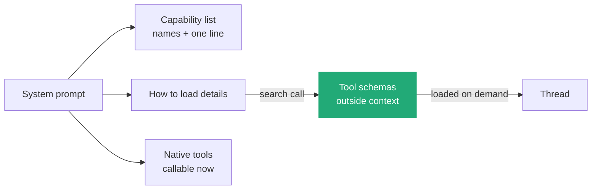
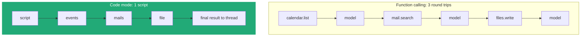
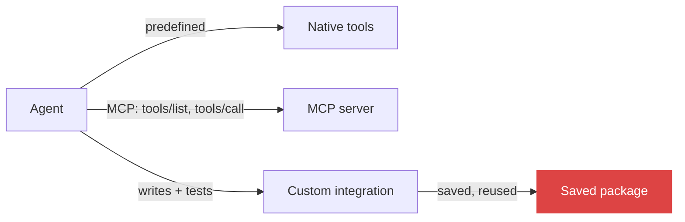
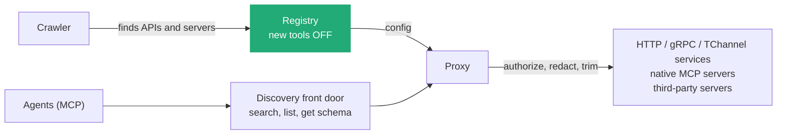

# 6. Tools: be aware of everything, load almost nothing, chain calls in code

> An agent stays aware of its capabilities through a short list plus a way to load details on demand, finds tools by a search tool or by files and bash, and finishes multi-tool work in few steps by writing one script whose intermediate results stay out of the thread.

Related: [03 Instructions: five parts and enforcement](03_Instructions_Five_Parts_And_Enforcement.md) · [04 Context window, cache, compaction](draft_04_Context_Window_Cache_Compaction.md) · [05 Agentic memory](draft_05_Agentic_Memory_Extraction_Retrieval.md) · [07 Tool approval and durable waits](draft_07_Tool_Approval_Durable_Waits.md) · [02 Threads, persistence, isolation](draft_02_Threads_Persistence_Isolation.md) · [Lecture 1: 10 Code mode](../Lecture_1_Mechanics_Behind_Generative_AI/10_code_mode.md) · [Lecture 1: 11 CLI and MCP](../Lecture_1_Mechanics_Behind_Generative_AI/11_cli_and_mcp.md) · [Lecture 1: 13 Skills and context](../Lecture_1_Mechanics_Behind_Generative_AI/13_skills_and_context.md) · [Lecture 1: 16 Self-management](../Lecture_1_Mechanics_Behind_Generative_AI/16_self_management.md)

Source: S02E01 article "Agentic Primitives", sections "Tools" (figures 24 to 28) and the tools paragraph of "Agentic Loop" (figures 12, 13); the Mastra retail-agent demo in the S02E01 transcript as a worked example only; sources checked 2026-11-15, see [Fact-check](#fact-check).

## Glossary

| Term | What it means here | Same thing elsewhere | Not to be confused with |
|---|---|---|---|
| Awareness | The agent knows a capability exists, from a name and one line | - | Loading: having the full schema in context |
| Discovery | Finding and loading the details of one capability | - | Registration: the harness making a tool callable |
| Function calling | The model emits a structured call per tool; each result returns to the model | - | Code mode, where the model writes a script that calls tools |
| Gateway | A shared service between agents and many tool servers (registry, proxy, authorization) | - | An MCP server: the gateway fronts many of them |

## 1. The problem

The lecture asks for two things at once: the agent must be **aware of its capabilities** and must **use them together in as few steps as possible**, without drowning its context. Loading every schema breaks the first; one tool call per round trip breaks the second. How do I get both, and what changes when the catalog grows from 10 tools to thousands?

## 2. Awareness: a list, a way to load, and a few native tools

The lecture's figure 24: the system prompt holds three things, a **list of capabilities**, **guidance on how to load their details**, and **native tools** the agent can call at once. Details stay outside the context until needed.



The decision the lecture leaves to me is which tools are native. Anthropic's tool search documentation gives numbers: a five-server setup (GitHub, Slack, Sentry, Grafana, Splunk) can use about 55k tokens of definitions before any work, selection accuracy degrades past 30 to 50 tools, and the advice is to keep the 3 to 5 most used tools non-deferred and add a system-prompt line that names the categories ("you can search for tools to interact with Slack, GitHub, and Jira").

| Stack | Native (always loaded) | Deferred | Discovery |
|---|---|---|---|
| Anthropic API | Tools without `defer_loading`; the search tool itself | `defer_loading: true`, up to 10,000 tools per request | `tool_search_tool_regex` or `_bm25`, returns `tool_reference` blocks, 5 results by default |
| Semantic Kernel | Plugins I register on the kernel | Filtered by function choice behavior or a custom filter I write | No built-in search tool I verified; verify before presenting |
| LangGraph / LangChain | Tools bound to the model | Selecting a subset per step in my own node | Custom retriever over tool descriptions; my pattern, not a vendor doc |

Evidence: the request still carries every definition on every call, but deferred ones are excluded from the cached prefix, so the cache stays valid (Anthropic docs, "Deferred tool loading"). This is the same reason the lecture's figure 11 keeps core tools in the cached prefix and loads the rest later (see [04](draft_04_Context_Window_Cache_Compaction.md)).

## 3. Discovery: search tool or files and bash

Two ways to expose a catalog. A **dedicated search tool** the harness owns gives control. **Files the agent explores with bash** give flexibility, because the agent can also manage them (good and bad, in the lecturer's words).

| | Search tool | Files + bash |
|---|---|---|
| Control | High: I decide what is searchable and returned | Low: the agent walks the tree |
| Flexibility | Fixed query surface | High: grep, read, edit, add |
| Self-management | Hard | Native |
| Risk | Search quality is a single point of failure | Agent edits or reads what it should not |
| Known form | Anthropic tool search; Uber's discovery calls | Anthropic "code execution with MCP": servers presented as a directory of code files |

Anthropic's engineering write-up describes the files route: present MCP servers as code files, the agent lists the directory and reads only the definitions it needs. Its example drops from about 150,000 tokens to 2,000 (98.7%); the article presents this as one illustration, not a benchmark.

## 4. Function calling versus code mode

Function calling needs each schema in context and returns every result to the model so it can pick the next step. Fine for simple work, inefficient for complex workflows. Code mode lets the model write one script that chains tools and keeps results in variables.



Industry check, two independent write-ups agree on the mechanism:

| Source | Claim | Consistent with lecture |
|---|---|---|
| [Anthropic programmatic tool calling](https://platform.claude.com/docs/en/agents-and-tools/tool-use/programmatic-tool-calling) | Tool opts in with `allowed_callers: ["code_execution_20260120"]`; "intermediate results are not loaded into Claude's context window"; a 20-employee budget check is one script, not 20 round trips | Yes |
| [Cloudflare Code Mode](https://blog.cloudflare.com/code-mode/) | Models have seen much more code than tool-call tokens; with direct calls each output passes through the model only to be copied into the next call; code runs in a V8 isolate with no general network, reached through bindings | Yes, and adds the training-data argument |
| Lecture | "Modern agents write code that can chain tools and keep results in variables" | Baseline |

Two cautions from the same sources. Anthropic's docs say `allowed_callers` "is not a hard API-level block on direct calls", so I do not use it as a security boundary. Anthropic's article also notes that running agent-generated code needs sandboxing, resource limits and monitoring, which is operational cost that function calling does not have. The earlier-lecture version of this idea, two tools `find` and `execute`, is in [Lecture 1: 10](../Lecture_1_Mechanics_Behind_Generative_AI/10_code_mode.md).

### Big results go to a file, the model gets a reference

When a script returns a large report, I do not append it to the thread. I write it to a file and hand the model a path, so it can read a fragment, show the file to the user, or pass it to another tool (the lecture's figure 13: read a fragment, display, or email it).

```text
tool_result: report written to workspace/reports/q3.md (412 KB). Read a range with
read(path, lines) or attach it with mail.send(attachment=path).
```

Evidence: Anthropic's code-execution article shows the same idea in two forms: filter or aggregate inside the environment so the model sees 5 rows instead of 10,000, and write files to persist state across runs. The file-reference form is the lecture's wording; the principle matches.

## 5. Tool management and reusability

An agent may have a fixed tool set, connect to MCP servers, or **write its own integrations**, which it saves and reuses once tested (figures 25 and 27). A saved package holds logic and imports integrations, value stores and other packages. This is the tool-side twin of skills with scripts ([Lecture 1: 13](../Lecture_1_Mechanics_Behind_Generative_AI/13_skills_and_context.md), [16](../Lecture_1_Mechanics_Behind_Generative_AI/16_self_management.md)).



| Concern | MCP | Agent-written package |
|---|---|---|
| Discovery | `tools/list` with pagination; `listChanged` notification when the list changes | Directory listing or my own index |
| Contract | `inputSchema`, optional `outputSchema`, tool annotations | Whatever the agent wrote; needs a test before it is saved |
| Trust | Clients must treat annotations as untrusted unless the server is trusted; servers must validate inputs and enforce access | The same, plus review before the package is shared |

Worked example from the transcript (the retail demo, used only for the pattern): the tool description says what it does and when to use it, so guidance lives with the tool and not in the agent instructions; the schema checks shape while the implementation enforces who may see what; the tool is registered only when a setting is on. Rules that must hold without the tool, such as "do not invent order details", stay in the instructions (see [03](03_Instructions_Five_Parts_And_Enforcement.md)).

The lecture also advises official SDKs over abstractions such as AI SDK to avoid unneeded layers. That is an opinion about adapters, not about tools; I note it and do not rely on it here.

## 6. Gateway at scale

When tools number in the thousands, the problem moves from context to **authorization, ownership and rollout**. The lecturer points to Uber's MCP gateway and the open-source Treg.



What Uber's post states: the gateway hosts over 800 MCP servers and over 5,000 tools (the lecture's "8000+" is not in the post). The registry is the single source of truth for discovery, ownership and enablement; the proxy translates MCP calls into HTTP, gRPC or TChannel; an auto-crawler scans the internal interface registry; **every server and tool starts disabled** until the owning team reviews and enables it; authorization and redaction apply at tool granularity. Its discovery server, Omni MCP, exposes discover_server, discover_tools, get_tool_schema and invoke_tool, which is tool search at the front door.

| Gateway | Shape | What it solves |
|---|---|---|
| Uber MCP gateway | Internal control plane (registry, crawler) and data plane (proxy) | Ownership, default-off rollout, redaction, thousands of tools |
| Treg | Hosted proxy and registry for external agent tools ("OpenRouter, but for agent tools"); one token, provider credentials injected server side | One account for many external APIs; search by task; per-call billing |

Treg is a smaller, different thing: a hosted catalog of external endpoints plus team-registered keys, not an internal enterprise gateway. Its MCP support status is unclear from the README I read. Mapping for my stack: a registry with default-off plus a discovery front door is the pattern; Semantic Kernel plugins and LangGraph tool lists are the client side of it.

## 7. Per-user workspace isolation, as it concerns tools

Agents that can write code or manage their own integrations need clearly separated workspaces, because they can easily find a way around a boundary and reach another user's data (figure 28: each user's agent runs code only in its own workspace with a runtime and filesystem).

| Layer | What stops the escape | Source |
|---|---|---|
| Sandbox | No general network; tools reached by bindings; keys held by the supervisor, not the model's code | Cloudflare Code Mode |
| Workspace | One runtime and filesystem per user | Lecture figure 28 |
| Tool | Server validates input and enforces access control; caller policy is not a boundary | MCP tools spec; Anthropic `allowed_callers` note |

Thread-level isolation and persistence are covered in [02](draft_02_Threads_Persistence_Isolation.md); approvals before irreversible tools in [07](draft_07_Tool_Approval_Durable_Waits.md).

## Summary

Keep a short list and a loading path in the prompt, three to five native tools, and defer the rest behind search or files. Chain work in code and keep intermediate and large results out of the thread. At thousands of tools, add a registry that starts everything disabled, a discovery front door, and a proxy that authorizes and redacts. Isolate each user's workspace.

## Fact-check

| # | Claim | Verdict | Source | Checked |
|---|---|---|---|---|
| 1 | Function calling needs schemas in context and returns every result to the model | **Agrees** | [Anthropic tool search](https://platform.claude.com/docs/en/agents-and-tools/tool-use/tool-search-tool): about 55k tokens of definitions in a five-server setup; [Anthropic code execution with MCP](https://www.anthropic.com/engineering/code-execution-with-mcp): "every intermediate result must pass through the model" | 2026-11-15 |
| 2 | Code mode chains tools and keeps results in variables | **Agrees** | [Anthropic programmatic tool calling](https://platform.claude.com/docs/en/agents-and-tools/tool-use/programmatic-tool-calling); [Cloudflare Code Mode](https://blog.cloudflare.com/code-mode/) | 2026-11-15 |
| 3 | Large results are dropped into a file and the model gets a reference | **Agrees, with scope** | Anthropic code-execution article: filter in code, persist files; the explicit file-reference wording is the lecture's | 2026-11-15 |
| 4 | Uber's MCP gateway manages 8000+ tools | **Wrong** | [Uber blog](https://www.uber.com/pl/en/blog/designing-mcp-gateway/): over 800 servers and over 5000 tools; confirmed by search summary of [InfoQ](https://infoq.com/news/2026/11/uber-mcp-gateway-ai-agents). Counts may have changed since the post | 2026-11-15 |
| 5 | Uber architecture: registry, proxy, tool search front door, tools off by default | **Agrees** | Same blog (page fetched, small-model summary): registry, proxy, crawler, Omni MCP discovery calls, "every MCP server and tool starts in a disabled state". The post does not use the phrase "front door" | 2026-11-15 |
| 6 | Treg is an open-sourced gateway for tools | **Agrees, with scope** | [Treg README](https://github.com/superdesigndev/treg): hosted proxy and registry for agent tools; not an internal enterprise gateway; MCP status unclear. Verify before presenting | 2026-11-15 |
| 7 | An agent can be aware of tools without loading them all | **Agrees** | Anthropic tool search: `defer_loading`, 3 to 5 native tools, over 85% definition reduction (vendor figure) | 2026-11-15 |
| 8 | Discovery by search tool gives control; files and bash give flexibility | **Lecture-specific (opinion)** | Both forms exist (tool search; directory of code files); the trade-off judgment is the lecturer's | 2026-11-15 |
| 9 | Agents can write integrations, save and reuse them once tested | **Agrees** | Anthropic code-execution article: save working code as reusable functions, package as skills; sandboxing needed | 2026-11-15 |
| 10 | MCP provides tool discovery by listing | **Agrees** | [MCP spec 2025-06-18, tools](https://modelcontextprotocol.io/specification/2025-06-18/server/tools): `tools/list`, pagination, `listChanged`; a newer spec revision may exist, not checked | 2026-11-15 |
| 11 | Use official SDKs, avoid abstractions like AI SDK | **Lecture-specific (opinion)** | Lecture "Agentic Loop"; not a tools claim | 2026-11-15 |
| 12 | Agents easily get around workspace boundaries | **Lecture-specific (opinion)** | Cloudflare sandbox design and Anthropic "not a security boundary" note point the same way; no measurement found | 2026-11-15 |
| 13 | Schema validates shape, implementation enforces access (transcript demo) | **Agrees** | MCP tools spec: servers must validate inputs and implement access controls | 2026-11-15 |

## Sources

- Lecture: S02E01 Agentic Primitives, "Tools" and "Agentic Loop"; transcript demo as a worked example.
- [Anthropic: tool search tool](https://platform.claude.com/docs/en/agents-and-tools/tool-use/tool-search-tool)
- [Anthropic: programmatic tool calling](https://platform.claude.com/docs/en/agents-and-tools/tool-use/programmatic-tool-calling)
- [Anthropic: code execution with MCP](https://www.anthropic.com/engineering/code-execution-with-mcp)
- [Cloudflare: Code Mode](https://blog.cloudflare.com/code-mode/)
- [MCP specification: tools](https://modelcontextprotocol.io/specification/2025-06-18/server/tools)
- [Uber: designing the MCP gateway](https://www.uber.com/pl/en/blog/designing-mcp-gateway/) · [Treg](https://github.com/superdesigndev/treg)
- My own reasoning: the stack-mapping table in section 2 (Semantic Kernel and LangGraph rows) and the layer table in section 7.
