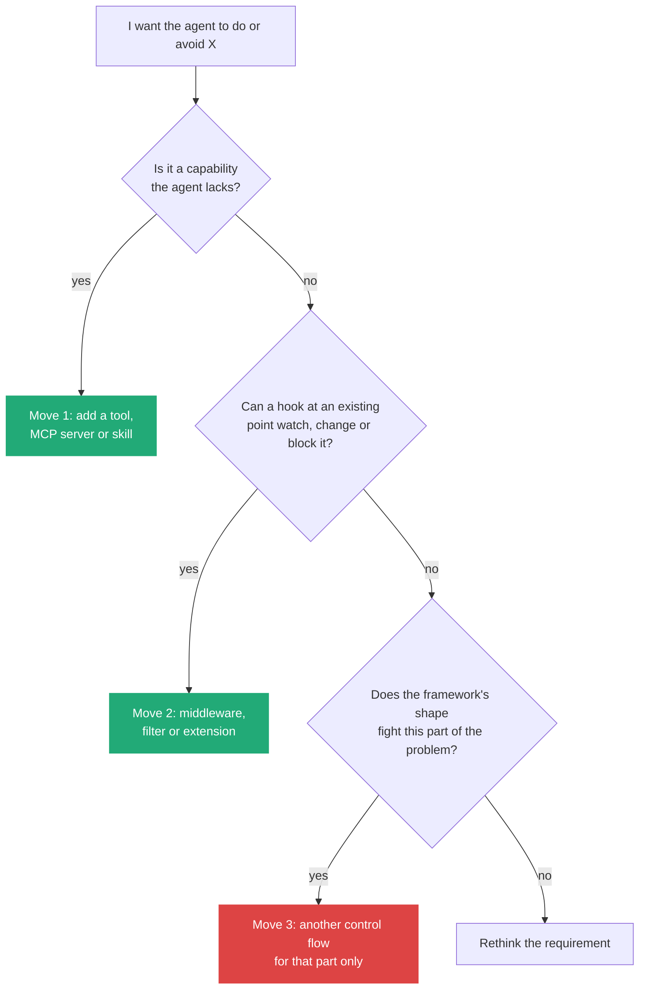

# 9. Knowing the primitives turns a framework into a choice: add tools, adjust the harness, or step out of it

> When I understand the loop and the parts around it, an improvement to an agent is one of three moves (add a tool, adjust the harness at an extension point, or leave the framework's paradigm for the part it fights), and I pick the smallest move that works for that one part.

Related: [01 Agent loop, stop, limits, recovery](draft_01_Agent_Loop_Stop_Limits_Recovery.md) · [03 Instructions](03_Instructions_Five_Parts_And_Enforcement.md) · [04 Context window, cache, compaction](draft_04_Context_Window_Cache_Compaction.md) · [06 Tools: awareness, discovery, code mode](draft_06_Tools_Awareness_Discovery_Code_Mode.md) · [07 Tool approval and durable waits](draft_07_Tool_Approval_Durable_Waits.md) · [08 Evals and traces](draft_08_Evals_And_Traces_For_Agent_Changes.md) · [Lecture 4: 01 Harness lock-in](../Lecture_4_Harness/01_Harness_Lock-in_Keep_Doors_Open.md) · [Lecture 4: 02 Agent runner portability](../Lecture_4_Harness/02_Agent_Runner_Portability.md) · [Lecture 2: 3 Lifecycle hooks](../Lecture_2_Context_Agents_md_Skills_Tools/3_lifecycle_hooks.md)

Source: S02E01 article, intro and figure 4 ("knowledge of agentic logic" and its four uses). LangChain, LangGraph, Pi and Anthropic documents checked on 2026-11-15, see [Fact-check](#fact-check). The three-move ladder and the decision flow are my own reasoning.

## 1. The problem

The lecture says the point of learning the primitives is that I can "either create a harness from scratch or customize a harness at any level", and build agentic tools for myself or for a product. I already run a framework. **When I want to improve an agent, or upgrade or replace that framework, which move fits, and what do I need to understand to choose well?**

## 2. Words

| Term | What it means here | Not to be confused with |
|---|---|---|
| Framework | A library that gives me agent abstractions (graphs, nodes, middleware). LangGraph, Semantic Kernel | A harness |
| Harness | Everything around the loop: wake, context, limits, hooks, history, memory, observability (see [01](draft_01_Agent_Loop_Stop_Limits_Recovery.md)) | The loop alone |
| Agentic tool | An agent used for myself or shipped as a product feature | A tool the model calls |
| Extension point | A place the framework or harness lets me add behaviour without forking it (a hook, middleware, a plugin) | A fork or a patch |
| Paradigm | The way the framework wants control flow expressed, such as a graph of nodes | The model or the prompt |

## 3. What the figure says

![The lecture's figure. One box, agentic logic: patterns and options, sends four arrows. Two go into a frame named Harnesses: build from scratch (your own harness) and customize at any level (an existing harness). Two go into a frame named Agentic tools: for your own use (agents for yourself) and as product features (for clients). Caption: an agent is more than a loop; when you know the patterns of agentic logic, you can build or customize a harness, and build agentic tools for yourself or for a product.](img/agent-logic-to-harness-or-tools.png)

Source: S02E01 article, figure 4.

Important:
- One source of knowledge feeds four uses, so the same understanding serves a platform team and a product team.
- "Customize at any level" sits next to "build from scratch": the lecture treats adjusting a harness as a normal outcome, not a failure to build.

Not important: the line routing, the frame borders, the corner pattern.

## 4. Three moves, smallest first

The lecture's two harness boxes become, in my reading, three moves for an agent I already run.

| Move | What changes | In LangChain / LangGraph | Elsewhere | Cost |
|---|---|---|---|---|
| Add a tool | The agent gets a new capability. The loop is untouched | A tool, an MCP server, a skill | Same in Claude Code, Pi, Semantic Kernel plugins | Lowest |
| Adjust the harness | Behaviour at a fixed point changes: watch, change or block | Middleware hooks `before_agent`, `before_model`, `wrap_model_call`, `after_model`, `wrap_tool_call`, `after_agent` | Pi extensions subscribe to lifecycle events and register tools. Semantic Kernel filters. Claude Code hooks | Low to medium |
| Step out of the paradigm | The control flow is written another way | LangGraph Functional API (`entrypoint`, `task`) on the same runtime, or my own loop on a provider SDK, or another harness | Pi, Deep Agents | Highest |

Stepping out of the paradigm does not mean leaving the runtime. LangGraph's two APIs run on the same runtime and can be combined in one application, and both support durable execution through a checkpointer. The Functional API is the documented fit for existing procedural code, and it has no graph visualization because the graph is built at runtime ([choosing APIs](https://docs.langchain.com/oss/python/langgraph/choosing-apis.md), search summary). So I can write one part as ordinary code and keep persistence and resume.

## 5. What industry sources say

Anthropic's "Building effective agents" advises starting with LLM APIs directly. Frameworks simplify calling the model, defining tools and chaining calls, but add layers that can obscure the prompts and responses and make debugging harder, so a team that uses one should understand the code underneath ([source](https://anthropic.com/engineering/building-effective-agents), search summary). That agrees with the lecture's reason for learning the primitives. Anthropic also sells the API, so the advice is not neutral on the SDK question. The lecture's own line, to prefer official SDKs over multi-provider abstractions, is an opinion (see [Lecture 4: 02](../Lecture_4_Harness/02_Agent_Runner_Portability.md) for the portability trade-off).

Worked example, abstract. The requirement: block a tool call when the caller lacks a role.

| Option | Verdict |
|---|---|
| Add a tool that checks roles | The model could skip it. Not a guarantee |
| Hook at the tool-call point (a `wrap_tool_call` middleware, a Pi `tool` event, a Claude Code `PreToolUse` hook) | Fits. It blocks whatever the model decides, see [03](03_Instructions_Five_Parts_And_Enforcement.md) |
| Rewrite the loop | Not needed, so the cost is not justified |

## 6. What I must understand before choosing

Each move needs a different part of the harness to be clear in my head. The earlier notes cover them.

| Before I … | I need to know | Note |
|---|---|---|
| Add a tool | How the agent finds and loads it | [06](draft_06_Tools_Awareness_Discovery_Code_Mode.md) |
| Add a hook | Which points exist and what a hook may do | [01](draft_01_Agent_Loop_Stop_Limits_Recovery.md) section 4 |
| Change context or prompts | What is cached and what compaction drops | [04](draft_04_Context_Window_Cache_Compaction.md) |
| Add an approval step | How the run waits and resumes | [07](draft_07_Tool_Approval_Durable_Waits.md) |
| Leave the paradigm | What state the framework stored for me, and how I would see a regression | [02](draft_02_Threads_Persistence_Isolation.md), [08](draft_08_Evals_And_Traces_For_Agent_Changes.md) |

## Summary

An agent improvement is a tool, a hook or a different control flow, in that order of cost. Knowing the loop and its harness is what lets me tell which one the problem needs. Leaving the framework's paradigm can be local to one part, and LangGraph's Functional API keeps the same runtime.

## Glossary

| Term | What it means here | Same thing elsewhere |
|---|---|---|
| Middleware | Code wrapped around the model call, the tool call or the whole agent run | LangChain `create_agent` middleware, Semantic Kernel filters, Claude Code hooks |
| Extension | A module loaded into a harness to add tools and subscribe to events | Pi extensions |
| Functional API | LangGraph's way to write control flow as ordinary code with `entrypoint` and `task` | Graph API is the node-and-edge form |
| Durable execution | A run that can stop and resume from saved progress | LangGraph checkpointer, see [07](draft_07_Tool_Approval_Durable_Waits.md) |
| Paradigm | How a framework wants control flow expressed | Graph of nodes in LangGraph |

## Fact-check

| # | Claim | Verdict | Source | Checked |
|---|---|---|---|---|
| 1 | Knowing agentic logic lets me build or customize a harness and build agentic tools for myself or a product | **Lecture-specific** | Figure 4 of the article | 2026-11-15 |
| 2 | Start with direct API calls, frameworks add abstraction that obscures prompts and makes debugging harder, understand the code under a framework | **Agrees** | [Building effective agents](https://anthropic.com/engineering/building-effective-agents), search summary. Vendor sells the API | 2026-11-15 |
| 3 | LangChain agents expose middleware hooks `before_agent`, `before_model`, `wrap_model_call`, `after_model`, `wrap_tool_call`, `after_agent` | **Agrees**, search summary | [LangChain middleware reference](https://reference.langchain.com/python/langchain/middleware/), [blog](https://blog.langchain.com/how-middleware-lets-you-customize-your-agent-harness). Names may change: `create_agent` is replacing `create_react_agent`. Verify before presenting | 2026-11-15 |
| 4 | LangGraph's Graph and Functional APIs share one runtime, can be combined, and both support durable execution | **Agrees**, search summary | [Functional API](https://docs.langchain.com/oss/python/langgraph/functional-api), [durable execution](https://docs.langchain.com/oss/python/durable-execution). Whether `interrupt` works the same in both APIs: verify before presenting | 2026-11-15 |
| 5 | Pi extensions subscribe to lifecycle events and register tools the model can call | **Agrees**, search summary | [Pi extensions](https://pi.dev/docs/latest/extensions). Event names change between versions (0.80.x to 0.81.x seen) | 2026-11-15 |
| 6 | Prefer official provider SDKs over multi-provider abstractions | **Lecture-specific** (opinion) | Article, "Connection" paragraph. Anthropic's advice on frameworks points the same way but is not about multi-provider SDKs | 2026-11-15 |

## Sources

- S02E01 article, figure 4.
- [Anthropic: Building effective agents](https://anthropic.com/engineering/building-effective-agents)
- [LangChain: How middleware lets you customize your agent harness](https://blog.langchain.com/how-middleware-lets-you-customize-your-agent-harness) and the [middleware reference](https://reference.langchain.com/python/langchain/middleware/)
- [LangGraph Functional API](https://docs.langchain.com/oss/python/langgraph/functional-api) and [durable execution](https://docs.langchain.com/oss/python/durable-execution)
- [Pi extensions](https://pi.dev/docs/latest/extensions)
- My own reasoning: the three-move ladder, the decision flow, the worked example and the "what I must understand" table.
