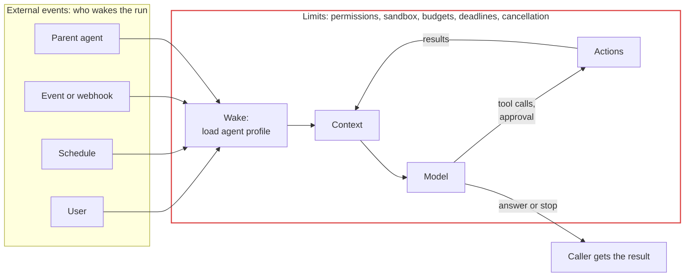

# 10. The loop is small, the harness is what is drawn around it: callers, hooks, limits

> A run is woken by an external event, intercepted by hooks at six points, bounded by limits (permissions, sandbox, budgets, deadlines, cancellation) and recorded by history, memory and observability: that surrounding set is the harness.

Related: [01 Agent loop, exits, limits, recovery](01_Agent_Loop_Stop_Limits_Recovery.md) · [11 Pi, LangGraph and the DeepSeek paper](draft_11_Pi_LangGraph_DeepSeek_Harnesses.md) · [12 Loop hooks declared](draft_12_Loop_Hooks_Declared.md) · [02 Persistence, access, isolation](draft_02_Persistence_Access_Isolation.md) · [05 Agentic memory](draft_05_Agentic_Memory_Extraction_Retrieval.md) · [07 Tool approval, durable waits](draft_07_Tool_Approval_Durable_Waits.md) · [08 Evals and traces](draft_08_Evals_And_Traces_For_Agent_Changes.md) · [Lecture 2: 3 Lifecycle hooks](../Lecture_2_Context_Agents_md_Skills_Tools/3_lifecycle_hooks.md) · [Lecture 4: 07 Multi-agent coordination](../Lecture_4_Harness/07_Multi_Agent_Coordination.md)

Source: S02E01 article, figure 1. Hook mapping is my own reasoning. Checked 2026-11-15, see [Fact-check](#fact-check).

## Glossary

| Term | What it means here | Same thing elsewhere | Not to be confused with |
|---|---|---|---|
| Harness | Wake, context, limits, hooks, history, memory, observability around the loop | - | The loop alone |
| External event | Starts a run: user, schedule, event, parent agent | - | A lifecycle event |
| Lifecycle event | A point inside a run where a hook fires | - | A log line |
| Hook | Code at a dot of the loop or on an error that can watch, change, block or queue work | - | A tool the model calls |
| Caller | What starts a run | LangGraph: whoever calls `invoke` or `stream` | - |
| Wake | Loads the agent profile before the first model call | Agent definition and config loaded per run | - |
| Limits frame | Permissions, sandbox, budgets, deadlines, cancellation | `recursion_limit`, budget caps, abort signals | - |
| Write-ahead history | Intent recorded before its effect | Durable-execution checkpointing, see [07](draft_07_Tool_Approval_Durable_Waits.md) | - |

## 1. The problem

A loop alone does not say who starts a run, where code may intercept it, what bounds it or what is stored. **What does a harness draw around the loop, and which events does it expose?**

## 2. The figure

![The lecture's harness figure. A caller (user, schedule, event or parent agent) wakes the run. Four boxes: Wake loads the agent profile, Context holds instructions, history, memory, live facts and compaction, Model answers or calls tools, Actions holds native tools, integrations, code and subagents with the same loop and their own budget. Tool calls and approval go from Model to Actions, results go back to Context. Dots on six arrows are hooks. A red frame names the limits: permissions, sandbox, budgets, deadlines, cancellation. Bands below: History, Memory, Observability.](img/agent-harness-loop-hooks-limits.png)

Source: S02E01 article, figure 1. Caption: "The loop is small. The harness is everything drawn around it." Hook: "runs at each dot and on every error. A hook can watch, change, block or queue more work."

## 3. Six hook points

| # | Dot | Kind | Nearest Claude Code event (my mapping) |
|---|---|---|---|
| 1 | Caller to Wake | External event arrives | `UserPromptSubmit` |
| 2 | Wake to Context | Profile loaded | `SessionStart` |
| 3 | Context to Model | About to call the model | None found |
| 4 | Model to Actions | Tool call, approval | `PreToolUse` |
| 5 | Actions to Context | Result returned | `PostToolUse` |
| 6 | Model to Caller | Answer or stop | `Stop` |

Check the mapping against the [hooks reference](https://code.claude.com/docs/en/hooks) before presenting.

## 4. The three bands

| Band | The figure says | Note |
|---|---|---|
| History | Records each intent before its effect and each result after it | [02](draft_02_Persistence_Access_Isolation.md), [07](draft_07_Tool_Approval_Durable_Waits.md) |
| Memory | Read when context is built, written through tools | [05](draft_05_Agentic_Memory_Extraction_Retrieval.md) |
| Observability | One trace across every step: logs, tokens, cost, time | [08](draft_08_Evals_And_Traces_For_Agent_Changes.md) |

Important:
- Four caller forms: the same loop runs interactively, on a schedule, on an event or as a subagent.
- The red frame holds more than a step cap (see [01](01_Agent_Loop_Stop_Limits_Recovery.md) section 4).
- Subagents run the same loop with their own budget.
- History is written before an effect as well as after it, which is what lets a run resume.

Not important: box colors, dot positions, the corner pattern.

## Summary

External events start a run, six hook points let code watch, change, block or queue work, and limits bound it. History, memory and observability sit under it. The harness is that surrounding set, not the loop.

## Fact-check

| # | Claim | Verdict | Source | Checked |
|---|---|---|---|---|
| 1 | A run can be woken by a user, schedule, event or parent agent | **Lecture-specific** | Figure 1. Triggers differ per harness: verify for the one I use | 2026-11-15 |
| 2 | A hook can watch, change, block or queue work at each dot | **Unverified** | Figure 1 only. `PreToolUse` can block ([memory docs](https://code.claude.com/docs/en/memory.md)). Other dots not checked | 2026-11-15 |
| 3 | History records intent before its effect and the result after | **Unverified** | Figure 1 only. Compare LangGraph checkpointing, [07](draft_07_Tool_Approval_Durable_Waits.md) | 2026-11-15 |
| 4 | Subagents run the same loop with their own budget | **Differs** in part | Agent SDK budget includes subagents; no per-subagent wall-clock ([hosting](https://code.claude.com/docs/en/agent-sdk/hosting)) | 2026-11-15 |

## Sources

- S02E01 article, figure 1.
- [Claude Code hooks](https://code.claude.com/docs/en/hooks) · [Claude Code memory](https://code.claude.com/docs/en/memory.md) · [Agent SDK hosting](https://code.claude.com/docs/en/agent-sdk/hosting)
- My own reasoning: the hook-to-event mapping.
