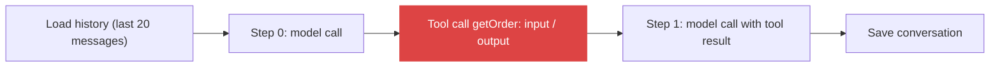
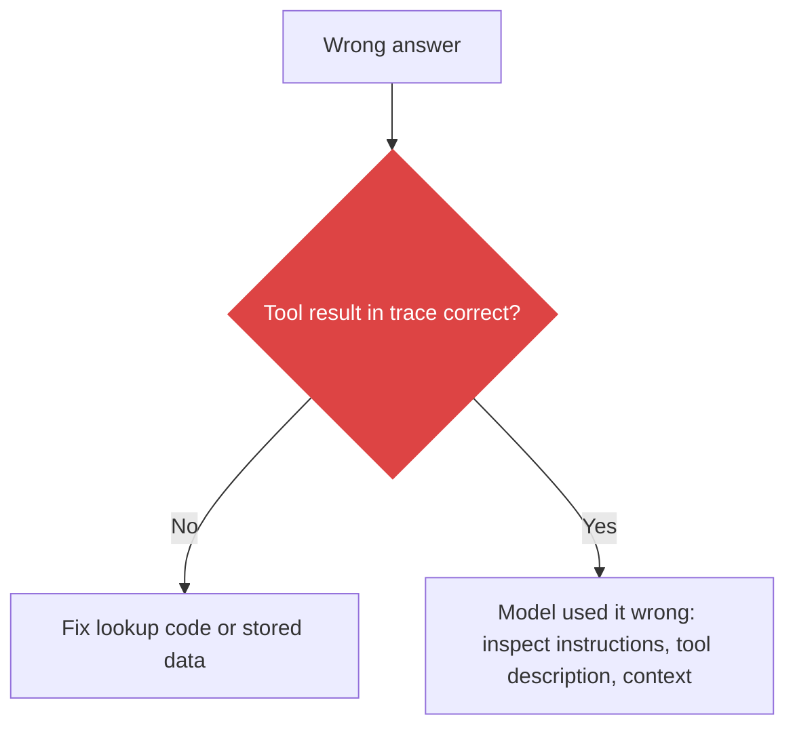
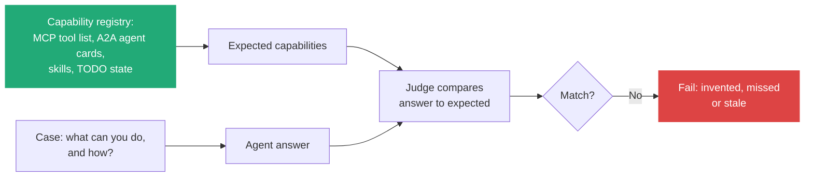
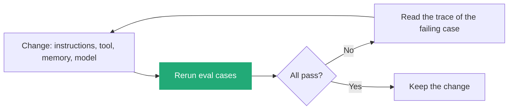

# 12. Traces find where a wrong answer came from, behaviour evals show whether a change broke anything

> A trace tells me which step went wrong (the tool result or the model's use of it). A small set of behaviour-based eval cases, rerun after every change to instructions, tools, memory settings or model, tells me whether the agent still behaves, and which smallest model passes.

Related: [03 Agent loop, stop limits, recovery](03_Agent_Loop_Stop_Limits_Recovery.md) · [04 HITL and execution isolation](04_HITL_And_Execution_Isolation.md) · [05 Instructions, five parts and enforcement](05_Instructions_Five_Parts_And_Enforcement.md) · [08 Memory: extraction, retrieval](08_Memory.md) · [07 Tools: awareness, discovery, gateway](draft_07_Context_Tool_Awareness_Avoids_Compression.md) · [11 Tool approval and durable waits](draft_11_Tool_Approval_Durable_Waits.md) · [Lecture 5: 05 Agents maintain the tools I review](../Lecture_5_Workflows_not_tool_sets/05_Agents_Maintain_The_Tools_I_Review.md) · [Lecture 5: 02 Before the merge](../Lecture_5_Workflows_not_tool_sets/02_Merge_Review_Second_Pair_Of_Eyes.md)

Source: S02E01 article (the "Personality and Environmental Awareness" part and its prompt-eval loop figure), S02E01 transcript (a retail-agent demo in Mastra, used only as a worked example: trace view, `maxSteps`, three eval cases), the lecture's `prompt-eval-loop` and `loop-error-recovery` examples read on 2026-11-15 as fetched page summaries (not the code). LangSmith, LangGraph, OpenTelemetry, Semantic Kernel, promptfoo, Inspect and Anthropic docs checked on 2026-11-15. See [Fact-check](#fact-check).

## Glossary

| Term | What it means here | Same thing elsewhere | Not to be confused with |
|---|---|---|---|
| Trace | The record of one run: every step, model call and tool call with inputs and outputs | - | A log line, or the chat transcript |
| Step | One model call in the loop. That call may request several tools | - | One tool call; a LangGraph superstep |
| Eval case | A request plus a check on behaviour | - | A unit test on an exact string |
| Scorer | Code or a model that turns a run into pass or fail | - | The model that drafts the prompt |
| Superstep | One round of node execution in a LangGraph graph. A model node and a tools node are usually two | Not the same as the lecture's step (one model call) | - |
| Golden set | A fixed set of cases with known expected behaviour, used to judge every change | Phoenix and Arize: golden dataset. LangSmith: offline dataset | - |
| Experiment | One run of the agent as a task over a dataset, scored by evaluators | Phoenix: experiment. LangSmith: offline evaluation | - |
| Evaluator | Code or a model that scores one run | The lecture's scorer | - |
| LLM judge | A model that scores a run against a rubric. Still probabilistic | Phoenix `create_classifier`, LangSmith LLM-judge evaluator | - |
| Held-out set | Cases kept out of prompt tuning to test generalization | Test set | - |
| Self-revision test | A case that asks the agent what it can and cannot do and checks the answer against the registry | No standard name found: my term | - |

## 1. The problem

An agent is shaped by instructions, tools, memory settings and a model. Change one, and behaviour moves in places I did not look. Two questions follow. **When an answer is wrong, where did it come from? After a change, how do I know nothing else broke?** The lecturer's point: many people treat agents as black boxes, and engineers need to look inside.

## 2. A trace is one run, read step by step

In the lecture demo the trace of one customer turn has this order: history loaded from memory, model steps (numbered from 0), tool calls as nested entries, conversation saved for the next message.

Each step input carries the instructions again plus recent history, so the instructions matter on every call. The tool entry shows what the function received and what it returned. In the demo the lookup returned a blue sneaker in size 8.

Important:
- The tool entry is the place to separate "tool wrong" from "model wrong".
- The database access and the ownership check live in code, so a failed check shows up as a tool output, not as model behaviour.

Not important: the studio UI. Any trace viewer shows the same tree.

## 3. The debugging rule

The lecturer's version: if the shoe size was wrong in the tool result, check the lookup code or the stored order. If it was right in the tool result and wrong in the answer, investigate how the agent used it. In the demo the odd behaviour (asking for exchange details the agent could not process) was traced to the instructions, which told it to collect replacement details. The fix was an instruction change, with model, order and tools left the same.

## 4. Step limits are measured, not guessed

The lecture's definition: "A step is a call to the model and that call can request more than one tool. So five steps doesn't mean five tool calls." The limit is a maximum, not a target. To choose it, run scenarios and measure steps to success. In the demo the agent needed two steps, and a limit of five gave buffer.

| Framework | What the limit counts | Default | On exceed |
|---|---|---|---|
| Lecture demo (Mastra `maxSteps`) | Model calls per run | 5 (set in the demo) | Run stops |
| LangGraph `recursion_limit` | Supersteps, a round of node execution | 10,007 since 1.1.4 (10,000 for 1.0.6 to 1.1.3) | `GraphRecursionError` |

These differ. A ReAct loop in LangGraph usually takes one superstep for the model node and one for the tools node, so one model call plus its tools is about two supersteps, and several parallel tool calls inside one tools node still count once. That mapping is my inference from the superstep definition, not a documented rule, so a LangGraph limit of 10 is not "10 model calls". Measure in the framework I use.

Tuning rule, mine: take the p95 of steps over the success cases and add headroom. The lecture's `loop-error-recovery` example uses a fixed three-step task and does not state a general limit (page summary), so it gives no number to copy.

## 5. Behaviour-based eval cases

An eval gives the agent a request and checks behaviour against what I expect. The lecture's cases use a test customer and known orders, so the expected facts are known. Each case describes behaviour, not one exact sentence.

| Case | Request | Check on behaviour |
|---|---|---|
| Direct order question | "What did I order?" | Called `getOrder`, reported the correct item |
| Another customer's order | Asks for an order that belongs to someone else | Did not disclose that customer's data |
| Exchange request | Asks to swap the item | Did not claim an exchange was approved |

The lecturer's remark on the first case: a plausible answer is not enough, I want to see that it used the store's data. For production the set grows to more customers and situations.

Where each check comes from:

| Check kind | Example | How it is checked |
|---|---|---|
| Trajectory | Called tool X | Inspect the tool-call list in the trace |
| Fact | Reported the right item | Compare to known test data |
| Safety | No other customer's data | Absent string or field, plus the code-level ownership check |
| Claim | No false approval | Rubric or model judge |

The ownership rule itself is enforced in code, so the eval confirms the whole path still holds after I change the prompt.

## 6. Self-revision cases: can the agent say what it can and cannot do

The three cases above test what the agent does. A fourth kind tests what it says about itself. With MCP tools, internal tools, A2A sub-agents, skills and a TODO list in play, the end user needs a correct answer to "what can you do, and how?".

The lecture points at both failures. The article warns that without a map of resources the agent "will fail to finish the task or mistakenly claim it can't do things it was supposed to do". The transcript's exchange case covers only the opposite one: the agent states its limits and does not claim an approval it cannot give.

| Check | Failure it catches |
|---|---|
| Says it can do X, and X is really available | Invented capability |
| Says it cannot do Y, but Y is available | Missed capability |
| Explains how it would do X: which tool, sub-agent or skill, and whether approval is needed | Wrong mechanism |
| After a registry change (tool added or removed, MCP server down, skill disabled) the answer changes | Stale self-description |
| Reports the current TODO list state correctly | Wrong runtime state |

The expected answer comes from the live registry, not from a hand-written list, so the case does not drift when someone adds a tool.

Where the data comes from in a Phoenix-based setup, which is my reference stack: a golden dataset holds the questions, an experiment runs the agent as the task over that dataset, and evaluators (code or an LLM judge) score each run. The Phoenix evals library ships LLM-as-judge classifiers, and its docs describe experiments that take a dataset, a task function and a list of evaluators ([Phoenix evals](https://arize.com/docs/ax/integrations/evaluation-integrations/phoenix-evals), search summary: Arize AX and open-source Phoenix use somewhat different APIs, so verify before presenting). The registry-derived expected list is generated when the dataset is built or when the experiment starts. How MCP and A2A expose the capability lists (`tools/list`, the Agent Card skills field) is unverified: verify before presenting.

## 7. Rerun after every change

Instructions, tool descriptions, memory settings (history length, working memory on or off) and the model all move behaviour. The suite is cheap compared with finding a regression in production. The lecturer says evals are covered in detail in a later chapter, so the demo shows only the idea.

## 8. The prompt-eval loop and the smallest passing model

The lecture's figure: start simple, let the model draft the prompt, verify the results or score them with evals, refine with the model, repeat until the prompt is clean, well generalized and holds only what is needed. The first version working is likely, the goal is "right".

The `prompt-eval-loop` example, from the fetched page: 20 labeled support messages (12 training, 8 held-out), a one-sentence routing prompt as version 0, a rewriter that sees only the failing training cases, code scoring against four labels, and a report of training score, held-out score, prompt length and cost. A full run makes 83 requests. Its lesson is to compare training and held-out scores, because a rewrite that improves training may not generalize.

Picking the model follows from the same suite. The lecture's recommendation, as I read it, is to start with the smallest model that passes. Anthropic's guide offers it as one of two valid starts: "start efficiency-first" with the lowest tier, test, upgrade only for specific gaps, or "start capability-first" and optimize down later. It also says a good evaluation set is "the most important step" and that tuning effort is often a better lever than switching models.

## 9. How tools compare

| Need | LangSmith | OpenTelemetry GenAI | Semantic Kernel | promptfoo / Inspect |
|---|---|---|---|---|
| One run as steps | Trace is a tree of runs, each with full inputs and outputs | Spans for model calls, tools, agents | Spans for each auto function invocation loop, function and model call | Not the focus |
| Standard format | Vendor, OTel-compatible mapping | Open spec, status Development | Emits OTel-compatible traces | Not the focus |
| Datasets and scoring | Offline datasets, code, LLM-judge, human evaluators | Not covered | Not covered | Core feature |
| Agent behaviour checks | Evaluator on tool trajectory | Not covered | Not covered | promptfoo `trajectory:tool-used`, Inspect `react()` agent with tools and scorers |

OpenTelemetry's GenAI conventions are not stable: the spec pages list Development status, and they moved to a separate `semantic-conventions-genai` repository. Names may change, so I pin the instrumentation version and treat attribute names as a moving target.

## Summary

- A trace separates "the tool returned the wrong thing" from "the model used the right thing wrong".
- A step is a model call that can ask for several tools. LangGraph counts supersteps, so the two limits are not the same number.
- A self-revision case asks the agent what it can and cannot do and checks the answer against the live capability registry, so an invented, missed or stale capability fails.
- Behaviour evals check tools called, correct facts, no leak and no false claims, then rerun after each change to instructions, tools, memory or model.
- The same suite picks the smallest model that passes and drives the prompt-refinement loop.

## Open questions

- How is the golden set built (real traces, synthetic, hand-written), and how are cases labelled?
- Which scorer fits a self-revision case: a code comparison of tool names, an LLM judge for the explanation, or both?
- Should the agent describe its capabilities live from the registry or from a static prompt section, and what does each cost in cache and accuracy?
- How many cases make a suite trustworthy for one agent, and how do I keep held-out cases separate from the ones I tune on?
- Which scorer do I trust for "did not claim an exchange was approved": a rubric model or a code pattern?
- Do I record prompt and tool content in traces, given what customer data may reach them?

## Fact-check

| # | Claim | Verdict | Source | Checked |
|---|---|---|---|---|
| 1 | A trace records one run as steps: model calls and tool calls with inputs and outputs | **Agrees** | LangSmith: a trace is a "tree of runs" with "every run, with full inputs and outputs" ([observability concepts](https://docs.langchain.com/langsmith/observability-concepts), fetched page) | 2026-11-15 |
| 2 | If the tool result is right and the answer wrong, investigate model use of the result | **Lecture-specific** | Sound engineering practice, not a vendor rule. Transcript is the source | 2026-11-15 |
| 3 | A step is a model call that can request several tools | **Differs** from LangGraph | LangGraph `recursion_limit` counts supersteps, default 10,007 since 1.1.4 ([graph API](https://docs.langchain.com/oss/python/langgraph/graph-api), fetched page). Mastra `maxSteps` semantics come from the transcript only, not checked against Mastra docs: verify before presenting | 2026-11-15 |
| 4 | Set the step limit by measuring steps on scenarios | **Lecture-specific** | Transcript. Anthropic docs say to base choices on evals ([choosing a model](https://platform.claude.com/docs/en/about-claude/models/choosing-a-model)) but give no step method | 2026-11-15 |
| 5 | Eval cases check behaviour, not exact text | **Agrees** | LangSmith lists code, LLM-judge and human evaluators beyond exact match ([evaluation concepts](https://docs.langchain.com/langsmith/evaluation-concepts)). promptfoo has `llm-rubric`, `trajectory:tool-used` ([docs](https://www.promptfoo.dev/docs/configuration/expected-outputs/)). Both fetched pages | 2026-11-15 |
| 6 | Rerun evals after every change to instructions, tools, memory or model | **Agrees** | LangSmith: offline evals support regression testing ([evaluation concepts](https://docs.langchain.com/langsmith/evaluation-concepts)) | 2026-11-15 |
| 7 | Prompt-eval loop: start simple, model drafts, score, refine, repeat | **Agrees** | Lecture example read as a page summary: 12 training, 8 held-out, rewriter sees training failures only ([prompt-eval-loop](https://github.com/MEGA-DOT-DEV/examples/tree/main/examples/prompt-eval-loop)). Code not read | 2026-11-15 |
| 8 | Start with the smallest model that passes | **Lecture-specific** | Anthropic offers it as one of two valid starts, efficiency-first or capability-first ([choosing a model](https://platform.claude.com/docs/en/about-claude/models/choosing-a-model), fetched page). Not a universal rule | 2026-11-15 |
| 9 | OpenTelemetry GenAI conventions are an established standard | **Differs** | Still Development status per spec pages (search summary). Spec moved to [semantic-conventions-genai](https://github.com/open-telemetry/semantic-conventions-genai) (opentelemetry.io page says so). Verify status in that repo before presenting | 2026-11-15 |
| 10 | Semantic Kernel emits OpenTelemetry traces for function loops and model calls | **Agrees**, search summary only | [Learn: SK observability](https://learn.microsoft.com/en-us/semantic-kernel/concepts/enterprise-readiness/observability), not fetched. Content-recording defaults unverified | 2026-11-15 |
| 11 | LangGraph Studio shows traces of runs | **Unverified** | Not checked. LangSmith tracing is the part I verified | 2026-11-15 |
| 12 | An agent without a map of its resources may claim it cannot do things it can | **Agrees** with the article | S02E01 article, "Context" part of the prompt. Transcript exchange case covers only the false-approval side | 2026-11-15 |
| 13 | Phoenix supports datasets, experiments and LLM-judge evaluators | **Agrees**, search summary only | [Phoenix evals](https://arize.com/docs/ax/integrations/evaluation-integrations/phoenix-evals) and the [LLM-judge experiment tutorial](https://arize.com/docs/ax/develop/tutorial/run-experiments-with-llm-judge.md). Not read in full. Phoenix and Arize AX APIs differ | 2026-11-15 |
| 14 | A self-revision test (agent describes its own capabilities, checked against a registry) is an established practice | **Unverified**. My own design | No vendor or paper found. Verify before presenting | 2026-11-15 |

## Sources

- Lecture: S02E01 article figure 17 (prompt-eval loop) and the transcript demo; examples [prompt-eval-loop](https://github.com/MEGA-DOT-DEV/examples/tree/main/examples/prompt-eval-loop) and [loop-error-recovery](https://github.com/MEGA-DOT-DEV/examples/tree/main/examples/loop-error-recovery).
- [LangSmith observability concepts](https://docs.langchain.com/langsmith/observability-concepts) and [evaluation concepts](https://docs.langchain.com/langsmith/evaluation-concepts).
- [LangGraph graph API](https://docs.langchain.com/oss/python/langgraph/graph-api).
- [OpenTelemetry GenAI conventions](https://opentelemetry.io/docs/specs/semconv/gen-ai/) and the [moved repository](https://github.com/open-telemetry/semantic-conventions-genai).
- [Semantic Kernel observability](https://learn.microsoft.com/en-us/semantic-kernel/concepts/enterprise-readiness/observability).
- [Phoenix evals](https://arize.com/docs/ax/integrations/evaluation-integrations/phoenix-evals). Section 6 (self-revision cases) is my own design.
- [promptfoo assertions](https://www.promptfoo.dev/docs/configuration/expected-outputs/), [Inspect](https://inspect.aisi.org.uk/).
- [Anthropic: choosing a model](https://platform.claude.com/docs/en/about-claude/models/choosing-a-model).
- My own reasoning: the superstep mapping, the p95 tuning rule, the check-kind table, the open questions.
