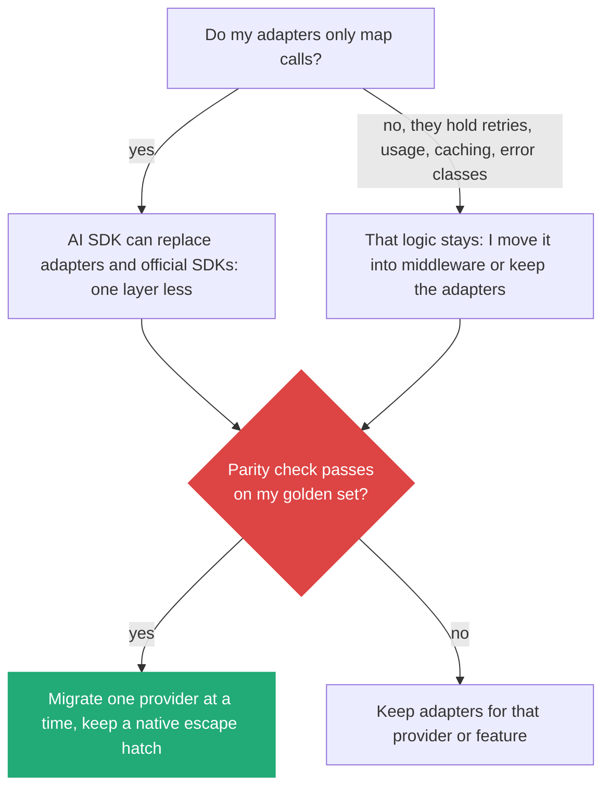

# 13. The AI SDK can replace my adapters only if it keeps the provider features I rely on

> The Vercel AI SDK is one TypeScript layer over many providers with a built-in multi-step loop, so it could replace two adapters plus two official SDKs, but only if it passes a parity check on caching, reasoning options, usage accounting, retries and error classes, and I accept version churn and silent option rewrites.

Related: [01 Agent loop](01_Agent_Loop_Stop_Limits_Recovery.md) · [04 Context window and compaction](draft_04_Context_Window_And_Compaction.md) · [07 Tool approval, durable waits](draft_07_Tool_Approval_Durable_Waits.md) · [08 Evals and traces](draft_08_Evals_And_Traces_For_Agent_Changes.md) · [09 Extend, adjust or leave the framework](draft_09_Extend_Adjust_Or_Leave_The_Framework.md) · [Lecture 4: 02 Agent runner portability](../Lecture_4_Harness/02_Agent_Runner_Portability.md) · [Lecture 4: 01 Harness lock-in](../Lecture_4_Harness/01_Harness_Lock-in_Keep_Doors_Open.md)

Source: S02E01 article, "Connection" paragraph (use official SDKs to avoid unnecessary abstractions, AI SDK named as an example). [vercel.com/ai-sdk](https://vercel.com/ai-sdk), the AI SDK docs and provider pages, and the `vercel/ai` issue tracker read through fetch agents on 2026-11-15. My current setup (two adapters over the Anthropic and OpenAI SDKs) is the case I test against. See [Fact-check](#fact-check).

## Glossary

| Term | What it means here | Same thing elsewhere | Not to be confused with |
|---|---|---|---|
| Adapter | My code that maps my loop's calls to one provider's API | Semantic Kernel connector, LangChain chat model | An official SDK, which only wraps the HTTP API |
| Official SDK | The provider's own client library | `anthropic`, `openai` packages | A multi-provider SDK |
| AI SDK | Vercel's TypeScript toolkit: Core (calls, tools, loop), UI, Harnesses | LangChain chat models, Semantic Kernel | A harness |
| `providerOptions` | The AI SDK's pass-through for provider-only settings | Native request fields | A portable setting |
| `stopWhen` | AI SDK loop control. Default `isStepCount(1)`, so one step | `recursion_limit`, `max_turns` | A tool-call check |
| Parity check | Run the same cases through both paths and compare behaviour and cost | Golden-set experiment, [08](draft_08_Evals_And_Traces_For_Agent_Changes.md) | A feature list comparison |

## 1. The problem

The lecture advises official SDKs to avoid unnecessary abstraction. I run two adapters on top of two official SDKs and suspect one layer can go. **Can the AI SDK remove a layer, and what would I give up?**

## 2. What the AI SDK gives

| Area | What the docs say | Source |
|---|---|---|
| Scope | "The TypeScript toolkit" for apps and agents. Only TypeScript or JavaScript is mentioned | [intro](https://ai-sdk.dev/docs/introduction) |
| Providers | First-party packages for OpenAI, Anthropic, Google, Azure, Bedrock, Mistral, xAI, DeepSeek and more, plus OpenAI-compatible and community providers | [providers](https://ai-sdk.dev/docs/foundations/providers-and-models) |
| Loop | `generateText` and `streamText` run one step by default. With `stopWhen` they loop. `ToolLoopAgent` stops after 20 steps by default | [loop control](https://ai-sdk.dev/docs/agents/loop-control) |
| Per-step control | `prepareStep` can change model, tools, messages, `providerOptions` before each step | same |
| Retries | `maxRetries` default 2. Which errors are retried is not documented | [generateText reference](https://ai-sdk.dev/docs/reference/ai-sdk-core/generate-text) |
| Tool errors | A throwing tool becomes a `tool-error` the model sees next step | same |
| Approval | `toolApproval` returns approval-request parts and does not pause in process. A second call continues. Provider-executed tools skip it | same |
| Middleware | `wrapLanguageModel` with `transformParams`, `wrapGenerate`, `wrapStream` at the model call only | [middleware](https://ai-sdk.dev/docs/ai-sdk-core/middleware) |
| Telemetry | OpenTelemetry spans in GenAI naming (`invoke_agent`, `step`, `chat`, `execute_tool`), needs `@ai-sdk/otel`, on by default | [telemetry](https://ai-sdk.dev/docs/ai-sdk-core/telemetry) |
| MCP | `createMCPClient`. No session persistence, resumable streams or notifications | [MCP tools](https://ai-sdk.dev/docs/ai-sdk-core/mcp-tools) |

The loop default is the same trap as in [01](01_Agent_Loop_Stop_Limits_Recovery.md): a limit of 20 is a default, not my cap. The approval flow matches [07](draft_07_Tool_Approval_Durable_Waits.md): the pause across days is still mine to build.

## 3. What can leak through the abstraction

| Feature | AI SDK behaviour | Why it matters |
|---|---|---|
| Anthropic prompt caching | `cacheControl` set via `providerOptions`, reads and writes in `usage.inputTokenDetails`. Short prompts are not cached | My cache prefix from [17](draft_17_KV_Cache_And_Prompt_Caching.md) must survive the mapping |
| Reasoning and effort | `providerOptions.anthropic.thinking` and `effort`, `openai.reasoningEffort`. Unsupported settings are rewritten or dropped with a warning | A silent rewrite can hide behaviour change |
| Usage | v5 reports the last step in `usage` and the sum in `totalUsage` | Cost per task needs the sum |
| Provider-only features | Anthropic message threads are beta and absent on Bedrock and Vertex Anthropic wrappers. A feature the SDK does not model needs the escape hatches (`providerOptions`, `anthropicBeta`, `headers`) | Open issue [#24882](https://github.com/vercel/ai/issues/24882): `allowed_callers` cannot be sent on web tools |
| Defaults | OpenAI calls use the Responses API by default since AI SDK 5. Docs disagree on the `strictJsonSchema` default | Check the request actually sent |

Independent evidence is thin. The fetch agent found no independent write-up praising the abstraction and had no search tool, so benefits beyond Vercel's own claims are **unverified**. Risk signals from Vercel's own repo: v4 to v5 renamed `maxTokens`, `providerMetadata` and `maxSteps`; a v8 milestone is open; a maintainer post of 2026-07-14 says maintenance is moving to a "software factory" and discourages full-implementation bug PRs ([#17243](https://github.com/vercel/ai/issues/17243)).

## 4. Does a layer really go?

My parity list: prompt cache hit rate and cached tokens, reasoning settings actually sent, parallel tool calls, structured output, streaming events, per-step and total usage, retry and error classes against [01](01_Agent_Loop_Stop_Limits_Recovery.md), step cap I set myself, trace shape against [08](draft_08_Evals_And_Traces_For_Agent_Changes.md).

## 5. What I take

- **The AI SDK moves the layer, it does not delete it.** The adapter logic becomes SDK calls plus middleware and `providerOptions`.
- **It applies only if my platform is TypeScript.** No other language is documented.
- **The lecture's advice is a default, not a rule.** Official SDKs remove an abstraction at the cost of one adapter per provider. The AI SDK removes the adapters at the cost of one dependency with its own churn.
- **Decide with an experiment**, not with the feature list: one provider, the golden set, both paths.

## Summary

The AI SDK can collapse adapters and official SDKs into one TypeScript layer with a loop, retries, middleware and OpenTelemetry. Its limits are provider features it does not model, silent option rewrites and major-version churn. I migrate one provider behind my interface after a parity check, and keep a native escape hatch.

## Open questions

- Is my agent platform TypeScript end to end, or only part of it?
- Do my adapters hold logic beyond mapping (retry, usage accounting, cache breakpoints)?
- Which retries does the AI SDK perform, and does it expose HTTP status for my retryable-fault classes?

## Fact-check

| # | Claim | Verdict | Source | Checked |
|---|---|---|---|---|
| 1 | Prefer official SDKs over multi-provider abstractions such as the AI SDK | **Lecture-specific** (opinion) | Article "Connection". Anthropic urges direct API calls first ([Building effective agents](https://anthropic.com/engineering/building-effective-agents), search summary) but not about SDK choice | 2026-11-15 |
| 2 | The AI SDK is a TypeScript toolkit with a provider-agnostic API | **Agrees** | [vercel.com/ai-sdk](https://vercel.com/ai-sdk), [intro](https://ai-sdk.dev/docs/introduction). License and a current major version number not found | 2026-11-15 |
| 3 | The loop runs only when `stopWhen` is set, `ToolLoopAgent` default 20 steps, `maxRetries` default 2 | **Agrees** | [loop control](https://ai-sdk.dev/docs/agents/loop-control), [reference](https://ai-sdk.dev/docs/reference/ai-sdk-core/generate-text), partly read, some via summary | 2026-11-15 |
| 4 | Provider-specific features pass through `providerOptions` | **Agrees**, with gaps | [Anthropic](https://ai-sdk.dev/providers/ai-sdk-providers/anthropic) and [OpenAI](https://ai-sdk.dev/providers/ai-sdk-providers/openai) pages, first 40k characters verbatim. Issue #24882 shows a gap | 2026-11-15 |
| 5 | Benefits of the AI SDK over official SDKs | **Unverified** | No independent source found. Vendor claims only | 2026-11-15 |
| 6 | Telemetry follows OpenTelemetry GenAI conventions | **Agrees** | [telemetry](https://ai-sdk.dev/docs/ai-sdk-core/telemetry). GenAI conventions themselves are in Development, see [08](draft_08_Evals_And_Traces_For_Agent_Changes.md) | 2026-11-15 |
| 7 | `strictJsonSchema` default | **Unverified** | OpenAI page says `true`, the v5 migration guide summary says `false` | 2026-11-15 |

## Sources

- S02E01 article, "Connection" paragraph.
- [AI SDK](https://vercel.com/ai-sdk) · [docs](https://ai-sdk.dev/docs/introduction) · [Anthropic provider](https://ai-sdk.dev/providers/ai-sdk-providers/anthropic) · [OpenAI provider](https://ai-sdk.dev/providers/ai-sdk-providers/openai) · [v5 migration](https://ai-sdk.dev/docs/migration-guides/migration-guide-5-0)
- [vercel/ai issue 24882](https://github.com/vercel/ai/issues/24882) · [issue 17243](https://github.com/vercel/ai/issues/17243)
- My own reasoning: the parity list, the layer decision flow, section 5.
