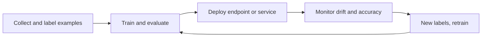
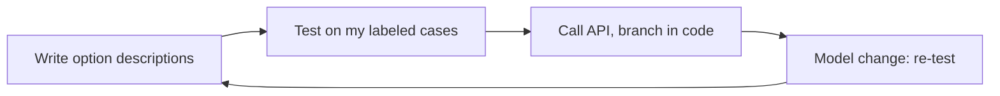
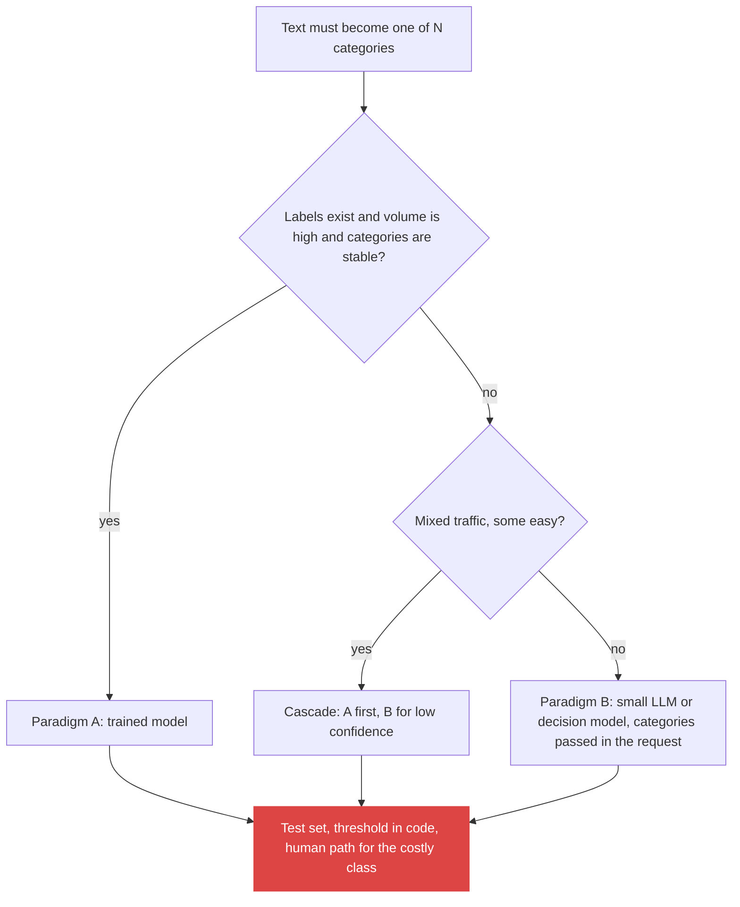

# 1. Two paradigms for turning text into a category: trained classifiers and LLM-based decision steps differ in setup, cost per call and upkeep, and the choice follows volume, stability of the categories and available labels

> Trained models (classical ML, fine-tuned encoders, managed classifiers) cost labeling and retraining but are cheap and fast per call; LLM-based steps (an LLM with an enum, a decision model) need no training and absorb change by editing text but cost more per call and depend on a provider's model lifecycle; both need a test set, and cascades combine them.

Related: [02 Classification model vs decision model](02_ClassificationModel_vs_DecisionModel.md) · [03 Classification options on the market](03_Classification_Options_Market.md) · [04 Jev and Microsoft Decision-1](04_Jev_And_Microsoft_Decision_1.md) · [05 Support chat in production](05_Support_Chat_In_Production.md) · [W2L1 02 Rethinking the skills](../Week2_Lecture_1_Agent_Primitives/02_Rethinking_The_Skills.md) · [W2L1 05 Instructions and enforcement](../Week2_Lecture_1_Agent_Primitives/05_Instructions_Five_Parts_And_Enforcement.md) · [W2L1 14 Approval and durable waits](../Week2_Lecture_1_Agent_Primitives/14_Tool_Approval_Durable_Waits.md) · [W2L1 16 Evals](../Week2_Lecture_1_Agent_Primitives/16_Evals_For_Agent_Changes.md) · [W2L1 17 Extend, adjust, leave](../Week2_Lecture_1_Agent_Primitives/17_Extend_Adjust_Or_Leave_The_Framework.md)

Source: S02E02 audio transcript (the exchange-agent demo), checked 2026-11-18. The transcript spells the model "JEFF" and "JEV"; the vendor docs spell it Jev. Papers and vendor docs are in [Sources](#sources). The two process flows, the scenario table and the support comparison are my own reasoning where marked.

## Glossary

| Term | What it means here | Same thing elsewhere | Not to be confused with |
|---|---|---|---|
| Trained classifier | A model fitted on my labeled examples | scikit-learn model, fine-tuned BERT, Comprehend or Azure custom classifier | A decision model |
| Decision tree | A classical ML model that splits features by rules | `DecisionTreeClassifier` | A decision model |
| Decision model | A contract: state and typed questions in, probabilities over the supplied options out, no text generated. A body can be an encoder or an LLM ([02](02_ClassificationModel_vs_DecisionModel.md)) | "System One" model: Jev, Microsoft-Decision-1 | A trained classifier |
| LLM step | A general LLM constrained to an enum or JSON schema | OpenAI `json_schema`, Anthropic `output_config.format` | A calibrated classifier |
| Encoder-only (BERT family) | A small model that outputs a vector or label scores | DeBERTa, BERT | Encoder-decoder (T5) |
| Confidence (vendor) | `1 - H(p)/ln(N)`: how concentrated the probabilities are | Ollama and Telnyx docs | Chance the answer is right |
| Cascade | A cheap model answers first and a stronger one handles the rest | FrugalGPT | A fallback on errors |
| Drift | Inputs or outputs shift away from what the model was trained on | Azure ML data drift, prediction drift | A bug |

## 1. The problem

A customer wants to exchange recently bought shoes. The message can carry a fit issue, a defect, both, or too little detail. Policy sends a defect to a person and a fit issue to a proposal. **Which paradigm turns the text into the category, what does using it look like day to day, and what does keeping it running cost?** Eligibility, price and identity stay in code in both.

## 2. In production: a support chat

A support chat is not one classifier call. Vendors put a fast first pass, a confidence gate and a human path in front of the answer, and the first pass is a trained intent model, an LLM, or both in sequence ([05](05_Support_Chat_In_Production.md)). The lecture's demo is one instance: `unclear` asks a question, a defect goes to a person.

## 3. Paradigm A: trained models



- **Using it:** after deployment a call is one cheap prediction returning per-class scores. Managed services want about 50 labeled examples per class ([Comprehend](https://docs.aws.amazon.com/comprehend/latest/dg/guidelines-and-limits.html), [Azure](https://learn.microsoft.com/en-us/azure/ai-services/language-service/custom-text-classification/faq)).
- **Support:** labeling effort, retraining, and monitoring. Azure ML offers data drift, prediction drift and data quality signals, and model performance needs ground truth ([monitoring](https://learn.microsoft.com/azure/machine-learning/concept-model-monitoring)). A Comprehend real-time endpoint is provisioned in inference units (100 characters per second each, up to 10) and billed until deleted ([endpoints](https://docs.aws.amazon.com/comprehend/latest/dg/using-endpoints.md)).
- **A new category** means new labels and a retrain.

## 4. Paradigm B: LLM-based steps



- **Using it:** no training. The category definitions are text in the request. Decision models return per-option probabilities and bill input tokens only ($0.042 per million, see [04](04_Jev_And_Microsoft_Decision_1.md)).
- **Support:** the provider retires models. Anthropic gives at least 60 days' notice, OpenAI at least 6 months for generally available models and as little as 2 weeks for previews ([Anthropic](https://platform.claude.com/docs/en/about-claude/model-deprecations), [OpenAI](https://developers.openai.com/api/docs/deprecations)). Rewording options can move decision-model probabilities (Telnyx, TypedBench), so a model or wording change means a re-test, as in [W2L1 02](../Week2_Lecture_1_Agent_Primitives/02_Rethinking_The_Skills.md).
- **A new category** means a new description and a re-test.

## 5. Side by side

| Axis | Trained (A) | LLM step (B) | Evidence |
|---|---|---|---|
| Time to a first result | Label, train, deploy (Azure: about 6 h to train on 12.8M characters) | Hours of prompt and test-set work | Azure FAQ; mine |
| Labeled data | About 50 per class for managed services; 8 to 16 for SetFit | None to start, still need a test set | Vendor docs; [SetFit](https://huggingface.co/blog/setfit) |
| Latency and cost per call | Lower: one fine-tuned-encoder study reports "one to two orders of magnitude lower cost and latency" than zero- and few-shot LLM prompting, on four generic datasets | Higher. Jev claims about 70 to 500 ms (vendor, relayed). No measured figures for my task | [arXiv 2602.06370](https://arxiv.org/abs/2602.06370), abstract only |
| Changing categories | Retrain | Edit text, re-test | Mine |
| Probabilities and explanations | Native scores, meaning varies by service; no rationale | Decision model: normalized, not calibrated, "does not generate explanations"; plain LLM: logprobs where exposed | [03](03_Classification_Options_Market.md), Decision-1 catalog |
| Languages | Azure about 100; DeBERTa zero-shot card English only | Model dependent | [Azure](https://learn.microsoft.com/en-us/azure/ai-services/language-service/custom-text-classification/language-support), [HF card](https://huggingface.co/MoritzLaurer/deberta-v3-base-zeroshot-v1.1-all-33) |
| Vendor lifecycle risk | Service retirement (Vertex AutoML Text deprecated; Azure custom text classification and CLU retire 2029-03-31) | Model retirement | [Google](https://docs.cloud.google.com/vertex-ai/docs/deprecations), [Azure](https://learn.microsoft.com/en-us/azure/ai-services/language-service/custom-text-classification/overview), provider pages |
| Data stays with me | Self-hosted encoder possible | Ollama can run System One models locally | [Ollama](https://docs.ollama.com/api/systemone.md) |

Small open models are viable on the B side: a 41-model zero-shot intent study found instruction-tuned 3B models can beat several 7B base models and the top models "statistically indistinguishable" on one dataset ([arXiv 2607.27421](https://arxiv.org/abs/2607.27421), abstract only).

## 6. Which paradigm for which scenario

This table is my reasoning from the sources above. Latency and cost for my own task are not measured, the encoder-versus-LLM claim is one preprint on generic datasets, and provider facts are dated 2026-11-18.

| Scenario | Leans toward | Why |
|---|---|---|
| High volume, stable categories, labeled history | A | Per-call cost and latency dominate |
| Low volume, categories change often, no labels | B | No retraining, change is an edit |
| Mixed: most traffic easy, some ambiguous | Cascade | A cheap model first, an LLM for the rest; FrugalGPT reports matching GPT-4 with up to 98% cost reduction ([paper](https://arxiv.org/abs/2305.05176), 2023 claim) |
| Low latency, inline in a user flow | A small encoder, or a low-latency decision model | Telnyx sells Flash for "lowest cost and latency" and says to measure; Jev's 70 to 500 ms is a vendor claim. Only if the category list can be supplied in the request |
| Cheap but still hosted | A decision model or a small hosted LLM | No infrastructure; decision models bill input tokens only ($0.042 per million, [04](04_Jev_And_Microsoft_Decision_1.md)). Provider lifecycle risk stays |
| Categorize before proceeding, in a platform where tenants run their own business: little known about them, categories and rules drift, complex cases | A small LLM with each tenant's categories in the request, fine-tuned later if behavior needs it | One trained model per tenant means one retrain per drift. Small LLMs hold up zero-shot (3B instruction-tuned models, see above). Google moved text classification from trained AutoML to Gemini tuning. A decision model fits only with a supplied list: it "cannot generate text", so it cannot propose categories. Discovering new categories needs a generative step, then a fast model classifies |
| Strict data control, offline | A, or a local open model | No external call |
| Learn the data first | B, then maybe A | LLM labels bootstrap a test set; training a small model later is a common pattern, **unverified** here |



## 7. The shape of the step, in either paradigm

One `choice` hides precedence in prose ("the fit description excludes a defect"). Two yes/no flags put precedence in code and let a lower bar apply to the costly class. TypedBench found that "under asymmetric costs, using its probabilities can be worse than taking its top answer" for hosted Jev, so the rule is tested, not trusted. The numbers below are illustrative and are set on a test set.

```text
if p(defect) >= 0.30  -> human review
elif p(fit) >= 0.80   -> exchange proposal
else                  -> ask the customer for detail
```

## My take

On Azure the lowest-effort start is Microsoft-Decision-1 (preview), behind one function with a fixed test set. If volume grows and categories settle, a trained classifier behind the same function is a swap, not a rewrite. The lecture's gateway and adapters idea applies to this step too.

## Summary

Paradigm A trades labeling and upkeep for cheap, fast calls. Paradigm B trades per-call cost and provider dependence for no training and cheap change. The choice follows volume, category stability and labels. A cascade covers mixed traffic, tenant-defined drifting categories lean to a small LLM, and the test set decides.

## Open questions

- At what volume does a trained classifier beat a decision model on total cost for my case?
- Do Jev or Decision-1 probabilities match hit rates on my data?

## Fact-check

| # | Claim | Verdict | Source | Checked |
|---|---|---|---|---|
| 1 | Do in code what code can do; the model only interprets | **Lecture-specific** (opinion), consistent with "simplest solution possible" | [Anthropic](https://www.anthropic.com/research/building-effective-agents), page read | 2026-11-18 |
| 2 | A fixed category set suits a decision model | **Agrees**, not the only option: Anthropic allows an LLM or a traditional classifier | Same page | 2026-11-18 |
| 3 | The returned confidence shows how far to trust the answer | **Differs**: it is concentration, not correctness | [Ollama](https://docs.ollama.com/api/systemone.md), [Telnyx](https://developers.telnyx.com/docs/inference/decision-models.md), pages read | 2026-11-18 |
| 4 | The 0.8 threshold is arbitrary and needs evals | **Agrees** | Telnyx and [Decision-1 blog](https://techcommunity.microsoft.com/blog/azure-ai-foundry-blog/introducing-microsoft-decision-1-in-microsoft-foundry-for-decision-and-classific/4562742) | 2026-11-18 |
| 5 | Fine-tuned encoders are one to two orders of magnitude cheaper and faster than LLM prompting | **Agrees** for four generic datasets, single-author preprint | [arXiv 2602.06370](https://arxiv.org/abs/2602.06370), abstract read | 2026-11-18 |
| 6 | A cascade cuts cost at similar quality | **Agrees**, vendor-neutral paper, 2023 numbers | [FrugalGPT](https://arxiv.org/abs/2305.05176), abstract read | 2026-11-18 |
| 7 | Providers retire models on a schedule | **Agrees**: 60 days (Anthropic), 6 months for GA (OpenAI) | Deprecation pages above | 2026-11-18 |
| 8 | A decision model is more than a simple classifier | **Differs**: it is a typed-answer contract. Decision-1 is Qwen3.5-9B post-trained, TypedBench lists an encoder (Laya) too, Jev base **unverified** ([02](02_ClassificationModel_vs_DecisionModel.md)) | [Catalog](https://ai.azure.com/catalog/models/Microsoft-Decision-1) | 2026-11-18 |
| 9 | A fit description that excludes defects separates mixed messages | **Lecture-specific**: one demo case; hosted Jev is wording-sensitive | [TypedBench](https://arxiv.org/abs/2610.11392v2), abstract read | 2026-11-18 |
| 10 | A decision model cannot propose categories outside the supplied list | **Agrees**: "cannot generate text or call tools" | [LLM Gateway](https://docs.llmgateway.io/features/system-one), [Decision-1 catalog](https://ai.azure.com/catalog/models/Microsoft-Decision-1), pages read | 2026-11-18 |

## Sources

- S02E02 audio transcript.
- [Anthropic: Building effective agents](https://www.anthropic.com/research/building-effective-agents) · [FrugalGPT](https://arxiv.org/abs/2305.05176) · [Cost-aware selection, encoders vs LLM prompting](https://arxiv.org/abs/2602.06370) · [41-model zero-shot intent study](https://arxiv.org/abs/2607.27421)
- [Azure ML model monitoring](https://learn.microsoft.com/azure/machine-learning/concept-model-monitoring) · [Comprehend endpoints](https://docs.aws.amazon.com/comprehend/latest/dg/using-endpoints.md)
- [Anthropic deprecations](https://platform.claude.com/docs/en/about-claude/model-deprecations) · [OpenAI deprecations](https://developers.openai.com/api/docs/deprecations)
- [Microsoft-Decision-1](https://ai.azure.com/catalog/models/Microsoft-Decision-1) · [Telnyx](https://developers.telnyx.com/docs/inference/decision-models.md) · [Ollama](https://docs.ollama.com/api/systemone.md) · [TypedBench](https://arxiv.org/abs/2610.11392v2)
- My own reasoning: the process flows, the scenario table, the shape of the step.
