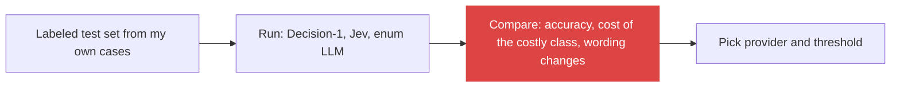

# 4. Jev and Microsoft-Decision-1 are hosted decision models with typed answers: I can try them cheaply, but their probabilities are not calibrated and both are young

> Jev (TypeSafe) and Microsoft-Decision-1 return typed answers with per-option probabilities for $0.042 per million input tokens; Decision-1 is a Qwen3.5-9B post-trained by Microsoft and in preview, Jev is closed and hosted, and an independent benchmark finds Jev wording-sensitive and underconfident.

Related: [01 LLM vs classification](01_LLM_vs_Classification.md) · [02 Classification model vs decision model](02_ClassificationModel_vs_DecisionModel.md) · [03 Classification options](03_Classification_Options_Market.md) · [W2L1 16 Evals](../Week2_Lecture_1_Agent_Primitives/16_Evals_For_Agent_Changes.md)

Source: vendor docs, integrator posts and one preprint, read on 2026-11-18, listed in [Sources](#sources). Tags below: vendor claim, integrator (Microsoft or TrueFoundry, not the maker), independent (TypedBench). I did not open TypeSafe's own site.

## Glossary

| Term | What it means here | Same thing elsewhere | Not to be confused with |
|---|---|---|---|
| System One | TypeSafe's name for the class of decision models | Decision model | System 1 thinking |
| `choice` | Pick one option; returns the winner, `probabilities`, `confidence` | Multiple choice | A free-text answer |
| `score` | Rate on ordered levels; returns a probability-weighted index | Rating | A percentage |
| `noul` | Yes/no as a number from 0 to 1 | The transcript's "null" question | A boolean |
| Datazone | Microsoft deployment region type for Decision-1 | US Datazone, EU Datazone | A single Azure region |

## 1. The problem

The audio lecture uses Jev for the exchange demo, and I had not heard of it. **What are Jev and its Azure counterpart, how do I call them, what do they cost, and what do I need to know before I experiment?**

## 2. The two models

| | Jev | Microsoft-Decision-1 |
|---|---|---|
| Maker | TypeSafe AI | Microsoft |
| Base | Not found in any source | Qwen3.5-9B, open-weight, post-trained by Microsoft ([catalog](https://ai.azure.com/catalog/models/Microsoft-Decision-1)) |
| Weights, license | Closed-source and hosted (independent); license text not found | Not stated. Microsoft says it will rebase on MAI and OpenAI models |
| Status | Early access from 2026-09-15 (relayed by integrator); Microsoft says to "apply for the preview" | Public preview, announced 2026-10-09 |
| Price | $0.042 per million input tokens, output free (relayed) | Same $0.042 input, output N/A ([blog](https://techcommunity.microsoft.com/blog/azure-ai-foundry-blog/introducing-microsoft-decision-1-in-microsoft-foundry-for-decision-and-classific/4562742)) |
| Context | 32k per decision; 262k mode for long input (Gateway, Telnyx) | 32,768 tokens, text only |
| Where | TypeSafe API, LLM Gateway, Telnyx beta, Eden AI, TrueFoundry, OpenRouter, Cloudflare Workers AI | Microsoft Foundry, OpenRouter |
| In Azure catalog | Not found. Microsoft shows an OpenAPI tool calling TypeSafe | Yes |

Ollama's page names its own models (nimble, Tev, clef:cloud) for the same System One API and does not mention Jev or TypeSafe. Whether Decision-1 and Jev are related is not stated anywhere I read.

## 3. How a call looks

```json
{
  "model": "jev-latest",
  "state": "<the customer message>",
  "questions": {
    "issue": {
      "type": "choice",
      "instructions": "What is the main issue?",
      "choices": { "fit": "...", "defect": "...", "unclear": "..." }
    }
  }
}
```

POST `https://api.typesafe.ai/v1/systemone` with `Authorization: Bearer <key>` (Microsoft's OpenAPI example). The body keys inside a question differ per page, so I copy the exact shape from the provider's docs before sending anything. The response holds `model`, `answers` keyed by question name, and `usage`. The Microsoft blog says to "confirm the route and authentication header before running it". I have not run any call.

## 4. What the sources say about quality

| Claim | Who | Reading |
|---|---|---|
| "calibrated probabilities" | LLM Gateway (vendor side) | Not backed by a measurement shown |
| "Not calibrated correctness" for confidence; scores "not calibrated probabilities that a decision is correct" | Ollama, Telnyx | Confidence is `1 - H(p)/ln(N)`, concentration of the distribution |
| "wording-sensitive and systematically underconfident" | TypedBench, independent | Hosted Jev 1.13.0 |
| "under asymmetric costs, using its probabilities can be worse than taking its top answer" | TypedBench | Test thresholds on my own costs |
| General LLMs limited to the options "do not close the gap" on a priority task and come close on phishing | TypedBench | Task dependent |
| Quality "competitive with GPT-5 while running 80 to 100 times faster" | Microsoft blog (Xbox Research), vendor claim | No method shown here |

Microsoft's own warning: do not use Decision-1 as the sole automated decision-maker for consequential decisions about people (credit, employment, housing, insurance, education, healthcare, legal rights). Neither model explains its answer: "does not generate explanations or rationales."

## 5. How I would try them



A wording check means rewriting each option description two ways and seeing whether the answer moves. This is the same test set that note 01 needs. It must use abstracted or synthetic messages, with no customer data.

## Cautions

- Pricing, limits and rate limits (250,000 tokens per second and 1,200 requests per minute for Jev, per Microsoft) are stated "subject to change".
- Pin a versioned model ID so thresholds stay stable (TrueFoundry advice).
- Telnyx and Ollama state compatibility "does not imply identical model predictions", so a provider swap needs a re-test.
- Gateway marks its `/v1/systemone` route "legacy" and "Deprecated soon" in favor of `/v1/decisions`.

## Summary

Both are hosted typed-answer models at the same input price. Decision-1 is on Azure but in preview; Jev is hosted elsewhere and closed. Neither gives calibrated probabilities, so I try both on my own labeled cases first, with a wording check, and keep the provider swappable.

## Open questions

- What is Jev's base model and license?
- Is Decision-1 a competitor to Jev or built on it?
- Do the Decision-1 response fields match the Jev ones?

## Fact-check

| # | Claim | Verdict | Source | Checked |
|---|---|---|---|---|
| 1 | Decision-1 is Qwen3.5-9B post-trained by Microsoft | **Agrees** | [Catalog](https://ai.azure.com/catalog/models/Microsoft-Decision-1), page read | 2026-11-18 |
| 2 | Both cost $0.042 per million input tokens | **Agrees** for Decision-1; Jev's price is relayed by integrators, not read from TypeSafe | [Blog](https://techcommunity.microsoft.com/blog/azure-ai-foundry-blog/introducing-microsoft-decision-1-in-microsoft-foundry-for-decision-and-classific/4562742), [Microsoft Jev post](https://techcommunity.microsoft.com/blog/azuredevcommunityblog/using-jev-with-agents-in-microsoft-foundry-for-model-evaluation/4559851) | 2026-11-18 |
| 3 | Jev's probabilities are calibrated | **Differs**: Telnyx and Ollama disclaim it, TypedBench finds underconfidence | [TypedBench](https://arxiv.org/abs/2610.11392v2) abstract and HTML start read | 2026-11-18 |
| 4 | Jev is available in the Azure catalog | **Differs**: not found; Microsoft would not comment on roadmap | Microsoft Jev post, comments | 2026-11-18 |
| 5 | Decision-1 is 80 to 100 times faster than GPT-5 at similar quality | **Unverified**: vendor claim, methodology page not read | Decision-1 blog | 2026-11-18 |
| 6 | Jev is open-weight | **Differs**: TypedBench calls it closed-source | TypedBench | 2026-11-18 |

## Sources

- [Microsoft-Decision-1 catalog](https://ai.azure.com/catalog/models/Microsoft-Decision-1) · [announcement](https://techcommunity.microsoft.com/blog/azure-ai-foundry-blog/introducing-microsoft-decision-1-in-microsoft-foundry-for-decision-and-classific/4562742)
- [Using Jev with Foundry agents (Microsoft)](https://techcommunity.microsoft.com/blog/azuredevcommunityblog/using-jev-with-agents-in-microsoft-foundry-for-model-evaluation/4559851) · [TrueFoundry](https://www.truefoundry.com/docs/ai-gateway/typesafe)
- [LLM Gateway](https://docs.llmgateway.io/features/system-one) · [Telnyx](https://developers.telnyx.com/docs/inference/decision-models.md) · [Ollama](https://docs.ollama.com/api/systemone.md) · [Eden AI](https://www.edenai.co/docs/v3/llms/decisions.md)
- [TypedBench, arXiv 2610.11392](https://arxiv.org/abs/2610.11392v2)
