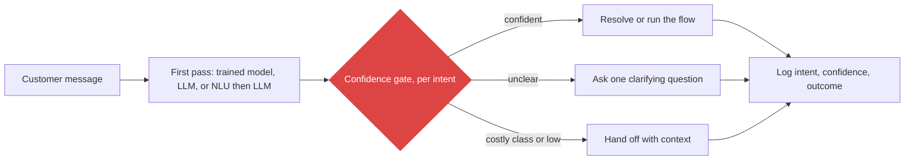

# 5. In a support chat the market routes a message through a fast first pass, a confidence gate and a human path; the first pass is a trained intent model, an LLM, or both in sequence

> Amazon Lex, Rasa and Dialogflow CX each combine a trained or LLM-based first pass with a confidence gate and a fallback, Lex runs the trained model first and the LLM only on low confidence, and Azure's trained language services (CLU, custom text classification, orchestration workflow) retire on 2029-03-31.

Related: [01 Two paradigms](01_LLM_vs_Classification.md) · [02 Classification model vs decision model](02_ClassificationModel_vs_DecisionModel.md) · [03 Classification options](03_Classification_Options_Market.md) · [04 Jev and Microsoft Decision-1](04_Jev_And_Microsoft_Decision_1.md) · [W2L1 14 Approval and durable waits](../Week2_Lecture_1_Agent_Primitives/14_Tool_Approval_Durable_Waits.md)

Source: vendor documentation read on 2026-11-18, listed in [Sources](#sources). Search-summary material is marked. The navigation table is my own reasoning.

## Glossary

| Term | What it means here | Same thing elsewhere | Not to be confused with |
|---|---|---|---|
| Intent | The category of what the customer wants | Lex intent, Dialogflow intent, Zendesk topic | A flow |
| Utterance | One customer message | Training phrase (Dialogflow, Lex) | A session |
| NLU | A trained model that maps an utterance to an intent and slots | Lex NLU, Dialogflow matching, Rasa NLU | An LLM |
| Fallback or no-match | What runs when no intent is confident enough | Lex FallbackIntent, Dialogflow no-match event | An error |
| Confidence gate | A threshold that decides auto-handle, clarify or hand off | Lex configured threshold, Dialogflow classification threshold | Calibrated probability |
| Flow | A defined multi-step task the assistant runs | Rasa flow | An intent |
| Handoff | Passing the conversation to a person | Rasa `human handoff` command | A ticket |

## 1. The problem

A product ships only a support chat. **What do others on the market use to understand a customer message, how do they treat uncertainty, and where do I start?** [Note 01](01_LLM_vs_Classification.md) covers the paradigms. This note is about how vendors assemble them.

## 2. What vendors do

| Product | First pass | How categories are defined | Uncertainty | Handoff |
|---|---|---|---|---|
| [Amazon Lex V2 Assisted NLU](https://docs.aws.amazon.com/lexv2/latest/dg/assisted-nlu.md) | Primary mode: LLM on every input. Fallback mode: trained NLU first, LLM only when confidence is below the configured threshold | Intents and slots I define; descriptions act as LLM prompts. The LLM "can only select" defined intents | `nluConfidence`, FallbackIntent | Not found |
| [Rasa CALM](https://rasa.com/docs/learn/concepts/dialogue-understanding/) | LLM produces commands, not one intent. NLU can run beside it with an `IntentBasedRouter` or `LLMBasedRouter` | Flows with descriptions | `clarify flows` command | `human handoff` command |
| [Dialogflow CX](https://docs.cloud.google.com/dialogflow/cx/docs/concept/intent) | Trained matching on training phrases. [Generative fallback](https://docs.cloud.google.com/dialogflow/cx/docs/concept/generative-fallback) (LLM) runs on no-match | At least 10 to 20 phrases per intent | Classification threshold, no-match event | Not found |
| [Azure CLU](https://learn.microsoft.com/en-us/azure/ai-services/language-service/conversational-language-understanding/overview) | LLM-powered quick deploy or a custom trained model | Intent descriptions or labeled utterances | Not found | Not found |
| [Zendesk intelligent triage](https://support.zendesk.com/hc/en-us/articles/4550640560538) | Classifies tickets, not live chat, from subject and first comment | Prebuilt plus custom topics | Confidence field per prediction, no threshold documented | Not found |
| Intercom Fin | Routing details not found on the research index page | - | - | - |

Rasa's pages call the LLM approach better than NLU classifiers ("LLMs outperform NLU classifiers"), a vendor claim.

## 3. The common shape

Lex Fallback mode is a cascade from [note 01](01_LLM_vs_Classification.md). Lex gives a rule of thumb: if more than 30 percent of utterances invoke the LLM in Fallback mode, consider Primary mode. It suggests Primary for fewer than 20 sample utterances per intent and advises avoiding "overlapping language across intents".

## 4. Where I start for a support chat

This table is my reasoning from the table above.

| Situation | Start with | Why |
|---|---|---|
| Few intents, no ticket history | An LLM or decision model with intent descriptions | No training data; Lex suggests Primary mode here |
| Labeled history, steady volume | Trained model first, LLM on low confidence | Lex Fallback mode, cascade |
| Multi-step tasks (returns, bookings) | An LLM that emits commands against defined flows | Rasa: the intent is one command, not the whole problem |
| A costly category (defect, anger, legal) | A separate flag with a lower bar, routed to a person | A missed case costs more than a review |
| Azure | Not CLU, custom text classification or orchestration workflow for new work | They retire on 2029-03-31, replacement Microsoft Foundry |
| Data residency matters | Check where inference runs | Lex notes data "might be processed across AWS Regions" |

## 5. Thresholds seen in practice

Search summaries of vendor-hosted case studies, not verified: confidence gates between 0.70 and 0.85, one gate on intent confidence and retrieval relevance together, thresholds set per intent rather than globally, the confidence score logged with the outcome, and traffic ramped from 10 to 30 percent with people reviewing. The range is wide, so thresholds are tuned on my own labeled messages, as in note 01.

## Cautions

- The pages read describe features, not production accuracy. Vendor figures are not independent.
- Human handoff is documented only for Rasa in the pages I read. Others may document it elsewhere.
- Dialogflow CX generative fallback is excluded from its SLA.

## Summary

Support chats in the market pair a first pass with a confidence gate, a clarifying question and a person. The first pass is trained, LLM-based, or trained first with the LLM on low confidence. For a new chat with few intents I start LLM-based, and with history and volume I add a trained first pass. On Azure the trained language services are on their way out.

## Open questions

- What fraction of my real messages would fall to the costly class, and what does a person need in the handoff?
- Does Lex's 30 percent rule transfer to other stacks?

## Fact-check

| # | Claim | Verdict | Source | Checked |
|---|---|---|---|---|
| 1 | Lex Fallback mode runs trained NLU first and the LLM only below a threshold | **Agrees** | [Lex Assisted NLU](https://docs.aws.amazon.com/lexv2/latest/dg/assisted-nlu.md), page read | 2026-11-18 |
| 2 | Rasa CALM replaces intent classification with LLM commands, and NLU can coexist | **Agrees** | [Rasa](https://rasa.com/docs/learn/concepts/dialogue-understanding/), [coexistence](https://rasa.com/docs/rasa-pro/building-assistants/coexistence), pages read | 2026-11-18 |
| 3 | LLMs outperform NLU classifiers | **Lecture-specific** vendor claim, no measurement shown | Rasa page | 2026-11-18 |
| 4 | Dialogflow CX matches intents with trained phrases and a threshold, with LLM fallback on no-match | **Agrees** | Dialogflow pages above | 2026-11-18 |
| 5 | CLU, custom text classification, orchestration workflow and question answering retire from Azure Language on 2029-03-31 | **Agrees** | [Custom text classification](https://learn.microsoft.com/en-us/azure/ai-services/language-service/custom-text-classification/overview), [CLU](https://learn.microsoft.com/en-us/azure/ai-services/language-service/conversational-language-understanding/overview), [orchestration](https://learn.microsoft.com/en-us/azure/ai-services/language-service/orchestration-workflow/overview), pages read. Custom NER: no notice found | 2026-11-18 |
| 6 | Production gates sit at 0.70 to 0.85 | **Unverified**: search summaries of vendor case studies | Search results | 2026-11-18 |

## Sources

- [Lex Assisted NLU](https://docs.aws.amazon.com/lexv2/latest/dg/assisted-nlu.md) · [Rasa dialogue understanding](https://rasa.com/docs/learn/concepts/dialogue-understanding/) · [Rasa coexistence](https://rasa.com/docs/rasa-pro/building-assistants/coexistence)
- [Dialogflow CX intents](https://docs.cloud.google.com/dialogflow/cx/docs/concept/intent) · [generative fallback](https://docs.cloud.google.com/dialogflow/cx/docs/concept/generative-fallback)
- [Azure CLU](https://learn.microsoft.com/en-us/azure/ai-services/language-service/conversational-language-understanding/overview) · [Azure custom text classification](https://learn.microsoft.com/en-us/azure/ai-services/language-service/custom-text-classification/overview) · [Azure orchestration workflow](https://learn.microsoft.com/en-us/azure/ai-services/language-service/orchestration-workflow/overview)
- [Zendesk intelligent triage](https://support.zendesk.com/hc/en-us/articles/4550640560538) · [Fin research index](https://fin.ai/research/)
- My own reasoning: the common shape and the navigation table.
