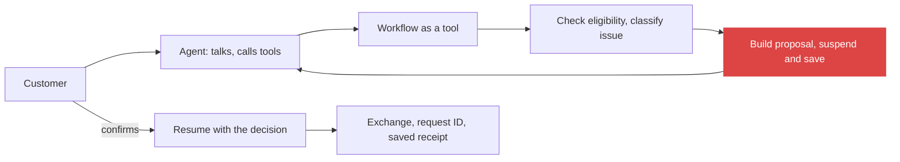

# 6. "Workflow" means steps whose order is fixed in code; LangGraph is a workflow engine that also runs agent loops, and the lecture uses the word for a process-enforcement use the same engine supports

> A workflow fixes the order of steps in code and a model is a step or the caller of it; LangGraph, Mastra, CrewAI Flows and Microsoft Agent Framework are workflow engines, the lecture's workflow is the process-enforcement use (a saved proposal, a customer's yes, then the action), and guardrails are a separate check at the entry or inside the harness.

Related: [05 Support chat in production](05_Support_Chat_In_Production.md) · [07 Workflows on the fly and todo lists](07_Workflows_On_The_Fly_And_Todo_Lists.md) · [01 LLM vs classification](01_LLM_vs_Classification.md) · [W2L1 03 Loop, limits, recovery](../Week2_Lecture_1_Agent_Primitives/03_Agent_Loop_Stop_Limits_Recovery.md) · [W2L1 05 Instructions and enforcement](../Week2_Lecture_1_Agent_Primitives/05_Instructions_Five_Parts_And_Enforcement.md) · [W2L1 14 Approval and durable waits](../Week2_Lecture_1_Agent_Primitives/14_Tool_Approval_Durable_Waits.md) · [W2L1 17 Extend, adjust, leave](../Week2_Lecture_1_Agent_Primitives/17_Extend_Adjust_Or_Leave_The_Framework.md) · [W2L1 20 Loop hooks](../Week2_Lecture_1_Agent_Primitives/20_Loop_Hooks_Declared.md)

Source: S02E02 audio transcript (the workflow part of the exchange demo) and the S02E02 article outline ("Workflows and Controls") and last section, checked 2026-11-18. Framework docs read the same day, listed in [Sources](#sources). The terms table, the direction-of-control comparison and the Chain of Responsibility remark are my own reasoning.

## Glossary

| Term | What it means here | Same thing elsewhere | Not to be confused with |
|---|---|---|---|
| Workflow | Steps and the rules for moving between them, written in code | LangGraph graph, Mastra workflow, CrewAI Flow, MAF workflow | A prompt that lists steps |
| Agent | A model that decides its own next step and tool calls | Anthropic: "dynamically direct their own processes" | A workflow |
| Guardrail | A check that blocks or filters content or behavior | Input content safety, prompt protection, output checks | A workflow step order |
| Durable | A run that can pause and resume from saved progress | LangGraph checkpointer, Mastra snapshot, MAF checkpoint | Retry |
| Suspend and resume | A step stops, saves, and later continues with input | LangGraph `interrupt` and `Command(resume=…)`, Mastra `suspend()` and `resume` | A chat turn |
| Process enforcement | Using a workflow so a risky action cannot happen out of order | The lecture's exchange flow | A guardrail on content |
| Idempotency | Repeating a request does not repeat its effect | A request ID with a saved receipt | Retry limits |

## 1. The problem

The lecture says "workflow" and mixes in approval, customer replies and pauses. I know LangGraph and want to place it. **What does workflow mean, where does LangGraph fit, how does the lecture use the word, and where do guardrails sit?**

## 2. Guardrail, workflow, durable

| Term | What it judges or fixes | Shoe example |
|---|---|---|
| Guardrail at the entry | Content of the incoming message | A safety service screens the customer's text before the agent sees it |
| Guardrail inside the harness | Prompt and tool behavior | Rules that protect the system prompt, hooks on tool calls ([W2L1 20](../Week2_Lecture_1_Agent_Primitives/20_Loop_Hooks_Declared.md)) |
| Workflow | Order of work | Eligibility, classify, proposal, wait, exchange |
| Durable | Survival across waits and restarts | The wait for the customer's yes can last days |

A guardrail judges content. A workflow fixes the order. A product usually has both.

## 3. Two uses of the word

| Use | Purpose | Source |
|---|---|---|
| Composing calls | Fixed code paths that chain model calls and tools: chaining, routing, parallel, orchestrator-workers, evaluator loop | Anthropic: "Workflows are systems where LLMs and tools are orchestrated through predefined code paths." LangGraph: "Workflows have predetermined code paths" |
| Enforcing a process | Make a side effect impossible without the earlier steps and an approval | The lecture: the agent "can call several tools before it ever replies", so the exchange must stop at the proposal until the customer confirms |

The red step is the guarantee: no confirmation, no exchange, whatever the model says. This is the enforcement in [W2L1 05](../Week2_Lecture_1_Agent_Primitives/05_Instructions_Five_Parts_And_Enforcement.md) and the wait in [W2L1 14](../Week2_Lecture_1_Agent_Primitives/14_Tool_Approval_Durable_Waits.md).

## 4. Who is the outer layer

| | Lecture's demo | Typical LangGraph picture |
|---|---|---|
| Outer loop | The agent | The graph |
| Model is | The caller | A node |
| Workflow is | A tool (`confirm_exchange` resumes it) | The whole program |

Both directions work. The design choice is which side carries the risky process. Anthropic's advice is to "find the simplest solution possible" and to use workflows for well-defined tasks and agents when the steps cannot be predicted.

## 5. Where the frameworks fit

| Framework | Primitive | Suspend and resume | Note |
|---|---|---|---|
| LangGraph | `StateGraph`; Functional API (`entrypoint`, `task`) | `interrupt()`, `Command(resume=…)`, checkpointer, `thread_id` | "Prefer the Graph API for building new agents". The node restarts on resume, so earlier side effects must be idempotent |
| LangChain | `create_agent` on the LangGraph runtime | Through LangGraph | Chains: no page found, status unknown |
| CrewAI | Flows (`@start`, `@listen`, `@router`) beside Crews (agents plus tasks) | `@persist` (SQLite default), `@human_feedback` | Flows page read in part |
| Mastra | `createStep`, `createWorkflow`, `.then`, `.parallel`, `.branch`, loops | `suspend()`, `run.resume`, snapshots in storage | The lecture's engine. The transcript spells it "Maestro" |
| Google ADK | `SequentialAgent`, `ParallelAgent`, `LoopAgent` | Not on the pages read | Template agents marked deprecated for graph-based workflows |
| Microsoft Agent Framework | Executors and edges | Checkpoint per superstep, `request_info()` | Resume needs the same topology |
| Semantic Kernel Process | Steps and events | Not found | "experimental", page dated 2024 |
| OpenAI Agents SDK | Orchestrate "via LLM" or "via code" | Not on the page read | Agents as tools, handoffs |
| Temporal | A durable execution engine | Core feature | Blog lists a LangGraph plugin (2026-07-16); only the index was read |

## 6. Chain of Responsibility

My reading, not a source claim. Chain of Responsibility passes a request along handlers until one handles it. A workflow is closer to a pipeline or state machine with shared state and defined transitions. The closest match to Chain of Responsibility is the cascade in [note 01](01_LLM_vs_Classification.md), where a cheap model answers and passes the rest on.

## Cautions

- The CrewAI, ADK dynamic and Temporal pages were read in part or as an index only.
- Semantic Kernel's status may have changed since the page's 2024 date.
- A workflow does not make the model's steps correct. It fixes the order and the gates.

## Summary

A workflow is code-fixed order, used either to compose model calls or to enforce a process with approval and a saved wait. LangGraph is one engine for both, next to Mastra, CrewAI Flows and Microsoft Agent Framework. Guardrails are a different check, at the entry or inside the harness. The lecture's demo puts the agent outside and the workflow behind a tool.

## Open questions

- Does a content-safety check on the entry also need to cover tool results?
- Which processes in my own product deserve a workflow gate, and which stay agent-led?

## Fact-check

| # | Claim | Verdict | Source | Checked |
|---|---|---|---|---|
| 1 | Workflows run predefined code paths, agents direct their own steps | **Agrees** | [Anthropic](https://www.anthropic.com/research/building-effective-agents), [LangGraph](https://docs.langchain.com/oss/python/langgraph/workflows-agents), pages read | 2026-11-18 |
| 2 | `interrupt` needs a checkpointer and `thread_id`, and the node restarts on resume | **Agrees** | [Interrupts](https://docs.langchain.com/oss/python/langgraph/interrupts), page read | 2026-11-18 |
| 3 | Mastra suspends, saves snapshots in storage and resumes with `resumeData` | **Agrees** | [Mastra suspend and resume](https://mastra.ai/docs/workflows/suspend-and-resume), page read | 2026-11-18 |
| 4 | A workflow is needed because the agent may call several tools before replying | **Lecture-specific**: a design argument, consistent with Anthropic's advice for well-defined tasks | Transcript | 2026-11-18 |
| 5 | Google ADK template workflow agents are deprecated | **Agrees**: "Deprecated: Use graph-based workflows" | [ADK](https://adk.dev/agents/workflow-agents/), page read | 2026-11-18 |
| 6 | Microsoft Agent Framework checkpoints each superstep and needs the same topology on resume | **Agrees** | [MAF checkpoints](https://learn.microsoft.com/en-us/agent-framework/workflows/checkpoints), page read | 2026-11-18 |
| 7 | CrewAI Flows persist with `@persist` and pause with `@human_feedback` | **Agrees**, page partly read | [CrewAI Flows](https://docs.crewai.com/en/concepts/flows) | 2026-11-18 |
| 8 | Semantic Kernel Process is experimental | **Agrees** for the page read, current status **unverified** | [SK Process](https://learn.microsoft.com/en-us/semantic-kernel/frameworks/process/process-framework) | 2026-11-18 |
| 9 | LangChain chains are legacy | **Unverified**: no page found | LangChain docs index | 2026-11-18 |

## Sources

- S02E02 audio transcript and article.
- [Anthropic: Building effective agents](https://www.anthropic.com/research/building-effective-agents)
- LangGraph: [workflows and agents](https://docs.langchain.com/oss/python/langgraph/workflows-agents) · [Graph API](https://docs.langchain.com/oss/python/langgraph/graph-api) · [interrupts](https://docs.langchain.com/oss/python/langgraph/interrupts) · [Functional API](https://docs.langchain.com/oss/python/langgraph/functional-api)
- [Mastra workflows](https://mastra.ai/docs/workflows/overview) · [CrewAI Flows](https://docs.crewai.com/en/concepts/flows) · [Google ADK workflow agents](https://adk.dev/agents/workflow-agents/) · [Microsoft Agent Framework workflows](https://learn.microsoft.com/en-us/agent-framework/workflows/) · [Semantic Kernel Process](https://learn.microsoft.com/en-us/semantic-kernel/frameworks/process/process-framework)
- [OpenAI Agents SDK orchestration](https://openai.github.io/openai-agents-python/multi_agent/) · [Temporal blog](https://temporal.io/blog)
- My own reasoning: the terms table, the direction of control, the Chain of Responsibility remark.
