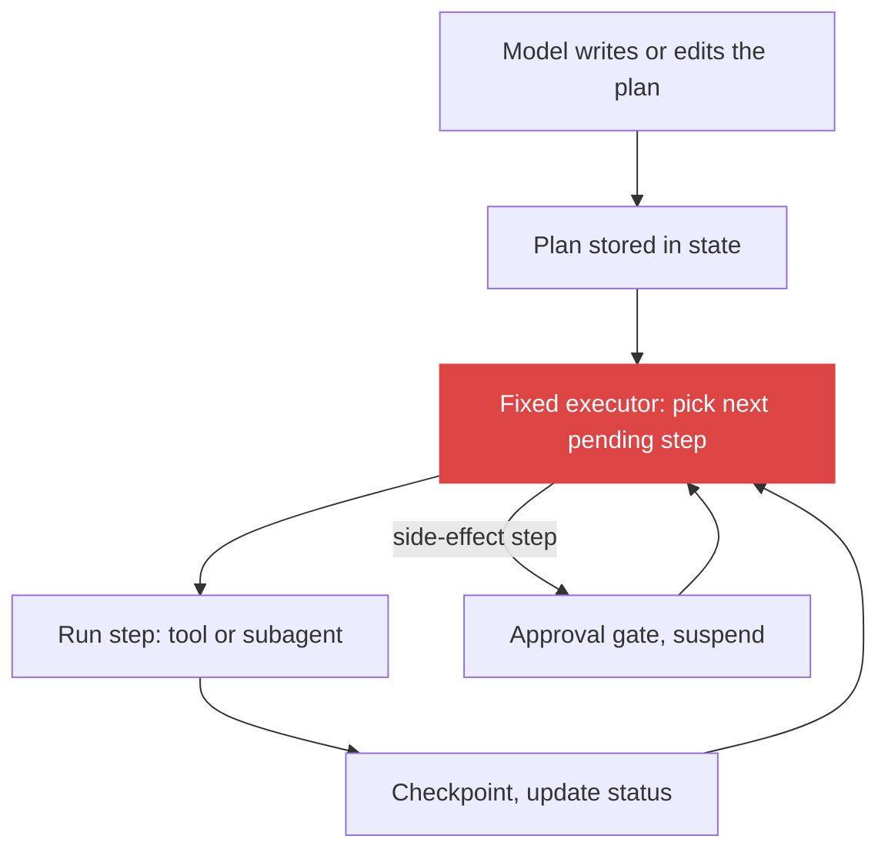

# 7. A model can write and edit a plan as data on the fly, but changing a workflow's structure at runtime costs resumability, so a fixed executor over a plan is the safe shape

> Deep Agents' todo list is a plan the model rewrites through a tool, stored in agent state and not enforced, and it is one of several principles (subagents with isolated context, files as memory, context management) inside a fixed loop graph; real workflow structure is fixed when the graph is built in LangGraph, Mastra and Microsoft Agent Framework, and only code-driven forms decide steps at runtime, trading away stable resume.

Related: [06 Workflow vs LangGraph](06_Workflow_vs_LangGraph.md) · [01 LLM vs classification](01_LLM_vs_Classification.md) · [W2L1 03 Loop, limits, recovery](../Week2_Lecture_1_Agent_Primitives/03_Agent_Loop_Stop_Limits_Recovery.md) · [W2L1 12 Audit ledger](../Week2_Lecture_1_Agent_Primitives/12_Memory_Audit_Ledger_In_Memory_Or_State.md) · [W2L1 14 Approval and durable waits](../Week2_Lecture_1_Agent_Primitives/14_Tool_Approval_Durable_Waits.md) · [W2L1 23 Self-configuring harness](../Week2_Lecture_1_Agent_Primitives/23_Self_Configuring_Harness.md) · [08 Mastra workflow mapped to LangGraph](08_Mastra_Workflow_Mapped_To_LangGraph.md) · [W2L3 19 ReAct vs Deep Agent on LangGraph](../Week2_Lecture_3_MCP_MCP+Resources_Skills/19_ReAct_Vs_Deep_Agent_On_LangGraph.md)

Source: framework docs read on 2026-11-18, the todo-list source and the principles in section 7 read on 2026-11-23, listed in [Sources](#sources). The three levels, the executor design and the guards are my own reasoning where marked.

## Glossary

| Term | What it means here | Same thing elsewhere | Not to be confused with |
|---|---|---|---|
| Plan as data | A list of steps the model writes and edits | Deep Agents `write_todos` | A workflow that executes |
| Topology | Which nodes and edges exist | LangGraph graph structure, MAF executor identities | The data flowing through |
| `Send` | LangGraph routing that starts a declared node a runtime-chosen number of times | Map-reduce fan-out | Creating a node |
| `Command` | A node returns a state update and the next node together | Dynamic edge | A tool call |
| Dynamic workflow (ADK) | A parent node calls child nodes in ordinary code | `ctx.run_node` | A template agent |
| Orchestrator-workers | A central LLM splits a task at runtime and delegates | Anthropic pattern | A fixed pipeline |
| Executor | Fixed code that runs the next step of a plan | My term | The model |

## 1. The problem

Can workflows be created on the fly and managed like the `todo_list` in Deep Agents, by the model, in a separate LangGraph node? **What can change at runtime, what does it cost, and what else besides the todo list makes a deep agent work?**

## 2. What the Deep Agents todo list is

| Fact | Detail |
|---|---|
| Mechanism | `TodoListMiddleware` adds a `write_todos` tool, a system prompt addition and one graph node, `after_model`. Opt-in since Deep Agents v0.7, earlier on by default |
| Storage | The `todos` key of the agent state (`PlanningState` in the source) |
| Statuses | `pending`, `in_progress`, `completed` |
| Who writes | The model; the tool "replaces the entire todo list" |
| Enforced | When a turn has more than one `write_todos` call, the `after_model` node answers each with an error. Completion is not enforced |
| Purpose | The overview calls planning "an explicit accountability tool" for "Less capable models" and a source for progress UIs |

The source shows the node, and it only checks parallel calls. Planning itself stays a tool call the model chooses, so the todo list is a plan as data. It does not run steps, so it is not a workflow in the sense of [note 06](06_Workflow_vs_LangGraph.md). The docs pages do not describe the node, and the node wiring in `factory.py` was read through a summary.

## 3. Three levels of "on the fly"

| Level | What changes at runtime | Where | Source |
|---|---|---|---|
| 1. Plan as data | The list of intended steps | Any framework, Deep Agents todos | Deep Agents docs |
| 2. Choice inside a fixed structure | Which declared nodes run, how many times, with what input | LangGraph `Send` and `Command`, Mastra `.branch` and `.foreach` | LangGraph: "the topology is fixed when you build the graph" |
| 3. Structure decided by code or by a model | The steps themselves | LangGraph Functional API (ordinary `if` and loops), ADK dynamic workflows (`ctx.run_node`), Anthropic orchestrator-workers ("subtasks … decided at runtime") | Pages read |

Not found: creating new node definitions at runtime in LangGraph, or runtime-created workflows in Mastra (only `cloneWorkflow`). Compiling a new graph for each request should work, but no source I read states it.

## 4. The cost: resume

- LangGraph restarts the node on resume and needs deterministic code before an `interrupt`.
- Microsoft Agent Framework requires the topology and executor identities to match the checkpoint.
- ADK skips sub-nodes that already succeeded when it resumes.

So a structure that changes under a saved run is risky. My reasoning: let the model change the plan (level 1) and keep the executor, the step types and the checkpoints fixed (red node). A resumed run then reads the saved plan and continues.

## 5. Which level for which need

| Need | Level | Why |
|---|---|---|
| Show progress, keep a long task on track | 1 | A todo list is enough |
| Fan out over an unknown number of items | 2 | `Send` handles it in a fixed graph |
| Unpredictable subtasks, no resume needed | 3 | Orchestrator-workers or ordinary code |
| Risky side effects with approvals | 2, with a fixed process | Order and gates must not move |

## 6. Guards for model-written plans

My reasoning, in line with the controls in the article outline ("execution budgets, isolation, approval"):
- A fixed set of allowed step types; the executor rejects the rest.
- A step budget ([W2L1 03](../Week2_Lecture_1_Agent_Primitives/03_Agent_Loop_Stop_Limits_Recovery.md)).
- Approval on any step with a side effect ([W2L1 14](../Week2_Lecture_1_Agent_Primitives/14_Tool_Approval_Durable_Waits.md)).
- An append-only journal of plan edits ([W2L1 12](../Week2_Lecture_1_Agent_Primitives/12_Memory_Audit_Ledger_In_Memory_Or_State.md), [W2L1 23](../Week2_Lecture_1_Agent_Primitives/23_Self_Configuring_Harness.md)).

## 7. What else a deep agent relies on, and other graph organizations

A deep agent keeps one loop graph. Its other principles are tools and middleware inside it:

| Principle | What it does | Source |
|---|---|---|
| Recite the plan | Rewriting the todo list puts the objectives at the end of the context | Manus: "reciting its objectives into the end of the context" |
| Subagents, isolated context | A fresh context per task, one report back | Deep Agents `task`, Anthropic's research system |
| Files as memory | Large results and notes live outside the thread | Manus: the file system as "the ultimate context", Deep Agents backend |
| Context management | Summarization, restorable compression | Deep Agents summarization middleware, Manus |
| Detailed prompt, skills, approval | How to plan, delegate and ask | Deep Agents blog and docs |
| Stable prefix, errors kept in | Cache hits, recovery | Manus |

So "workflow on the fly" fits only the todo list. What is dynamic is the model's choice of tools (`write_todos`, `task`, file tools), not the graph. Other organizations in the docs are fixed at build time:

- Prompt chaining, routing, parallelization, evaluator-optimizer: fixed workflows (LangGraph docs, Anthropic).
- Orchestrator-worker: a lead splits the task at runtime and `Send` fans out workers. Choose it when subtasks cannot be predefined. My planning node plus a fixed executor is this pattern with a fixed executor.
- LangChain multi-agent: subagents as tools (Deep Agents' `task`), handoffs, skills, router, custom workflow in LangGraph.
- Anthropic's research system: a lead with parallel subagents beat a single agent by 90.2% on its own eval, at about 15 times the tokens of a chat, and fits code poorly. LangChain says a single agent with the right tools "can often achieve similar results".

## Cautions

- ADK's dynamic workflows page was partly read, and its maturity is not labeled.
- The todo-list facts come from the Deep Agents overview and `todo.py`; behavior may change by version. Anthropic's 90.2% is its own internal eval.

## Summary

A model can write a plan as data on the fly, like Deep Agents' todo list. The structure of a workflow is fixed at build time in most engines, and code-driven forms decide steps at runtime but weaken resume. A fixed executor over a model-written plan keeps both. A deep agent's other principles (subagents, files, context management) are tools and middleware inside one fixed loop graph.

## Open questions

- Does compiling a LangGraph graph per request keep a paused run resumable? The docs say `thread_id` is the cursor and a resume restarts the node. They do not address per-request compilation, or renaming and removing nodes.
- After `after_model` rejects parallel `write_todos` calls, does the tools node still run them? Not checked.

## Fact-check

| # | Claim | Verdict | Source | Checked |
|---|---|---|---|---|
| 1 | `write_todos` is a tool added by `TodoListMiddleware`, stored in agent state, replaced whole by the model | **Agrees** | [Deep Agents overview](https://docs.langchain.com/oss/python/deepagents/overview), [middleware reference](https://reference.langchain.com/python/langchain/agents/middleware/todo/TodoListMiddleware), pages read | 2026-11-18 |
| 2 | A turn with more than one `write_todos` call gets error messages, completion not enforced | **Agrees**, in the source | [todo.py](https://github.com/langchain-ai/langchain/blob/master/libs/langchain_v1/langchain/agents/middleware/todo.py) | 2026-11-23 |
| 3 | The middleware adds a graph node | **Agrees**: `after_model` checks parallel calls. Planning is a tool call, not a node. Wiring from a summary of `factory.py` | [todo.py](https://github.com/langchain-ai/langchain/blob/master/libs/langchain_v1/langchain/agents/middleware/todo.py), [factory.py](https://github.com/langchain-ai/langchain/blob/master/libs/langchain_v1/langchain/agents/factory.py) | 2026-11-23 |
| 4 | LangGraph's structure is fixed at build time, `Send` and `Command` choose at runtime | **Agrees** | [Graph API](https://docs.langchain.com/oss/python/langgraph/graph-api), page read | 2026-11-18 |
| 5 | The Functional API uses ordinary control flow | **Agrees**. Docs: "Prefer the Graph API for building new agents" | [Functional API](https://docs.langchain.com/oss/python/langgraph/functional-api) | 2026-11-18 |
| 6 | ADK dynamic workflows call child nodes in code and skip successful ones on resume | **Agrees**, page partly read | [ADK dynamic](https://adk.dev/graphs/dynamic/) | 2026-11-18 |
| 7 | Microsoft resume needs the same topology | **Agrees** | [MAF checkpoints](https://learn.microsoft.com/en-us/agent-framework/workflows/checkpoints) | 2026-11-18 |
| 8 | Orchestrator-workers decides subtasks at runtime | **Agrees** | [Anthropic](https://www.anthropic.com/research/building-effective-agents) | 2026-11-18 |
| 9 | A graph can be compiled per request and stay resumable | **Unverified**: the persistence, interrupts and checkpointer pages do not address it | [Interrupts](https://docs.langchain.com/oss/python/langgraph/interrupts), [persistence](https://docs.langchain.com/oss/python/langgraph/persistence) | 2026-11-23 |
| 10 | Manus recites objectives through a todo list and treats the file system as the ultimate context | **Agrees**, a blog | [Manus, 2025-07-18](https://manus.im/blog/Context-Engineering-for-AI-Agents-Lessons-from-Building-Manus) | 2026-11-23 |
| 11 | Deep agents add a planning tool, subagents, a file system and a prompt to the same loop | **Agrees** | [Deep Agents blog, 2025-07-30](https://www.langchain.com/blog/deep-agents) | 2026-11-23 |
| 12 | A lead with subagents beat a single agent by 90.2%, at about 15 times a chat's tokens | **Agrees** as Anthropic's claim from its own eval | [Anthropic, 2025-06-13](https://www.anthropic.com/engineering/multi-agent-research-system) | 2026-11-23 |
| 13 | LangChain lists subagents, handoffs, skills, router and custom workflow | **Agrees** | [Multi-agent](https://docs.langchain.com/oss/python/langchain/multi-agent), [workflows and agents](https://docs.langchain.com/oss/python/langgraph/workflows-agents) | 2026-11-23 |

## Sources

- [Deep Agents overview](https://docs.langchain.com/oss/python/deepagents/overview) · [TodoListMiddleware reference](https://reference.langchain.com/python/langchain/agents/middleware/todo/TodoListMiddleware)
- [LangGraph Graph API](https://docs.langchain.com/oss/python/langgraph/graph-api) · [Functional API](https://docs.langchain.com/oss/python/langgraph/functional-api) · [interrupts](https://docs.langchain.com/oss/python/langgraph/interrupts)
- [ADK dynamic workflows](https://adk.dev/graphs/dynamic/) · [Microsoft Agent Framework checkpoints](https://learn.microsoft.com/en-us/agent-framework/workflows/checkpoints) · [Mastra control flow](https://mastra.ai/docs/workflows/control-flow)
- [Anthropic: Building effective agents](https://www.anthropic.com/research/building-effective-agents) · [Anthropic multi-agent research system](https://www.anthropic.com/engineering/multi-agent-research-system) · [Manus context engineering](https://manus.im/blog/Context-Engineering-for-AI-Agents-Lessons-from-Building-Manus)
- [LangChain multi-agent](https://docs.langchain.com/oss/python/langchain/multi-agent) · [Deep Agents blog](https://www.langchain.com/blog/deep-agents) · [todo.py](https://github.com/langchain-ai/langchain/blob/master/libs/langchain_v1/langchain/agents/middleware/todo.py)
- My own reasoning: the three levels, the executor design and the guards.
