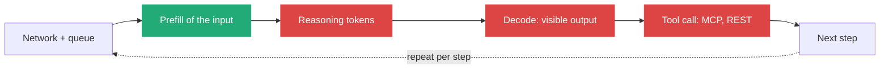
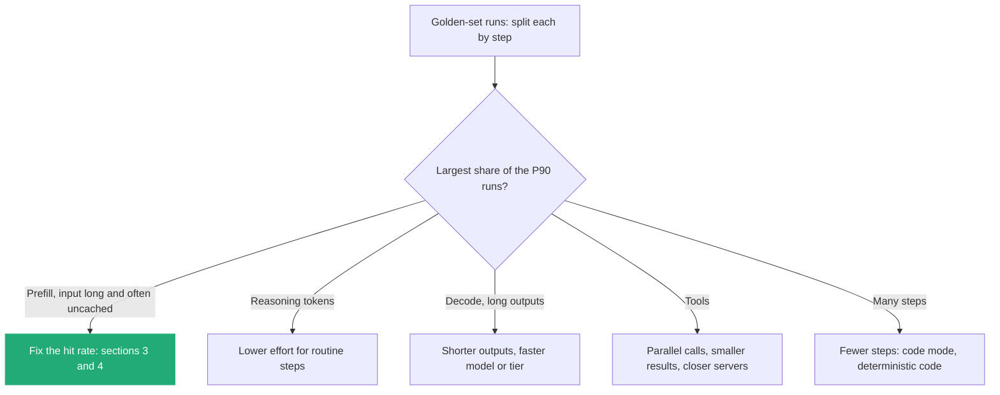

# 09. A higher cache hit rate cuts prefill and input cost, but it cannot fix P90 alone: I measure time to first token, decode speed and step count first

> Going from 75-89% to 95-99% cached input removes most of the prefill work and about half of the input cost, but a cache hit does nothing for reasoning time, decode speed, tool time or the number of steps; so before I spend effort on the hit rate I split each step of my golden-set runs into those parts and test whether the high-hit calls are really faster.

Related: [W2L1 24 Prompt caching](../Week2_Lecture_1_Agent_Primitives/24_KV_Cache_And_Prompt_Caching.md) · [W2L1 06 Context window and compaction](../Week2_Lecture_1_Agent_Primitives/06_Context_Window_And_Compaction.md) · [W2L1 25 Tool execution instead of tool calls](../Week2_Lecture_1_Agent_Primitives/25_Tool_Execution_Instead_Of_Tool_Calls.md) · [W2L1 03 Agent loop, limits and recovery](../Week2_Lecture_1_Agent_Primitives/03_Agent_Loop_Stop_Limits_Recovery.md) · [01 LLM vs classification](01_LLM_vs_Classification.md) · [12 Sandbox for agent code](12_Sandbox_For_Agent_Code_Pi_And_Search_Execute.md) · [10 Memory-centric approach with events](10_Memory_Centric_Approach_With_Events.md)

Source: S02E02 article, architecture question "Cache: how do we optimize for a 99% cache hit rate? And that's critical!" and the context-management section. My own golden-set numbers (below). OpenAI latency, reasoning and prompt-caching guides read through fetch summaries on 2026-11-22. See [Fact-check](#fact-check).

## Glossary

| Term | What it means here | Same thing elsewhere | Not to be confused with |
|---|---|---|---|
| Hit rate | Cached input tokens ÷ all input tokens of a call, from the usage fields | OpenAI `input_tokens_details.cached_tokens`, Anthropic `cache_read_input_tokens` | The share of calls with any hit |
| Prefill | Processing the input before the first output token | vLLM: caching reduces only this phase | Decoding |
| TTFT | Request sent until the first non-empty text delta (streaming) | OpenAI latency guide | Time to the first reasoning token |
| Decode speed | Output tokens per second after the first token, or its inverse, inter-token time | Token-to-token time | TTFT |
| Step | One model call plus the tool calls it triggers | Super-step in LangGraph | A whole run |
| Critical path | The chain of sequential spans that sets the run time | Trace waterfall | The sum of all spans |

## 1. The problem

My agent on GPT-6-luna has a cache hit rate of about 75-89%. My golden set gives a mean run time of 75 s and a P90 of 120 s. Time to first token is not acceptable and the token-to-token time is high. The lecture says a 99% hit rate is critical. **What does 95-99% buy me, what does it not touch, and what do I measure before I optimize?** The mechanics of the cache are in [W2L1 24](../Week2_Lecture_1_Agent_Primitives/24_KV_Cache_And_Prompt_Caching.md); this note is the diagnosis.

## 2. What a cache hit touches

| Part of a step | Does a cache hit shorten it? | What does |
|---|---|---|
| Network and queue | No | Region, tier |
| Prefill | Yes, in proportion to the uncached share (my reading of vLLM) | Cache hit rate, shorter input |
| Reasoning before the first visible text | No | Reasoning effort |
| Decode | No | Shorter output, faster model or tier |
| Tool calls | No | Parallel calls, smaller results, closer servers |
| Number of steps | No | Code mode, parallel calls, less model use |

The OpenAI guide says it directly: "A long prompt can delay the first token, especially when much of the input is new", and "time to first visible text still depends on any reasoning or tool work before the answer". In an agent, the user's first token comes after all steps that precede the answer.

Source: S02E02 article, figure 2. For the cache, the red "loaded next run" path matters: whatever the agent edits in its own primitives enters the next run's Context. If it enters before the conversation, the prefix changes and that run starts with a miss (my reading). New state belongs at the end of the context.

## 3. What 95-99% buys: arithmetic

Input cost per token against an uncached token is `hit × r + (1 − hit)`, with `r` the cached-read price ratio. I use `r = 0.1` from note 24 (OpenAI: read 0.1×, some models 0.05×). I have not checked GPT-6-luna's ratio. Cache-write premiums, output and reasoning tokens are not in the numbers.

| Hit rate | Uncached share | Input cost vs uncached | Against my 89% | Against my 75% |
|---|---|---|---|---|
| 75% | 25% | 0.325 | - | - |
| 89% | 11% | 0.199 | - | -39% |
| 95% | 5% | 0.145 | -27% | -55% |
| 99% | 1% | 0.109 | -45% | -66% |

The uncached share is what prefill has to compute: 25% to 5% is 5× fewer tokens, 11% to 1% is 11× fewer. Whether that shows in TTFT depends on how much of my TTFT is prefill, which I have not measured.

**A ceiling:** inside one thread the new tokens of each turn are always a miss, so `hit ≤ 1 − new ÷ total`. Adding 2k tokens to a 100k context allows at most 98%. A 99% target needs a large stable prefix against a small delta per turn (my arithmetic).

## 4. Where my missing 11-25% may sit

These are hypotheses until the logs confirm them. The mechanics are in [W2L1 24](../Week2_Lecture_1_Agent_Primitives/24_KV_Cache_And_Prompt_Caching.md).

| Suspect | How I check it in the logs |
|---|---|
| First call of a run or wake-up has nothing to hit | Hit rate of step 1 against later steps |
| Gap longer than the TTL (30 min or 12 h on OpenAI) | Hit rate against time since the previous call of the same prefix |
| Compaction or summarization rewrites the prefix | Drop in hit rate on the step after a compaction |
| Tool list or settings change (`reasoning.effort`, `text.format`, `parallel_tool_calls`) | Compare the request prefix of consecutive steps |
| Timestamp or "current state" high in the prompt | Diff the first 1k tokens across calls |
| Sub-agents or branches with no shared prefix | Hit rate per agent name |
| Model routing: each model has its own cache | Hit rate per model |
| Too many requests per `prompt_cache_key` (about 15 per minute) | Hit rate against request rate per key |
| `tool_search` activation changing the tool list ([12](12_Sandbox_For_Agent_Code_Pi_And_Search_Execute.md#5-cache-and-tool-search)) | Hit rate after a tool activation |

## 5. Measure the whole picture first

Per step, from my traces:

| Field | Where it comes from |
|---|---|
| TTFT | Stream timestamps: request sent to the first non-empty `response.output_text.delta` |
| Input tokens, cached tokens | `usage.input_tokens_details.cached_tokens` |
| Reasoning tokens, output tokens | `usage.output_tokens_details.reasoning_tokens`, billed as output |
| Decode speed | Output tokens ÷ (end of stream − first token) |
| `service_tier` | Response field, to see which tier served the call |
| Tool time | Span around each MCP call, and inside it the REST call |
| Steps per run | Count in the trace |

**The P90 test:** compare latency of high-hit and low-hit calls. Input size confounds it: long inputs both miss more and run slower. I compare inside buckets of equal input length. The mean of 75 s against the P90 of 120 s is a ratio of 1.6, a narrow tail: this suggests a cost in every run, such as many sequential steps, more than rare outliers (my inference, to confirm in the traces).

## 6. Levers outside the cache

OpenAI's latency guide lists seven principles: process tokens faster, generate fewer tokens, use fewer input tokens, make fewer requests, parallelize, make users wait less, and do not default to an LLM. It also describes Fast and Ultrafast modes as costing a premium, to compare against standard processing on the same prompts. I have not checked whether they exist for GPT-6-luna. In this repo: chaining tools in a script ([W2L1 25](../Week2_Lecture_1_Agent_Primitives/25_Tool_Execution_Instead_Of_Tool_Calls.md)), a small model for fixed choices ([01](01_LLM_vs_Classification.md)), deterministic work in code (the article's exchange quote).

## Summary

A 95-99% hit rate cuts the uncached input to 1-5% and the input cost by about half. It shortens prefill only. Reasoning, decode, tools and step count are separate costs, so I measure them per step and test the P90 claim inside equal input-size buckets before I commit to the hit-rate work.

## Open questions

- What is GPT-6-luna's cached-read price ratio, TTL options and minimum prefix?
- How much of my TTFT is prefill, and how much is reasoning?
- How many steps does a golden-set run take, and how long is the longest MCP to REST path?
- Which tracing do I use to record these fields?

## Fact-check

| # | Claim | Verdict | Source | Checked |
|---|---|---|---|---|
| 1 | A 99% cache hit rate is critical | **Lecture-specific** | S02E02 article. I found no vendor target | 2026-11-22 |
| 2 | Cached input reads cost 0.1× | **Unverified** for GPT-6-luna | Note 24 (OpenAI pricing page, 2026-11-15). Model-specific ratios not re-read | 2026-11-22 |
| 3 | TTFT is measured to the first non-empty text delta; a long, new input delays it | **Agrees** | [OpenAI latency optimization](https://developers.openai.com/api/docs/guides/latency-optimization), fetch summary | 2026-11-22 |
| 4 | First visible text depends on reasoning or tool work before it | **Agrees** | Same page | 2026-11-22 |
| 5 | Reasoning tokens are in `output_tokens_details.reasoning_tokens` and billed as output | **Agrees** | [OpenAI reasoning guide](https://developers.openai.com/api/docs/guides/reasoning), fetch summary. No latency figure given | 2026-11-22 |
| 6 | A cache hit shortens prefill only | **Agrees** | [vLLM prefix caching](https://docs.vllm.ai/en/latest/features/automatic_prefix_caching/), read 2026-11-15, see note 24 | 2026-11-22 |
| 7 | Fast and Ultrafast modes carry a premium | **Agrees**, availability unverified | OpenAI latency guide. Not checked for GPT-6-luna | 2026-11-22 |
| 8 | OpenTelemetry GenAI metrics define time-to-first-token and per-token time | **Unverified** | The page moved to a [separate repository](https://github.com/open-telemetry/semantic-conventions-genai) and its metrics file was not read. Verify before presenting | 2026-11-22 |

## Sources

- S02E02 article. My own golden-set numbers and hit-rate range.
- [OpenAI latency optimization](https://developers.openai.com/api/docs/guides/latency-optimization) · [OpenAI reasoning](https://developers.openai.com/api/docs/guides/reasoning) · [OpenAI prompt caching](https://developers.openai.com/api/docs/guides/prompt-caching) · [vLLM prefix caching](https://docs.vllm.ai/en/latest/features/automatic_prefix_caching/)
- My own reasoning: the cost table, the hit-rate ceiling, the miss-cause checks and the P90 test.
