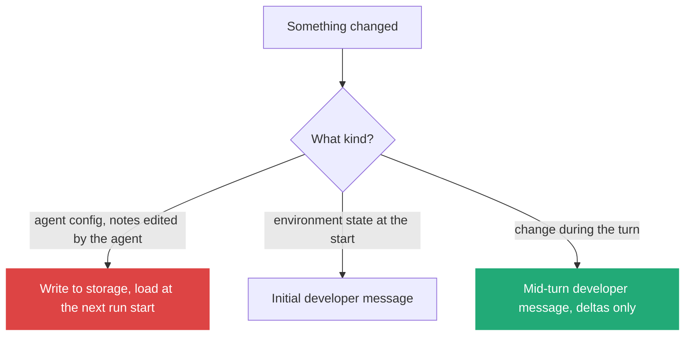

# 10. The context stack keeps the cache by putting what describes the agent first and appending only what changed; the agent's own edits to its notes must not rewrite the cached prefix

> The system prompt and the tools describe the agent and stay fixed; developer messages describe its environment, with the full state once at the start and only the changes during the turn, appended after the cached part. That keeps the prefix intact, but the editable Notes block inside the system prompt, the personalized top blocks and the provider's role rules can each break the cache unless I handle them on purpose.

Related: [09 Cache hit rate and P90](09_Cache_Hit_Rate_And_P90_Latency.md) · [W2L1 24 Prompt caching](../Week2_Lecture_1_Agent_Primitives/24_KV_Cache_And_Prompt_Caching.md) · [W2L1 06 Context window and compaction](../Week2_Lecture_1_Agent_Primitives/06_Context_Window_And_Compaction.md) · [16 Memory-centric approach with events](16_Memory_Centric_Approach_With_Events.md) · [14 Execution flows](14_Execution_Flows_Skill_Tool_Or_Workflow.md) · [13 LLM adapters and gateway](13_LLM_Adapters_And_Gateway.md) · [11 Model routing in LangGraph](11_Model_Routing_In_LangGraph.md)

Source: S02E02 article, "Context management" (figure 13). OpenAI's text-generation guide and Anthropic's Messages reference read on 2026-11-22 through fetch summaries. The cache mechanics are in [W2L1 24](../Week2_Lecture_1_Agent_Primitives/24_KV_Cache_And_Prompt_Caching.md). See [Fact-check](#fact-check).

## Glossary

| Term | What it means here | Same thing elsewhere | Not to be confused with |
|---|---|---|---|
| Context window | The tokens the model can read in one request | Context length | The cache, which only makes the same tokens cheaper |
| Prefix | The start of the request that must stay identical for a cache hit | Cached prefix | A system prompt alone |
| Developer message | An instruction from the application, above user messages in priority | OpenAI `developer` role | A user message |
| Mid-turn message | A message the harness appends after a tool result, with what changed | Environment update | An edit of the earlier messages |
| Personalized block | Prompt text that differs per user | Per-tenant role or capabilities | A shared template |

## 1. The problem

My agent must know its environment (events, schedules, running instances) and keep a high hit rate. The article says I "can't simply set our AGENTS.md, because we need to inject context mid-turn". **Where does each piece go so that the cache survives?**

## 2. The stack

![The article's context stack, top to bottom. A System prompt frame holds Role (personalized), Capabilities (personalized) and Notes (agent can modify, with a dashed line from the Agent). Then Tools (exec, search, fetch), a Developer message (initial, current state), a User message (scheduled by harness), a Tool call and a Tool result. A bracket marks all of these as cached. Below, a red Developer message (mid-turn, what changed) holds Events, Schedules and Running instances, with an arrow from the Harness. A faded Tool call follows.](img/context-stack-cached-prefix-mid-turn-developer-message.png)

Source: S02E02 article, figure 13. Caption: "The system prompt and the tools describe the agent. Developer messages describe its environment: the state at the start, and during the turn only what changed."

| Block | Changes | Written by | Cache rule |
|---|---|---|---|
| Role, Capabilities | Per user | Harness | Fixed within a run |
| Notes (agent can modify) | When the agent edits | Agent | A same-run edit rewrites the prefix: a miss from that point |
| Tools | Per deploy | Harness | Fixed order, none added or removed mid-run ([W2L1 24](../Week2_Lecture_1_Agent_Primitives/24_KV_Cache_And_Prompt_Caching.md)) |
| Initial developer message | Once per run | Harness | A snapshot, then it stays |
| User message | Per wake-up | Harness | Appended |
| Tool call, result | Per step | Model, tools | Appended |
| Mid-turn developer message | Per turn | Harness | Appended after the cached part, deltas only |

- **Important:** the red block sits after the cached bracket, so what changes never touches the prefix. The unusual part is Notes: it lives inside the cached system prompt and the agent can edit it.
- **Not important:** the faded last box, which only shows that the turn continues.

## 3. What the picture implies (my reasoning)

- **Notes edits:** the article's figure 2 says what the agent edits is "loaded next run". Inside one run, an edit of Notes in the system prompt changes the prefix, so I keep the run's copy frozen and surface the change in the next mid-turn message if the agent needs it now.
- **Personalization at the top:** the provider matches the prefix, so two users with different Role text never share a cache entry. I put the shared text first and the personalized text after it, and I check the hit rate per user, since a sparse wake-up pattern outlives the TTL ([16](16_Memory_Centric_Approach_With_Events.md), [09](09_Cache_Hit_Rate_And_P90_Latency.md)).
- **Delta size:** each turn's new tokens set the ceiling `1 − new ÷ total` ([09](09_Cache_Hit_Rate_And_P90_Latency.md)), so the mid-turn message carries only what changed.
- **Window against cache:** the cache does not enlarge the window. Compaction still rewrites the thread, so it costs a miss ([W2L1 06](../Week2_Lecture_1_Agent_Primitives/06_Context_Window_And_Compaction.md)).

## 4. Roles differ by provider

| | OpenAI | Anthropic |
|---|---|---|
| Roles | `developer`, `user`, `assistant`. Developer is prioritized ahead of user | `user` and `assistant` in `messages`. The system prompt is the top-level `system` parameter. The schema also lists a `system` role in `messages`, the prose does not use it. No `developer` role documented |
| Guidance across turns | The first `developer` message in `input`, eligible for caching | The `system` parameter |
| Top-level `instructions` | From GPT-6.2, billed at the uncached input rate | n/a |
| A mid-turn "developer message" | Placement mid-conversation not documented on the page I read | Send as user-role text or inside a tool result |

For [13](13_LLM_Adapters_And_Gateway.md) this means one internal operation, "add an environment update", and one implementation per dialect. For my hit rate: if my agent sends its guidance in top-level `instructions`, it may be billed uncached.

## 5. My agent today: piled-up answers and system messages

My loop adds reasoning and tool results to the history on every step, and I summarize at 75% of the window. Appending is what the vendors recommend: "Append new messages rather than rewriting earlier turns", and reusing the growing history "can save more input tokens than caching only the initial instructions" (OpenAI). So piling is not the problem. What breaks the prefix is anything that changes or moves text that is already there:

| Suspect | Why it misses | Check |
|---|---|---|
| Keeping only the last N messages | The oldest message drops out, so the whole prefix shifts every turn. LangChain's trimming example keeps the first message and a few recent ones | The first differing message index moves forward each call |
| Editing a message in place | `add_messages` "updates existing ones by ID", so a reused ID rewrites an earlier message | Same ID, different text between calls |
| Rebuilding the system message each call | Time, state or events inside it change the first block | Diff the first block between calls |
| Inserting a state message before the latest user turn | Everything after the insert point is new | First difference sits in the middle |
| My summarization at 75% | Replaces earlier turns once, then the new prefix is cached again. It costs an extra LLM call and loses detail. OpenAI: "fewer input tokens can still save money even when the cache-hit rate falls". An alternative is [19](19_Evict_Tool_Results_To_Memory_By_Reference.md) | Hit rate on the call right after it |
| Developer messages after the first block | They "are not automatic cache lookup boundaries" (OpenAI) | `cached_tokens` stays flat as they pile up |
| Unstable serialization of tool results | Key order or whitespace differs | Diff the raw request bytes |

**A diagnostic without any model call**, from logged requests: for each pair of consecutive calls in a run, find the first position where request N+1 differs from request N, and divide the shared part by the length of N+1. Compare it with the reported `cached_tokens`:

| Shared prefix against `cached_tokens` | Meaning |
|---|---|
| About equal | My prompt construction diverges at that position. The block there is the cause |
| Shared prefix much larger | The prompt is stable. Look at the provider side: TTL, routing key, breakpoints, minimum length ([W2L1 24](../Week2_Lecture_1_Agent_Primitives/24_KV_Cache_And_Prompt_Caching.md)) |
| Shared prefix small | I rewrite or trim early. Fix section 3 first |

**Piling has its own cost.** Cached reads are cheaper, not free, and a longer history costs more per call ([09](09_Cache_Hit_Rate_And_P90_Latency.md)). Old tool results are most of it, so I move them out by reference instead of summarizing the whole thread: [19](19_Evict_Tool_Results_To_Memory_By_Reference.md).

**The TTFT hope is a hypothesis.** A miss on a long prefix repeats the whole prefill, so small fixes can change TTFT a lot when prefill is most of it. If reasoning or tool time dominate, they will not. I measure the prefill share first ([09](09_Cache_Hit_Rate_And_P90_Latency.md#5-measure-the-whole-picture-first)).

## 6. The lecturer's principles against the market

| Lecturer's principle | What others say | Verdict |
|---|---|---|
| Fixed system prompt and tools first | OpenAI: stable instructions first. Manus: "Keep your prompt prefix stable", no second-precise timestamp at the top | **Agrees** |
| Few tools: exec, search, fetch | Manus masks tools through decoding instead of removing them mid-task. Anthropic and OpenAI defer rare tools to a search ([15](15_Tool_Navigation_And_Flexibility.md)) | **Agrees** in direction |
| Initial developer message with the current state | OpenAI has the role and caches it. Anthropic documents none | **Agrees** where the role exists |
| Mid-turn message with only what changed | OpenAI and Manus: append, never rewrite | **Agrees** |
| Self-steering messages from tool hooks | Not found in the sources I read | **Lecture-specific** |
| (Not in the lecture) clear or offload old tool results | Anthropic context editing, Deep Agents offloading, Manus | A gap: [19](19_Evict_Tool_Results_To_Memory_By_Reference.md) |

## Summary

Fixed blocks first, environment state in an initial developer message, only changes appended after the cached part. Notes edits wait for the next run, personalized text goes after shared text, and each provider needs its own way to append a developer-level update. Piling by appending is fine (my loop adds tool results each step and I summarize at 75%); trimming from the front, editing in place and rebuilding the system message are what break the prefix, and a first-difference check on logged requests shows which one my agent does.

## Open questions

- Which of the seven suspects in section 5 does my agent do: trimming, in-place edits, a rebuilt system message, inserted state?
- Where does the first differing position fall between consecutive calls in my traces?
- Does GPT-6-luna fall under the GPT-6.2 `instructions` billing rule, and does my agent use `instructions`?
- What does my agent do with Notes edits inside a run?
- On Anthropic, does a `system` role inside `messages` work, or must the update be user text?
- What is my hit rate per user?
- Is the next step an eviction by reference, as in [19](19_Evict_Tool_Results_To_Memory_By_Reference.md)?

## Fact-check

| # | Claim | Verdict | Source | Checked |
|---|---|---|---|---|
| 1 | Prefix caching needs the earlier context to stay the same | **Agrees** | [W2L1 24](../Week2_Lecture_1_Agent_Primitives/24_KV_Cache_And_Prompt_Caching.md), S02E02 article | 2026-11-22 |
| 2 | OpenAI roles are `developer`, `user`, `assistant`; developer is prioritized; cross-turn guidance goes in the first developer message, which is cache-eligible | **Agrees** | [OpenAI text guide](https://developers.openai.com/api/docs/guides/text), fetch summary | 2026-11-22 |
| 3 | From GPT-6.2, top-level `instructions` are billed at the uncached rate | **Agrees**; applies to GPT-6-luna: **Unverified** | Same page | 2026-11-22 |
| 4 | Anthropic's system prompt is top-level; no developer role is documented | **Agrees** | [Messages reference](https://platform.claude.com/docs/en/api/messages/create), read to 100,000 of 150,405 characters. Behavior of an in-array `system` role is unverified | 2026-11-22 |
| 5 | A mid-turn message appended after the cached part keeps the prefix | **Agrees**, by the prefix rule | Lecture claim, my reasoning from note 24 | 2026-11-22 |
| 6 | An edit of Notes inside the system prompt breaks the cache from that point | **Unverified** in practice | My reasoning from the prefix rule | 2026-11-22 |
| 7 | Append rather than rewrite; truncation, summarization and compaction can reset reuse; developer messages after the first block are not automatic lookup boundaries | **Agrees** | [OpenAI prompt caching](https://developers.openai.com/api/docs/guides/prompt-caching), fetch summary | 2026-11-22 |
| 8 | `add_messages` updates existing messages by ID; the trimming example keeps the first message and a few recent ones; no mention of cache | **Agrees** | [Graph API](https://docs.langchain.com/oss/python/langgraph/graph-api), [short-term memory](https://docs.langchain.com/oss/python/langchain/short-term-memory), fetch summaries | 2026-11-22 |
| 9 | Small prompt fixes cut TTFT drastically | **Unverified** | My hypothesis. Depends on the prefill share of TTFT | 2026-11-22 |
| 10 | Stable prefix, append-only context, tools masked not removed | **Agrees** | [Manus blog](https://manus.im/blog/Context-Engineering-for-AI-Agents-Lessons-from-Building-Manus), fetch summary. A vendor's own account | 2026-11-22 |

## Sources

- S02E02 article, figure 13 and the context-management bullets.
- [OpenAI text generation](https://developers.openai.com/api/docs/guides/text) · [OpenAI prompt caching](https://developers.openai.com/api/docs/guides/prompt-caching) · [LangChain short-term memory](https://docs.langchain.com/oss/python/langchain/short-term-memory) · [Manus context engineering](https://manus.im/blog/Context-Engineering-for-AI-Agents-Lessons-from-Building-Manus) · [Anthropic Messages API](https://platform.claude.com/docs/en/api/messages/create) · [W2L1 24](../Week2_Lecture_1_Agent_Primitives/24_KV_Cache_And_Prompt_Caching.md)
- My own reasoning: the block table, section 3, the provider table's last row and the diagnostic in section 5.
