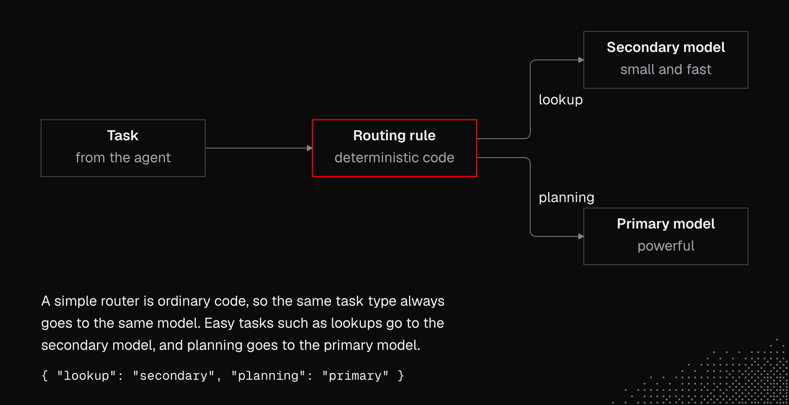
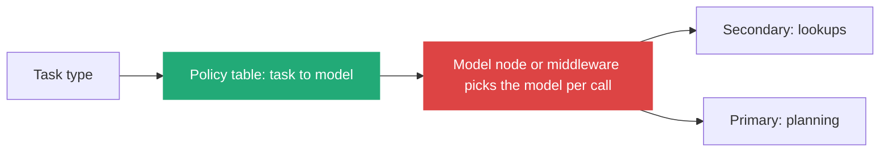

# 11. LangGraph chooses a model per call without changing the graph, so routing by role needs no dynamic graph; the real cost is a cold cache on every switch

> The graph's shape is fixed once compiled, but the model is not part of the shape: LangChain middleware, runtime context and configurable models pick it at call time, and Deep Agents subagents carry their own model; Claude Code, Aider and Foundry's model router show that roles are the common split, so I route by role with a policy table and pay for it in cache and evals, not in graph generation.

Related: [13 LLM adapters and gateway](13_LLM_Adapters_And_Gateway.md) · [09 Cache hit rate and P90](09_Cache_Hit_Rate_And_P90_Latency.md) · [07 Workflows on the fly and todo lists](07_Workflows_On_The_Fly_And_Todo_Lists.md) · [06 Workflow vs LangGraph](06_Workflow_vs_LangGraph.md) · [01 LLM vs classification](01_LLM_vs_Classification.md) · [02 Classification model vs decision model](02_ClassificationModel_vs_DecisionModel.md) · [W2L1 17 Extend, adjust or leave the framework](../Week2_Lecture_1_Agent_Primitives/17_Extend_Adjust_Or_Leave_The_Framework.md) · [W2L1 22 Threads, subagents and A2A](../Week2_Lecture_1_Agent_Primitives/22_Threads_Vs_A2A_Subagents.md) · [W2L1 24 Prompt caching](../Week2_Lecture_1_Agent_Primitives/24_KV_Cache_And_Prompt_Caching.md)

Source: S02E02 article, "Providers and configuration" (model routing, figure 8). LangChain, LangGraph and Deep Agents docs, Claude Code model docs, Aider docs and a search summary on Foundry's model router, read on 2026-11-22 through fetch summaries. See [Fact-check](#fact-check).

## Glossary

| Term | What it means here | Same thing elsewhere | Not to be confused with |
|---|---|---|---|
| Model routing | Picking the model for each task or call by a rule | Anthropic's "routing" workflow, Foundry model router | A fallback after an error |
| Primary / secondary | A powerful model for hard steps, a small fast one for easy steps | Architect and editor (Aider), `opusplan` | Two copies of one model |
| Policy table | Task type to model, as data: `lookup` to secondary, `planning` to primary | The article's routing rule | A learned router |
| Runtime context | Per-run values passed to nodes, not stored in state | LangGraph `context_schema`, `runtime.context` | Graph state |
| Model middleware | A hook around each model call that can replace the model | `wrap_model_call` | A graph node |
| Compiled graph | The checked graph that runs, with checkpointer attached | `StateGraph.compile()` | The builder |

## 1. The problem

I want several models in one execution: a strong one for planning, a small one for lookups. I suspect LangGraph cannot change the graph or the `call_model` node after compile, so I would need two models registered and a choice, or a planning node and an execution node, or graphs generated per task. **How well is LangGraph prepared, and is this used in the industry?**



Source: S02E02 article, figure 8. Caption: "A simple router is ordinary code, so the same task type always goes to the same model. Easy tasks such as lookups go to the secondary model, and planning goes to the primary model."

```json
{ "lookup": "secondary", "planning": "primary" }
```

## 2. The graph is fixed, the model is not

The docs require compiling before a run and checking the structure at compile time. They do not say a compiled graph can be edited, and a resumed run uses "the graph you compile now". So topology is fixed in practice. The model is a value read inside a node:

| Way in LangGraph | How it picks the model | Graph change | Documented |
|---|---|---|---|
| Middleware around the model call | `@wrap_model_call`, `request.override(model=...)`. The docs example uses message count | None | Yes, LangChain agents |
| Configurable model | `init_chat_model(...)` with `config={"configurable": {"model": ...}}` | None | Yes |
| Runtime context | `context_schema`, `runtime.context`, `graph.invoke(..., context={...})`. The docs' own example value is a model name | None | Yes |
| Two nodes, planner and executor | `Command(goto=...)` or conditional edges | Fixed at build time | Yes |
| Subagent with its own model | Deep Agents `model` field per subagent. A compiled subagent has no such field | None | Yes, field table |
| A new graph per task | Compile per task | Whole graph, and resume compatibility | Cost of compiling not documented |

My two options, two registered models or two nodes, are the third and fourth rows. The first three need neither. One limit from the docs: a pre-bound model (`bind_tools` already called) is not supported together with structured output in dynamic selection.



## 3. What the industry does

| Who | What | Level |
|---|---|---|
| [Claude Code](https://code.claude.com/docs/en/model-config) | `opusplan`: Opus in plan mode, Sonnet for execution. Subagents take a `model` field or an environment variable | Role |
| [Aider](https://aider.chat/docs/usage/modes.html) | Architect mode: the main model proposes, an editor model writes the edits. "This uses two LLM requests, which can take longer and increase costs" | Role |
| [Deep Agents](https://docs.langchain.com/oss/python/deepagents/subagents) | Examples give a Gemini subagent for large context and a GPT subagent for numbers | Subagent |
| Foundry model router | A small ML model picks the underlying model per prompt, with Balanced, Quality and Cost modes. It charges for its own input. Microsoft cites early customers with up to 50% lower latency, a community test found equal latency (search summary, pages not read) | Per prompt |

So routing is used, but by role, by subagent or by a router in front, not by generating the graph. I found no adoption numbers, so "widely used" stays unmeasured. What I did not find is graph composition on the fly as a routing method ([07](07_Workflows_On_The_Fly_And_Todo_Lists.md) covers its resume cost).

## 4. What routing costs me

- **Cold cache on each switch.** Each model has its own cache ([09](09_Cache_Hit_Rate_And_P90_Latency.md)). A secondary model that takes over mid-thread prefills the whole thread again, which can cost more than the saving on a short step. Routing pays off when the small model runs a short, separate context: a subagent or a lookup call.
- **Behavior differs.** Models differ in tool-call style and reasoning settings, so a role needs its own eval ([W2L1 16](../Week2_Lecture_1_Agent_Primitives/16_Evals_For_Agent_Changes.md)). Microsoft's own advice for its router is to validate with my evals.
- **More moving parts.** The policy table lives in config, and the gateway applies it with fallbacks ([13](13_LLM_Adapters_And_Gateway.md)).

## Summary

LangGraph is prepared well enough: the graph stays fixed and the model is chosen per call by middleware, context or configuration, or by subagents with their own model. The industry routes by role or subagent. I start with a policy table and subagents for isolated work, and measure cache and quality per role before anything more dynamic.

## Open questions

- How much does the second prefill cost in my agent when a small model takes over, from my per-step data in [09](09_Cache_Hit_Rate_And_P90_Latency.md)?
- Which of my steps are short and separate enough for a secondary model?
- Is a decision model or a rule enough to classify the task type ([02](02_ClassificationModel_vs_DecisionModel.md))?

## Fact-check

| # | Claim | Verdict | Source | Checked |
|---|---|---|---|---|
| 1 | After compile I cannot adjust the graph | **Unverified** as a rule | [Graph API](https://docs.langchain.com/oss/python/langgraph/graph-api): "You must compile the graph before you invoke or stream it"; no statement on editing after compile; resumed runs use the graph compiled now | 2026-11-22 |
| 2 | The model can be replaced per call | **Differs** from my assumption | [Custom middleware](https://docs.langchain.com/oss/python/langchain/middleware/custom), [models](https://docs.langchain.com/oss/python/langchain/models): `wrap_model_call` with `request.override(model=...)`; configurable models | 2026-11-22 |
| 3 | Runtime context can carry a model name | **Agrees** | Graph API page, `context_schema` | 2026-11-22 |
| 4 | Deep Agents subagents can use their own model | **Agrees** | [Subagents](https://docs.langchain.com/oss/python/deepagents/subagents), last 8,000 characters unread. No `model` field on compiled subagents is my inference | 2026-11-22 |
| 5 | Claude Code uses Opus for planning and Sonnet for execution | **Agrees** | [Model config](https://code.claude.com/docs/en/model-config), `opusplan`; page read to 100,000 of 134,711 characters | 2026-11-22 |
| 6 | Aider's architect and editor split costs two requests | **Agrees** | [Aider modes](https://aider.chat/docs/usage/modes.html) | 2026-11-22 |
| 7 | Foundry's model router: ML router, three modes, charges router input, up to 50% lower latency | **Unverified** | Search summary of Microsoft Learn and blog pages, none read. Verify before presenting | 2026-11-22 |
| 8 | Routing is not widely used | **Unverified** | No adoption data found. Role-level use is documented (rows 5 to 7) | 2026-11-22 |
| 9 | A primary and secondary model gives a noticeable efficiency gain; Arena "Max" is a router | **Lecture-specific** | S02E02 article. Arena Max not checked | 2026-11-22 |
| 10 | Compiling a graph per task is cheap | **Unverified** | Not documented | 2026-11-22 |

## Sources

- S02E02 article, figure 8.
- [LangChain middleware](https://docs.langchain.com/oss/python/langchain/middleware/custom) · [LangChain models](https://docs.langchain.com/oss/python/langchain/models) · [LangGraph graph API](https://docs.langchain.com/oss/python/langgraph/graph-api) · [Deep Agents subagents](https://docs.langchain.com/oss/python/deepagents/subagents)
- [Claude Code model config](https://code.claude.com/docs/en/model-config) · [Aider chat modes](https://aider.chat/docs/usage/modes.html)
- My own reasoning: the options table in section 2, the cache cost in section 4.
