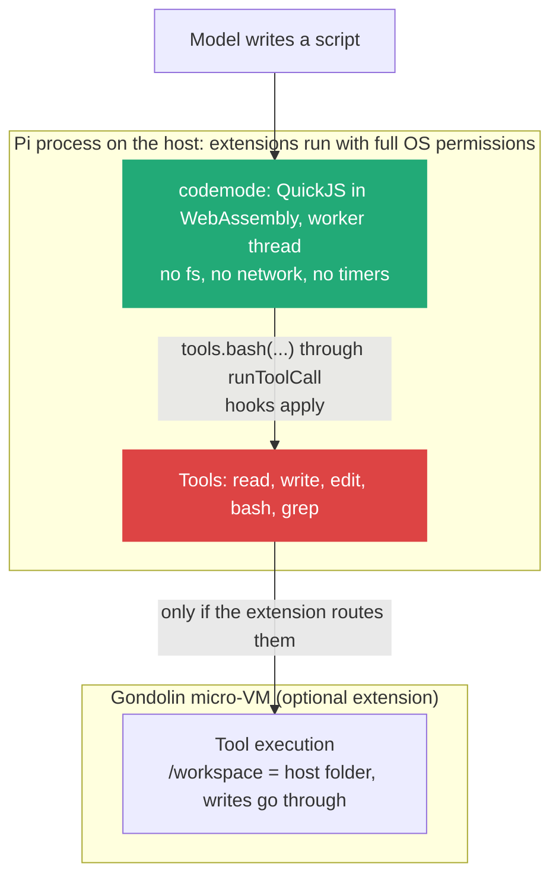

# 12. A sandbox has three layers, and Pi's codemode sandboxes only the script: the tools it calls still need their own boundary

> "Sandbox" names three different walls: one around a script (Pi codemode: QuickJS in WebAssembly; Cloudflare: a V8 isolate), one around tool execution (Pi plus the Gondolin micro-VM), and one around the whole harness (Docker, Docker Sandboxes). Pi gives me the first by default and the other two by extension; the official DeepSeek API gives none; Claude's "search then run code" is two separate features, and the exact `search()` and `execute()` pair is Cloudflare's.

Related: [09 Cache hit rate and P90](09_Cache_Hit_Rate_And_P90_Latency.md) · [07 Workflows on the fly](07_Workflows_On_The_Fly_And_Todo_Lists.md) · [W2L1 04 HITL and execution isolation](../Week2_Lecture_1_Agent_Primitives/04_HITL_And_Execution_Isolation.md) · [W2L1 25 Tool execution instead of tool calls](../Week2_Lecture_1_Agent_Primitives/25_Tool_Execution_Instead_Of_Tool_Calls.md) · [W2L1 08 Tool search](../Week2_Lecture_1_Agent_Primitives/08_Tool_Search_Instead_Of_Many_Tools.md) · [W2L1 19 Pi, LangGraph, DeepSeek](../Week2_Lecture_1_Agent_Primitives/19_Pi_LangGraph_DeepSeek_Harnesses.md) · [W2L1 24 Prompt caching](../Week2_Lecture_1_Agent_Primitives/24_KV_Cache_And_Prompt_Caching.md) · [Lecture 1: 10 Code mode](../Lecture_1_Mechanics_Behind_Generative_AI/10_code_mode.md) · [Lecture 5: 09 Local fleet lab](../Lecture_5_Workflows_not_tool_sets/09_Local_Fleet_Lab_Sandboxes_And_Worktrees.md) · [Lecture 5: 10 Fleet lab threat model](../Lecture_5_Workflows_not_tool_sets/10_Fleet_Lab_Threat_Model.md)

Source: S02E02 article, architecture questions "Capabilities" and "Integrations", and the "Designing tools" section. Pi docs and repo files, Cloudflare and Anthropic docs, the community DeepSeek TUI README, read on 2026-11-22 through fetch summaries (no install, no run). See [Fact-check](#fact-check).

## Glossary

| Term | What it means here | Same thing elsewhere | Not to be confused with |
|---|---|---|---|
| Script sandbox | A runtime that runs model-written code with only injected functions | Cloudflare Dynamic Worker isolate, Pi `CodemodeSandbox`, OpenAI's no-network V8 | An OS boundary |
| Micro-VM | A small virtual machine with its own kernel | Gondolin, Docker Sandboxes (`sbx`), Firecracker | A container, which shares the host kernel |
| Tool isolation | Built-in tools (`bash`, `read`, `write`) run elsewhere than the harness | Pi Gondolin extension | Harness isolation |
| Harness isolation | The whole agent process runs inside the wall | Plain Docker, Docker Sandboxes, OpenShell | Tool isolation |
| Search → execute | One tool finds what exists, another runs code against it | Cloudflare `search()` and `execute()`, Lecture 1 `find` and `execute` | Anthropic's tool search tool |
| Deferred tool | Registered, but not in the model's tool list until found | Anthropic `defer_loading`, Pi `exposure: "deferred"` | A disabled tool |
| Credential proxy | The real key stays outside; the wall sees a placeholder | Docker Sandboxes proxy | A secret manager |

## 1. The problem

The article asks "does the agent need its own computer, browser, filesystem or sandbox?" and says primitives live as files, so the agent must write code. **Can I give a harness a wall for that code, and a "search then execute" way to reach tools, in Pi and in DeepSeek-based setups, as Claude does?** Per-tenant walls are in [W2L1 04](../Week2_Lecture_1_Agent_Primitives/04_HITL_And_Execution_Isolation.md), the fleet lab in Lecture 5, code mode in [W2L1 25](../Week2_Lecture_1_Agent_Primitives/25_Tool_Execution_Instead_Of_Tool_Calls.md). This note adds the layers and the Pi and DeepSeek facts.

![The article's architecture figure. A User gives a task and gets requests to approve and reports. The Harness frame ("what we build") holds Tools, the Agent loop (Think, Act, Observe around the Model), Context, State and Permissions. Below it, a Primitives frame holds six blocks: Integrations, Values, Secrets, Apps, Documents and Packages. Red arrows run from Permissions down to Primitives ("create / edit") and from Primitives up to Context ("loaded next run"). Only Integrations leads to External systems ("only way out").](img/harness-loop-context-primitives-only-way-out.png)

Source: S02E02 article, figure 2. Caption: "The harness gives the agent loop access to primitives. The agent changes itself when it creates or edits its own primitives within approved permissions, and the next run loads them."

- **Important:** Integrations is the only way out, so one wall at that exit covers every external call. Secrets are "hidden from the model", the same idea as the credential proxy in the glossary. Code the agent writes into Documents or Packages goes through Permissions and reaches the next run's Context.
- **Not important:** the box layout and the dark styling.

## 2. Three walls, three layers

A script can only call the functions injected into it, so the script wall is tight. But those functions run on the host, so the wall is only as strong as the tools behind it (my reading of the Pi sources below). A script that calls `tools.bash` runs bash wherever bash runs.

| Layer | Examples | What stays outside the wall |
|---|---|---|
| Script | Pi `CodemodeSandbox`, Cloudflare isolate | Every tool the script may call |
| Tool execution | Pi + Gondolin (Node 23.6+, QEMU) | The Pi process, extension tools that do not delegate, env variables (inherited) |
| Whole harness | Docker, Docker Sandboxes, OpenShell | Whatever I mount or forward |

## 3. Pi: what is there

- **No built-in sandbox.** Extensions run "with the same operating-system permissions". Policy is a hook: `tool_call` can block (`{ block: true }`), the `permission-gate.ts` example confirms `rm -rf` and `sudo`. A hook is a rule, not a wall ([Lecture 5: 10](../Lecture_5_Workflows_not_tool_sets/10_Fleet_Lab_Threat_Model.md)).
- **Replace a built-in.** Registering a tool under a built-in name replaces it "without a warning". `--no-builtin-tools` removes all built-ins. The `bash` tool takes a `spawnHook` (rewrite command, cwd, env) and pluggable operations for SSH or containers. `GrepOperations` covers only the directory check, grep still runs the local `rg` unless I override it.
- **Gondolin example.** It re-registers `read`, `write`, `edit`, `bash`, `ls`, `find`, `grep` to run in a local micro-VM. The host folder mounts at `/workspace` and writes go through to the host. The VM inherits the host environment, so Pi's docs say not to treat it as a credential boundary.
- **Pi's own isolation doc** lists four options: plain Docker, Docker Sandboxes, OpenShell, Gondolin. Its warning: tool-only isolation "does not constrain the host Pi process or extension tools that do not use the isolated backend".
- **Codemode.** `CodemodeSandbox` runs the script in QuickJS compiled to WebAssembly, in a worker thread, about 20 ms to start. Only `tools`, `ALL_TOOLS`, `text`, `console`, `store` and `load` exist, "no timers, `fetch`, `process`, `require`". Options: `timeoutMs` (the MCP example sets 120 s), `memoryLimitBytes`, output caps. Nested calls go through `runToolCall`, so validation and `beforeToolCall` hooks still apply.
- **Search.** Exposure modes: `direct`, `model-only`, `codemode`, `deferred`, `hidden`. A `deferred` tool is found by the built-in `tool_search`, activated with `pi.setActiveTools()`, and "stays callable from codemode scripts whether active or not". `ALL_TOOLS` lists name and description to a script.

So in Pi, "search then execute" is `tool_search` (or a script filtering `ALL_TOOLS`) plus codemode. It is not one fixed pair of tools.

## 4. Search → execute across vendors

| | Search | Execute | Where code runs | Network and secrets |
|---|---|---|---|---|
| [Cloudflare Code Mode MCP](https://blog.cloudflare.com/code-mode-mcp/) | `search()`: JS against the OpenAPI spec | `execute()`: JS calling `cloudflare.request()` | Dynamic Worker, V8 isolate | No fs, no env, fetch off by default, OAuth scope |
| [Anthropic](https://platform.claude.com/docs/en/agents-and-tools/tool-use/tool-search-tool) | `tool_search_tool_regex` or `_bm25`, server side, `defer_loading` | Separate: programmatic tool calling in code execution ([W2L1 25](../Week2_Lecture_1_Agent_Primitives/25_Tool_Execution_Instead_Of_Tool_Calls.md)) | Anthropic's code execution | Per Anthropic docs, not re-read here |
| Pi | `tool_search`, `ALL_TOOLS` | `codemode` tool | QuickJS WASM on the host | No network in the script, tools unrestricted by default |
| DeepSeek API | None found | None found | The caller runs functions | n/a |
| Community DeepSeek TUI ([CodeWhale](https://github.com/Hmbown/DeepSeek-TUI)) | Not in the current README | "Code mode" (experimental, on by default) | Host process | Seatbelt on macOS, bubblewrap on Linux, none on Windows, Full Access turns it off |

Two cautions on the table. The TUI is "independently maintained and not affiliated with DeepSeek". Older docs.rs copies of it list `tool_search_tool_regex` and a Python `code_execution` tool; I did not verify them for the current version.

## 5. Cache and tool search

Anthropic keeps deferred tools out of the prefix and appends a `tool_reference` inline, so discovery does not rewrite the tool list. A `deferred` tool cannot carry `cache_control`. Pi says only that after a search "the model receives the updated tool list on its next request". If that list sits before the conversation, each activation can invalidate the cache ([W2L1 24](../Week2_Lecture_1_Agent_Primitives/24_KV_Cache_And_Prompt_Caching.md)). Not verified for Pi: test before I rely on it, with the checks in [09](09_Cache_Hit_Rate_And_P90_Latency.md#4-where-my-missing-11-25-may-sit).

## 6. Which wall when (my reasoning)

| Situation | Wall I would start with |
|---|---|
| Me alone, trusted repo | Pi as is, a permission gate, no wall |
| Agent-written code against an API | Script sandbox (isolate or QuickJS), tools limited to that API |
| Agent runs shell on a shared or always-on host | Micro-VM or Docker Sandboxes with a credential proxy ([Lecture 5: 09](../Lecture_5_Workflows_not_tool_sets/09_Local_Fleet_Lab_Sandboxes_And_Worktrees.md)) |
| Many tenants | A wall per tenant, never a shared folder ([W2L1 04](../Week2_Lecture_1_Agent_Primitives/04_HITL_And_Execution_Isolation.md)) |
| Windows laptop | Docker or a VM: the TUI has no OS sandbox there, Docker Sandboxes' install was verified on macOS only |

## 7. Freedom lives inside a scope, and the wall proves it

Source: S02E02 article, figure 3. Caption: "The app gives the agent an interface to a library of filters. Through it, the agent creates new filters and manages existing ones freely, but only within this scope."

- **Important:** the freedom is in what the agent creates (a new filter with its own options), not in which operations exist. The interface in red is fixed in advance. The article asks what happens to projects that used a filter the agent later modified.
- **Not important:** the filter names and swatches.
- **My take:** the better the model, the more freedom I can give it, and the more I need a mechanism that proves the scope holds. A rule in a prompt proves nothing. The walls of section 2, a permission gate and an audit trail do ([W2L1 04](../Week2_Lecture_1_Agent_Primitives/04_HITL_And_Execution_Isolation.md), [Lecture 5: 10](../Lecture_5_Workflows_not_tool_sets/10_Fleet_Lab_Threat_Model.md)).

**Second level.** The same CRUD shape, with more flexibility: the agent creates whole features, not only filters.

Source: S02E02 article, figure 4. Caption: "The agent builds tools, panels and workflows for each user. We shape the environment: the interface it gets, the rules it follows and the limits it can't cross."

| Level | The agent creates | I fix in advance |
|---|---|---|
| 1 | Filters: data in one library | Four operations on that library |
| 2 | Tools, panels, workflows: features for each user | The interface, the rules, the limits |

- **Important:** three kinds of fixed things. The interface says what it can do. Rules say what it must keep. Limits say what it cannot cross. My reading: a limit needs a wall (section 2), a rule needs a check, such as append-only history or a test that old projects still open.
- **Not important:** the example names.

## Summary

Script wall, tool wall and harness wall are different, and a tight script wall does not protect the tools behind it. Pi has a script wall and a documented way to build the tool wall. DeepSeek's official API offers no execution at all. The search → execute pair is Cloudflare's; Claude offers tool search and programmatic calling as separate features.

## Open questions

- Who writes the code: the agent, the user, or me? Does each tenant need a wall of its own?
- Which network does the code need, and where does its state live?
- Does a `tool_search` activation in Pi change the cached prefix?
- Do I run Gondolin on a Mac to see what a write-through mount exposes? That needs an install, so it waits for my yes.

## Fact-check

| # | Claim | Verdict | Source | Checked |
|---|---|---|---|---|
| 1 | Pi has no built-in sandbox and extensions run with OS permissions | **Agrees** | [Extensions docs](https://docs.pi.dev/latest/extensions), two fetch passes, summary | 2026-11-22 |
| 2 | Gondolin routes built-ins into a micro-VM (Node 23.6+, QEMU), mounts the cwd write-through, inherits env | **Agrees** | [`gondolin/index.ts`](https://github.com/earendil-works/pi/blob/main/packages/coding-agent/examples/extensions/gondolin/index.ts), [containerization](https://github.com/earendil-works/pi/blob/main/packages/coding-agent/docs/containerization.md), fetch summaries | 2026-11-22 |
| 3 | Pi codemode runs QuickJS in WASM with timeout and memory caps, no fetch or timers | **Agrees** | [packages/codemode](https://github.com/earendil-works/pi/tree/main/packages/codemode) README, [`mcp-codemode/tools.ts`](https://github.com/earendil-works/pi/blob/main/packages/agent/examples/mcp-codemode/tools.ts), fetch summaries | 2026-11-22 |
| 4 | Pi `deferred` exposure plus `tool_search` and `setActiveTools` | **Agrees** | Extensions docs | 2026-11-22 |
| 5 | Cloudflare: `search()` and `execute()` in a V8 isolate, no fs or env, fetch off by default | **Agrees** | [Cloudflare blog](https://blog.cloudflare.com/code-mode-mcp/). Its token figures disagree inside the post (1.17M against "over 2 million") | 2026-11-22 |
| 6 | Claude does "search → execute" like Cloudflare | **Differs** | [Tool search tool](https://platform.claude.com/docs/en/agents-and-tools/tool-use/tool-search-tool): search only, up to 10,000 deferred tools, 5 results by default. Execution is a separate feature | 2026-11-22 |
| 7 | DeepSeek's official API has no code execution or tool search | **Unverified** | Carried from [W2L1 25](../Week2_Lecture_1_Agent_Primitives/25_Tool_Execution_Instead_Of_Tool_Calls.md) (docs read 2026-11-15), not re-read | 2026-11-22 |
| 8 | The community TUI sandboxes with Seatbelt or bubblewrap, none on Windows | **Agrees** | [README](https://github.com/Hmbown/DeepSeek-TUI), fetch summary. No release date shown | 2026-11-22 |
| 9 | The lecture: primitives as files need code, so the agent needs a sandbox | **Lecture-specific** | S02E02 article. It names no mechanism | 2026-11-22 |
| 10 | The lecture: as models get better, give them more freedom inside an interface, rules and limits | **Lecture-specific** | S02E02 article, "Core features". The need for proof of control is my addition | 2026-11-22 |

## Sources

- S02E02 article.
- [Pi extensions](https://docs.pi.dev/latest/extensions) · [Pi containerization](https://github.com/earendil-works/pi/blob/main/packages/coding-agent/docs/containerization.md) · [Pi examples](https://github.com/earendil-works/pi/tree/main/packages/coding-agent/examples/extensions) · [Pi codemode](https://github.com/earendil-works/pi/tree/main/packages/codemode)
- [Cloudflare Code Mode MCP](https://blog.cloudflare.com/code-mode-mcp/) · [Anthropic tool search](https://platform.claude.com/docs/en/agents-and-tools/tool-use/tool-search-tool) · [DeepSeek TUI](https://github.com/Hmbown/DeepSeek-TUI)
- My own reasoning: the three-layer split, section 5 and section 6.
