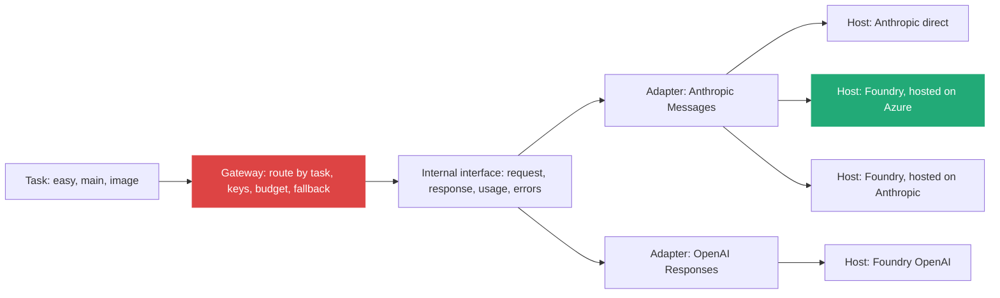

# 13. I adapt per API dialect, keep the host as configuration, and put a thin gateway on top for routing, not a gateway that hides the dialects

> Foundry serves Claude through an Anthropic-style endpoint and OpenAI models through OpenAI-style APIs, so my several SDKs are really two API dialects on several hosts; the cleaner design is one small internal interface, one adapter per dialect, hosts as data with capability flags, and a gateway that only routes by task, because a gateway that normalizes everything hides the cache and feature controls I need.

Related: [11 Model routing in LangGraph](11_Model_Routing_In_LangGraph.md) · [09 Cache hit rate and P90](09_Cache_Hit_Rate_And_P90_Latency.md) · [12 Sandbox for agent code](12_Sandbox_For_Agent_Code_Pi_And_Search_Execute.md) · [06 Workflow vs LangGraph](06_Workflow_vs_LangGraph.md) · [W2L1 21 AI SDK or official SDKs](../Week2_Lecture_1_Agent_Primitives/21_AI_SDK_Or_Official_SDKs.md) · [W2L1 09 Tool search and proxy gateway](../Week2_Lecture_1_Agent_Primitives/09_Tool_Search_And_Proxy_Gateway.md) · [W2L1 24 Prompt caching](../Week2_Lecture_1_Agent_Primitives/24_KV_Cache_And_Prompt_Caching.md) · [W2L1 25 Tool execution instead of tool calls](../Week2_Lecture_1_Agent_Primitives/25_Tool_Execution_Instead_Of_Tool_Calls.md)

Source: S02E02 article, "Providers and configuration" (figure 7). My setup: Azure AI Foundry (OpenAI and Anthropic models) plus Anthropic direct. Anthropic's Foundry page, LiteLLM and OpenRouter caching docs read through fetch summaries on 2026-11-22. See [Fact-check](#fact-check).

## Glossary

| Term | What it means here | Same thing elsewhere | Not to be confused with |
|---|---|---|---|
| Dialect | The request and response shape of an API: Anthropic Messages, OpenAI Responses | API shape | The company that hosts it |
| Host | Where a dialect is served: Foundry on Azure, Foundry on Anthropic, Anthropic direct | Endpoint plus auth | The model |
| Adapter | Code that translates my internal request to one dialect and back | Ports and adapters | An SDK, which an adapter wraps |
| Gateway | A layer that picks a model for a task and applies keys, budgets, fallback, logging | LiteLLM proxy, OpenRouter, Azure API Management | The tool gateway in [W2L1 09](../Week2_Lecture_1_Agent_Primitives/09_Tool_Search_And_Proxy_Gateway.md) |
| Capability flag | A per-host fact: supports code execution, batch, a given tool version | Feature matrix | A feature switch for users |
| Provider options | A pass-through field for settings only one dialect knows | AI SDK `providerOptions` | A normalized setting |

## 1. The problem

I support Azure AI Foundry (OpenAI and Anthropic models) and Anthropic, through several SDKs. **Should I keep it, or make it pure adapters with a gateway in front?**

Source: S02E02 article, figure 7: "we need to make sure that all providers speak the same language in our app and that adding or removing a provider won't be an issue." The model split is an example.

## 2. Dialect and host are two axes

Anthropic's SDKs reach Claude on Foundry at `https://{resource}.services.ai.azure.com/anthropic/v1/messages` through a Foundry client class, so Anthropic direct and Foundry share one dialect and differ in endpoint, auth (API key or Entra ID) and features. For OpenAI models on Foundry I did not read the docs, so that row is unverified.

**Hosts differ in features.** For Claude on Foundry hosted on Azure, code execution, programmatic tool calling, the Files API and Agent Skills return 400 "by design", Batch is not available and Anthropic's rate-limit headers are not sent. Hosted on Anthropic, most of these exist. So the flag belongs to the host, and my adapter checks it before a call (relevant to [12](12_Sandbox_For_Agent_Code_Pi_And_Search_Execute.md) and [W2L1 25](../Week2_Lecture_1_Agent_Primitives/25_Tool_Execution_Instead_Of_Tool_Calls.md)).

## 3. Three designs

| Design | I get | I lose | Work |
|---|---|---|---|
| A. SDK calls spread through the code (today) | Every native feature | Each provider leaks into the agent code | Low now, grows per provider |
| B. Own interface, one adapter per dialect, thin gateway | Native controls through provider options, one usage shape, hosts as data | I write and test the adapters | Medium, once |
| C. Third-party gateway or SDK layer | Many providers fast, keys and logs | A normalized surface, so native controls need pass-through | Low to set up, parity to prove |

What C does with caching: LiteLLM keeps Anthropic's `cache_control`, reports cache hits in the OpenAI shape (`prompt_tokens_details.cached_tokens`), translates markers for Bedrock, and skips caching silently below the minimum. OpenRouter needs the same markers, pins a session to one provider (60 minutes idle) when cached reads are cheaper, and takes a `session_id`. So a gateway can keep the cache, but only when it passes the markers and keeps requests on one deployment ([09](09_Cache_Hit_Rate_And_P90_Latency.md)).

## 4. What the interface must carry

- **Usage:** input, cached read, cache write, output, reasoning tokens, in one shape, per call ([09](09_Cache_Hit_Rate_And_P90_Latency.md#5-measure-the-whole-picture-first)).
- **Cache controls:** `cache_control`, `prompt_cache_key`, `prompt_cache_breakpoint` as provider options, never dropped.
- **Errors:** one set of classes (rate limit, content filter, overload, invalid request) and a retry rule for each.
- **Capabilities:** the host's flags, read from config.
- **Routing:** model per task. A different model has its own cache, so routing a task to a small model costs a cold prefix ([09](09_Cache_Hit_Rate_And_P90_Latency.md)).

## Summary

My SDKs are two dialects on three hosts. I keep one adapter per dialect behind a small interface, describe each host as data with capability flags, and let a thin gateway route by task. A gateway product is worth it only if it passes the parity check of [W2L1 21](../Week2_Lecture_1_Agent_Primitives/21_AI_SDK_Or_Official_SDKs.md) on caching, reasoning options, usage and errors.

## Open questions

- How many places in my code branch on the provider today, and which native features do I really use?
- Do I need a gateway product for three deployments, or is a routing table enough?
- Which OpenAI endpoint do I call on Foundry, and does it support what I use?

## Fact-check

| # | Claim | Verdict | Source | Checked |
|---|---|---|---|---|
| 1 | Claude on Foundry is reached at an Anthropic-style `/anthropic/v1/messages` endpoint with Anthropic SDK Foundry clients, key or Entra ID | **Agrees** | [Claude in Microsoft Foundry](https://platform.claude.com/docs/en/build-with-claude/claude-in-microsoft-foundry), fetch of the full page | 2026-11-22 |
| 2 | Azure-hosted Claude lacks code execution, programmatic tool calling, Files API, Agent Skills, later web-search versions, Batch, rate-limit headers | **Agrees** | Same page | 2026-11-22 |
| 3 | LiteLLM passes `cache_control` and reports cache hits in the OpenAI usage shape | **Agrees** | [LiteLLM prompt caching](https://docs.litellm.ai/docs/completion/prompt_caching), fetch summary | 2026-11-22 |
| 4 | OpenRouter needs the cache markers, pins sessions, reports `cached_tokens` and `cache_write_tokens` | **Agrees** | [OpenRouter prompt caching](https://openrouter.ai/docs/guides/best-practices/prompt-caching), fetch summary | 2026-11-22 |
| 5 | OpenAI models on Foundry use OpenAI-style APIs | **Unverified** | Not read. Verify before presenting | 2026-11-22 |
| 6 | A gateway and adapters let me add or drop a provider easily; avoid layers that block a move from Chat Completions to Responses | **Lecture-specific** | S02E02 article. The OpenAI migration page was not read | 2026-11-22 |

## Sources

- S02E02 article, figure 7.
- [Claude in Microsoft Foundry](https://platform.claude.com/docs/en/build-with-claude/claude-in-microsoft-foundry) · [LiteLLM prompt caching](https://docs.litellm.ai/docs/completion/prompt_caching) · [OpenRouter prompt caching](https://openrouter.ai/docs/guides/best-practices/prompt-caching)
- My own reasoning: the dialect and host split, the three designs and the interface list.
