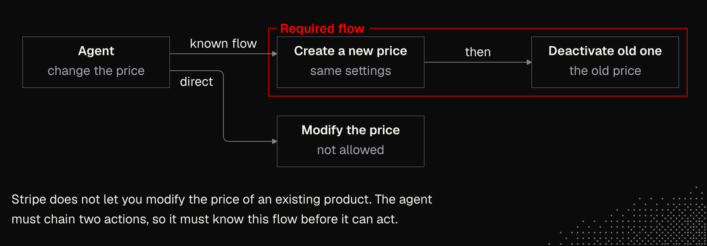
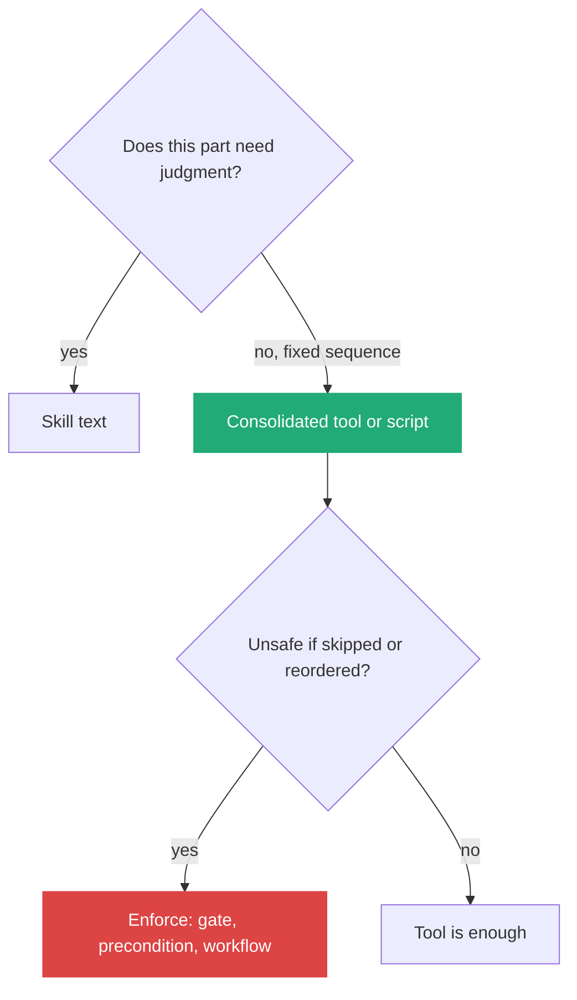

# 14. A flow the agent must follow can live in a skill, in a tool, or in code; I keep judgment in the skill and move fixed sequences into consolidated tools and enforced steps, so the skill stops growing

> "Load the skill first, then do the job" works while the skill is small. As it grows I split it by what each part needs: judgment stays as text, a fixed sequence becomes one consolidated tool or script, and an order that must never break is enforced by a gate or a workflow; and because unloading a skill rewrites the thread, I switch flows with a subagent or a new thread, not by deleting text in the middle.

Related: [06 Workflow vs LangGraph](06_Workflow_vs_LangGraph.md) · [09 Cache hit rate and P90](09_Cache_Hit_Rate_And_P90_Latency.md) · [16 Memory-centric approach with events](16_Memory_Centric_Approach_With_Events.md) · [12 Sandbox for agent code](12_Sandbox_For_Agent_Code_Pi_And_Search_Execute.md) · [W2L1 02 Rethinking the skills](../Week2_Lecture_1_Agent_Primitives/02_Rethinking_The_Skills.md) · [W2L1 22 Threads, subagents and A2A](../Week2_Lecture_1_Agent_Primitives/22_Threads_Vs_A2A_Subagents.md) · [W2L1 24 Prompt caching](../Week2_Lecture_1_Agent_Primitives/24_KV_Cache_And_Prompt_Caching.md) · [W2L1 14 Tool approval, durable waits](../Week2_Lecture_1_Agent_Primitives/14_Tool_Approval_Durable_Waits.md) · [Lecture 5: 04 Executable Markdown](../Lecture_5_Workflows_not_tool_sets/04_Executable_Markdown_Skills_As_Programs.md)

Source: S02E02 article, "Designing tools" (the Stripe price example, figure 10, and the guide example, figure 12). My own practice: one skill loaded per conversation, replaced when the task changes. Stripe's price update reference, Anthropic's tool-writing and agent-building articles read on 2026-11-22 through fetch summaries. See [Fact-check](#fact-check).

## Glossary

| Term | What it means here | Same thing elsewhere | Not to be confused with |
|---|---|---|---|
| Execution flow | The order and checks the agent must follow to finish a kind of work | Procedure, runbook, SOP | A plan the agent writes for one task |
| Skill | Instructions the agent loads on demand | Agent Skills `SKILL.md` | A tool, which acts |
| Consolidated tool | One tool that does several API calls in the right order | Anthropic's `schedule_event` example | A thin wrapper over one endpoint |
| Gate | A programmatic check between steps | Anthropic's prompt-chaining gate | A prompt rule |
| Enforcement | Code that makes a wrong order impossible | Workflow step, tool precondition | Guidance |
| Guide | The starting skills and documents I ship so the agent knows its workspace; the agent may edit them | The article's "guide" | AGENTS.md, which the user owns |
| Unload | My term: removing a skill from the thread to load another | Not a vendor feature | Compaction |

## 1. The problem

I load the skill that explains how to act, then do the job. It works, but skills grow, and I allow one skill per conversation with a swap. **Where should a required flow live as it grows, and what does the swap cost?**

## 2. The example: Stripe prices



Source: S02E02 article, figure 10. Caption: "Stripe does not let you modify the price of an existing product. The agent must chain two actions, so it must know this flow before it can act."

- **Important:** the model knows this flow for Stripe, and not for my internal API, so the knowledge has to come from me. Stripe's update call takes `active`, `metadata`, `nickname`, `lookup_key`, `tax_behavior`, `currency_options` and `transfer_lookup_key`, and no amount. `transfer_lookup_key` moves a lookup key to the new price in one step.
- **Not important:** the exact box labels.

## 3. A guide that starts as a skill


Source: S02E02 article, figure 12. Caption: "A skill joins the existing tools into one flow and holds the report template. The agent can modify the skill, so each user gets a report in their own shape."

```text
skills/weekly-digest.md
```

- **Important:** the skill, not a new tool, joins the existing tools into one flow, and the agent may edit it, so the flow can drift per user. The tools stay fixed.
- **My take:** I let the agent edit the template and the judgment parts, and I keep exact sequences in tools it cannot rewrite. Each edit goes into the journal so I can undo it ([16](16_Memory_Centric_Approach_With_Events.md), [12](12_Sandbox_For_Agent_Code_Pi_And_Search_Execute.md) section 7).
- **Not important:** the layout of the tool boxes.

## 4. Four places a flow can live

| Place | What it gives | What it costs | Use it for |
|---|---|---|---|
| Skill text | Judgment, tone, what to check | Grows; the model may skip a step | Choices that depend on context |
| Consolidated tool or script | The sequence runs the same every time; fewer model steps | I build and test it | Fixed, repeated sequences (create price, deactivate old) |
| Gate between steps | A check that the process is on track | A step per gate | Verify a result before the next step |
| Enforcement in code | A wrong order cannot happen | A workflow or preconditions ([06](06_Workflow_vs_LangGraph.md)) | Anything unsafe out of order |



Evidence: Anthropic says tools can handle "multiple discrete operations under the hood", with `schedule_event` instead of `list_users`, `list_events` and `create_event`. Its workflow article puts a programmatic "gate" between chained steps "to ensure that the process is still on track". My Lecture 5 note keeps Markdown for judgment and moves exact, repeated steps into scripts.

## 5. When the skill grows

My reasoning, from the limits in [W2L1 02](../Week2_Lecture_1_Agent_Primitives/02_Rethinking_The_Skills.md) (body under 500 lines, about 5,000 tokens recommended):

1. **Split by flow.** The root file is a router with a one-line description per flow, and each flow sits in a file loaded on demand.
2. **Move sequences out.** A numbered list of API calls in the skill is a tool waiting to be written. Keep the why, drop the how.
3. **Add a completion check.** The flow ends with a verification. The article's false-success example shows why: an API returned 200 although the player had not started.
4. **Evaluate each flow** on its own tasks ([W2L1 16](../Week2_Lecture_1_Agent_Primitives/16_Evals_For_Agent_Changes.md)), and re-read the skill when the model changes.

## 6. One skill per conversation and the swap

Removing a skill from the middle of the thread changes the prefix from that point, so everything after it misses the cache ([W2L1 24](../Week2_Lecture_1_Agent_Primitives/24_KV_Cache_And_Prompt_Caching.md): "append, never rewrite"). Claude Code does not unload either: an invoked skill stays, and after compaction up to 5,000 tokens per skill come back, 25,000 in total. Options:

| Swap by | Cache | Context |
|---|---|---|
| Deleting the old skill text | Misses from that point | Clean |
| Keeping it and appending the new one | Hits | Both skills stay |
| A subagent per flow, with a short result back ([W2L1 22](../Week2_Lecture_1_Agent_Primitives/22_Threads_Vs_A2A_Subagents.md)) | Own cache per subagent | Isolated |
| A new thread with a handoff summary | One cold start | Clean |
| Unloading at compaction only | The cache is gone anyway | Clean |

## 7. Showing that the flow was followed

Each flow step writes a journal entry with the skill or tool that made it ([16](16_Memory_Centric_Approach_With_Events.md)). A gate or a trace check then compares the steps with the flow.

## Summary

A flow lives where its guarantee is cheapest: judgment in the skill, fixed sequences in a consolidated tool, unsafe orders in enforcement. Splitting skills by flow and moving sequences into tools stops the growth. I swap flows with a subagent or a new thread, because deleting text mid-thread breaks the cache.

## Open questions

- How does my unload work today: deleting messages, or editing the system prompt? What does it do to my hit rate?
- Which numbered steps in my skills are really tools?
- Which of my flows are unsafe out of order and need enforcement?
- Which parts of a starting skill may the agent edit, and which stay fixed?

## Fact-check

| # | Claim | Verdict | Source | Checked |
|---|---|---|---|---|
| 1 | Stripe does not allow changing the amount of an existing price; the flow is create a new price, then deactivate the old | **Agrees**, by the parameter list | [Update a price](https://docs.stripe.com/api/prices/update): no amount among the updatable fields. The page states no rule in words | 2026-11-22 |
| 2 | An agent knows the Stripe flow but not an internal API | **Lecture-specific** | S02E02 article. Plausible, not measured | 2026-11-22 |
| 3 | Tools should consolidate several operations | **Agrees** | [Writing tools for agents](https://www.anthropic.com/engineering/writing-tools-for-agents), fetch summary | 2026-11-22 |
| 4 | A gate between chained steps checks the process | **Agrees** | [Building effective agents](https://www.anthropic.com/engineering/building-effective-agents), fetch summary | 2026-11-22 |
| 5 | Skill limits: body under 500 lines, 5,000 tokens re-attached per skill, 25,000 total | **Agrees** | [W2L1 02](../Week2_Lecture_1_Agent_Primitives/02_Rethinking_The_Skills.md), read 2026-11-15 | 2026-11-22 |
| 6 | Deleting an early part of the thread breaks the cache after it | **Agrees** | [W2L1 24](../Week2_Lecture_1_Agent_Primitives/24_KV_Cache_And_Prompt_Caching.md). The effect on my own unload is unmeasured | 2026-11-22 |

## Sources

- S02E02 article, figure 10 and the false-success example.
- [Stripe: update a price](https://docs.stripe.com/api/prices/update) · [Anthropic: writing tools for agents](https://www.anthropic.com/engineering/writing-tools-for-agents) · [Anthropic: building effective agents](https://www.anthropic.com/engineering/building-effective-agents)
- My own reasoning: the four places, the growth steps and the swap table.
