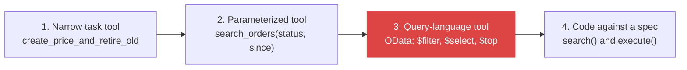

# 15. Vendors agree on clear names, typed schemas with per-parameter descriptions, actionable errors and few focused tools; my OData read tool fits that if it stays bounded, validated and taught by examples

> LangChain, the MCP spec, OpenAI and Anthropic give the same core advice (describe each tool and parameter, make invalid calls impossible by schema, return errors the model can fix, keep the tool set small and defer the rest), and none compares a generic query language such as OData with curated tools, so I treat a query tool as the flexible end of a four-step ladder and keep named tools for the questions I ask often.

Related: [14 Execution flows](14_Execution_Flows_Skill_Tool_Or_Workflow.md) · [12 Sandbox for agent code](12_Sandbox_For_Agent_Code_Pi_And_Search_Execute.md) · [13 LLM adapters and gateway](13_LLM_Adapters_And_Gateway.md) · [09 Cache hit rate and P90](09_Cache_Hit_Rate_And_P90_Latency.md) · [W2L1 08 Tool search instead of many tools](../Week2_Lecture_1_Agent_Primitives/08_Tool_Search_Instead_Of_Many_Tools.md) · [W2L1 09 Tool search and proxy gateway](../Week2_Lecture_1_Agent_Primitives/09_Tool_Search_And_Proxy_Gateway.md) · [W2L1 25 Tool execution instead of tool calls](../Week2_Lecture_1_Agent_Primitives/25_Tool_Execution_Instead_Of_Tool_Calls.md) · [Lecture 1: 10 Code mode](../Lecture_1_Mechanics_Behind_Generative_AI/10_code_mode.md)

Source: S02E02 article, "Designing tools". My setup: an OData contract, parameter validation on the MCP side, a docstring and a Pydantic annotation on each parameter. LangChain tools docs, the MCP tools spec (2025-11-25), OpenAI function-calling guide, Anthropic's tool-writing article and the arXiv abstract of TheMCPCompany read on 2026-11-22 through fetch summaries. See [Fact-check](#fact-check).

## Glossary

| Term | What it means here | Same thing elsewhere | Not to be confused with |
|---|---|---|---|
| Tool navigation | How the agent finds the right tool and uses it correctly | Tool selection, discovery | Tool search alone |
| Input schema | The typed description of a tool's parameters | MCP `inputSchema`, Pydantic model, JSON Schema | Validation code |
| Execution error | A tool result that says what was wrong, so the model can retry | MCP `isError: true`, LangChain `ToolMessage` | A protocol error |
| Contract | The agreed shape of queries and entities the tool accepts | OData metadata, OpenAPI | A prompt |
| Hidden argument | A value the harness injects, not the model | LangChain `ToolRuntime` | A default value |
| Ladder of flexibility | Narrow task tool, parameterized tool, query-language tool, code against a spec | - | A maturity model |

## 1. The problem

My tools carry an OData contract, server-side validation, a docstring and Pydantic annotations. **What do LangChain and the other vendors recommend for helping the agent navigate tools, and how flexible should a tool be?**

## 2. What the sources say

| Topic | Sources agree on |
|---|---|
| Description | The docstring becomes the tool description (LangChain). Describe each tool and parameter with purpose and format (OpenAI). "Think of how you would describe your tool to a new hire" (Anthropic) |
| Schema | Type hints are required and `Field(description=...)` explains each field (LangChain). MCP carries a JSON Schema and an optional output schema. Use enums and object structure so invalid calls cannot be written (OpenAI). Unambiguous names: `user_id`, not `user` (Anthropic) |
| Validation | A server MUST validate all tool inputs (MCP). Validation errors are execution errors with `isError: true` and "actionable feedback that language models can use to self-correct" (MCP) |
| Errors | Write errors that state a specific fix (Anthropic). LangChain turns exceptions into a `ToolMessage` in middleware |
| Known values | "Don't make the model fill arguments you already know" (OpenAI). LangChain hides the `runtime` argument from the model |
| Size of results | Paginate, filter, truncate, offer a concise or detailed format. Claude Code caps tool responses at 25,000 tokens by default (Anthropic) |
| Number of tools | Too many overwhelm the model (LangChain). Fewer than 20 at the start of a turn is a soft suggestion, and tool search defers the rest (OpenAI). Merge functions that always run together |
| Test them | Build evaluation tasks from real workflows and track calls, errors, tokens (Anthropic). "Even small refinements to tool descriptions can yield dramatic improvements" |

Two cautions. OpenAI warns that examples in a description "may hurt performance for reasoning models", so I test them. MCP says clients must treat annotations as untrusted unless the server is trusted.

## 3. How flexible a tool should be

| Level | Reliable | Tokens | Risk | Use for |
|---|---|---|---|---|
| 1 Narrow | Highest | Lowest | Many tools to maintain | Repeated, risky or ordered work ([14](14_Execution_Flows_Skill_Tool_Or_Workflow.md)) |
| 2 Parameterized | High | Low | Schema grows | Common filters |
| 3 Query language | Medium: syntax and meaning errors | Grows with retries | Wide reach, large results | Exploration, rare questions |
| 4 Code | Depends on the model | Fixed small | Needs a sandbox ([12](12_Sandbox_For_Agent_Code_Pi_And_Search_Execute.md)) | Large APIs |

I found no source that compares OData or GraphQL with curated tools. Search summaries say generic query tools suit exploratory work while repeated tasks cost more tokens, and a preprint, [TheMCPCompany](https://arxiv.org/abs/2510.19286) (Oct 2025), builds over 18,000 tools from REST APIs and reports that tool-retrieval agents do as well as or better than browser agents, that GPT-5 with retrieval comes close to using the right tools, and that weaker models cannot exploit retrieval. That is evidence for narrow tools plus discovery, not for or against OData.

## 4. My OData setup against that

| What I do | Fits | What I would check |
|---|---|---|
| OData contract | `$select`, `$top`, `$filter` give filter, truncate and paginate in one syntax | Is the metadata document small enough for the context, or do I expose a trimmed summary and a describe call? |
| Validation on the MCP side | Matches the spec: validate, return `isError` | Does each error name the bad part and the valid choices? |
| Docstring and Pydantic `Field` text | The documented route for descriptions and schemas | Do entity and property names come as enums, so a bad name cannot be written? Are two descriptions of one field kept in sync? |
| One query tool for reads | Flexible | Default and maximum `$top`, default `$select`, and named tools for the five questions I ask most |
| Writes | Not covered by the sources for OData | Writes go through named tools with approval, not through generic CRUD ([14](14_Execution_Flows_Skill_Tool_Or_Workflow.md)) |

## 5. Helping the agent find the tool

Clear names with a shared prefix (`orders_search`, `orders_get`), a system-prompt line that names the tool categories, deferred tools found by search when the set grows ([W2L1 08](../Week2_Lecture_1_Agent_Primitives/08_Tool_Search_Instead_Of_Many_Tools.md)), a tool list filtered by state or context (LangChain), and a skill that says which tools make a flow ([14](14_Execution_Flows_Skill_Tool_Or_Workflow.md)).

## Summary

Vendors converge on descriptions, typed schemas, enums, actionable errors, bounded results and few tools. My OData, validation and Pydantic setup matches the documented route. What I add: bounded defaults, enums from the metadata, errors that name the valid choices, named tools for frequent and risky work, and an evaluation of the descriptions.

## Open questions

- How large is my metadata document in tokens, and what does the model read of it?
- Which five questions account for most of my OData calls?
- Do examples in my descriptions help or hurt on my model?
- What share of my calls end in an execution error, and how often does the retry fix it?

## Fact-check

| # | Claim | Verdict | Source | Checked |
|---|---|---|---|---|
| 1 | Docstring is the tool description, type hints are required, `Field` describes parameters | **Agrees** | [LangChain tools](https://docs.langchain.com/oss/python/langchain/tools), fetch summary | 2026-11-22 |
| 2 | Tool errors become a `ToolMessage` through middleware; `runtime` is hidden from the model; too many tools overwhelm | **Agrees** | Same page | 2026-11-22 |
| 3 | Servers must validate inputs; validation errors are execution errors that the model can use to self-correct | **Agrees** | [MCP tools](https://modelcontextprotocol.io/specification/2025-11-25/server/tools), fetch of the page | 2026-11-22 |
| 4 | Enums prevent invalid states; do not make the model fill known arguments; fewer than 20 tools is a soft suggestion; examples may hurt reasoning models | **Agrees** | [OpenAI function calling](https://developers.openai.com/api/docs/guides/function-calling), fetch summary | 2026-11-22 |
| 5 | New-hire description, unambiguous names, concise or detailed format, 25,000-token cap, actionable errors | **Agrees** | [Anthropic: writing tools for agents](https://www.anthropic.com/engineering/writing-tools-for-agents), fetch summary | 2026-11-22 |
| 6 | Tool-retrieval agents match or beat browser agents; GPT-5 with retrieval is near ground-truth tools | **Agrees** | [arXiv 2510.19286](https://arxiv.org/abs/2510.19286), abstract only | 2026-11-22 |
| 7 | Generic query tools suit exploration and cost more on repeated tasks | **Unverified** | Search summary of cloud-vendor and Elastic blogs. The [AWS MCP tool design post](https://aws.amazon.com/blogs/machine-learning/mcp-tool-design-practical-approaches-and-tradeoffs/) returned no article text. Verify before presenting | 2026-11-22 |
| 8 | OData or GraphQL against curated tools | **Not found** | One search, no direct comparison | 2026-11-22 |
| 9 | An agent can make its own tools if I give guidance and ways to test names, descriptions, schemas and output | **Lecture-specific** | S02E02 article. Anthropic's advice to evaluate tools is consistent with it | 2026-11-22 |

## Sources

- S02E02 article, "Designing tools".
- [LangChain tools](https://docs.langchain.com/oss/python/langchain/tools) · [MCP tools spec](https://modelcontextprotocol.io/specification/2025-11-25/server/tools) · [OpenAI function calling](https://developers.openai.com/api/docs/guides/function-calling) · [Anthropic: writing tools for agents](https://www.anthropic.com/engineering/writing-tools-for-agents) · [TheMCPCompany](https://arxiv.org/abs/2510.19286)
- My own reasoning: the ladder of flexibility and the OData review table.
