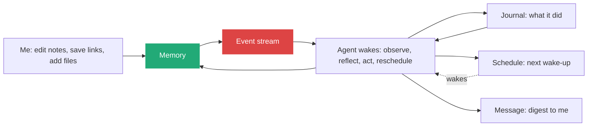

# 16. In a memory-centric agent every change to memory is an event, and I must record three things: the messages it sent, the journal of what it did, and the schedule it sets for itself

> The agent has no UI. The user edits notes, saves links or adds files; each change becomes an event that wakes the agent, which observes, reflects on its journal, acts and reschedules itself. Memory sits in the center. Messages, journal and schedule are the three records that make this loop safe to repeat, debug and undo.

Related: [09 Cache hit rate and P90](09_Cache_Hit_Rate_And_P90_Latency.md) · [12 Sandbox for agent code](12_Sandbox_For_Agent_Code_Pi_And_Search_Execute.md) · [08 Mastra workflow mapped to LangGraph](08_Mastra_Workflow_Mapped_To_LangGraph.md) · [W2L1 10 Memory](../Week2_Lecture_1_Agent_Primitives/10_Memory.md) · [W2L1 12 Audit ledger](../Week2_Lecture_1_Agent_Primitives/12_Memory_Audit_Ledger_In_Memory_Or_State.md) · [W2L1 13 Memory operations](../Week2_Lecture_1_Agent_Primitives/13_Memory_Operations.md) · [W2L1 14 Tool approval, durable waits](../Week2_Lecture_1_Agent_Primitives/14_Tool_Approval_Durable_Waits.md) · [W2L1 23 Self-configuring harness](../Week2_Lecture_1_Agent_Primitives/23_Self_Configuring_Harness.md) · [Lecture 3: 12 Knowledge update triggers](../Lecture_3_Simplify_Codebase_&_Knowledge_Base/12_Knowledge_Event_&_Triggers.md) · [Lecture 1: 17 Ambient, durable agents](../Lecture_1_Mechanics_Behind_Generative_AI/17_ambient_durable_agents.md)

Source: S02E02 article, "Core features" (figures 5 and 6) and "Designing tools" (figure 11). The lecturer's remark that memory changes through different channels and then an event comes is from the audio and is not in the two files I have. Letta, Cloudflare Agents and Claude Code docs read through fetch summaries on 2026-11-22. See [Fact-check](#fact-check).

## Glossary

| Term | What it means here | Same thing elsewhere | Not to be confused with |
|---|---|---|---|
| Memory | The knowledge base the agent and I both edit (`notes.read`, `notes.write`, `notes.link`) | Store, vault, MemFS | A conversation history |
| Event | A signal that something changed: "note edited", "link saved", "file added" | Change feed, webhook | A message |
| Message | Something the agent sent to me; the only way out to me (`message.send`) | Notification, digest | An event |
| Journal | Append-only storage of the session and of the actions that were confirmed: entries are added, never edited | Audit log, event log | Memory the agent searches |
| Ledger | My name for the same kind of append-only storage: the session and the confirmed actions ([W2L1 12](../Week2_Lecture_1_Agent_Primitives/12_Memory_Audit_Ledger_In_Memory_Or_State.md)) | Write-ahead log | Memory the agent reads to answer |
| Schedule | The agent's own wake-ups, which it can change (`schedule.get`, `schedule.set`) | Cron, `this.schedule()` | A fixed job I set once |
| Reflection | The step where the agent reads its journal and decides what to do and when to wake next | Letta "dreaming" | Memory consolidation alone |

## 1. The problem

A proactive agent with no interface still has to know when to wake, what changed, what it already did and what it already told me. **What do I build around memory so that wake-ups are driven by events, and which records must exist?**

## 2. The picture

![The article's figure of six primitives. You edit notes in Memory and receive a weekly digest through Messages. The red Primitives frame holds Memory (notes.read, notes.write, notes.link), Events (events.watch: note edited, link saved, file added), Tools (web.search, page.read), Messages (message.send), Journal (journal.read, journal.write) and Schedule (schedule.get, schedule.set). Below, a loop around an Agent with no UI: observe (Events, Memory), reflect (Journal), act (Tools, Memory, Messages), reschedule (Schedule, Journal). A busy week shows many wake-ups, a quiet week two.](img/memory-centric-primitives-events-reschedule-loop.png)

Source: S02E02 article, figure 5. Caption: "We shape six primitives, and the agent builds its own loop from them. It reflects and reschedules itself, so it wakes often in a busy week and rarely in a quiet one."

- **Important:** memory is the center, and events come from changes to it. Only Messages reaches me. The wake-up rate follows the loop: busy week often, quiet week rarely.
- **Not important:** the bar heights of the two weeks, which the article calls illustrative.

**The same loop on one example.** A saved link wakes the agent days later.

![The article's example for a knowledge-base agent. In the red frame "Environment we shape": the Event "link saved" triggers the Skill "summarize article into a note", which writes a note into the Document "research topics". The Schedule "every Monday" updates Documents. Every action leaves an entry in the Journal ("09:12 summarized article", "Mon 08:00 updated 3 research notes"). The Agent reflects: it reads the Journal, saves repeated work as a Skill, sets "wake up in 2 days" on the Schedule and sends a short digest through the Channel to the User. A Trace panel links the entry "09:12 summarized article" "made by" the Skill, "triggered by" the Event "link saved".](img/wake-up-after-delay-event-skill-journal-trace.png)

Source: S02E02 article, figure 6. Caption: "Six general blocks combine into behavior that nobody designed upfront, and every step stays inside the environment we shape. When something goes wrong, the Journal shows what happened and why."

- **Important:** the 2-day wake-up is a schedule entry the agent wrote after reading its journal, not a timer I set. The Trace panel is the point: each journal entry points to the skill that made it and the event that triggered it, so the chain can be read backwards. Only the Channel crosses the frame to me.
- **Not important:** the times and the example names.
- **Two lists of six:** this figure names Event, Schedule, Document, Skill, Journal, Channel. Figure 5 names Memory, Events, Tools, Messages, Journal, Schedule. My mapping: Document is the memory I edit, Channel is where messages go, and a Skill is repeated work saved on top of the tools. The article does not give the mapping.

## 3. What I register

| Primitive | I record | Why |
|---|---|---|
| Messages | Id, time, target, a hash of the content, the event or schedule that caused it | A retry or a second wake-up must not send the digest twice ([08](08_Mastra_Workflow_Mapped_To_LangGraph.md) on idempotency keys) |
| Journal (Ledger) | Append-only: the session, and each action once it is confirmed, with run id, trigger, skill, tools, result, cost | Nothing is edited afterwards, so the agent can reflect on it and I can undo or explain from it |
| Schedule | Id, when, who set it (agent or me), the reason, the run that created it, last result | It is the one record that changes the agent's own future behavior |

My Ledger and the article's Journal are the same kind of thing: append-only storage of the session and of confirmed actions. The difference is who reads it. My Ledger is kept away from memory the agent reads. The article's Journal is read by the agent for reflection. The article also says the harness writes the journal and the agent cannot edit it, while figure 5 lists `journal.write`. My reading: the agent appends through one operation and cannot rewrite entries. Whether the agent reads the same store I audit from, or I keep a second copy for it, is open.

## 4. Self-scheduling in practice

| Who | What it provides | Guard |
|---|---|---|
| [Cloudflare Agents](https://developers.cloudflare.com/agents/api-reference/schedule-tasks/) | `this.schedule(when, callback)` with a delay, a date or a cron string, stored in SQLite, "survive restarts and evictions". An agent method can schedule itself | Limits are on another page I did not read |
| [Claude Code `/loop`](https://code.claude.com/docs/en/scheduled-tasks) | With no interval Claude picks a delay between 1 minute and 1 hour from what it observed and prints the reason. It can stop the loop itself | Session-scoped, 7-day expiry, 50 tasks per session. Events are handled by Channels, not by polling |
| [Letta](https://docs.letta.com/guides/agents/architectures/sleeptime) | Background "dreaming" subagents consolidate lessons into git-backed memory | Triggered after N steps or at compaction, optional review before applying |
| The lecturer's `pi-until` | Watchers and recurring wake-ups | Repository not read |

A self-scheduling agent can run away, so I would bound it: a minimum and a maximum interval, a wake-up budget per day, an expiry, and a journal entry for every schedule change (my reasoning, after the Claude Code limits).

**An event loop to avoid:** if the agent's own memory write emits an event, it can wake itself. Each event carries its actor, and the agent ignores its own (my reasoning).

## 5. Wake-ups and the cache

Claude Code's docs say a run exactly five minutes after the last one would start after the 5-minute prompt cache expired, so it fires 15 seconds sooner. A self-set schedule has the same trap: waking just after the TTL pays a full prefill ([09](09_Cache_Hit_Rate_And_P90_Latency.md)). A 2-day wake-up as in the example is longer than any TTL I know of (OpenAI 30 minutes or 12 hours, [W2L1 24](../Week2_Lecture_1_Agent_Primitives/24_KV_Cache_And_Prompt_Caching.md)), so every such wake-up starts with a miss and the prefix of a wake-up run should stay small. I either wake inside the TTL or accept the miss and keep the prefix short.

## Summary

Memory changes emit events, events wake the agent, and the agent reflects on its journal and sets its next wake-up. Messages, journal and schedule are what I register so a repeated wake-up is safe and I can explain or undo what happened. Cloudflare, Claude Code and Letta show self-scheduling and background reflection exist; each bounds them differently.

## Open questions

- One store or two: the Ledger I audit from and the Journal the agent reads?
- Does "confirmed" mean approved by me, confirmed by the tool's result, or both?
- Do I tag events with their actor so the agent ignores its own writes?
- Which primitives live in files and which in a database?
- What bounds do I set on the agent's own schedule?

## Fact-check

| # | Claim | Verdict | Source | Checked |
|---|---|---|---|---|
| 1 | Memory changes through different channels, then an event comes | **Lecture-specific** | From the audio. The article defines an Event as a signal that "may come from any source and shape documents" | 2026-11-22 |
| 2 | The agent reflects on its journal and reschedules itself | **Agrees** as a pattern | Cloudflare `schedule()` and Claude Code self-paced `/loop` allow it (rows in section 4). No source shows reflection-driven rates working well | 2026-11-22 |
| 3 | Cloudflare Agents schedule by delay, date or cron, persisted in SQLite | **Agrees** | [Schedule tasks](https://developers.cloudflare.com/agents/api-reference/schedule-tasks/), fetch summary | 2026-11-22 |
| 4 | Claude Code self-paced loops pick 1 min to 1 h, expire after 7 days, 50 tasks | **Agrees** | [Scheduled tasks](https://code.claude.com/docs/en/scheduled-tasks), fetch summary | 2026-11-22 |
| 5 | Letta runs background memory consolidation | **Agrees** | [Letta docs](https://docs.letta.com/guides/agents/architectures/sleeptime): the page calls it "Dreaming" | 2026-11-22 |
| 6 | `pi-until` gives watchers and recurring wake-ups | **Unverified** | [Repository](https://github.com/joelhooks/pi-until) not read. Verify before presenting | 2026-11-22 |
| 7 | The journal is read-only for the agent (figure 11) and has `journal.write` (figure 5) | **Differs** within the article | S02E02 article, figures 5 and 11 | 2026-11-22 |
| 8 | Figures 5 and 6 name different six primitives (Memory, Messages, Tools against Document, Channel, Skill) | **Differs** within the article | S02E02 article. The mapping is mine | 2026-11-22 |

## Sources

- S02E02 article, figures 5, 6 and 11.
- [Cloudflare schedule tasks](https://developers.cloudflare.com/agents/api-reference/schedule-tasks/) · [Claude Code scheduled tasks](https://code.claude.com/docs/en/scheduled-tasks) · [Letta dreaming](https://docs.letta.com/guides/agents/architectures/sleeptime)
- My own reasoning: the three records table, the guards and the actor tag, the cache link.
