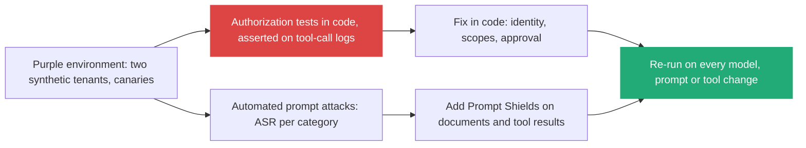

# 17. Automated red teaming finds what Content Safety and prompt rules miss, but "data from a source that does not belong to it" is an authorization defect I test with synthetic tenants and canaries, not with a content scanner

> Prompt Shields and prompt guardrails look at text; neither decides which data a user or tenant may read. I split the test into prompt-level attacks (jailbreaks, encodings, multi-turn, injected tool results), which PyRIT, promptfoo or Foundry's red teaming agent automate and score as an attack success rate, and authorization attacks (other tenant's IDs, admin tools, fetch tools), which I write as deterministic tests against tool-call logs; all of it runs in a purple environment with synthetic data.

Related: [Lecture 2: 9 Tools and prompt injection](../Lecture_2_Context_Agents_md_Skills_Tools/9_tools_prompt_injection.md) · [W2L1 04 HITL and execution isolation](../Week2_Lecture_1_Agent_Primitives/04_HITL_And_Execution_Isolation.md) · [W2L1 05 Instructions and enforcement](../Week2_Lecture_1_Agent_Primitives/05_Instructions_Five_Parts_And_Enforcement.md) · [W2L1 16 Evals for agent changes](../Week2_Lecture_1_Agent_Primitives/16_Evals_For_Agent_Changes.md) · [12 Sandbox for agent code](12_Sandbox_For_Agent_Code_Pi_And_Search_Execute.md) · [14 Execution flows](14_Execution_Flows_Skill_Tool_Or_Workflow.md) · [15 Tool navigation and flexibility](15_Tool_Navigation_And_Flexibility.md) · [16 Memory-centric approach with events](16_Memory_Centric_Approach_With_Events.md) · [W2L3 20 Sandbox against jailbreak and prompt injection](../Week2_Lecture_3_MCP_MCP+Resources_Skills/20_Sandbox_Against_Jailbreak_And_Prompt_Injection_Per_Tenant.md)

Source: my setup: Azure AI Content Safety and a few guardrail lines in the prompt. Microsoft Learn pages on the AI Red Teaming Agent and Prompt Shields, the OWASP pages, the promptfoo plugin list and the garak and PyRIT READMEs, read on 2026-11-22 through fetch summaries. Nothing installed or run. See [Fact-check](#fact-check).

## Glossary

| Term | What it means here | Same thing elsewhere | Not to be confused with |
|---|---|---|---|
| Red teaming | Simulating an adversary against my own agent to find failures | Penetration test for AI | A content filter |
| ASR | Attack success rate: successful attacks ÷ attacks tried | Foundry red teaming metric | An accuracy score |
| Prompt Shields | Detects user prompt attacks and document attacks in text | Azure AI Content Safety feature | An access control |
| Indirect injection | Instructions hidden in data the agent reads | XPIA, document attack | A user's own jailbreak |
| BOLA / BFLA | Broken object-level / function-level authorization | IDOR, privilege escalation | Prompt injection |
| Canary | A fake secret planted to see where it leaks | Honeytoken | A real credential |
| Purple environment | Non-production, with production-like resources | Foundry docs term | Production |

## 1. The problem

I have Content Safety and a few prompt guardrails. **How do I attack my own agent automatically, and what else can go wrong, for example the agent reading data from a source that does not belong to it?**

## 2. What my layers cover

| Layer | Catches | Does not decide |
|---|---|---|
| Prompt Shields, user prompt attacks | Rule changes, conversation mock-ups, role-play, encodings. On by default in Foundry | Whether a request is benign or fits the task. Trained mainly on English |
| Prompt Shields, document attacks | Instructions hidden in documents, emails, web pages. Off by default. For Foundry agents, tool-response scanning is in preview for supported tools | Harm, grounding, policy compliance, task alignment. It does not verify where content came from |
| Prompt rules | Guidance the model usually follows | Anything the model may ignore ([W2L1 05](../Week2_Lecture_1_Agent_Primitives/05_Instructions_Five_Parts_And_Enforcement.md)) |

None of them checks that tenant A's agent may read tenant B's record. That is an authorization check in the tool code, with identity taken from the session and not from the model ([W2L1 04](../Week2_Lecture_1_Agent_Primitives/04_HITL_And_Execution_Isolation.md), and the `get_order` call in the S02E02 demo). So I test it as authorization.

## 3. What to attack

| Attack | Test I run | OWASP |
|---|---|---|
| Jailbreak, encodings, multi-turn | Automated strategies, scored by ASR | LLM01, ASI01 |
| Injected tool results | Plant instructions in a test ticket, page or file the agent reads | LLM01, ASI01, ASI06 |
| Another tenant's data (BOLA) | Ask for IDs I do not own, swap IDs in tool arguments, check the server-side filter | LLM02, ASI03 |
| Another user's session (leak) | Ask in session B about what session A said | LLM02 |
| Admin or write tools as a read-only user (BFLA) | Call or persuade the agent to call them | LLM06, ASI02, ASI03 |
| Fetch tools (SSRF) | Ask for internal URLs or metadata endpoints | ASI02, ASI05 |
| Prompt and tool disclosure | Ask for the system prompt and tool list | LLM07 |
| Poisoned memory, runaway loops | A planted memory note, a loop with no end | ASI06, LLM10 |

The existing note lists ten injection vectors and a manual canary test: [Lecture 2: 9](../Lecture_2_Context_Agents_md_Skills_Tools/9_tools_prompt_injection.md). This note automates it.

## 4. Tools

| Tool | Scope | Fits my agent when |
|---|---|---|
| [Foundry AI Red Teaming Agent](https://learn.microsoft.com/en-us/azure/foundry/concepts/ai-red-teaming-agent) | PyRIT-based scans, ASR, 25 strategies including Crescendo and multi-turn. Agent categories: prohibited actions, sensitive data leakage, task adherence, indirect injection. Those run in the cloud only, in 4 regions, on Foundry hosted prompt or container agents with Azure tools. Function tool calls and non-Foundry agents are not supported. Data is synthetic, tools are mocks, two categories are single-turn and English-only | My agent runs as a Foundry hosted agent. Otherwise its content scans only |
| [PyRIT](https://github.com/microsoft/PyRIT) | MIT. CLI scanner, GUI and Python framework. Targets include custom application endpoints over HTTP, WebSockets or Playwright | I need to attack my own endpoint with multi-turn strategies |
| [garak](https://github.com/NVIDIA/garak) | Apache-2.0. Probes, detectors, REST generators. Model-level, agents and tool use not addressed | A model-level baseline |
| [promptfoo](https://www.promptfoo.dev/docs/red-team/plugins/) | Plugins `bola`, `bfla`, `rbac`, `cross-session-leak`, `indirect-prompt-injection`, `ssrf`, `excessive-agency`, `pii:*`, `tool-discovery`, set in `promptfooconfig.yaml`. Some plugins use remote inference in the Community edition | I want ready authorization and leak cases |

## 5. Plan

1. **Purple environment:** a copy of the agent with synthetic data, two tenants and canary secrets, and no real credentials.
2. **Authorization as ordinary tests:** assert on the tool-call log and the journal ([16](16_Memory_Centric_Approach_With_Events.md)), not on the reply text. A tenant-B record must never appear in a tenant-A call.
3. **Prompt attacks scored:** review the hits by hand, since the Foundry scorer is generative and can give false positives.
4. **Compare ASR** with Prompt Shields document attacks on and off.
5. **Keep it as a regression suite** next to my evals ([W2L1 16](../Week2_Lecture_1_Agent_Primitives/16_Evals_For_Agent_Changes.md)). A pass does not prove safety.

## Cautions

The tools send hostile traffic to my agent, so they run only against the purple environment. Remote-inference plugins send prompts to a third party, which needs a check against my data policy. Installing any tool, or any model call, needs my explicit yes first.

## Summary

Content Safety and prompt rules read text and do not enforce who may read what. I test authorization as deterministic tests on tool logs, test prompt attacks with PyRIT, promptfoo or Foundry's red teaming agent and track ASR, add Prompt Shields on documents and tool results, and re-run everything on each change.

## Open questions

- Does my agent run as a Foundry hosted agent, or is it custom code outside the supported targets?
- Which tools enforce tenant identity in code, and which rely on the model passing the right ID?
- Do I log every tool call with the identity and tenant it ran for?
- Which sources can the agent reach that no tenant owns?

## Fact-check

| # | Claim | Verdict | Source | Checked |
|---|---|---|---|---|
| 1 | Prompt Shields cover user prompt and document attacks; the first is on by default in Foundry, the second off; tool-response scanning is preview | **Agrees** | [Prompt Shields](https://learn.microsoft.com/en-us/azure/ai-services/content-safety/concepts/jailbreak-detection), fetched page | 2026-11-22 |
| 2 | Prompt Shields do not judge harm, grounding, policy or task alignment, nor verify provenance | **Agrees** | Same page | 2026-11-22 |
| 3 | The Foundry agentic risk categories are cloud-only and support Foundry hosted agents with Azure tools; function tool calls and non-Foundry agents are not supported | **Agrees** | [AI Red Teaming Agent](https://learn.microsoft.com/en-us/azure/foundry/concepts/ai-red-teaming-agent), fetched page (updated 2026-11-17) | 2026-11-22 |
| 4 | OWASP LLM Top 10 2025 and the Agentic Top 10 (ASI01 to ASI10, 9 December 2025) | **Agrees** | [LLM Top 10](https://genai.owasp.org/llm-top-10/), [Agentic Top 10 announcement](https://genai.owasp.org/2025/12/09/owasp-top-10-for-agentic-applications-the-benchmark-for-agentic-security-in-the-age-of-autonomous-ai/), fetch summaries of titles only | 2026-11-22 |
| 5 | promptfoo has plugins for BOLA, BFLA, RBAC, cross-session leak, SSRF, indirect injection | **Agrees** | [Plugin list](https://www.promptfoo.dev/docs/red-team/plugins/). The page states no license | 2026-11-22 |
| 6 | PyRIT (MIT) can target custom application endpoints; garak (Apache-2.0) is model-level | **Agrees** | READMEs of [PyRIT](https://github.com/microsoft/PyRIT) and [garak](https://github.com/NVIDIA/garak), fetch summaries | 2026-11-22 |
| 7 | Wrong-source data is an authorization defect, not a content-safety one | **Lecture-specific** reasoning | My conclusion, consistent with the S02E02 demo where identity comes from the session | 2026-11-22 |
| 8 | Foundry's agentic red teaming applies to my agent | **Unverified** | Depends on how my agent is hosted | 2026-11-22 |

## Sources

- My setup: Azure AI Content Safety and prompt guardrails.
- [Foundry AI Red Teaming Agent](https://learn.microsoft.com/en-us/azure/foundry/concepts/ai-red-teaming-agent) · [Prompt Shields](https://learn.microsoft.com/en-us/azure/ai-services/content-safety/concepts/jailbreak-detection) · [OWASP LLM Top 10](https://genai.owasp.org/llm-top-10/) · [OWASP Agentic Top 10](https://genai.owasp.org/2025/12/09/owasp-top-10-for-agentic-applications-the-benchmark-for-agentic-security-in-the-age-of-autonomous-ai/)
- [promptfoo plugins](https://www.promptfoo.dev/docs/red-team/plugins/) · [PyRIT](https://github.com/microsoft/PyRIT) · [garak](https://github.com/NVIDIA/garak)
- My own reasoning: the attack table, the plan and the authorization split.
