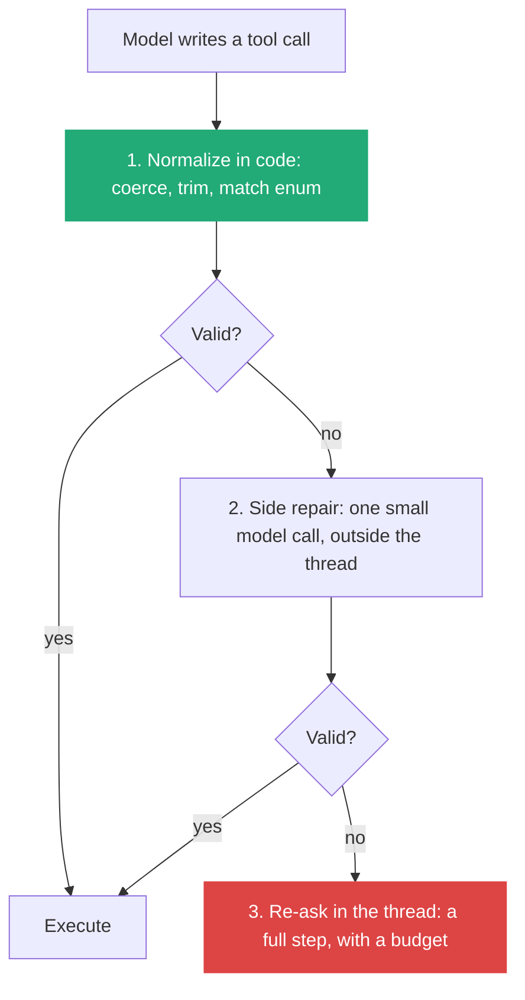

# 20. Most invalid tool calls can be repaired in code or by a small side model before a full agent step is spent, if every repair is capped, logged and limited to changes that cannot alter meaning

> A failed tool call costs a whole extra step, so the cheapest fix is to repair the call before the model sees an error: deterministic normalization first (Pydantic's lax mode already turns `"2"` into `2`), one side-model repair second (the AI SDK's `repairToolCall`), and a re-ask in the thread last, with a budget per tool; I repair syntax and never IDs, scope or amounts, and I log each repair so a rising rate sends me back to fix the tool.

Related: [15 Tool navigation and flexibility](15_Tool_Navigation_And_Flexibility.md) · [10 Cache and context window](10_Cache_And_Context_Window.md) · [09 Cache hit rate and P90](09_Cache_Hit_Rate_And_P90_Latency.md) · [16 Memory-centric approach with events](16_Memory_Centric_Approach_With_Events.md) · [17 Auto penetration testing](17_Auto_Penetration_Testing_Of_My_Agent.md) · [14 Execution flows](14_Execution_Flows_Skill_Tool_Or_Workflow.md) · [W2L1 03 Agent loop, limits and recovery](../Week2_Lecture_1_Agent_Primitives/03_Agent_Loop_Stop_Limits_Recovery.md)

Source: my setup: MCP tools with typed, structured input and output and variable validation. AI SDK, Pydantic AI, Instructor and LangChain docs, the Pydantic conversion table and two arXiv abstracts read on 2026-11-22 through fetch summaries. See [Fact-check](#fact-check).

## Glossary

| Term | What it means here | Same thing elsewhere | Not to be confused with |
|---|---|---|---|
| Repair | Turning an invalid call into a valid one before it counts as a step | AI SDK `repairToolCall` | A retry of a failed execution |
| Normalization | A deterministic fix with no model: type coercion, case, whitespace | Pydantic lax mode | Guessing a value |
| Side repair | One model call outside the thread that rewrites the arguments | AI SDK repair with a structured-output model | A re-ask |
| Re-ask | Sending the error back so the model calls again: a full step | MCP `isError`, Pydantic AI retry, Instructor retry | Repair |
| Retry budget | The cap on repairs and re-asks per tool or per call | Pydantic AI per-tool counter, Instructor `max_retries` | A rate limit |

## 1. The problem

Each failed tool call adds a whole step to the run (about `n × f × t`, [15](15_Tool_Navigation_And_Flexibility.md)). My tools shape the call and validate it, but validation rejects after the model has written the call. **What do others do to repair a call before a step is spent, and what must I limit?**

## 2. The ladder

| Level | Evidence | Cost |
|---|---|---|
| 1 Normalize | [Pydantic](https://pydantic.dev/docs/validation/latest/concepts/conversion_table/) lax mode accepts `"123"` for an `int`, with whitespace, underscores and `1.0`; strict mode rejects it. Anthropic says that without strict mode Claude "might return incompatible types (`"2"` instead of `2`)" | None, microseconds |
| 2 Side repair | [AI SDK](https://ai-sdk.dev/docs/ai-sdk-core/tools-and-tool-calling) `repairToolCall` fixes invalid calls "without adding extra steps that clutter the message history", by a structured-output model, a stronger model or targeted instructions. Its example does not repair a wrong tool name. [arXiv 2510.17874](https://arxiv.org/abs/2510.17874) repairs kubectl calls after execution with reflection and RAG: 36% more likely on average to answer the query correctly | One small model call |
| 3 Re-ask | MCP: validation errors are execution errors the model uses to self-correct. Pydantic AI: an error goes back automatically, a counter per tool, default 1, then the run raises. [Instructor](https://python.useinstructor.com/concepts/retrying/): `max_retries`, `token_budget`, and "retries multiply token spend and latency". LangChain `ToolRetryMiddleware`: 2 retries with backoff, `on_failure` returns a `ToolMessage`. Its page does not say that invalid arguments are retried | A full step |

A third paper family trains or adds a separate refiner (Structured Reflection, arXiv 2509.18847; Invocation Refiner, ACL Findings 2026). I read only search summaries of them, so I do not rely on them.

## 3. What I may repair (my reasoning)

| Class | Examples | Rule |
|---|---|---|
| Syntax | Number as string, extra whitespace, case of an enum, date format, malformed JSON | Repair automatically |
| Needs a check | A property name close to a valid one, a missing optional value | Repair only on a unique, exact-enough match, and log it |
| Meaning | IDs, tenant or scope, amounts, the target of a write | Never repair. Return an error. A repair that widens access is an attack path ([17](17_Auto_Penetration_Testing_Of_My_Agent.md)) |

A write is repaired for syntax only, and the approval screen shows the normalized call ([14](14_Execution_Flows_Skill_Tool_Or_Workflow.md)). The failure-analysis paper [arXiv 2507.15296](https://arxiv.org/abs/2507.15296) warns that a call can look successful and still mislead the model.

## 4. Guards and where each level lives

1. **Cap:** one side repair per call, then a re-ask budget per tool.
2. **Log:** each repair is a journal entry with the layer, before and after ([16](16_Memory_Centric_Approach_With_Events.md)).
3. **Count:** repair rate per layer, residual failures, steps saved. A rising rate for one tool means its schema or description needs fixing, not more repair ([15](15_Tool_Navigation_And_Flexibility.md)).
4. **Cache:** a repair outside the thread leaves the history clean and the prefix intact ([10](10_Cache_And_Context_Window.md)). It adds a small model call, so I measure it.
5. **Placement:** level 1 in the MCP server, which I own. Levels 2 and 3 in the harness around the tool call, for example a `wrap_tool_call` middleware in LangChain.

## 5. What my error rates imply

I count failures on my own taxonomy: about 1 to 1.5% of calls with the skill loaded, about 3 to 5% without skills, for external agents that use my MCP server (my measurement, method not written down here).

| Case | Failing calls per 100 | Extra steps per run of 10 calls |
|---|---|---|
| Skill loaded | 1 to 1.5 | 0.10 to 0.15 |
| No skill, external agent | 3 to 5 | 0.3 to 0.5 |

The run length of 10 calls is my assumption. The extra steps are `n × f`, each costing a step time `t`.

- **The skill already cuts failures about three times** (4% against 1.25% at the midpoints). That is the "teach" layer working.
- **With the skill, even a perfect repair saves at most 0.10 to 0.15 steps per 10-call run**, so the average gain is small. It matters more if failures cluster in the slowest runs, which I check on the golden set.
- **External agents do not run my harness**, so only the server-side levels reach them: level 1 (normalize in the MCP server) and level 3 (errors that say the fix). Level 2 lives in the client harness, which I do not own. Their 3 to 5% is where level 1 pays most.
- **The split by class decides the level:** syntactic errors go to level 1, semantic ones to the descriptions and the skill ([15](15_Tool_Navigation_And_Flexibility.md)).

## Summary

Normalize in code, repair once with a small model, re-ask last, and cap every level. I repair syntax and never meaning, and I log each repair so the tool gets fixed.

## Open questions

- Is Pydantic's lax mode already active on my MCP side, so level 1 runs today?
- What share of my failed calls are syntactic, and what share are semantic?
- Does a side repair cost less time than a re-ask on my golden set?
- Which error classes remain with the skill loaded, and which dominate without it?
- Do the failures cluster in the slowest runs?

## Fact-check

| # | Claim | Verdict | Source | Checked |
|---|---|---|---|---|
| 1 | Pydantic lax mode converts a valid integer string to `int`; strict mode does not | **Agrees** | [Conversion table](https://pydantic.dev/docs/validation/latest/concepts/conversion_table/), fetch summary | 2026-11-22 |
| 2 | Without strict mode a model may return `"2"` for an integer | **Agrees** | [Anthropic strict tool use](https://platform.claude.com/docs/en/agents-and-tools/tool-use/strict-tool-use) | 2026-11-22 |
| 3 | The AI SDK repairs invalid calls without extra steps in the message history, with three strategies, and skips wrong tool names in its example | **Agrees** | [AI SDK tools](https://ai-sdk.dev/docs/ai-sdk-core/tools-and-tool-calling), fetch summary | 2026-11-22 |
| 4 | Pydantic AI returns validation errors to the model with a per-tool retry counter | **Agrees** | [Pydantic AI tools](https://pydantic.dev/docs/ai/tools-toolsets/tools-advanced/), last 9,014 characters unread | 2026-11-22 |
| 5 | Instructor retries on validation errors with `max_retries` and `token_budget`; retries multiply cost | **Agrees** | [Instructor retrying](https://python.useinstructor.com/concepts/retrying/), fetch summary | 2026-11-22 |
| 6 | LangChain `ToolRetryMiddleware` retries failed tool calls (default 2) | **Agrees**; for invalid arguments **Unverified** | [Built-in middleware](https://docs.langchain.com/oss/python/langchain/middleware/built-in) | 2026-11-22 |
| 7 | Post-execution reflection with RAG repairs kubectl calls, 36% more likely to answer correctly on average | **Agrees**, for kubectl only | [arXiv 2510.17874](https://arxiv.org/abs/2510.17874), abstract | 2026-11-22 |
| 8 | Structured Reflection (2509.18847) and Invocation Refiner (ACL Findings 2026) | **Unverified** | Search summary only | 2026-11-22 |
| 9 | Which classes are safe to repair | **Unverified** | My reasoning | 2026-11-22 |
| 10 | My error rate is about 1 to 1.5% with the skill and 3 to 5% without | **Own measurement** | My taxonomy, reported by me; method and sample size not recorded in this note | 2026-11-22 |

## Sources

- My setup: typed, structured MCP tool input and output with validation.
- [AI SDK tools](https://ai-sdk.dev/docs/ai-sdk-core/tools-and-tool-calling) · [Pydantic AI tools](https://pydantic.dev/docs/ai/tools-toolsets/tools-advanced/) · [Instructor retrying](https://python.useinstructor.com/concepts/retrying/) · [LangChain middleware](https://docs.langchain.com/oss/python/langchain/middleware/built-in) · [Pydantic conversion table](https://pydantic.dev/docs/validation/latest/concepts/conversion_table/)
- [arXiv 2510.17874](https://arxiv.org/abs/2510.17874) · [arXiv 2507.15296](https://arxiv.org/abs/2507.15296)
- My own reasoning: the ladder's placement, the repair classes and the guards.
