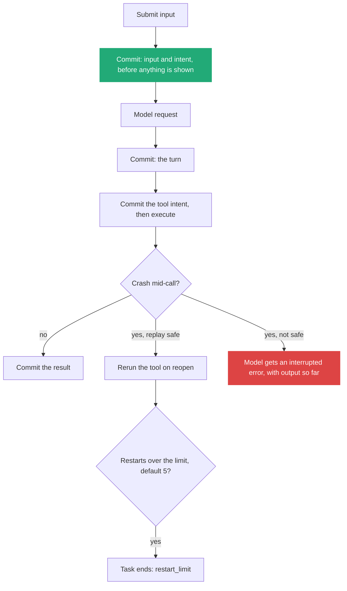

# 24. pi-durable commits the intent before every step and replays only what is declared safe: it gives crash recovery and sleeping tasks without a process, but it is experimental, single-writer and needs my own idempotency

> pi-durable writes conversations, model turns, tool intents and my state to storage in atomic commits before anything is shown, resumes tasks from checkpoints after a crash, reruns a tool only if it is declared `replay: "safe"`, and lets a task sleep until a time or a signal; the lecture's "recover from nearly any failure" overstates it, because the README lists a one-writer rule, lost output windows, a restart cap, storage errors that end the harness, and an experimental API.

Related: [22 Long-horizon runs](22_Long_Horizon_Runs_Concurrency_Durability_Watchers.md) · [08 Mastra workflow mapped to LangGraph](08_Mastra_Workflow_Mapped_To_LangGraph.md) · [16 Memory-centric approach with events](16_Memory_Centric_Approach_With_Events.md) · [09 Cache hit rate and P90](09_Cache_Hit_Rate_And_P90_Latency.md) · [W2L1 14 Tool approval, durable waits](../Week2_Lecture_1_Agent_Primitives/14_Tool_Approval_Durable_Waits.md) · [W2L1 12 Audit ledger](../Week2_Lecture_1_Agent_Primitives/12_Memory_Audit_Ledger_In_Memory_Or_State.md) · [W2L1 19 Pi, LangGraph and the DeepSeek paper](../Week2_Lecture_1_Agent_Primitives/19_Pi_LangGraph_DeepSeek_Harnesses.md)

Source: S02E02 article (pi-durable named for recovery and pauses). The pi-durable README, its `src` listing and the chord README, read on 2026-11-22 through fetch summaries (README read in full). No source code read, nothing installed or run. See [Fact-check](#fact-check).

## Glossary

| Term | What it means here | Same thing elsewhere | Not to be confused with |
|---|---|---|---|
| Commit | An atomic write of entries, documents and tasks together | Database transaction | A git commit |
| Task | "A durable state machine that saves a checkpoint at every step" | Temporal workflow, LangGraph node run | A to-do item |
| Phase | The code between two waits. It reruns from its top after a restart | Temporal workflow task | A turn |
| `replay: "safe"` | A tool may run again after a crash | Idempotent activity | A guarantee of idempotency |
| Signal | A typed value delivered to a waiting task | Temporal signal | An OS signal |
| Deferred commit | Streamed partial output saved later, within a window | Buffered write | A lost write |

## 1. The problem

The article names pi-durable so the agent can "recover from nearly any failure or pause the execution for as long as needed". **How is it done, and what does it really give?**

## 2. How it works

| What | When it is stored |
|---|---|
| Conversation entries, model turns, my documents | In one atomic commit, before they are shown |
| Tool call intent | Before `execute()` runs |
| Streamed partial output | At most every 100 ms, saved within `persistWithinMs` (default 1,000 ms). A crash can lose about that window |
| Sleep deadline and checkpoint | With the task, so a sleeping task holds no process |

A model request cut off by a crash is "a failed attempt under `settings.retry`", kept as an aborted entry and retried after a backoff.

## 3. What it gives

- **Crash recovery:** reopening the storage resumes the work.
- **Sleeping tasks:** a phase can end as `{ status: "sleeping", until, checkpoint }`. "There is no sleep in the middle of a phase: a phase reruns from its top after a restart", so work after a wait belongs in the next phase.
- **Signals:** typed values, early ones kept, results `delivered`, `duplicate`, `invalid`, `closed` or `not_found`. "Nothing checks who sends a signal: authenticate senders in your host."
- **Parked tool calls:** a tool can wait or sleep and has a `cancel` hook.
- **Idempotency help:** `api.memo()` stores an idempotency key before an external call.
- **Storage:** memory, IndexedDB, SQLite, JSONL and a Cloudflare Durable Object adapter. Evictable hosts use `onWake` and arm their own alarm.
- **Operations:** `compact`, `fork`, `reset`, `abort`, subagents, read-only viewers.

## 4. What it does not give

| Limit | From the README |
|---|---|
| Experimental | "The API changes without notice between releases" |
| One writer | "One process writes a storage at a time; there is no cross-process locking". A second process opens read-only |
| Lost data windows | About 1 s of partial output; the newest SQLite commits on power or host failure |
| Storage errors | Any error from `commit()` ends the Harness, and nothing is retried. I reopen, and resubmitting with the same `requestId` is safe |
| Effects | A replay-safe tool with external effects needs its own idempotency |
| Waking | No scheduler of its own: the host calls `resume()` when its alarm fires. All processes need the same clock |
| Language | TypeScript (Node, Bun, browser, Durable Objects) |

## 5. Against the others

| | pi-durable | Temporal | LangGraph |
|---|---|---|---|
| Unit | Task with checkpoints | Workflow replayed from an event history | Graph run, checkpoint per super-step ([W2L1 19](../Week2_Lecture_1_Agent_Primitives/19_Pi_LangGraph_DeepSeek_Harnesses.md)) |
| After a crash | Resume at the checkpoint, rerun the phase | Replay the code from the history | Resume from the last checkpoint |
| Side effects | Intent committed first, rerun if `safe`, `memo` for keys | Activities run once and are recorded | Mine to make idempotent ([08](08_Mastra_Workflow_Mapped_To_LangGraph.md)) |
| Sleep | `sleeping` status | Durable timers | Waits at `interrupt` |
| Maturity | Experimental | Production | Production |

Sources for Temporal and LangGraph are in [22](22_Long_Horizon_Runs_Concurrency_Durability_Watchers.md) and [08](08_Mastra_Workflow_Mapped_To_LangGraph.md).

## 6. What I take (my reasoning)

My stack is Python, LangGraph and Redis, and pi-durable is TypeScript, so I take the ideas, not the package:

1. **Commit the intent before the side effect**, and the result after. That is the write-ahead entry of my Ledger ([W2L1 12](../Week2_Lecture_1_Agent_Primitives/12_Memory_Audit_Ledger_In_Memory_Or_State.md)).
2. **Mark each tool `safe` or not** for replay, and give a key to every external call.
3. **Write work in phases** that can rerun from the top.
4. **Cap restarts** so a crash loop ends.
5. **Authenticate who may send a wake signal** ([17](17_Auto_Penetration_Testing_Of_My_Agent.md)).

## Summary

pi-durable is a small, explicit design for crash recovery and long waits: commit first, resume at checkpoints, rerun only safe tools. It is experimental and single-writer, and the lecture's "nearly any failure" holds only inside the README's rules. I borrow its intent-first commit, safe-replay flag, phases and restart cap.

## Open questions

- Do my tools carry a safe-to-replay flag and an idempotency key today?
- Do I write an intent entry before each side effect?
- Do I want to read `docs/spec.md` and run its recovery example? That needs an install, so it needs my yes.

## Fact-check

| # | Claim | Verdict | Source | Checked |
|---|---|---|---|---|
| 1 | Commit before display; tool intent before `execute()`; rerun only if `replay: "safe"`, else an interrupted error | **Agrees** | [pi-durable README](https://github.com/earendil-works/pi/tree/main/packages/durable), fetch summary | 2026-11-22 |
| 2 | Partial output is committed every 100 ms at most, within 1,000 ms; a crash can lose it | **Agrees** | Same README | 2026-11-22 |
| 3 | Restart limit 5; model requests retried under `settings.retry` | **Agrees** | Same README | 2026-11-22 |
| 4 | Sleeping tasks hold no process; a phase reruns from its top; one clock | **Agrees** | Same README | 2026-11-22 |
| 5 | Signals are typed, de-duplicated, and unauthenticated by the library | **Agrees** | Same README | 2026-11-22 |
| 6 | One writer per storage; a second process is read-only | **Agrees** | Same README | 2026-11-22 |
| 7 | Backends and SQLite durability on power loss | **Agrees** | Same README | 2026-11-22 |
| 8 | Experimental, API changes without notice, MIT | **Agrees** | Same README | 2026-11-22 |
| 9 | Internals beyond the README (`tasks.ts`, `storage`, `docs/spec.md`) | **Unverified** | Not read. The chord README does not mention pi-durable | 2026-11-22 |
| 10 | It recovers from nearly any failure and pauses as long as needed | **Differs** in strength | S02E02 article against the limits above | 2026-11-22 |

## Sources

- S02E02 article.
- [pi-durable](https://github.com/earendil-works/pi/tree/main/packages/durable) · [src listing](https://github.com/earendil-works/pi/tree/main/packages/durable/src) · [chord](https://github.com/earendil-works/pi/tree/main/packages/chord)
- My own reasoning: the comparison row for Temporal and LangGraph and section 6.
