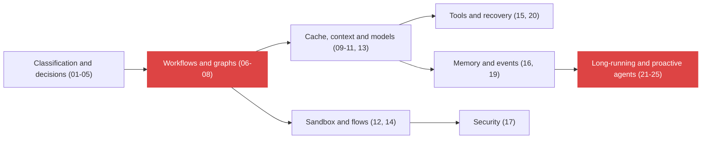

# Week 2, Lecture 2: Building an agent

> How I choose between a classifier, a decision model and an LLM step, how workflows and graphs fit, how cache, context and models are managed, and how long-running, always-on agents stay durable and safe.

Source: the S02E02 written lesson, the audio transcript and web research. Related: [Week 2, Lecture 1: Agent primitives](../Week2_Lecture_1_Agent_Primitives/README.md) · [Week 2, Lecture 3: MCP, resources and skills](../Week2_Lecture_3_MCP_MCP+Resources_Skills/README.md) · [root README](../README.md)

## What this lecture covered

## Notes

The folder has no file 18.

### Classification and decisions

| File | Name | What it covers | Keywords |
|---|---|---|---|
| [01_LLM_vs_Classification.md](01_LLM_vs_Classification.md) | Trained classifiers vs LLM steps | Trained classifiers against LLM decision steps on setup, cost per call and upkeep; the choice follows volume, category stability and labels | trained classifier, decision model, llm step, cascade, drift |
| [02_ClassificationModel_vs_DecisionModel.md](02_ClassificationModel_vs_DecisionModel.md) | Classification model vs decision model | A classification model fixes labels at training, while a decision model takes options per request and returns typed probabilities | classification model, decision model, typed answer, calibration |
| [03_Classification_Options_Market.md](03_Classification_Options_Market.md) | Classification options on the market | Text classification options ordered by how much I own: classical ML, trained encoders, managed classifiers, LLMs, decision models | multi-class, few-shot, managed classifier, flywheel |
| [04_Jev_And_Microsoft_Decision_1.md](04_Jev_And_Microsoft_Decision_1.md) | Jev and Microsoft-Decision-1 | Two hosted decision models return typed answers with per-option probabilities at low input-token cost | system one, choice, score, typed answers, probabilities |
| [05_Support_Chat_In_Production.md](05_Support_Chat_In_Production.md) | Support chat in production | Lex, Rasa and Dialogflow CX route a message through a fast first pass, a confidence gate and a human path | intent, nlu, fallback, confidence gate, handoff |

### Workflows and graphs

| File | Name | What it covers | Keywords |
|---|---|---|---|
| [06_Workflow_vs_LangGraph.md](06_Workflow_vs_LangGraph.md) | Workflow vs LangGraph | A workflow fixes step order in code, and LangGraph is a workflow engine that also runs agent loops | workflow, agent, guardrail, durable, idempotency |
| [07_Workflows_On_The_Fly_And_Todo_Lists.md](07_Workflows_On_The_Fly_And_Todo_Lists.md) | Workflows on the fly and todo lists | A model can write a plan as data, but changing a workflow's structure at runtime costs resumability | plan as data, topology, send, command, orchestrator-workers |
| [08_Mastra_Workflow_Mapped_To_LangGraph.md](08_Mastra_Workflow_Mapped_To_LangGraph.md) | Mastra workflow mapped to LangGraph | A Mastra step with suspend and resumeData maps onto a LangGraph node with interrupt, a checkpointer and thread_id | step, run, snapshot, resume data, superstep |

### Cache, context and models

| File | Name | What it covers | Keywords |
|---|---|---|---|
| [09_Cache_Hit_Rate_And_P90_Latency.md](09_Cache_Hit_Rate_And_P90_Latency.md) | Cache hit rate and P90 latency | A higher cache hit rate cuts prefill and input cost but cannot fix P90 alone, so I measure TTFT, decode speed and steps | hit rate, prefill, ttft, decode speed, critical path |
| [10_Cache_And_Context_Window.md](10_Cache_And_Context_Window.md) | Cache and context window stack | The context stack keeps the cache by putting what describes the agent first and appending only what changed | context window, prefix, developer message, mid-turn message |
| [11_Model_Routing_In_LangGraph.md](11_Model_Routing_In_LangGraph.md) | Model routing in LangGraph | LangGraph picks a model per call without changing the compiled graph, so routing by role needs no dynamic graph | model routing, policy table, runtime context, model middleware |
| [13_LLM_Adapters_And_Gateway.md](13_LLM_Adapters_And_Gateway.md) | LLM adapters and a thin gateway | Adapt per API dialect, keep the host as configuration, and put a thin gateway on top for routing | dialect, host, adapter, gateway, capability flag |

### Sandbox and flows

| File | Name | What it covers | Keywords |
|---|---|---|---|
| [12_Sandbox_For_Agent_Code_Pi_And_Search_Execute.md](12_Sandbox_For_Agent_Code_Pi_And_Search_Execute.md) | Sandbox layers for agent code | A sandbox has three layers, and Pi's codemode sandboxes only the script, so the tools it calls need their own boundary | script sandbox, micro-vm, tool isolation, credential proxy |
| [14_Execution_Flows_Skill_Tool_Or_Workflow.md](14_Execution_Flows_Skill_Tool_Or_Workflow.md) | Execution flows: skill, tool or workflow | A flow can live in a skill, a tool or code; judgment stays in the skill and fixed sequences move out | execution flow, skill, consolidated tool, gate, enforcement |

### Tools and recovery

| File | Name | What it covers | Keywords |
|---|---|---|---|
| [15_Tool_Navigation_And_Flexibility.md](15_Tool_Navigation_And_Flexibility.md) | Tool navigation and flexibility | Vendors agree on clear names, typed schemas, parameter descriptions, actionable errors and few focused tools | tool navigation, input schema, execution error, ladder of flexibility |
| [20_Repair_Tool_Calls_Before_A_Step_Is_Spent.md](20_Repair_Tool_Calls_Before_A_Step_Is_Spent.md) | Repair tool calls before a step | Most invalid tool calls can be repaired in code or by a small side model before a full agent step is spent | repair, normalization, side repair, re-ask, retry budget |

### Memory and events

| File | Name | What it covers | Keywords |
|---|---|---|---|
| [16_Memory_Centric_Approach_With_Events.md](16_Memory_Centric_Approach_With_Events.md) | Memory-centric agent with events | In a memory-centric agent every memory change is an event, and I record messages, a journal and a schedule | memory, event, journal, ledger, reflection |
| [19_Evict_Tool_Results_To_Memory_By_Reference.md](19_Evict_Tool_Results_To_Memory_By_Reference.md) | Evict tool results by reference | Dropping old tool results from context and leaving a pointer is used on the market and matches published results | eviction, observation masking, reference, compaction |

### Security

| File | Name | What it covers | Keywords |
|---|---|---|---|
| [17_Auto_Penetration_Testing_Of_My_Agent.md](17_Auto_Penetration_Testing_Of_My_Agent.md) | Automated red teaming of my agent | Red teaming finds what Content Safety and prompt rules miss, such as data from a source that does not belong to the user | red teaming, prompt shields, indirect injection, canary |

### Long-running and proactive agents

| File | Name | What it covers | Keywords |
|---|---|---|---|
| [21_Engagement_Signals_And_Proactive_Agents.md](21_Engagement_Signals_And_Proactive_Agents.md) | Engagement signals for proactive agents | Engagement events can steer a proactive agent, but opens and read receipts are weak signals | engagement event, explicit signal, weak signal, aggregate |
| [22_Long_Horizon_Runs_Concurrency_Durability_Watchers.md](22_Long_Horizon_Runs_Concurrency_Durability_Watchers.md) | Long-horizon runs: concurrency and durability | Long runs need one writer or a version check per entity, durable waits across days and watchers | optimistic locking, single writer, durable execution, watcher |
| [23_Wake_And_Reflect_Agents_On_The_Market.md](23_Wake_And_Reflect_Agents_On_The_Market.md) | Wake-and-reflect agents on the market | Wake-and-reflect agents exist as products with research behind them, but reflection needs an outside signal | wake-and-reflect loop, reflection, sleep-time compute |
| [24_Pi_Durable_How_It_Recovers_Long_Running_Tasks.md](24_Pi_Durable_How_It_Recovers_Long_Running_Tasks.md) | pi-durable recovers long tasks | pi-durable commits intent before each step and replays only what is declared safe, giving crash recovery | commit, task, phase, replay safe, deferred commit |
| [25_Always_On_Agents_Lee_Robinson_Talk_Mapped.md](25_Always_On_Agents_Lee_Robinson_Talk_Mapped.md) | Always-on agents talk mapped | The always-on agents talk, as far as secondary sources show, matches most of what I already wrote | always-on agent, thin client thick server, trigger router |

## Related review reminders

All reminders for this episode, in note order. The index by episode is [notes_for_later_use/README.md](../notes_for_later_use/README.md).

| File | Name | What to review | Keywords |
|---|---|---|---|
| [2026-11-22-cache-hit-target-95-99-s02e02-note-09.md](../notes_for_later_use/2026-11-22-cache-hit-target-95-99-s02e02-note-09.md) | Raise cache hit rate to 95-99% | My agent has a 75-89% hit rate; review whether 95-99% improves P90 and cost | cache hit rate, p90, cost |
| [2026-11-22-measure-latency-before-optimizing-s02e02-note-09.md](../notes_for_later_use/2026-11-22-measure-latency-before-optimizing-s02e02-note-09.md) | Measure latency before optimizing | Measure TTFT, token speed and the step waterfall first | ttft, token speed, step waterfall |
| [2026-11-22-cache-and-context-window-s02e02-note-10.md](../notes_for_later_use/2026-11-22-cache-and-context-window-s02e02-note-10.md) | Cache and context window stack | How the system prompt, tools, developer messages and a mid-turn message are laid out so the cache survives | context stack, cache, developer messages |
| [2026-11-22-model-routing-several-models-s02e02-note-11.md](../notes_for_later_use/2026-11-22-model-routing-several-models-s02e02-note-11.md) | Several models in one execution | Check my suspicions about model routing and several models in one LangGraph run | model routing, several models, langgraph |
| [2026-11-22-agent-freedom-needs-proof-of-control-s02e02-note-12.md](../notes_for_later_use/2026-11-22-agent-freedom-needs-proof-of-control-s02e02-note-12.md) | Agent freedom needs proof of control | Smarter models allow more freedom, so I need more proof that control stays mine | freedom, proof of control, filters |
| [2026-11-22-llm-adapters-and-gateway-review-s02e02-note-13.md](../notes_for_later_use/2026-11-22-llm-adapters-and-gateway-review-s02e02-note-13.md) | Provider approach: adapters and gateway | Review whether Azure AI Foundry and Anthropic support should become pure adapters with a gateway in front | adapters, gateway, azure foundry |
| [2026-11-22-execution-flows-skill-growth-s02e02-note-14.md](../notes_for_later_use/2026-11-22-execution-flows-skill-growth-s02e02-note-14.md) | Execution flows and skill growth | Load the skill that explains how to act, then do the job; review what happens as the skill grows | execution flow, skill, one skill per conversation |
| [2026-11-22-tool-navigation-odata-pydantic-s02e02-note-15.md](../notes_for_later_use/2026-11-22-tool-navigation-odata-pydantic-s02e02-note-15.md) | Tool errors and my setup | Compare my OData contract, MCP-side validation and Pydantic annotations with how others keep tool error rates low | tool errors, odata, pydantic, validation |
| [2026-11-22-memory-centric-events-ledger-journal-s02e02-note-16.md](../notes_for_later_use/2026-11-22-memory-centric-events-ledger-journal-s02e02-note-16.md) | Memory-centric agent: Ledger or Journal | Memory changes arrive through channels and an event; I register messages, a journal and a schedule | events, ledger, journal, schedule |
| [2026-11-22-automated-pentest-of-my-agent-s02e02-note-17.md](../notes_for_later_use/2026-11-22-automated-pentest-of-my-agent-s02e02-note-17.md) | Penetration test my agent automatically | Find issues such as the agent reading data from sources that do not belong to it | pentest, content safety, guardrails |
| [2026-11-22-framework-review-beyond-langgraph-s02e02-note-18.md](../notes_for_later_use/2026-11-22-framework-review-beyond-langgraph-s02e02-note-18.md) | Is there a better framework than LangGraph | Check modern frameworks for the needed primitives and flexibility | langgraph, frameworks, primitives |
| [2026-11-22-evict-tool-results-to-memory-references-s02e02-note-19.md](../notes_for_later_use/2026-11-22-evict-tool-results-to-memory-references-s02e02-note-19.md) | Evict tool results, keep references | Instead of summarizing at 75%, evict old results to my own Runtime and Redis store and keep references | eviction, references, redis |
| [2026-11-22-engagement-signals-proactive-agent-s02e02-note-21.md](../notes_for_later_use/2026-11-22-engagement-signals-proactive-agent-s02e02-note-21.md) | Steering the agent with activity events | The agent reads events about my activity and adjusts or stops actions | activity events, engagement, proactive agent |
| [2026-11-22-long-horizon-concurrency-durability-s02e02-note-22.md](../notes_for_later_use/2026-11-22-long-horizon-concurrency-durability-s02e02-note-22.md) | Long-horizon runs: concurrency and durability | Parallel updates that may lose data, queues or versioning, pi-durable and pi-until against the industry | parallel updates, versioning, pi-durable |
| [2026-11-22-wake-and-reflect-on-the-market-s02e02-note-23.md](../notes_for_later_use/2026-11-22-wake-and-reflect-on-the-market-s02e02-note-23.md) | Wake and reflection against the market | An agent wakes on its own schedule, logs a journal, writes insights and reflects before the next wake-up | wake, reflection, journal, insights |
| [2026-11-22-pi-durable-review-s02e02-note-24.md](../notes_for_later_use/2026-11-22-pi-durable-review-s02e02-note-24.md) | pi-durable review | Review how pi-durable supports long-running tasks that recover after failures and can pause | pi-durable, recovery, pause |
| [2026-11-22-always-on-agents-leerob-s02e02-note-25.md](../notes_for_later_use/2026-11-22-always-on-agents-leerob-s02e02-note-25.md) | Always-on agents talk to reread | Read again the talk on agents that sleep, wake on an event, load state, work and sleep | always-on, sleep, wake, state |

