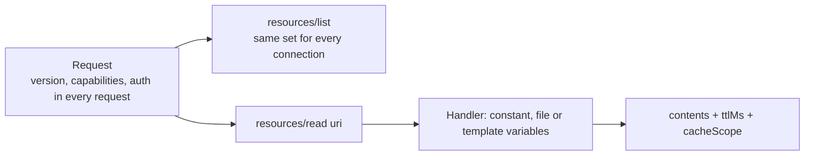

# 1. MCP resources are application-controlled context by URI: the spec keeps them, hosts read them unevenly, and ten common misreadings change how I design them

> A resource is data a host reads by URI, and the host decides what to do with it. The protocol supports it and stateless servers keep it, so I use resources for stable context and never rely on the model reading them.

Related: [02 MCP resources and plugins](02_MCP_Resources_Plugins.md) · [03 Policy resource from the check rules](03_MCP_Resource_Policy_Text_From_The_Check_Rules.md) · [Lecture 1: 12 MCP resources and skills](../Lecture_1_Mechanics_Behind_Generative_AI/12_mcp_resources_and_skills.md) · [W2L2 15 Tool navigation and flexibility](../Week2_Lecture_2_Building_an_Agent/15_Tool_Navigation_And_Flexibility.md) · [W2L1 08 Tool search instead of many tools](../Week2_Lecture_1_Agent_Primitives/08_Tool_Search_Instead_Of_Many_Tools.md)

Source: S02E03 written lesson and transcript (a resource for a return policy, list and read tools), MCP spec 2026-07-28 (resources, tools, server overview), MCP learn page, TypeScript SDK docs, client docs. Checked 2026-11-23.

## Glossary

| Term | What it means here | Same thing elsewhere | Not to be confused with |
|---|---|---|---|
| Resource | Data with a URI, read with `resources/read`. Nothing runs. | Context attachment | A tool result |
| Application-controlled | The host decides what to load and show | User-attached context | Model-controlled (tools) |
| Static resource | Fixed URI, listed by `resources/list` | Document, file | Resource template |
| Resource template | A URI pattern with variables (RFC 6570) | Parameterized path | A tool with arguments |
| Resource link | A pointer to a resource inside a tool result (`resource_link`) | Link in a response | The content itself |
| Embedded resource | The content itself inside a tool result (`type: resource`) | Inline attachment | A link |

## 1. Ten misreadings and what I do instead

| # | Misreading | What the sources say | What I do |
|---|---|---|---|
| 1 | Resources are stale and dropped | The 2026-07-28 spec has a full resources page and marks nothing deprecated. Subscriptions were redesigned (`subscriptions/listen`). Support in hosts is the uneven part. | Keep using them, and check each host (section 4) |
| 2 | The model reads resources by itself | The spec calls them application-driven. Listed patterns: UI selection, user search, and automatic inclusion "based on heuristics or the AI model's selection". It mandates no interaction model. | Assume nothing. The tool must work when no resource is read |
| 3 | Publishing a resource puts it in context | It does not. In the lecture demo the agent needed two extra tools, list resources and read resource, before it could answer. | Name the URI in the tool description or server instructions, or return a `resource_link` |
| 4 | A resource is a read-only tool, and it saves tokens | The control differs: tools are model-controlled, resources application-controlled. The content tokens are the same. Only the tool schema and the decision to fetch are saved. | Resource for stable context, tool when the model must decide to fetch or the call has effects |
| 5 | A resource must be a file | The URI scheme is free, if it follows RFC 3986. `file://` need not map to a disk. `https://` only if the client can fetch it directly. | Pick the scheme by meaning, e.g. `guide://`, and return a constant, a file or a query |
| 6 | Resources need sessions, so they clash with stateless MCP | `resources/list` must not vary per connection. It may vary by the authorization on the request. Reads and lists carry `ttlMs` and `cacheScope`. | Static content, same list for everyone, no subscriptions |
| 7 | A link in a tool result appears in `resources/list` | The spec says links returned by tools are not guaranteed to be listed. | Register the resource as well if clients should list it |
| 8 | A resource is public once listed | Servers MUST validate URIs and sanitize `file://` paths. Access controls and permission checks SHOULD be done. | Check permissions on read, not only on list |
| 9 | If the host ignores resources, they are useless | The user can still attach them in hosts with a picker or `@` mention. | A thin `read_doc(uri)` tool over the same source (my reasoning, not a sourced pattern) |
| 10 | A template lets clients browse every URI | In the SDK, a template with `list: undefined` is readable but never listed. A `list` callback makes instances appear. | Add `list` for a countable set and use the completion API for parameters |

## 2. What a resource can hold

| Form | How it looks | Listed | Typical use |
|---|---|---|---|
| URI only | A list entry (`uri`, `name`, `description`) or a `resource_link` in a tool result | Entry yes. A link from a tool is not guaranteed | Point to a guide without sending its text |
| Static content | The read handler returns `contents: [{ uri, text }]` from a constant | Yes | A workflow, a policy, a glossary |
| Static file | The read handler reads a file at request time, text or base64 `blob` | Yes | A manual, a schema, a size guide |
| Generated from rules | The handler builds the text from the stored rules a check also uses | Yes | A policy text that cannot drift from the check, see [03](03_MCP_Resource_Policy_Text_From_The_Check_Rules.md) |
| Template | `scheme://{id}/path`, variables go to the handler | Only with a `list` callback | One page per entity |
| Embedded in a tool result | `type: resource` with the content inline | No | Attach the record a tool just used |

- One read can return several `contents` parts.
- Annotations are hints for the host: `audience` (`user`, `assistant`), `priority` 0.0 to 1.0, `lastModified`.
- A missing resource returns error -32602, never an empty `contents`.

## 3. Resources in a stateless server

- A read may answer with `InputRequiredResult` when it needs more input, which keeps even that step request-scoped.
- Change notifications: `list_changed` when the set changes, and `subscriptions/listen` for content updates. Static documents need neither.

## 4. What the industry says and does

**Spec and docs (primary)**
- Official definition: "passive data sources that provide read-only access to information for context". Examples: file contents, database schemas, API documentation, git history, calendar events.
- The learn page contrasts them with tools by example: read the calendar as a resource, create an event with a tool. Neither page gives a rule for choosing between them.
- Both pages say the application decides how to use a resource: select parts, search with embeddings, or pass all of it to the model.

**Hosts on 2026-11-23**

| Host | Status | Evidence |
|---|---|---|
| Claude Code | `@server:protocol://path` by the user. The docs say it provides list and read tools. No tool names given | Docs, partly summary |
| Gemini CLI | Model tools `list_mcp_resources` and `read_mcp_resource`, no confirmation. The page says the CLI was replaced by Antigravity CLI on 2026-06-18 | Docs, page dated 2026-04-16 |
| Cursor | Docs table says Supported. A forum thread of 2026-02-13 says not supported | Conflict |
| Claude API MCP connector | Tool calls only | Docs, verbatim |
| Codex, VS Code Copilot, OpenAI remote MCP | Not stated on the pages I read | Silent docs |

**Practice (secondary, blogs)**
- The advice repeated across blogs: stable context the user would attach is a resource, anything that changes state is a tool, and important data is exposed both ways (a tool returns a `resource_link` to the same URI). One blog says most hosts show resources to the user and do not let the model browse them.
- One author argues hosts have not built the UX for resources. His client claims rest on his own tests and undated issues.
- A blog reports 114K against 27K input tokens, with no model, runs or method. I do not use the number.

**Built on resources**
- Skills over MCP serve `SKILL.md` files as `skill://` resources (extension Final, host support still being implemented).
- MCP Apps serve their UI as `ui://` resources. Claude Code hides these from `@` suggestions and from its list tool.

## 5. Cautions

- A resource nobody reads gives no signal. I need an eval per host that checks the guide was loaded.
- Remote resource text steers the model like any instruction.
- Host support changes quickly, so I re-check section 4 before presenting.

## Summary

Resources stay in the spec and fit stateless servers when static and identical for every caller. The host decides whether the user or the model reads them. I design the tool to work without them and treat a resource as optional context.

## Open questions

- Which of my target hosts let the model read resources, measured with an eval?
- Does Codex or VS Code Copilot expose resources to the model?
- Does Cursor read resources today?

## Fact-check

| # | Claim | Verdict | Source |
|---|---|---|---|
| 1 | Resources are application-driven and not deprecated | agrees | [Resources spec 2026-07-28](https://modelcontextprotocol.io/specification/2026-07-28/server/resources) |
| 2 | The spec mandates no interaction model | agrees | same page |
| 3 | `resources/list` must not vary per connection, only by per-request authorization | agrees | same page |
| 4 | Links returned by tools are not guaranteed to be listed | agrees | [Tools spec](https://modelcontextprotocol.io/specification/2026-07-28/server/tools) |
| 5 | The official pages give no rule for resource against tool | agrees, by absence | [Server concepts](https://modelcontextprotocol.io/docs/learn/server-concepts), [Server overview](https://modelcontextprotocol.io/specification/2026-07-28/server) |
| 6 | A template without `list` is readable but not listed | agrees | [TypeScript SDK resources](https://github.com/modelcontextprotocol/typescript-sdk/blob/main/docs/servers/resources.md), through Context7 |
| 7 | Subscriptions moved to `subscriptions/listen` | agrees on the spec page. The SEP text came from a search summary | [SEP-2575](https://modelcontextprotocol.io/seps/2575-stateless-mcp) |
| 8 | Claude Code supports `@` resources and list and read tools | agrees. Tool names not given. Verify before presenting | [Claude Code MCP docs](https://code.claude.com/docs/en/mcp) |
| 9 | Claude API connector supports only tool calls | agrees | [MCP connector docs](https://platform.claude.com/docs/en/agents-and-tools/mcp-connector) |
| 10 | Gemini CLI has model tools for resources | agrees | [Gemini CLI docs](https://geminicli.com/docs/tools/mcp-resources/) |
| 11 | Cursor supports resources | unverified: docs say yes, forum says no | [Cursor docs](https://cursor.com/docs/context/mcp), [forum](https://forum.cursor.com/t/mcp-resources-support/151758) |
| 12 | Codex and VS Code expose resources to the model | unverified, pages silent | [Codex](https://developers.openai.com/codex/mcp), [VS Code](https://code.visualstudio.com/docs/copilot/customization/mcp-servers) |
| 13 | Lecture: support for resources, prompts and sampling varies by client | agrees | rows 8 to 12 |
| 14 | Blogs: tool for actions, resource for stable context, dual-expose with a link | lecture-specific opinion of the blogs, no primary rule | [mcp.so, 2026-10-15](https://mcp.so/blog/mcp-resources-vs-tools) |
| 15 | Hosts have not built the UX for resources, Claude Desktop does not call `resources/read` | unverified: one author, 2026-01-20, undated issues | [layered.dev](https://layered.dev/mcp-resources-the-overlooked-primitive/) |
| 16 | 114K against 27K tokens | unverified, no method | [dev.to](https://dev.to/kenimo49/mcp-resources-vs-tools-vs-prompts-3-layers-that-cut-my-agents-tokens-from-114k-to-27k-440a) |
| 17 | Skills over MCP is Final, support in progress | agrees | [Skills overview](https://modelcontextprotocol.io/extensions/skills/overview) |

## Sources

- MCP spec 2026-07-28 and the MCP learn page, read through fetch agents and Context7. TypeScript SDK docs through Context7.
- Client docs and blogs as linked in the fact-check. The `read_doc` fallback, the eval and the "design so the tool works without it" rule are my own reasoning.
