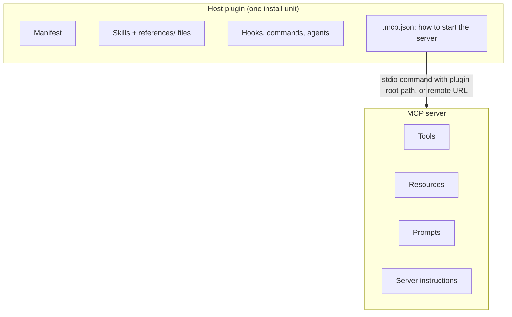

# 2. "Plugin" is a host's install bundle, not an MCP concept: it packs an MCP server with skills and files, but it never ships resources by itself

> A plugin installs an MCP server together with skills, hooks and files as one unit, and the server alone owns the tools and resources. So tools, skills and reference files pack well in a plugin, and resources only travel inside the server.

Related: [01 MCP resources](01_MCP_Resources_Static_Context_And_Sampling.md) · [Lecture 1: 12 MCP resources and skills](../Lecture_1_Mechanics_Behind_Generative_AI/12_mcp_resources_and_skills.md) · [W2L1 02 Rethinking the skills](../Week2_Lecture_1_Agent_Primitives/02_Rethinking_The_Skills.md) · [08 MCP Apps and the lecturer's preview tool](08_MCP_Apps_And_The_Lecturers_Preview_Tool.md) · [15 MCP server instructions and harness support](15_MCP_Server_Instructions_And_Harness_Support.md) · [18 MCP skills and tools](18_MCP_Skills_And_Tools.md)

Source: Claude Code plugin and MCP docs, Cursor, Gemini CLI, VS Code and Codex plugin pages, MCP extensions, server concepts and registry pages, MCP spec 2026-07-28. Checked 2026-11-23.

## Glossary

| Term | What it means here | Same thing elsewhere | Not to be confused with |
|---|---|---|---|
| Host plugin | A bundle the host installs and loads as one unit | Gemini CLI calls it an extension, VS Code an agent plugin | An MCP extension |
| MCP extension | An opt-in protocol feature that client and server both declare in `capabilities.extensions` | Skills over MCP, MCP Apps | A host plugin |
| MCP server | A process or URL that exposes tools, resources and prompts | | A plugin |
| Registry entry | A `server.json` that says where a server is installed from | npm, PyPI, Docker pointer | A bundle of tools and resources |
| Manifest | The plugin's description file (`plugin.json`, `gemini-extension.json`) | | `.mcp.json` (server definitions) |
| Marketplace | A catalog of plugins, not a hosted store | | The MCP registry |

## 1. The problem

The word "plugin" is used for three different things. **Which one is meant, what does each pack, and how well do resources travel together with tools?**

| Meaning | Defined by | What it is | Packs |
|---|---|---|---|
| Host plugin | Each host (Claude Code, Cursor, Gemini CLI, VS Code, Codex) | An install bundle | Skills, hooks, commands, agents, MCP server definitions, files |
| MCP extension | The MCP spec | A protocol feature negotiated between client and server | Nothing. It changes what both sides can say |
| MCP server entry | The MCP registry | Metadata that points to a package or a URL | Nothing. Code stays on npm, PyPI or Docker Hub |

MCP itself defines no "plugin" and no bundle of tools, resources and prompts. The registry is in preview, does not support private servers, and hosts do not consume it directly.

## 2. What a host plugin packs

| Host | Packs | Manifest | MCP server declared in |
|---|---|---|---|
| Claude Code | Skills, agents, hooks, MCP servers, LSP servers, output styles, commands, executables | `.claude-plugin/plugin.json` (optional, only `name` required) | `.mcp.json` at the root or `mcpServers` in the manifest, path variable `${CLAUDE_PLUGIN_ROOT}` |
| Cursor | Rules, skills, agents, commands, MCP servers, hooks | `.cursor-plugin/plugin.json` or `plugin.json` | `mcp.json` at the root, key names not verified |
| Gemini CLI | Prompts, MCP servers, commands, hooks, sub-agents, skills, policies, themes, a `GEMINI.md` context file | `gemini-extension.json` | `mcpServers` map in the manifest, path variable `${extensionPath}` |
| VS Code | Skills, MCP servers, agents, hooks, commands, instructions | `plugin.json` with the Agent Plugins schema, also reads Claude's and OpenPlugin's | `mcp.json` or `.mcp.json`, root variable `${PLUGIN_ROOT}` in Agent Plugins 1.0 |
| Codex | Skills, MCP servers with an optional custom UI, browser extensions, hooks | Not stated on the page I read | Not stated |

- The shared core is skills plus MCP servers. VS Code's reference calls exactly these two the portable component types of Agent Plugins 1.0.
- A Claude Code plugin's own `CLAUDE.md` is not loaded. Instructions that must reach the model go into a skill.
- Plugin MCP tools are named `mcp__plugin_<plugin>_<server>__<tool>`, and hook or permission rules need the full name.
- The server starts when the plugin is enabled, and a stdio server stops with the session.

## 3. How well resources pack with tools

| I want to pack | Where it lives | Plugin's part |
|---|---|---|
| Tools | The MCP server | Only starts it |
| Resources | The MCP server | None. No plugin page I read has a resources component |
| A guide for the tools | A skill, or the server instructions | The skill and its `references/` files ship with the plugin |
| A supporting file | A skill's folder, or a resource the server reads from disk | Ships the file. The server reading it from the plugin directory is my inference |
| A workflow | A skill, or a skill served over MCP | The plugin skill is the common route |

- **Tools plus skills plus files pack well.** One install, one version, one place to review.
- **Resources do not travel alone.** The server must be started from the plugin, so the plugin ships the server code or URL, and the server serves resources.
- **Whether plugin resources show up in the host** (the `@` menu, list tools) is the same host question as in note 01. The Claude Code docs I read do not say.
- **Same content two ways:** a skill reference works wherever the host loads plugin skills, a resource works wherever the host reads resources. Keeping one source file for both avoids drift. This is my reasoning, not a sourced pattern.

## 4. Distribution and trust

- Claude Code: a plugin "can execute arbitrary code on your machine with your user privileges". Installing enables it by default, and the docs advise reading `hooks/hooks.json`, `.mcp.json` and `bin/` before install.
- A marketplace is a `marketplace.json` catalog. Sources can be a path, GitHub, a URL, npm or an archive with a `sha256` pin. Auto-update can change the plugin in the background.
- The unit under review is the whole bundle: server command, hooks and skills together.

## 5. Cautions

- Manifest names and root variables differ per host, so a plugin is portable only through the shared Agent Plugins core.
- Cursor's MCP keys, Codex's manifest and the Agent Plugins spec itself are not read.

## Summary

"Plugin" is a host install bundle. It packs an MCP server with skills, hooks and files, and the server owns tools and resources. For guidance that must reach the model, the skill inside the plugin is the dependable carrier.

## Open questions

- Do resources of a plugin-bundled server appear in Claude Code's `@` menu and list tool?
- Which plugin format do I target, the Agent Plugins core or one host's?
- How are tools, resources and instructions packed inside one server, and where do the limits sit? (A separate note.)

## Fact-check

| # | Claim | Verdict | Source |
|---|---|---|---|
| 1 | MCP defines no "plugin". An extension is an opt-in protocol feature | agrees | [Extensions overview](https://modelcontextprotocol.io/extensions/overview) |
| 2 | The spec has no bundle of tools, resources and prompts | agrees, by absence | [Server concepts](https://modelcontextprotocol.io/docs/learn/server-concepts), [Server spec](https://modelcontextprotocol.io/specification/2026-07-28/server) |
| 3 | The registry points to packages, preview, no private servers | agrees | [Registry about](https://modelcontextprotocol.io/registry/about) |
| 4 | Skills over MCP: SEP-2640 is Final (merged 2026-09-13 per the working group charter) and the extension stage is Beta | agrees. They are two different labels | [Extensions overview](https://modelcontextprotocol.io/extensions/overview), [SEP-2640](https://modelcontextprotocol.io/seps/2640-skills-extension), [Charter](https://modelcontextprotocol.io/community/skills-over-mcp/charter) |
| 5 | A Claude Code plugin bundles skills, agents, hooks, MCP servers and more as one unit | agrees | [Plugins](https://code.claude.com/docs/en/plugins) |
| 6 | Claude Code starts plugin MCP servers when the plugin is enabled | agrees | [Claude Code MCP](https://code.claude.com/docs/en/mcp) |
| 7 | No Claude Code page I read says plugins ship MCP resources | agrees, by absence | same pages |
| 8 | Cursor plugins bundle rules, skills, agents, commands, MCP servers, hooks | agrees. MCP keys not verified | [Cursor plugins](https://cursor.com/docs/plugins) |
| 9 | Gemini CLI extensions declare `mcpServers` in `gemini-extension.json` | agrees | [Gemini extensions reference](https://geminicli.com/docs/extensions/reference/) |
| 10 | VS Code agent plugins treat skills and MCP servers as the portable core | agrees | [VS Code agent plugins](https://code.visualstudio.com/docs/copilot/customization/agent-plugins) |
| 11 | Codex plugins include skills and MCP servers | agrees from a summary of the page. Manifest not read | [Codex plugins](https://learn.chatgpt.com/docs/plugins) |
| 12 | Installing a Claude Code plugin can run arbitrary code | agrees | [Plugin security](https://code.claude.com/docs/en/plugins/security) |

## Sources

- The pages linked in the fact-check, read through fetch agents on 2026-11-23. Several pages were read only in part, and the tail came from a summary.
- Section 3 is my own reasoning: the packing table, the same-source idea and the inference about reading from the plugin directory.
