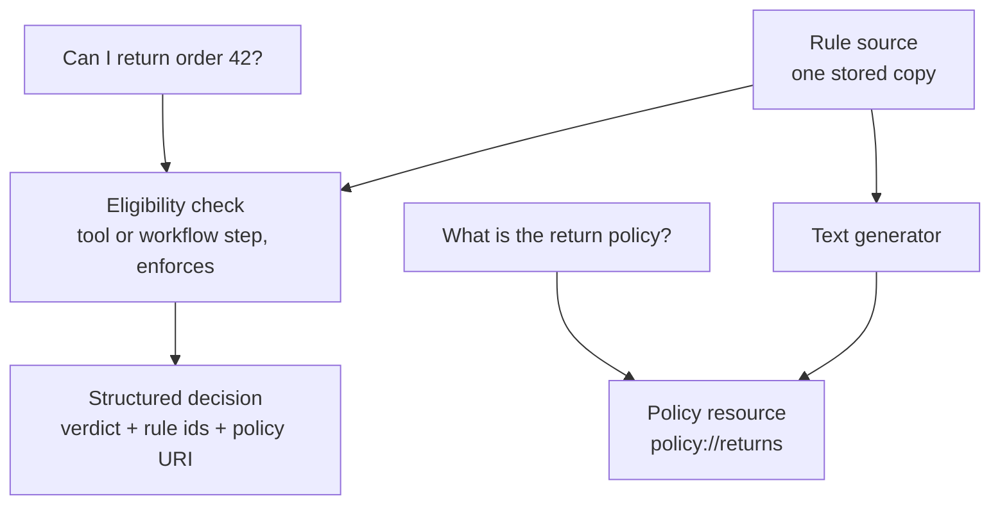

# 3. A policy resource built from the same rules as the eligibility check keeps the explanation from drifting, while the check itself stays in code

> The lecture's resource does not check eligibility. It explains the policy, and the server generates that text from the same stored rules the check uses, so the two cannot disagree. This matches policy-as-code practice, but I found no published source for this exact combination.

Related: [01 MCP resources](01_MCP_Resources_Static_Context_By_URI.md) · [W2L1 05 Instructions and what code must enforce](../Week2_Lecture_1_Agent_Primitives/05_Instructions_Five_Parts_And_Enforcement.md) · [W2L2 06 Workflow vs LangGraph](../Week2_Lecture_2_Building_an_Agent/06_Workflow_vs_LangGraph.md) · [W2L2 14 Execution flows](../Week2_Lecture_2_Building_an_Agent/14_Execution_Flows_Skill_Tool_Or_Workflow.md) · [W2L2 15 Tool navigation and flexibility](../Week2_Lecture_2_Building_an_Agent/15_Tool_Navigation_And_Flexibility.md)

Source: S02E03 transcript, the resources passage (return policy resource, eligibility checks). The written lesson does not mention it. OPA docs, Claude Code hooks guide, OpenAI Agents SDK guardrails, Anthropic tool-writing article, MCP learn page. Checked 2026-11-23.

## Glossary

| Term | What it means here | Same thing elsewhere | Not to be confused with |
|---|---|---|---|
| Rule source | The one stored place where the rules live | Policy as code, decision table | A prompt |
| Eligibility check | Code that applies the rules to one case and returns a decision | Policy decision point, guardrail | The policy text |
| Policy resource | Customer-readable text of the rules, served by URI | Generated documentation | The check |
| Drift | The text and the check disagree after one is edited | Stale docs | A model error |
| Structured decision | A result with the verdict and the reasons, not only yes or no | OPA output document | A message to the user |

## 1. The problem

The lecturer's agent answers "what is the return policy?" from a resource, and the demo says the text comes from the rules behind the eligibility checks. **Is this a use of resources for checks, and does the pattern match what the industry does?**

The words matter here:
- The lecturer's words: "the server builds the policy text from the stored rules that's used by our eligibility checks, and that keeps the explanation connected to those rules."
- A resource is read-only context (note 01). It cannot decide. The decision stays in a tool or a workflow step.
- The demo does not show how the rules are stored. The rest of this note is my reading of the pattern.

## 2. The pattern

| Customer asks | Answered by | Why |
|---|---|---|
| "What is your return policy?" | The resource, or a tool that returns the same text | General explanation, no case data |
| "Can I return this order?" | The check | It needs the order, the date and the customer |
| "Why was it refused?" | The check's reasons, with a link to the resource | The reason names the rule that fired |

- If the model answered the second question from the policy text alone, it would guess. The check must run for every individual case.
- The lecture adds that the service enforces ownership, and moving the tool behind MCP keeps that check.

## 3. How it maps to the industry

| Lecture idea | Industry equivalent | Verdict |
|---|---|---|
| One authoritative copy, no second copy to maintain | OPA separates policy from the service so people manage it apart from the code. Rule repositories and living-documentation tools aim at the same: remove drift between rules and docs | agrees in principle. The doc-generation tools are blogs and vendor pages |
| The decision runs in code, not in a prompt | Claude Code hooks run deterministic commands before a tool call. OpenAI tool guardrails run before the tool and can skip it. My W2L1 05 reaches the same rule | agrees |
| A decision with reasons | OPA output can be structured data, and its example builds a list of violation messages. The messages are written by the policy author | agrees |
| The refusal reason goes back to the model | Claude Code feeds `permissionDecisionReason` to the model on a deny. Anthropic advises actionable errors, not opaque codes | agrees |
| The policy text is generated from the rules | OPA rules can carry `# METADATA` annotations (title, description, related resources, custom fields). `opa inspect -a` lists them, the style guide prefers them over comments so external tools can parse the documentation, and one example reads them with `rego.metadata.rule()` to build the decision message | agrees in part: the mechanism exists, and I found no OPA page that calls it a generator |
| The explanation is an MCP resource | The MCP learn page names file contents, database schemas and API documentation as resource examples | fits the spec. No vendor describes a policy resource |
| Prompt text and check from one rule source | No published source found | lecture-specific |

## 4. Where it works and where it does not

- The lecture's agent runs in the owner's own application, so the owner gives it the list and read tools. That is why the policy resource is reachable in the demo.
- In a third-party host, whether the model reads the resource depends on the host (note 01).
- Fallback: the check's result carries the rule ids and the clause text, so the explanation arrives without a resource read. This is my reasoning.

## 5. My take

- Keep the rule source as data or as code objects, and let both the check and the text generator read it.
- A test that asserts the generated text covers every rule id catches drift in a build. This is my idea, not a sourced practice.
- The check returns a structured result: verdict, rule ids, the policy URI.
- The resource is explanation, never authority. Ownership and limits stay in the service.
- Static text can carry `ttlMs` and `cacheScope` so a rule change reaches readers on a known schedule.

## 6. Cautions

- A generated policy text can expose internal thresholds. I publish only the rules meant for the customer.
- A model that reads the policy may answer a case itself. The tool description must say that individual cases go through the check.
- The Claude Code guide says hooks match specific tools, and Claude can change protected files with shell commands. A rule enforced in one place only can be bypassed in another.

## Summary

The resource explains and the check decides, and both read one rule source. This is policy as code applied to an MCP resource. The decision, the reasons and the ownership stay in code, and the text is the readable face of the same rules.

## Open questions

- How does the demo store its rules, and does the text come from code or from data?
- Which of my rules can be customer-facing text, and which must stay internal?
- Which host reads the policy resource for my agent, measured with an eval?

## Fact-check

| # | Claim | Verdict | Source | Checked |
|---|---|---|---|---|
| 1 | The demo builds the policy text from the rules the eligibility checks use | lecture-specific, transcript quote | S02E03 transcript | 2026-11-23 |
| 2 | Resources hold docs and schemas as context | agrees | [MCP server concepts](https://modelcontextprotocol.io/docs/learn/server-concepts) | 2026-11-23 |
| 3 | OPA decouples policy decisions from enforcement | agrees | [OPA philosophy](https://openpolicyagent.org/docs/philosophy) | 2026-11-23 |
| 4 | OPA output can be structured data, with violation messages | agrees. Messages are policy-author text | [OPA intro](https://www.openpolicyagent.org/docs/latest/) | 2026-11-23 |
| 5 | OPA can return an evaluation trace through `explain` | agrees. POST support unclear in the docs | [OPA REST API](https://www.openpolicyagent.org/docs/rest-api) | 2026-11-23 |
| 6 | OPA rule annotations feed both documentation tools and the decision message | agrees. No page calls it a documentation generator | [OPA policy language](https://www.openpolicyagent.org/docs/policy-language), [style guide](https://www.openpolicyagent.org/docs/style-guide), through Context7 | 2026-11-23 |
| 7 | A Claude Code hook deny feeds the reason back to the model | agrees. The `continueOnBlock` and bypass-mode details came from a summary | [Hooks guide](https://code.claude.com/docs/en/hooks-guide) | 2026-11-23 |
| 8 | OpenAI tool guardrails run before the tool and can reject | agrees. The page does not state where the rejection message goes | [Guardrails](https://openai.github.io/openai-agents-python/guardrails/) | 2026-11-23 |
| 9 | Anthropic advises actionable error messages | agrees. The article does not cover enforcement or permissions | [Writing tools for agents](https://www.anthropic.com/engineering/writing-tools-for-agents) | 2026-11-23 |
| 10 | Single-source rule repositories and doc generators exist | unverified, vendor pages and blogs | [Enterprise Architect DMN](https://sparxsystems.com/enterprise_architect_user_guide/17.2/guide_books/guide_dmn_truth_singlesource.html) | 2026-11-23 |
| 11 | Prompt policy text and the check come from one rule source in published practice | unverified, no source found | search, 2026-11-23 | 2026-11-23 |

## Sources

- The pages linked above, read through fetch agents. The OPA and hooks pages were read in part.
- Sections 2, 4, 5 and 6 are my own reasoning: the question table, the drift test, the structured result and the fallback.
