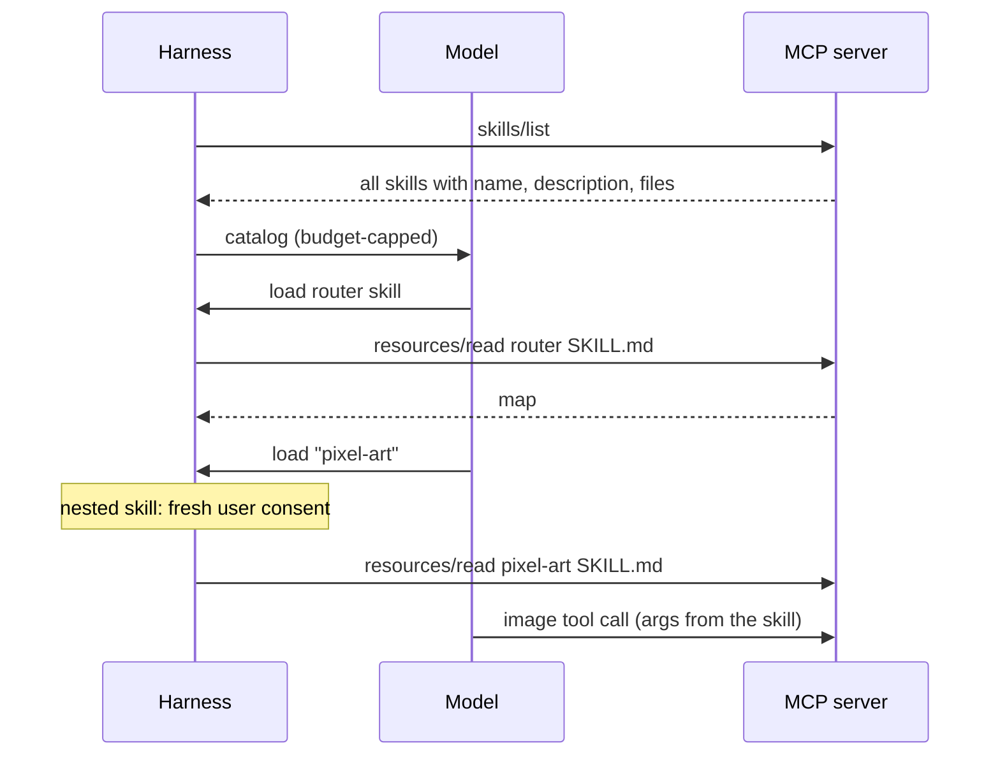

# 04. A router skill on an MCP server pays only when the catalog is the problem: each hop costs a model decision and, over MCP, fresh consent, and no vendor documents skill-to-skill routing

> A router skill is a short `SKILL.md` that names which other skill to load. On an MCP server it spans three layers: the server serves the skills, the Skills extension defines how they are listed and activated, and the harness decides what the model sees. The pattern is a convention, not a spec field. It saves catalog space only if the host hides the children, and each extra hop adds a chance of not loading.

Related: [03 MCP skills and tools](03_MCP_Skills_And_Tools.md) · [08 MCP server instructions and harness support](08_MCP_Server_Instructions_And_Harness_Support.md) · [09 MCP tools loading and code mode with many servers](09_MCP_Tools_Loading_And_Code_Mode_With_Many_Servers.md) · [10 Sys prompt vs skills content and threats](10_Sys_Prompt_vs_Skills_Content_And_Threats.md) · [Lecture 2: 6 Router skills](../Lecture_2_Context_Agents_md_Skills_Tools/6_router_skills.md) · [Lecture 2: 5 Skills](../Lecture_2_Context_Agents_md_Skills_Tools/5_skills.md) · [06 Search over skills](06_Search_Over_Skills_Instead_Of_Listing_Them.md)

Source: S02E03 lesson, figure 12 (router skill over image, video and audio skills). Lecture 2 note 6 for the pattern itself. Claude Code skills and settings docs (through Context7 and the live page), Anthropic best practices, the Agent Skills specification, OpenAI skills docs, the MCP Skills extension overview, read on 2026-11-25. See [Fact-check](#fact-check).

## Glossary

| Term | What it means here | Same thing elsewhere | Not to be confused with |
|---|---|---|---|
| Router skill | A skill whose body maps situations to other skills | Index skill, `ask-*` skill | A tool router or an LLM gateway |
| Catalog | Name and description of every skill, shown each turn | Skill listing, `available_skills` | The skill bodies |
| Hop | One extra load before the work starts | Routing step | A tool call |
| Nested skill | A skill reached from another skill's text | Child skill | A reference file inside one skill |
| Fresh consent | A new user approval for a skill activated from another skill | Per-skill approval | A permission rule |

## 1. The problem

The lecturer's router sits over image, video and audio skills on one MCP server. **How do the server, the Skills extension and the harness interact around it, and when does a router help?**

## 2. The figure

![The lesson's figure 12. An agent gets the request "Make a pixel art trailer with a retro soundtrack". Inside an MCP server, a red router skill points to three groups. Image holds pixel art, concept art, realistic photo and cartoon, above an image tool. Video holds animation and cinematic, above a video tool. Audio holds retro, ambient and voiceover, above an audio tool. Grey arrows link pixel art to animation and animation to retro. A dashed line lets the agent skip the router and call the image tool directly.](img/mcp-router-skill-routes-image-video-audio-skills.png)

Source: S02E03 article, figure 12.

- **Story:** one request crosses three domains, the router names the leaf skill per domain, the leaves point to the next domain, and the agent may skip the router.
- **Important:** the red router path, the grey cross-domain arrows, the dashed skip line. **Not important:** the style names.

## 3. How the three layers meet

| Layer | What it decides | Source |
|---|---|---|
| MCP server | Serves router and leaves as `skill://` URIs under one root, plus the tools | Skills extension |
| Skills extension | `skills/list` returns every skill. Hierarchy is path-based. A skill's URI may come from "another skill". A nested skill needs "fresh user consent", and reading its `SKILL.md` as supporting content does not activate it | Skills overview |
| Harness | What the model sees. Claude Code shows names and descriptions each turn, capped at 1% of the context window by default, 1,536 characters per entry. Over budget, it keeps every name and drops the descriptions of the least-used skills | Claude Code docs |

## 4. Does the router save anything over MCP

- **The catalog saving is the host's choice.** `skills/list` returns all skills, and "host applications determine how skills are exposed". If the host lists leaves too, the router adds a hop and saves nothing. I found no host documenting that it hides children (my reasoning).
- **Local rules still apply.** Claude Code's loading rules for nested directories are about files in a repository, not MCP skills. They do not tell me what MCP-served children do.
- **Every hop is a miss chance.** Evals show skills often go unloaded (note 03, section 7). A router puts a second skill load before the work.
- **Consent adds friction.** Fresh consent per nested skill means a router over an MCP server asks the user more than a flat set does.

## 5. Worth it, and what follows

| Case | Router? | Why |
|---|---|---|
| A few skills, catalog well under the budget | No | A flat catalog is one hop |
| Many skills in one family, catalog over budget | Maybe | Try `name-only` entries and sharper descriptions first |
| Steps that cross domains (the figure) | Yes, as a map of the order | The sequence is the knowledge the model lacks |
| A tool that must work without skills | Keep the dashed skip | The tool stays usable alone (note 03) |
| A rule that must hold | No: code | A router is advice |

| | With a router | Without |
|---|---|---|
| Catalog | One entry, if children are hidden | One entry per skill |
| Hops | Router, then leaf, then tool | Leaf, then tool |
| Maintenance | A map that must match the leaves | Each description stands alone |
| Consent | Fresh consent for each nested skill | One approval per skill |
| Failure | A wrong map misroutes everything | One wrong description loses one skill |

## 6. In my system (my reasoning)

- Start flat with sharp descriptions. Add a router only when the catalog is measured as the problem (`/doctor` shows Claude Code's cost).
- If I add one, I write the cross-domain order into it (image, then video, then audio) and keep each leaf self-sufficient.
- I test the router with the lecturer's style of grader: did the right leaf load, and did the tool still work when the router was skipped.

## 7. Industry adoption and standards

| Source | Position |
|---|---|
| [Lecture 2: 6](../Lecture_2_Context_Agents_md_Skills_Tools/6_router_skills.md) | The pattern, with a real router (`ask-matt`) that is user-invoked, hand-written and recommends only |
| Anthropic best practices | Keep references one level deep, `SKILL.md` under 500 lines. Its patterns split one skill into references. Skill-to-skill routing is not documented |
| Agent Skills specification | One-level references, about 100 tokens of metadata per skill. No nested skills |
| OpenAI | "Prefer one focused skill over a large collection of loosely related instructions". No nesting documented |
| MCP Skills extension | Path-based URIs, nested activation needs fresh consent. No collection concept |
| Research | One 2026 paper treats choosing a skill from a large pool as retrieval (abstract level, unverified for routers) |

The closest vendor-endorsed form is a high-level `SKILL.md` that points to reference files inside one skill. A router across skills is a lecturer and community pattern.

## Open questions

- Does any host hide child skills behind a router, or list everything?
- Does Claude Code ask consent again when a router skill loads a child from an MCP server?
- Is my catalog over budget at all?

## Fact-check

| # | Claim | Verdict | Source | Checked |
|---|---|---|---|---|
| 1 | Claude Code caps the listing at 1% of the context window and 1,536 characters per entry, keeps names, drops least-used descriptions | agrees | [settings reference](https://code.claude.com/docs/en/settings-reference), [skills](https://code.claude.com/docs/en/skills), via Context7 | 2026-11-25 |
| 2 | `skills/list` returns every skill. Hosts decide exposure | agrees | [Skills overview](https://modelcontextprotocol.io/extensions/skills/overview) | 2026-11-25 |
| 3 | A nested skill needs fresh user consent. Reading its file does not activate it | agrees | same page | 2026-11-25 |
| 4 | References stay one level deep. `SKILL.md` under 500 lines | agrees | [Anthropic](https://platform.claude.com/docs/en/agents-and-tools/agent-skills/best-practices), [spec](https://agentskills.io/specification) | 2026-11-25 |
| 5 | No vendor documents skill-to-skill routing | agrees by absence, pages read in part | the pages above, [OpenAI](https://developers.openai.com/plugins/concepts/skills.md) | 2026-11-25 |
| 6 | Router is a pattern, not a spec field | agrees | [Lecture 2: 6](../Lecture_2_Context_Agents_md_Skills_Tools/6_router_skills.md) | 2026-11-25 |
| 7 | Skills are often not invoked | agrees, Vercel and LlamaIndex (note 03) | [Vercel](https://vercel.com/blog/agents-md-outperforms-skills-in-our-agent-evals) | 2026-11-25 |
| 8 | Hosts may or may not hide children, and the hop and consent costs | lecture-independent, my reasoning, verify before presenting | | |

## Sources

- The pages linked above. Sections 4 to 6 are my own reasoning.
