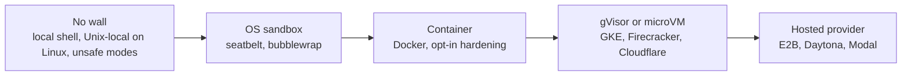

# 4. A workspace is a framework's bundle of files, sandbox and skills, and the wall comes from a provider: plain LangGraph has none, Deep Agents, Mastra, the OpenAI SDK and CrewAI's tools plug one in

> "Workspace" is not a standard term. Frameworks use it for a filesystem plus an execution environment, and almost all of them delegate the real isolation to a provider such as Docker, E2B, Daytona, Modal or Vercel, so the choice I make is the provider and the scope, not the framework.

Related: [W2L2 12 Sandbox for agent code](../Week2_Lecture_2_Building_an_Agent/12_Sandbox_For_Agent_Code_Pi_And_Search_Execute.md) · [W2L1 04 HITL and execution isolation](../Week2_Lecture_1_Agent_Primitives/04_HITL_And_Execution_Isolation.md) · [W2L2 06 Workflow vs LangGraph](../Week2_Lecture_2_Building_an_Agent/06_Workflow_vs_LangGraph.md) · [02 MCP resources and plugins](02_MCP_Resources_Plugins.md) · [05 Where the sandbox attaches](05_Where_The_Sandbox_Attaches_Tool_Node_Backend_Or_Run_Config.md)

Source: S02E03 transcript (a Mastra workspace with a read-only local filesystem). Docs of Mastra, LangChain Deep Agents and LangSmith, CrewAI, OpenAI Agents SDK, Google ADK, smolagents, Microsoft Agent Framework, Pydantic AI, Vercel, Claude Code and Cloudflare, read through fetch agents and Context7 on 2026-11-23. Nothing was installed or run.

## Glossary

| Term | What it means here | Same thing elsewhere | Not to be confused with |
|---|---|---|---|
| Workspace | Where one agent, user or task works: files, and often a place to run commands | Mastra `Workspace`, OpenAI `Manifest` workspace, Deep Agents backend | The sandbox. A workspace is data, a sandbox is a wall (W2L1 04) |
| Sandbox | An environment that runs agent-written code behind a boundary | Executor, devbox, microVM | A prompt rule |
| Provider | The service or runtime that supplies the wall | Daytona, E2B, Modal, Vercel, Cloudflare, Docker | The framework |
| Backend | Deep Agents' name for where files and commands live | Sandbox backend | A database |
| Manifest | OpenAI SDK's declaration of the starting contents of a workspace | Image, template | A tool schema |

## 1. The problem

The lecture shows a workspace for a filesystem. I want one for **code execution**, to isolate my agent's internals. **How do LangGraph, CrewAI and other Python and TypeScript frameworks support a code sandbox, and what else does a workspace give?**

## 2. What the lecture shows

In the transcript the agent gets a workspace with a local filesystem, a base path to the product care folder and `read only`, which "prevents changes through that file system". A description of the collection goes into the instructions, and the documents must be mounted when the agent is deployed. The speaker adds: "check how it enforces file access." The demo uses only the filesystem part. Mastra's docs show more (section 3).

## 3. What a Mastra workspace bundles

| Part | What it gives the agent | Note |
|---|---|---|
| Filesystem | `read_file`, `write_file`, `edit_file`, `list_files`, `grep`, others | `readOnly: true` removes the write tools. `LocalFilesystem` stays inside `basePath` but does not restrict shell commands |
| Sandbox | `execute_command`, `get_process_output`, `kill_process` | Providers: Local, Docker, Daytona, E2B, Modal, Vercel, Cloudflare, Blaxel, AgentCore, Apple Container, Railway, Fly.io Sprites |
| Search | `search`, `index` | BM25 and vector search |
| Skills | `skill`, `skill_read`, `skill_search` | Agent Skills layout |
| LSP | `lsp_inspect` | Needs a static sandbox |
| Per-request resolvers | A separate sandbox or filesystem per user, tenant or thread | "Use a resolver when each user, tenant, or thread needs a separate sandbox" |
| Approval | `requireApproval` per tool | Approving `write_file` "doesn't stop the agent from using `execute_command` to write the same mounted path" |

- `LocalSandbox` "runs commands on the application host by default and isn't isolated or secure". The `isolation` option defaults to `none`, with `seatbelt` on macOS and `bwrap` on Linux. With isolation on, the network is blocked by default.
- A static sandbox is shared by every request and thread. For isolation between users I need the resolver, and the app must destroy the sandboxes it returns.

## 4. How the frameworks support a code sandbox

**Python**

| Framework | Built-in sandbox | How it works |
|---|---|---|
| LangGraph (plain) | None | The docs describe no sandbox object. I wire a provider SDK as a tool or node |
| Deep Agents (on LangGraph) | Yes, through backends | A sandbox is a backend that adds an `execute` tool. Providers: LangSmith (first party), AgentCore, Daytona, E2B, Modal, Runloop, Vercel, Databricks and many third-party ones. The default `StateBackend` has no `execute`, and `LocalShellBackend` is "no sandboxing" |
| CrewAI | Through tools | `CodeInterpreterTool` was removed in v1.14.0 (2026-04-07) and `allow_code_execution` is deprecated. Daytona (v1.14.3) and E2B tool families, each with exec, Python and file tools. Some docs pages still show the old parameters |
| OpenAI Agents SDK | Yes | `SandboxAgent` with a `Manifest` and capabilities (Shell, Filesystem, Skills, Memory, Compaction). Clients: Unix-local, Docker, Blaxel, Cloudflare, Databricks, Daytona, E2B, Modal, Vercel |
| Google ADK | Yes, executors | GKE executor (gVisor, sandbox mode recommended), Agent Runtime code execution, Gemini built-in execution, a Bash tool where all commands are allowed by default |
| smolagents | Yes, opt-in | Default runs code in my environment. Remote executors: E2B, Modal, Docker, Blaxel |
| Microsoft Agent Framework | A hosted tool | A Code Interpreter tool on Responses, Foundry and Anthropic providers. I did not read its shell tools or AutoGen's executors |
| Pydantic AI | None built in | A separate sandboxed interpreter project, Monty |

**TypeScript**

| Framework | Built-in sandbox | How it works |
|---|---|---|
| Mastra | Yes | The workspace sandbox, section 3 |
| Deep Agents JS | Yes, shorter list | LangSmith, Deno, Daytona, Modal and a few others on the integrations page |
| OpenAI Agents JS | Yes, per the docs index | Sandbox agents with local and provider clients. The sub-pages are not read |
| Vercel AI SDK | Not found | Vercel Sandbox is a separate product (Firecracker microVM), its own SDK is the recommended route |
| Cloudflare | A separate SDK | Sandbox SDK (microVM containers) or Dynamic Workers. Requires a paid Workers plan |

Claude Code has its own OS sandbox for Bash commands (Seatbelt, bubblewrap). It is off by default, and it does not cover its file tools, MCP servers or hooks.

## 5. How strong the wall is

- The order is my own reading of the docs, not a rating from any vendor. Mastra says it gives no isolation rating per provider.
- Defaults are weak: Mastra local isolation `none`, OpenAI Unix-local with no confinement on Linux, smolagents local, ADK's Java container executor unrestricted until strict mode is switched on (ADK 2.0 makes strict the default), Claude Code sandbox off.
- OpenAI's advice: for untrusted commands use Docker or a hosted sandbox. smolagents says no local Python sandbox can be completely secure.

## 6. What else workspaces give

| Capability | Where | Why it matters to me |
|---|---|---|
| Per-user or per-thread sandboxes | Mastra resolvers, Deep Agents thread or assistant scope | Separates users, as W2L1 04 asks |
| Lifecycle: TTL, stop, destroy | Deep Agents, Mastra, CrewAI (ephemeral, persistent, attach) | Cost and leftovers |
| Snapshots and resume | OpenAI SDK, LangSmith | Long tasks and recovery |
| Starting contents | OpenAI `Manifest`, mounts (S3, GCS, Git) in LangSmith | Reproducible start |
| File transfer by the app | Deep Agents `upload_files`, `download_files` | The model does not move files |
| Skills, search, LSP, memory | Mastra, OpenAI capabilities | Context without extra tools |
| Credential proxy | LangSmith auth proxy | Keys stay outside the sandbox |
| Approval and read-only modes | Mastra `requireApproval`, `readOnly` | Guards for writes |

## 7. Security rules the docs repeat

- Deep Agents: "Never put secrets inside a sandbox". Block the network when it is not needed. Treat all sandbox output as untrusted. A sandbox does not stop context injection or exfiltration over open network.
- CrewAI's E2B page: ephemeral mode is "the primary blast-radius control".
- OpenAI Unix-local starts every command from the complete host environment unless `inherit_host_environment=False`.
- Deep Agents' production page: do not use `FilesystemBackend` or `LocalShellBackend` in deployed agents.

## 8. My take

- The sandbox is a tool or a harness choice, not a feature of the graph. With plain LangGraph I either add Deep Agents' backend or call a provider from my own tool.
- Two patterns from the Deep Agents docs: the agent runs inside the sandbox (keys must live inside), or the sandbox is a tool (keys stay outside). I prefer the tool pattern for my agent's internals. This is my reasoning.
- I pick a provider with a no-network option and a per-thread scope first, and decide the framework after.
- A hosted provider receives my code and data. In a work environment only approved providers are allowed.

## 9. Cautions

- Provider pages were not read one by one. Isolation claims are the vendors' own.
- Several framework pages were read in part, and the tail came from a summary. CrewAI docs after v1.15.2 and ADK's classic executors are unchecked.

## Summary

A workspace bundles files, a sandbox and often skills, search and per-user scope. Plain LangGraph gives no sandbox, Deep Agents, Mastra, the OpenAI SDK, ADK, smolagents and CrewAI's tools do through providers, and defaults are mostly weak. I choose the wall and the scope first.

## Open questions

- Which wall and scope fit my agent: per thread, no network, files moved by the app?
- Does a Deep Agents backend fit my LangGraph agent, or is my own provider tool simpler?
- Do the Microsoft Agent Framework shell tools, AutoGen executors and OpenAI Agents JS sandbox pages say more?
- Is the old `langchain-sandbox` (Pyodide) still maintained? No page I read mentions it.

## Fact-check

| # | Claim | Verdict | Source |
|---|---|---|---|
| 1 | Mastra's workspace bundles filesystem, sandbox, search, skills and LSP | agrees. The lecture shows only the filesystem | [Mastra workspace](https://mastra.ai/docs/workspace/overview), [reference](https://mastra.ai/reference/workspace/workspace-class) |
| 2 | Mastra LocalSandbox is not isolated by default, `isolation` default `none` | agrees | [LocalSandbox](https://mastra.ai/reference/workspace/local-sandbox) |
| 3 | Mastra resolvers give a sandbox per user, tenant or thread | agrees | Mastra workspace pages |
| 4 | Plain LangGraph has no code sandbox | agrees, by absence. Overview read | [LangGraph overview](https://docs.langchain.com/oss/python/langgraph/overview) |
| 5 | Deep Agents sandboxes are backends with an `execute` tool | agrees | [Deep Agents sandboxes](https://docs.langchain.com/oss/python/deepagents/sandboxes) |
| 6 | Deep Agents security rules (no secrets, block network) | agrees, partly from a summary | same page |
| 7 | CrewAI removed `CodeInterpreterTool` in v1.14.0 and added Daytona and E2B tools | agrees. Docs partly stale | [CrewAI changelog](https://docs.crewai.com/v1.15.2/en/changelog), [E2B tools](https://docs.crewai.com/edge/en/tools/ai-ml/e2bsandboxtools.md) |
| 8 | OpenAI `SandboxAgent` has Manifest, capabilities and provider clients | agrees | [Sandbox agents](https://openai.github.io/openai-agents-python/sandbox_agents/) |
| 9 | OpenAI Agents JS has sandbox agents | unverified, docs index only | [Agents JS](https://openai.github.io/openai-agents-js/) |
| 10 | ADK GKE executor uses gVisor and sandbox mode is recommended | agrees | [GKE executor](https://adk.dev/integrations/gke-code-executor/) |
| 11 | ADK Java container executor is unrestricted until strict mode, strict default in ADK 2.0 | agrees | ADK API reference through Context7 |
| 12 | smolagents runs code locally by default, remote executors opt in | agrees | [smolagents](https://huggingface.co/docs/smolagents/tutorials/secure_code_execution) |
| 13 | Pydantic AI has no built-in sandbox | agrees, overview page only | [Pydantic AI](https://pydantic.dev/docs/ai/overview/) |
| 14 | Vercel Sandbox is a Firecracker microVM, separate from the AI SDK | agrees, page updated 2026-09-22 | [Vercel Sandbox](https://vercel.com/docs/vercel-sandbox) |
| 15 | Claude Code's sandbox is off by default and skips file tools, MCP servers, hooks | agrees, partly from a summary | [Sandboxing](https://code.claude.com/docs/en/sandboxing) |
| 16 | The strength order in section 5 | lecture-independent, my reading | |

## Sources

- The pages linked above. Sections 7 and 8 and the order in section 5 are my own reasoning.
