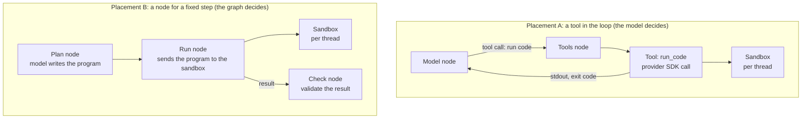
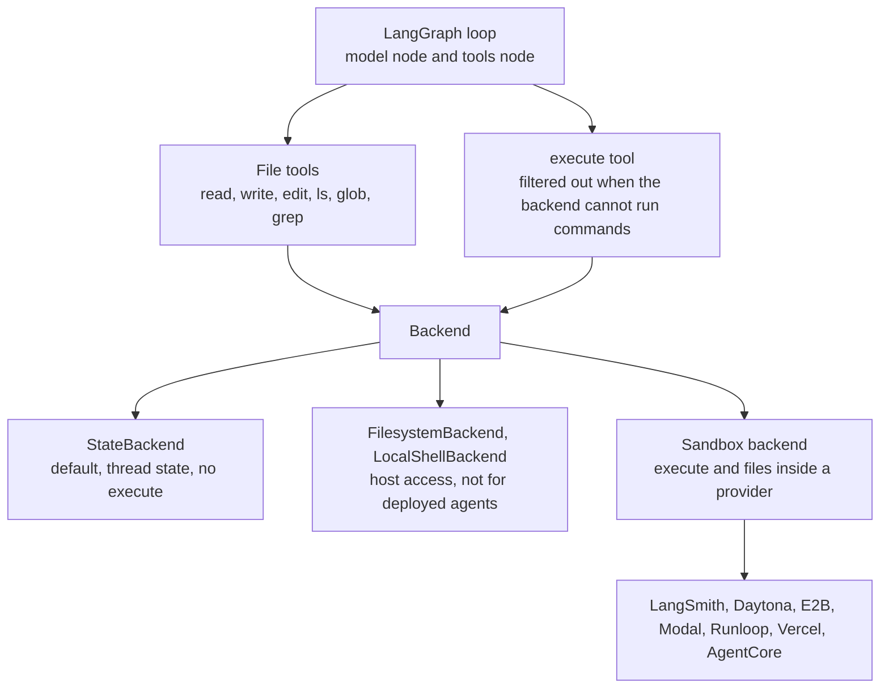
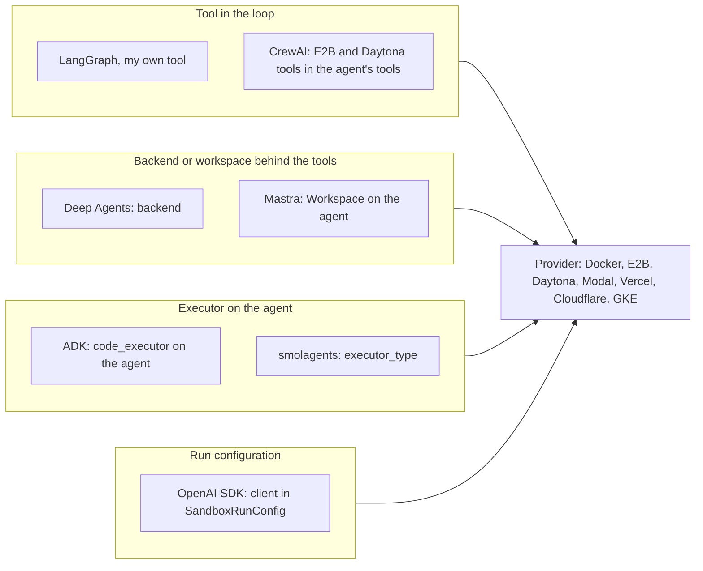

# 5. The sandbox attaches in four places across frameworks: a tool, a backend behind the tools, an executor on the agent, or the run configuration; LangGraph leaves the choice to me

> LangGraph has no sandbox object, so I place one as a tool in the loop or as a node for a fixed step. Deep Agents, Mastra, ADK, smolagents, CrewAI and the OpenAI SDK each attach it at a different point, and that point decides who owns the lifecycle, the scope and the secrets.

Related: [04 Workspaces and code sandboxes in frameworks](04_Workspaces_And_Code_Sandboxes_In_Frameworks.md) · [W2L2 12 Sandbox for agent code](../Week2_Lecture_2_Building_an_Agent/12_Sandbox_For_Agent_Code_Pi_And_Search_Execute.md) · [W2L2 06 Workflow vs LangGraph](../Week2_Lecture_2_Building_an_Agent/06_Workflow_vs_LangGraph.md) · [W2L2 11 Model routing in LangGraph](../Week2_Lecture_2_Building_an_Agent/11_Model_Routing_In_LangGraph.md)

Source: the framework docs read for note 04 (Deep Agents and LangGraph, Mastra, CrewAI, OpenAI Agents SDK, Google ADK, smolagents) and the code snippets Context7 returned for them, 2026-11-23. The two LangGraph sketches are my own, not from the docs.

## Glossary

| Term | What it means here | Same thing elsewhere | Not to be confused with |
|---|---|---|---|
| Attachment point | The place in the framework where the sandbox is plugged in | Integration point | The provider that supplies the wall |
| Tool placement | The sandbox is called by a tool inside the agent loop | `execute` tool, exec tool | A node |
| Node placement | The sandbox is called by a graph step that code decides to run | Workflow step | A tool the model chooses |
| Backend | A Deep Agents object behind the file and `execute` tools | Storage and execution layer | A database |
| Executor | An object on the agent that runs the code the model writes | ADK `code_executor`, smolagents executor | A tool |
| Run configuration | The settings passed when a run starts | OpenAI `SandboxRunConfig` | The agent definition |

## 1. The problem

Note 04 lists which frameworks support a code sandbox. **Where does the sandbox sit in each of them, and how does it relate to LangGraph's graph?**

## 2. LangGraph: two placements I can choose

| | Placement A: tool | Placement B: node |
|---|---|---|
| Who chooses to run code | The model, on any turn | The graph, at a fixed step |
| Fits | Open-ended work, many tools | A known flow where the code step is always needed |
| Result goes to | The model as a tool result | State, then a check step |
| Risk | The model can run code at the wrong time | The step is rigid |

- Plain LangGraph gives me the graph and state, and I write the provider call myself.
- The sandbox id belongs in state or thread metadata, so a resumed run finds the same sandbox. Deep Agents' production page stores the id on the thread (thread scope) or on the assistant (assistant scope).
- Sandbox creation is I/O, so a graph factory that creates it should be async (Deep Agents' production page says so).

## 3. Deep Agents: the backend sits behind the tools

- The only method a sandbox provider must implement is `execute()`. The file tools are built on top of it.
- Two planes: the model's file tools run inside the sandbox through `execute()`, and the application moves files with `upload_files()` and `download_files()`, which use the provider's own API.
- The sandbox is scoped per thread or per assistant, with a TTL for idle ones.

## 4. Other frameworks: four attachment points

| Style | Frameworks | What it means for me |
|---|---|---|
| Tool in the loop | LangGraph (mine), CrewAI | The model calls it like any tool. Each tool has its own lifecycle: CrewAI's are ephemeral by default, persistent or attached by id |
| Backend or workspace | Deep Agents, Mastra | One place for files and commands, scope by thread, with a resolver in Mastra for per user |
| Executor on the agent | ADK, smolagents | The model writes code, and the executor runs it as a step of the agent, not as a tool call |
| Run configuration | OpenAI SDK | The agent declares a manifest and capabilities, and the run chooses the sandbox client. The same agent can run locally or hosted |

- Mastra's workspace attaches to the agent, and its tools (`execute_command` and the file tools) appear to the model as tools. So it sits between a backend and a tool.
- The OpenAI SDK keeps the choice of the wall out of the agent definition. This helps me use a weak wall in development and a strong one in production.

## 5. What this means for my agent

- With LangGraph, placement A is the simplest start: one tool and one provider call. Placement B fits a flow that always runs a program, as in the lecture's product search (see the next note on this idea).
- A tool or backend attachment lets me keep keys outside the sandbox, because the host-side tool holds them (Deep Agents' own advice). An executor on the agent runs code the model wrote, so the host needs another way to keep secrets out.
- The attachment point decides where the scope is set: per thread in Deep Agents, per request in Mastra, per run in the OpenAI SDK. I choose it before the provider.

## Summary

The wall always comes from a provider, and the framework decides where it plugs in: as a tool, behind a backend, as an executor, or in the run configuration. LangGraph leaves it to me, as a tool for open work or a node for a fixed step.

## Open questions

- Should my agent run code as a tool (A) or as a fixed step (B)?
- Where does my agent keep the sandbox id so a resumed run finds it?
- Does ADK's executor run code only from the model's reply, or also from a tool call? The pages I read do not say.

## Fact-check

| # | Claim | Verdict | Source |
|---|---|---|---|
| 1 | Plain LangGraph has no sandbox object | agrees, by absence | [LangGraph overview](https://docs.langchain.com/oss/python/langgraph/overview) |
| 2 | Deep Agents sandboxes are backends, `execute` is filtered out without one | agrees | [Deep Agents sandboxes](https://docs.langchain.com/oss/python/deepagents/sandboxes), [backends](https://docs.langchain.com/oss/python/deepagents/backends) |
| 3 | A provider only needs `execute()`. App code moves files with `upload_files` and `download_files` | agrees, partly from a summary | same pages |
| 4 | Sandbox id on thread or assistant, async graph factory | agrees | [Going to production](https://docs.langchain.com/oss/python/deepagents/going-to-production) |
| 5 | CrewAI sandbox tools: ephemeral default, persistent or attach by id | agrees | [E2B tools](https://docs.crewai.com/edge/en/tools/ai-ml/e2bsandboxtools.md) |
| 6 | Mastra `Agent(workspace=...)` exposes `execute_command` as a tool | agrees | [Mastra LocalSandbox](https://mastra.ai/reference/workspace/local-sandbox) |
| 7 | ADK takes `code_executor` on the agent | agrees, from the docs snippet | [GKE executor](https://adk.dev/integrations/gke-code-executor/) |
| 8 | OpenAI chooses the sandbox client in `SandboxRunConfig` | agrees | [Sandbox agents](https://openai.github.io/openai-agents-python/sandbox_agents/) |
| 9 | smolagents selects the remote executor with `executor_type` | agrees | [smolagents](https://huggingface.co/docs/smolagents/tutorials/secure_code_execution) |
| 10 | The two LangGraph placements and the key advice for executors | lecture-independent, my reasoning | |

## Sources

- The pages linked above, read on 2026-11-23. Sections 2 and 5 and the four-style grouping are my own reasoning.
