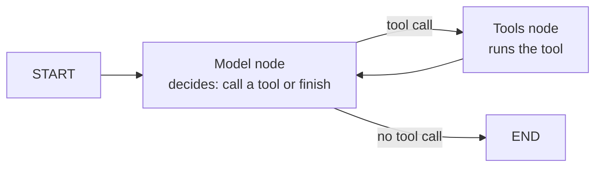
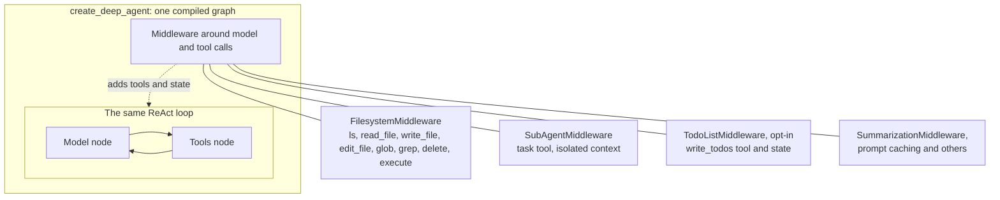
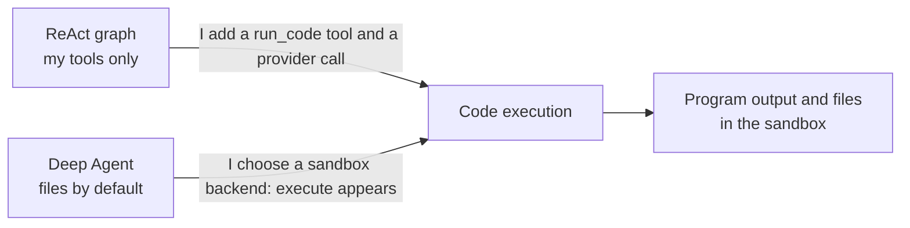

# 6. A Deep Agent is the same ReAct loop with middleware around it, so the differences in my two graphs come from what is attached: a todo tool, a file backend, subagents, and with a sandbox backend an `execute` tool

> LangChain says the core algorithm of a deep agent is the same as a plain agent, an LLM calling tools in a loop. What differs is the harness: planning, files, subagents, context management, and code execution only when the backend is a sandbox. My own todo list is a node, while the library's is a tool the model may call.

Related: [W2L2 07 Workflows on the fly and todo lists](../Week2_Lecture_2_Building_an_Agent/07_Workflows_On_The_Fly_And_Todo_Lists.md) · [05 Where the sandbox attaches](05_Where_The_Sandbox_Attaches_Tool_Node_Backend_Or_Run_Config.md) · [04 Workspaces and code sandboxes in frameworks](04_Workspaces_And_Code_Sandboxes_In_Frameworks.md) · [W2L1 05 Instructions, archetype ReAct or Deep Agent](../Week2_Lecture_1_Agent_Primitives/05_Instructions_Five_Parts_And_Enforcement.md) · [W2L1 03 Agent loop and limits](../Week2_Lecture_1_Agent_Primitives/03_Agent_Loop_Stop_Limits_Recovery.md) · [W2L2 19 Evict tool results](../Week2_Lecture_2_Building_an_Agent/19_Evict_Tool_Results_To_Memory_By_Reference.md)

Source: my two LangGraph agents, as I describe them (a ReAct graph and a Deep Agent graph that differ in node layout and in a TODO_List node). I did not read their code. LangChain agents and middleware docs, Deep Agents docs and blog (2025-07-30), the LangGraph workflows page, the ReAct abstract, read on 2026-11-23.

## Glossary

| Term | What it means here | Same thing elsewhere | Not to be confused with |
|---|---|---|---|
| ReAct | The model interleaves reasoning and actions, reads the result, repeats | The agent loop, tool-calling loop | A library class |
| Harness | Everything around the loop: prompt, tools, middleware | Agent runtime | The model |
| Deep Agent | The loop plus planning, files, subagents and context management | `create_deep_agent`, Claude Code style agents | A different algorithm |
| Middleware | Hooks around model and tool calls that can add tools and state | Plugin of the loop | A graph node |
| Todo list | A structured task list with `pending`, `in_progress`, `completed` | `write_todos` | A planner that enforces steps |
| Backend | Where the agent's files live, and whether it can run commands | State, filesystem, sandbox backend | A database |

## 1. The problem

I built a ReAct agent and a Deep Agent on LangGraph. They differ in how I arranged the nodes and in a TODO_List node. **What is the real difference between the two, where does the todo list live in the library, and is code execution another difference?**

## 2. ReAct: the loop

The ReAct paper (Yao et al., arXiv 2210.03629) is a prompting pattern: reasoning traces and actions interleaved. It reports gains on ALFWorld (34 points) and WebShop (10 points) over imitation and reinforcement learning with one or two examples. LangChain defines an agent as "a model calling tools in a loop until a given task is complete". The LangGraph page shows the loop as an `llm_call` node, a `tool_node` and a conditional edge. Neither docs page uses the word ReAct.

## 3. Deep Agent: the same loop, a stack around it

The Deep Agents blog says "the core algorithm is actually the same", and names four additions: a planning tool, sub agents, a file system and a detailed prompt. The docs say `create_deep_agent` pre-assembles a middleware stack on top of `create_agent` and returns a compiled LangGraph graph.

- With only a model, the stack has filesystem, subagent (a general-purpose subagent is added), summarization, tool-call patching and prompt caching middleware.
- Subagents are isolated by default: a fresh context, one final report back to the main agent.
- The docs add context management (summarization, skills, memory) and human approval. The 2025 blog does not mention them.
- I found no benchmark numbers on these pages. The blog argues that a plain loop is "a bit shallow" over long tasks, a qualitative claim.

## 4. The todo list: a node in my graph, a tool in the library

| | My TODO_List node (as I described it) | `TodoListMiddleware` |
|---|---|---|
| What it is | A graph node | Middleware: a `write_todos` tool, state, a prompt addition and an `after_model` node |
| Who decides to plan | The graph, when an edge reaches the node | The model, when it chooses to call the tool |
| State | My state key | "persisted in agent state", with statuses |
| Enforcement | Whatever my node does | At most one call per model turn, completion not enforced (W2L2 07) |
| Default | Always there | Opt-in since Deep Agents v0.7, earlier on by default |

- The 2025 blog called the todo tool "basically a no-op", a context-engineering aid, while the current docs describe state with statuses. The state key is `todos`.
- The source adds one node, `after_model`, that rejects parallel `write_todos` calls. Planning itself stays a tool call (node wiring read through a summary).
- If my node forces a planning step, my graph enforces planning, and the library only invites it. I need to check what my node really does.

## 5. Code execution: the difference I noticed

| | ReAct agent | Deep Agent |
|---|---|---|
| Files | None unless I add tools | A virtual filesystem by default (`StateBackend`, in agent state) |
| Code execution | A tool I add (placement A in note 05) | `execute` appears only when the backend is a sandbox backend, and is dropped otherwise |
| Where results go | Into the thread | Files, so large results can stay out of the thread |
| Permissions | My own checks | Do not apply to sandbox backends: "arbitrary command execution" |

- So the third difference is real: a Deep Agent has a place for files and, with a sandbox backend, for code. A ReAct agent has only what I wire in.
- This fits the code mode idea from the lecture: the model writes a program and keeps the intermediate results in files and variables, not in the thread. Deep Agents already ships the file side.

## 6. Which to use (my reasoning)

- ReAct: short tasks, few tools, small results.
- Deep Agent: long tasks, large intermediate results, delegation to subagents, code that works on files.
- Either way the loop is the same, and each added piece costs tokens, tools to approve and a wall to maintain.

## 7. Cautions

- I compare the libraries as documented. My own graphs may add or remove parts.
- Versions matter: todo opt-in and the `delete` tool came with v0.7, and `fork` subagents with v0.7.13.
- Some pages were read in part, and a few lines came from summaries.
- Whether `create_agent` replaces `create_react_agent` is not stated on the pages I read, so I do not claim it.

## Summary

ReAct is the loop. A Deep Agent is that loop with middleware that adds planning, files, subagents and context management, and code execution when the backend is a sandbox. My difference in nodes and the TODO_List node is a design choice (graph decides) against the library's (model decides).

## Open questions

- Does my TODO_List node force a planning step, and does anything check completion?
- Which Deep Agents version do I run, and is planning on?
- Does my Deep Agent use `task` subagents or my own nodes?
- Does my ReAct graph have a file or run-code tool, and which backend does my Deep Agent use?

## Fact-check

| # | Claim | Verdict | Source |
|---|---|---|---|
| 1 | ReAct interleaves reasoning traces and actions, ALFWorld +34 and WebShop +10 | agrees, abstract read | [arXiv 2210.03629](https://arxiv.org/abs/2210.03629) |
| 2 | An agent is a model calling tools in a loop, a harness is everything around it | agrees | [LangChain agents](https://docs.langchain.com/oss/python/langchain/agents) |
| 3 | The loop is a model node, a tool node and a conditional edge | agrees | [LangGraph workflows and agents](https://docs.langchain.com/oss/python/langgraph/workflows-agents) |
| 4 | A deep agent's core algorithm is the same loop, plus four additions | agrees | [Deep Agents blog](https://www.langchain.com/blog/deep-agents) |
| 5 | `create_deep_agent` builds a middleware stack on `create_agent` and returns a compiled graph | agrees. Last 6,458 characters of the page not read | [Customization](https://docs.langchain.com/oss/python/deepagents/customization) |
| 6 | `write_todos` comes from `TodoListMiddleware`, opt-in since v0.7, state with statuses | agrees | [Deep Agents overview](https://docs.langchain.com/oss/python/deepagents/overview) |
| 7 | The todo list is a tool and state, plus an `after_model` node that checks parallel calls | agrees in the source. The docs pages do not describe the node | [todo.py](https://github.com/langchain-ai/langchain/blob/master/libs/langchain_v1/langchain/agents/middleware/todo.py) |
| 8 | The default backend is `StateBackend`, `execute` only with a sandbox backend | agrees | [Overview](https://docs.langchain.com/oss/python/deepagents/overview), [backends](https://docs.langchain.com/oss/python/deepagents/backends) |
| 9 | Subagents are isolated by default and return one report | agrees, partly from a summary | [Subagents](https://docs.langchain.com/oss/python/deepagents/subagents) |
| 10 | Deep Agents give better results than a plain loop | unverified: no benchmark numbers found | blog, overview |
| 11 | `create_agent` supersedes `create_react_agent` | unverified, not stated on the pages read | [LangChain v1 migration guide](https://docs.langchain.com/oss/python/migrate/langchain-v1.md), not fetched |

## Sources

- The pages above. My two graphs are described from memory, not read. Sections 4 to 6 and the questions are my own reasoning.
