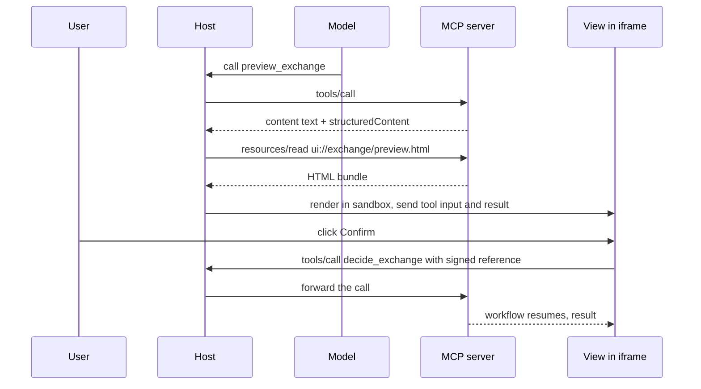
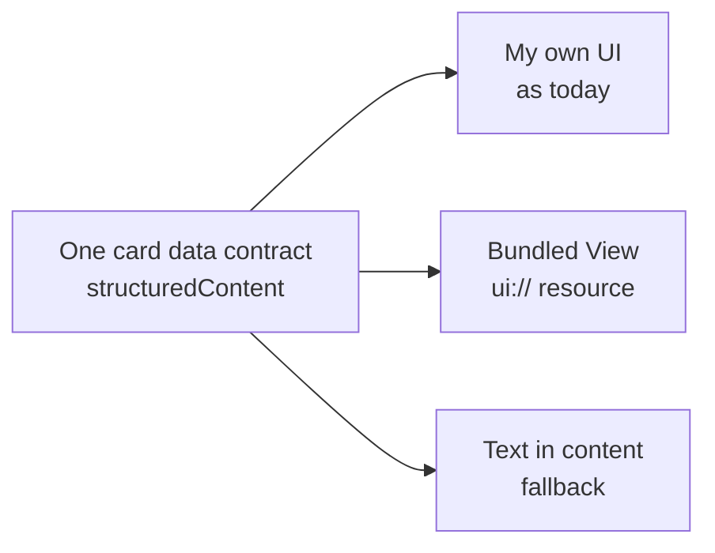

# 8. "Preview" is the lecturer's tool name, not an MCP mode: the feature is an MCP App, a tool linked to a `ui://` HTML resource, and my cards can ship there only as a second renderer behind one data contract and a text fallback

> There is no "Preview Mode" in the MCP spec or docs I read. The lecturer's `preview_exchange` tool returns a proposal, and its metadata points to a `ui://` resource that a supporting host renders in a sandboxed iframe, which is MCP Apps. A host without support shows the tool's text.

Related: [01 MCP resources](01_MCP_Resources_Static_Context_And_Sampling.md) · [02 MCP resources and plugins](02_MCP_Resources_Plugins.md) · [03 Policy resource from the check rules](03_MCP_Resource_Policy_Text_From_The_Check_Rules.md) · [07 Sandbox against jailbreak and prompt injection](07_Sandbox_Against_Jailbreak_And_Prompt_Injection_Per_Tenant.md) · [W2L2 06 Workflow vs LangGraph](../Week2_Lecture_2_Building_an_Agent/06_Workflow_vs_LangGraph.md) · [09 Human confirmation across channels](09_Human_Confirmation_Across_AG-UI_A2A_And_MCP_Channels.md)

Source: S02E03 transcript (the `preview_exchange` and `decide_exchange` tools, a Goose elicitation form, MCP Apps). The MCP Apps spec (SEP-1865, Stable 2026-01-26) read in full, the MCP Apps docs, OpenAI's ChatGPT UI docs, the MCP-UI site, the A2UI repository, the AG-UI docs and Microsoft Learn pages, read on 2026-11-23. My cards: a React component that talks to the agent over AG-UI, with HITL confirmation buttons (as I describe it). I did not see its code.

## Glossary

| Term | What it means here | Same thing elsewhere | Not to be confused with |
|---|---|---|---|
| MCP App | A tool plus a `ui://` HTML resource that the host renders | Interactive UI for MCP | A web page the model reads |
| View | The HTML document running in the host's sandboxed iframe | App UI | The tool result |
| Host | The client application that renders the View | Claude, ChatGPT, VS Code Copilot | The MCP server |
| App-only tool | A tool the View can call but the model cannot see | `visibility: ["app"]` | A private function |
| `structuredContent` | Data for the UI, not added to the model's context | Card data | `content`, the text for the model |
| Elicitation | The host draws a form from my schema and returns the answer | Form request | An MCP App |

## 1. The problem

The lecturer shows a "preview" with custom UI on the agent side. **Is "Preview Mode" an MCP feature, how does it differ from MCP Apps, and should my own cards also live on my MCP server for third-party clients?**

In the transcript "preview" is a tool name: "In preview exchange tool, the metadata connects preview exchange to a resource URI that starts with UI". It previews a proposal before anything is committed. The UI mechanism is an MCP App.

## 2. How it works

- **Tool:** `preview_exchange` carries `_meta.ui.resourceUri`. The lecturer's `decide_exchange` is called by the View, and the click, not the model, supplies the decision. The server verifies the signed reference and resumes the saved workflow.
- **Resource:** a `ui://` resource with the MIME type `text/html;profile=mcp-app`. The lecturer's HTML contains its own code and fetches nothing from another site. The host may prefetch and cache it.
- **Result:** `content` is text for the model and text-only hosts, `structuredContent` is data for the UI and not added to the model's context.
- **App-only tools:** `visibility: ["app"]` keeps a tool out of the model's tool list. The host must reject app calls to tools without `"app"`.

So the relation you guessed is right: an MCP App is a tool plus a resource, and the host, not the model, reads the resource (note 01).

## 3. MCP Apps against elicitation

| | Elicitation | MCP App |
|---|---|---|
| Who draws it | The host, from my schema | My HTML |
| Fits | A confirm or a few fields | My layout, images, brand, controls |
| Content | Flat primitive fields and a text message | Any HTML, with a build and a review |
| Lecturer's rule | When the client's form is enough | When the interaction needs my own layout |

For my HITL confirmations (confirm or decline) the rule points to elicitation first, and an App only for the rich proposal card (note 09).

## 4. Fallback and host support

- The spec: "If host does not support MCP Apps, tool behaves as standard tool (text-only fallback)." Servers SHOULD provide a text fallback for every UI tool, and the tool MUST return a meaningful `content` array.
- The host advertises support in `capabilities.extensions` under `io.modelcontextprotocol/ui` with `mimeTypes`. Servers SHOULD check it before registering UI tools.
- The MCP Apps overview lists as clients: Claude, Claude Desktop, VS Code GitHub Copilot, Microsoft 365 Copilot, Goose, Postman, MCPJam and Archestra.AI. In the docs of my three hosts: ChatGPT renders apps inline, fullscreen and picture-in-picture, Copilot in VS Code renders them as Experimental and inline only, and Claude Code's docs mention `ui://` entries and app visibility but no rendering, so its text fallback is the real experience there.

## 5. Security of the View

- The View runs in a sandboxed iframe and talks only through `postMessage`. Web hosts use two iframes with different origins.
- Default CSP: no network (`connect-src 'none'`), scripts and styles from itself. External domains must be declared in `_meta.ui.csp`, and the host must block the rest.
- The View has no session of mine. Its tool calls go through the host, which may block them or ask the user. My tenant checks stay behind the server, as in note 07.
- The spec advises hashing and reviewing HTML templates, and logging calls that come from the View.

## 6. The market

| Standard | What it is | Status | Relation to MCP Apps |
|---|---|---|---|
| MCP Apps | HTML View for MCP tools | Stable (2026-01-26) | The standard |
| MCP-UI | The earlier community project | Its site says it is "standardized into MCP Apps" and keeps a legacy adapter | Predecessor, now implements MCP Apps |
| OpenAI Apps SDK | ChatGPT's UI for MCP servers | ChatGPT "implements the open MCP Apps standard" | Same standard, plus `window.openai` extras |
| Google A2UI | Declarative JSON UI, rendered natively | Early, packages not all published | Different. Embedding MCP Apps in A2UI is on its roadmap |
| AG-UI | Event protocol between an agent and a front end | Backed by CopilotKit | Carries A2UI or MCP Apps, "not a generative UI specification" |
| Adaptive Cards | Microsoft's card format | The pages I read do not mention MCP Apps | Different. The MCP Apps overview lists Microsoft 365 Copilot as a client |

## 7. My project (my reasoning)

| Option | What it means | Cost |
|---|---|---|
| A. Own UI only | Third-party clients get text | None |
| B. Also an MCP App | The same card data, a second renderer in one HTML file | A second renderer to build and review |
| C. Elicitation for confirmations | The host draws the form | Little, no custom look |
| D. A2UI | Native rendering across clients | Early, a new stack |

- The sound base is one data contract for the cards, with my UI and the View as two renderers.
- Start with one card as an App, keep the text fallback, and register the UI tool only for hosts that declare support.
- My cards carry HITL confirmation buttons. A button in a View is not proof of a human decision, see [09](09_Human_Confirmation_Across_AG-UI_A2A_And_MCP_Channels.md).

## 8. Cautions

- A `ui://` bundle is code that runs in other people's hosts. It needs a build, a review and a hash.
- The spec is Stable, but hosts differ. The spec's own examples contain version and CSP inconsistencies.
- My renderer is a React component that talks to the agent over AG-UI, so a View is a second build with its own bridge to the host.

## Summary

"Preview" is a tool in the lecturer's workflow, and MCP Apps is the mechanism behind it: a tool linked to a `ui://` resource that supporting hosts render. For my cards I would keep one data contract, add the View as a second renderer, and keep a text fallback.

## Open questions

- Can my React card renderer be bundled into one HTML file with no external calls?
- Does Claude Code render an app, or does it use the text fallback?
- Which of my three hosts matter most for cards: ChatGPT and VS Code can render, and Claude Code probably cannot?

## Fact-check

| # | Claim | Verdict | Source |
|---|---|---|---|
| 1 | "Preview" is a tool name in the lecture. MCP has no Preview Mode | agrees, by absence in the spec and docs read | S02E03 transcript, [MCP Apps overview](https://modelcontextprotocol.io/extensions/apps/overview) |
| 2 | A tool links to a `ui://` resource with `_meta.ui.resourceUri`, MIME `text/html;profile=mcp-app` | agrees | [MCP Apps spec](https://github.com/modelcontextprotocol/ext-apps/blob/main/specification/2026-01-26/apps.mdx) |
| 3 | The View runs in a sandboxed iframe and calls tools through the host | agrees | same spec |
| 4 | `visibility: ["app"]` hides a tool from the model | agrees | same spec |
| 5 | `content` for the model, `structuredContent` for the UI | agrees | same spec |
| 6 | Text-only fallback when a host has no support. Servers should check `io.modelcontextprotocol/ui` | agrees | same spec |
| 7 | Default CSP blocks network. Declared domains only | agrees | same spec |
| 8 | MCP Apps is Stable | agrees | same spec header |
| 9 | Clients: Claude, Claude Desktop, VS Code Copilot, Microsoft 365 Copilot, Goose, Postman, MCPJam, Archestra.AI | agrees as the overview's list. No per-version evidence | [Overview](https://modelcontextprotocol.io/extensions/apps/overview) |
| 10 | ChatGPT implements MCP Apps, `window.openai` is extra | agrees | [ChatGPT UI docs](https://developers.openai.com/plugins/build/chatgpt-ui.md) |
| 11 | MCP-UI is standardized into MCP Apps | agrees | [MCP-UI](https://mcpui.dev/) |
| 12 | A2UI is declarative JSON, native rendering, MCP Apps embedding on its roadmap | agrees, repository README | [A2UI](https://github.com/google/A2UI) |
| 13 | AG-UI is not a generative UI specification | agrees | [AG-UI](https://docs.ag-ui.com/concepts/generative-ui-specs.md) |
| 14 | Microsoft 365 Copilot renders MCP Apps | unverified: the overview lists it, the Microsoft pages read do not mention it | [Microsoft Learn](https://learn.microsoft.com/en-us/microsoft-365-copilot/extensibility/overview-declarative-agent) |
| 15 | Claude Code renders MCP Apps | unverified | [Claude Code MCP docs](https://code.claude.com/docs/en/mcp) |
| 16 | The options in section 7 | lecture-independent, my reasoning | |

## Sources

- The pages linked above. Section 7 and the cautions are my reasoning. I read no blog posts for this note.
