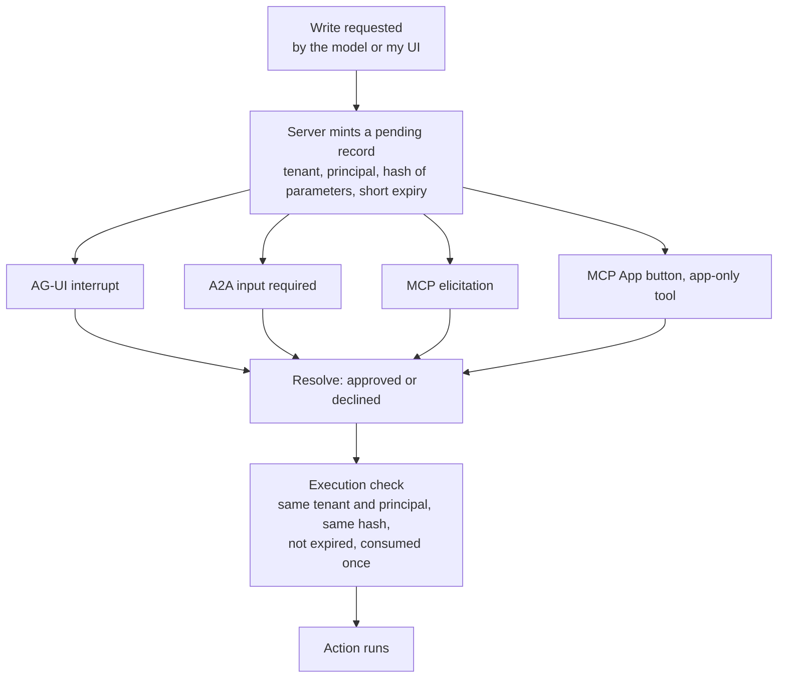
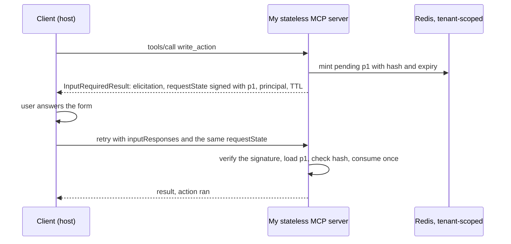

# 9. A confirmation is a server-held fact that every channel only fills in: one pending record, resolved from AG-UI, A2A, MCP elicitation or an MCP App button, and checked by the server before the action runs

> Hosts differ in how they ask a human, and some let hooks, autopilot or policy answer for the human, so a button or a host approval cannot be proof. The proof is a server record minted for one action, bound to the tenant, the principal and a hash of the parameters, resolved once through any channel and consumed by the server before the action runs.

Related: [08 MCP Apps and the lecturer's preview tool](08_MCP_Apps_And_The_Lecturers_Preview_Tool.md) · [07 Sandbox against jailbreak and prompt injection](07_Sandbox_Against_Jailbreak_And_Prompt_Injection_Per_Tenant.md) · [03 Policy resource from the check rules](03_MCP_Resource_Policy_Text_From_The_Check_Rules.md) · [W2L1 14 Tool approval, durable waits](../Week2_Lecture_1_Agent_Primitives/14_Tool_Approval_Durable_Waits.md) · [W2L1 04 HITL and execution isolation](../Week2_Lecture_1_Agent_Primitives/04_HITL_And_Execution_Isolation.md)

Source: S02E03 transcript (elicitation with Goose, `decide_exchange`). My setup as I describe it: a React card component that talks to my agent over AG-UI or A2A with HITL confirmation buttons, a stateless MCP server with external tools, users on Claude Code, Copilot and ChatGPT. MCP spec 2026-07-28 (elicitation, multi round-trip requests, tools), AG-UI docs, A2A 1.0 spec, LangGraph interrupts, host docs, read on 2026-11-24.

## Glossary

| Term | What it means here | Same thing elsewhere | Not to be confused with |
|---|---|---|---|
| Pending record | A server-side record of one action waiting for a human | Approval request | A UI event |
| Channel | A way to ask and carry the answer | AG-UI interrupt, A2A input-required, elicitation | The proof |
| Interrupt | A paused run that waits for input | LangGraph `interrupt()`, AG-UI outcome `interrupt` | An error |
| Elicitation | The host shows a form from my schema and returns accept, decline or cancel | Input request | An MCP App |
| MRTR | Multi round-trip request: the server answers `InputRequiredResult`, the client retries with the input | Stateless elicitation | A session |
| `requestState` | An opaque string the server hands out and gets back on the retry | Signed state token | Server memory |
| Host approval | The host's own prompt for a tool call | Permission prompt | A fact the server can read |

## 1. The problem

My cards' buttons are HITL confirmations. **On Claude Code, Copilot and ChatGPT, through my stateless MCP server, what carries the confirmation, and what proves that a human decided?**

## 2. The channels

| Channel | How it pauses and resumes | Who draws it | Where it works |
|---|---|---|---|
| AG-UI | The run finishes with an `interrupt` outcome (reason `confirmation` is core). The next input carries a `resume` list with the interrupt id and a payload such as `approved`. All open interrupts must be answered together | My React card | My UI. The LangGraph adapter emits the outcome only when `emit_interrupt_outcome` is on, otherwise a legacy custom event |
| A2A | Task state `INPUT_REQUIRED`. The client continues with a new message on the same `taskId` and `contextId` | My UI or an agent | The spec defines no approval payload |
| MCP elicitation | `InputRequiredResult` with `elicitation/create` and `requestState`. The client retries with `inputResponses`. Answers: accept, decline, cancel | The host | Claude Code (interactive terminal), Copilot in VS Code (active turn). ChatGPT: not stated |
| MCP App button | The View calls an app-only tool | My HTML | ChatGPT, Copilot in VS Code (Experimental, inline). Claude Code: no rendering stated |
| Host approval | The host prompts for the tool call | The host | All three, and the server cannot see it |
| Chat text | The model asks and the user types yes | The model | Not proof |

## 3. Why a click is not proof

- Claude Code has an `Elicitation` hook that can decline with no dialog or answer with `accept` and content (docs summary), and it cancels in non-interactive sessions.
- Copilot cancels elicitation in Autopilot, declines it with no active turn, and says "Don't assume every call prompts the user".
- ChatGPT's annotations "only influence how ChatGPT or Codex frames the tool call... servers must still enforce their own authorization logic". The MCP spec says annotations are untrusted unless the server is trusted, and that a human SHOULD be able to deny tool calls.
- OWASP LLM06 says the same: authorization downstream, human approval for high-impact actions.

So `accept` proves that a client answered. It does not prove that a person did, and a model-callable "confirm" tool lets a hijacked model approve itself.

## 4. The design (my reasoning)

- The first call never writes. It mints the record.
- `requestState` is attacker-controlled input. It carries only the id, principal, expiry and hash under HMAC or AEAD, and the record lives in Redis under the tenant key. The spec says single use "MUST" be enforced server-side.
- The confirm path is never a tool the model can call alone: elicitation, my UI, or an app-only tool (`visibility: ["app"]`).
- A decline or cancel closes the record. Expiry is short.
- Where a host offers only its own approval, a high-risk tool returns a proposal and does not commit.
- Every state change is logged with the tenant id (note 07).

## 5. My three hosts

| Host | Elicitation | MCP Apps | Host approval |
|---|---|---|---|
| Claude Code | Form and URL, interactive sessions only | Not stated as rendered | Permission rules (deny, ask, allow). A per-tool `_meta` flag `anthropic/requiresUserInteraction` forces a prompt (docs summary) |
| Copilot in VS Code | Form and URL during an active turn | Experimental, inline only | Depends on session permissions and organization policy |
| ChatGPT | Not stated | Yes: inline, fullscreen, picture-in-picture | `destructiveHint` helps frame approval. The Responses API asks per tool call by default |

Copilot CLI's MCP docs mention none of these, and I did not check the Copilot coding agent.

## 6. My take

- One pending record, several channels. For my own agent the pause is a LangGraph `interrupt()`, which needs a checkpointer and a thread id, and side effects before it must be idempotent. AG-UI projects it, and the interrupt id can be the pending id.
- For MCP the tool call is stateless, so the Redis record is the durable part and `requestState` only points to it.
- The card in a View shows the proposal. The proof is the record, not the button.
- The lecturer's approach is elicitation: my server defines the question and the allowed answers, the host draws the form and controls the wait, the run id travels in the form's message, and the answer resumes the saved workflow. His words: "Elicitation handles collecting the answer through another client, and our workflow and database still manage the business process in its saved state." This is the same split as my pending record: the channel collects, the server holds the state.
- Two differences. His run id sits in a visible message, so the resume must check that the same principal answers, while the stateless spec carries the id in an integrity-protected `requestState`. A form holds only flat primitive fields, so a rich proposal needs an App.
- For a confirm or decline, his rule ("use elicitation when the client's form is enough") points to elicitation first, and an App for the rich card.

## 7. Cautions

- ChatGPT's elicitation support and Claude Code's app rendering are not stated. The Claude Code hook details came from summaries.
- AG-UI's concepts page and spec prose use different status words (`resolved` and `cancelled`, `answered` and `abandoned`). I need the schema before I code.
- Only part of the A2A spec was read. A host approval or an Autopilot setting can be changed by the user or an admin.

## Summary

Third-party hosts can ask a human in several ways and cannot always prove it. I keep the proof on my server: a pending record per action, resolved once through any channel, checked and consumed before the action runs.

## Open questions

- Which actions need a server-verified confirmation, and which may rely on a host's approval?
- Does ChatGPT support elicitation, or must the button in a View carry it?
- Can my AG-UI interrupt id be the same as the pending record id?
- What does A2A's `INPUT_REQUIRED` message look like for an approval in my agent?

## Fact-check

| # | Claim | Verdict | Source |
|---|---|---|---|
| 1 | Stateless elicitation uses `InputRequiredResult`, `inputRequests`, `requestState` and a retry | agrees | [MRTR](https://modelcontextprotocol.io/specification/2026-07-28/basic/patterns/mrtr), [elicitation](https://modelcontextprotocol.io/specification/2026-07-28/client/elicitation) |
| 2 | `requestState` is attacker-controlled, protect it with HMAC or AEAD, enforce single use server-side | agrees | MRTR page |
| 3 | Elicitation answers are accept, decline, cancel. Secrets only through URL mode | agrees | elicitation page |
| 4 | A human SHOULD be able to deny tool calls. Annotations are untrusted unless the server is trusted | agrees. The second part partly from a summary | [Tools spec](https://modelcontextprotocol.io/specification/2026-07-28/server/tools) |
| 5 | AG-UI pauses with an `interrupt` outcome and resumes with a `resume` list | agrees | [AG-UI interrupts](https://docs.ag-ui.com/concepts/interrupts.md) |
| 6 | The LangGraph adapter emits the interrupt outcome only when enabled | agrees | same page |
| 7 | A2A has `INPUT_REQUIRED`, continued by a message on the same task, and no approval schema | agrees, part of the spec read | [A2A spec](https://a2a-protocol.org/latest/specification/) |
| 8 | LangGraph interrupts need a checkpointer and thread id, and earlier side effects must be idempotent | agrees | [Interrupts](https://docs.langchain.com/oss/python/langgraph/interrupts) |
| 9 | Claude Code elicitation is form and URL, interactive sessions only | agrees. Modes from a summary | [Claude Code MCP docs](https://code.claude.com/docs/en/mcp) |
| 10 | A Claude Code `Elicitation` hook can answer the request | unverified, from a summary | [Hooks](https://code.claude.com/docs/en/hooks) |
| 11 | Copilot: form and URL elicitation, cancelled in Autopilot. Apps Experimental, inline. Approval depends on policy | agrees | [MCP developer guide](https://code.visualstudio.com/docs/copilot/guides/mcp-developer-guide) |
| 12 | ChatGPT renders MCP Apps. Hints only frame approval. Elicitation not stated | agrees | [ChatGPT UI](https://developers.openai.com/plugins/build/chatgpt-ui.md), [reference](https://developers.openai.com/plugins/reference.md) |
| 13 | OWASP: authorization downstream, human approval for high impact | agrees | [LLM06](https://genai.owasp.org/llmrisk/llm062025-excessive-agency/) |
| 14 | The lecturer's elicitation keeps the run id in the form's message and resumes the saved workflow, and the workflow and database hold the state | lecture-specific, transcript quote | S02E03 transcript |
| 15 | The pending-record design | lecture-independent, my reasoning | |

## Sources

- The pages linked above. Sections 4 and 6 are my reasoning. I read no blog posts for this note.
