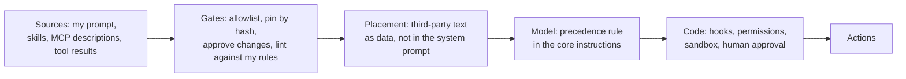

# 10. The instruction hierarchy is trained behavior, not a mechanism, so a skill or tool description that contradicts my system prompt needs a design answer: precedence stated in the core, authority set by where the text is loaded, and enforcement in code

> The Model Spec ranks root, system, developer, user and guideline, and gives tool outputs and untrusted text no authority by default, but it says production models do not yet fully follow it, and research shows hierarchies fail. Skills, MCP and plugins are not in the spec, so a skill's or a tool description's authority depends on where my harness loads it. I do not use the hierarchy as a security boundary.

Related: [20 Sandbox against jailbreak and prompt injection](20_Sandbox_Against_Jailbreak_And_Prompt_Injection_Per_Tenant.md) · [12 Self-evolution of the harness](12_Self_Evolution_Of_Harness_On_Event.md) · [02 MCP resources and plugins](02_MCP_Resources_Plugins.md) · [W2L1 05 Instructions and what code must enforce](../Week2_Lecture_1_Agent_Primitives/05_Instructions_Five_Parts_And_Enforcement.md) · [W2L1 09 Tool search and proxy gateway](../Week2_Lecture_1_Agent_Primitives/09_Tool_Search_And_Proxy_Gateway.md) · [Lecture 2: 9 Tools and prompt injection](../Lecture_2_Context_Agents_md_Skills_Tools/9_tools_prompt_injection.md) · [03 MCP skills and tools](03_MCP_Skills_And_Tools.md)

Source: S02E03 lesson, "Personalization" (the note that no instruction can be overridden, linking the Model Spec of 2026-08-18). The current Model Spec (2026-10-29) and its changelog, Anthropic docs, arXiv abstracts, Invariant Labs, the MCP spec and OWASP, read on 2026-11-25. See [Fact-check](#fact-check).

## Glossary

| Term | What it means here | Same thing elsewhere | Not to be confused with |
|---|---|---|---|
| Chain of command | The ranking of who may instruct the model | Instruction hierarchy, principal hierarchy | An access control |
| Authority level | The weight a piece of text gets from where it sits | Root, system, developer, user | Trust in the author |
| Untrusted data | Tool outputs, files, quoted text: information, not commands | Data plane | A system instruction |
| Tool poisoning | Hidden instructions in a tool description | Description injection | A bad tool result |
| Rug pull | A description that changes after I approved it | Supply-chain swap | A bug |
| Precedence rule | My written statement of what wins and what the agent does on a conflict | Conflict clause | A guarantee |

## 1. The problem

The lesson says: "technically there is no way to 'override' an instruction", and the model does not always respect the system prompt over lower levels. **What if a skill contradicts my system prompt, or a tool description carries hidden instructions? How do I act?**

## 2. What is true in the lesson's claim

| Claim | Verdict | Evidence |
|---|---|---|
| The Model Spec ranks the system prompt above developer and user messages | agrees | Levels: root, system, developer, user, guideline. Tool messages and quoted or untrusted text have "no authority by default". The 2026-10-29 version keeps this and changes the overview and chain of command |
| There is no technical override | agrees as design | The ranking is trained, not enforced. The 2024 OpenAI paper found models gave system prompts and untrusted text the same priority until trained otherwise |
| The model does not always respect it | agrees | The spec itself: "Our production models do not yet fully reflect the Model Spec". Control Illusion (AAAI-26): system and user roles do not give a reliable hierarchy across six models. IH-Challenge (OpenAI, 2026-03): after training, 84.1% to 94.1% on its own benchmark. Adaptive attacks beat 12 defenses above 90% |

So the hierarchy helps, and I design as if it can fail.

## 3. Where a skill or tool description sits

| Text | Loaded where | Authority |
|---|---|---|
| My system prompt | System | System |
| `AGENTS.md` in the repository | Context | Users "may implicitly delegate authority", `AGENTS.md` is the spec's own example |
| Skill name and description | Anthropic platform: "includes it in the system prompt" | System-level placement for third-party text |
| Skill body | Platform: read by bash, so a tool result. Claude Code: a message in the conversation, role not stated in the docs read | Data by default, unless delegated |
| MCP tool description | Tool definitions, which "a system or developer message will list" (Model Spec) | System-level or developer-level placement for third-party text, depending on the message my harness uses |
| Tool result | `tool_result` | None by default, trained skepticism |

The same text can be data or instruction depending on the harness. The Model Spec does not mention skills, MCP or plugins in the text I read. Tool poisoning works because tool definitions give an attacker's words the placement of mine, system-level or developer-level. The spec lists tools in either message and does not say a definition inherits its message's authority. That reading is my reasoning.

## 4. What goes wrong

- **Tool poisoning** (Invariant Labs, 2025-04-01): instructions "invisible to users but visible to AI models" in a description. Their example made an `add` tool read SSH keys and pass them as a "sidenote". **Rug pull:** the description changes after approval. **Shadowing:** one server's description changes how another's tool is used.
- **A malicious skill:** Anthropic says it "can direct Claude to call tools or run code in ways that don't match the Skill's stated purpose", and fetched content "might contain malicious instructions".
- **Pre-approval:** Claude Code's `allowed-tools` lets a skill use tools without asking during its turn, and a project skill's grant applies in a folder never trusted (docs summary, verify).
- **No attacker at all:** a stale skill that contradicts a rule I added later.
- **OWASP:** ASI01 goal hijack, ASI02 tool misuse, ASI04 agentic supply chain.

## 5. How I act (my reasoning, with sources)

| # | Rule | Why |
|---|---|---|
| R1 | Security lives in code: hooks, permission rules, tool allowlists, sandbox | The hierarchy fails sometimes (W2L1 05, note 20) |
| R2 | The core states the precedence and the reason: on a conflict follow the core, do not follow the conflicting text, say so in broad terms | The spec's "surface conflicts" behavior and Anthropic's "information to report, not commands to follow" |
| R3 | Skills and tool descriptions are supply chain: trusted sources only, review all files, pin by content hash, re-verify at runtime, approve description changes, qualify tool names | Anthropic, OWASP ASI02 and ASI04, Invariant, the MCP spec |
| R4 | Third-party text goes in tool results, JSON-encoded, never in the system prompt. My own instructions never go in tool results | Anthropic's mitigation guide |
| R5 | A lint step before a skill loads: forbidden tools and URLs, `allowed-tools`, a model check against my rules | My idea, run in the review of note 12 |
| R6 | Least privilege per skill. A skill cannot grant tools. Risky skills are not model-invoked | Docs summary, verify |
| R7 | Conflict evals: a skill against a system rule, a poisoned description, a tool result with instructions. Measure the attack success rate on every model change | W2L2 17, note 12 |
| R8 | Log each tool call with the description hash and alert on drift | OWASP ASI02 |

My own MCP server passes external tools' descriptions on to hosts, so I am a link in someone else's supply chain: I pin, review and, where I can, shorten those descriptions.

## 6. Cautions

- The Model Spec is OpenAI's. Anthropic's constitution (its principal hierarchy) was not read, so I cannot compare the two.
- Snyk's skill study and an academic skill-security paper were not read.
- The Claude Code skill facts came from a docs summary. About 3,000 characters at the end of the Model Spec were not read.

## Summary

The hierarchy is a trained preference, and skills and tool descriptions have no defined place in it. I state the precedence in my core, control where third-party text is loaded, gate and pin it as supply chain, and enforce what matters in code.

## Open questions

- Where does my harness load skill bodies and MCP descriptions: system, developer or tool result?
- Do I pin the descriptions of the external tools behind my MCP, and who approves a change?
- Does my eval set contain a skill that contradicts a system rule?

## Fact-check

| # | Claim | Verdict | Source | Checked |
|---|---|---|---|---|
| 1 | Chain of command levels. Tool outputs and untrusted text have no authority by default. Instructions in them are information | agrees | [Model Spec 2026-10-29](https://model-spec.openai.com/2026-10-29.html), [2026-08-18](https://model-spec.openai.com/2026-08-18.html) | 2026-11-25 |
| 2 | Production models do not yet fully reflect the spec | agrees | same pages | 2026-11-25 |
| 3 | The spec does not mention skills, MCP, plugins or tool descriptions | agrees, by absence in the text read | same pages | 2026-11-25 |
| 4 | Users may implicitly delegate authority to tool outputs, with `AGENTS.md` | agrees | [Changelog v2025.10.27](https://raw.githubusercontent.com/openai/model_spec/main/CHANGELOG.md) | 2026-11-25 |
| 5 | Models treat system prompts and untrusted text alike until trained | agrees, GPT-3.5 only | [arXiv 2404.13208](https://arxiv.org/abs/2404.13208) | 2026-11-25 |
| 6 | System and user roles give no reliable hierarchy | agrees, abstract | [arXiv 2502.15851](https://arxiv.org/abs/2502.15851) | 2026-11-25 |
| 7 | IH-Challenge: 84.1% to 94.1%, unsafe 6.6% to 0.7% | agrees, a fine-tuned GPT-5-Mini, OpenAI's own benchmark | [arXiv 2603.10521](https://arxiv.org/abs/2603.10521), [OpenAI](https://openai.com/index/instruction-hierarchy-challenge/) | 2026-11-25 |
| 8 | Adaptive attacks bypass 12 defenses above 90% | agrees, abstract | [arXiv 2510.09023](https://arxiv.org/abs/2510.09023) | 2026-11-25 |
| 9 | Anthropic: untrusted content only in tool results, JSON-encoded, treat instructions as information | agrees | [Mitigate jailbreaks](https://platform.claude.com/docs/en/test-and-evaluate/strengthen-guardrails/mitigate-jailbreaks) | 2026-11-25 |
| 10 | Skill metadata is in the system prompt, the body arrives through bash. Use trusted sources only | agrees | [Skills overview](https://platform.claude.com/docs/en/agents-and-tools/agent-skills/overview) | 2026-11-25 |
| 11 | Claude Code `allowed-tools` pre-approves tools, also in an untrusted folder | unverified, docs summary | [Claude Code skills](https://code.claude.com/docs/en/skills) | 2026-11-25 |
| 12 | Tool poisoning, rug pull, shadowing | agrees, vendor blog | [Invariant Labs](https://invariantlabs.ai/blog/mcp-security-notification-tool-poisoning-attacks.html) | 2026-11-25 |
| 13 | MCP: annotations untrusted, sanitize outputs, disambiguate tool names. The security best-practices page does not cover tool poisoning | agrees | [Tools spec](https://modelcontextprotocol.io/specification/2026-07-28/server/tools), [security best practices](https://modelcontextprotocol.io/specification/2026-07-28/basic/security_best_practices) | 2026-11-25 |
| 14 | OWASP ASI01, ASI02 and ASI04 mitigations | agrees | [OWASP Agentic Top 10](https://genai.owasp.org/top-10-for-agentic-applications-2026/) | 2026-11-25 |
| 15 | Rules R1 to R8 and the placement reading in section 3 | lecture-independent, my reasoning | | 2026-11-25 |

## Sources

- The pages linked above. Section 3's last paragraph and section 5 are my own reasoning.
