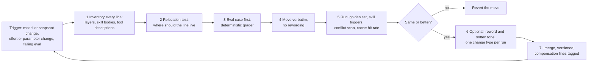

# 11. A prompt review is mostly relocation: each instruction moves to the cheapest place that still does its job, and every move changes its authority, its cache cost, whether it loads and whether I can test it

> Verbose is not the defect, always-on is: a long procedure is fine when it loads only for its task. The review question for each line is where it should live, and the sources agree on a list of moves I make, plus an optional softening of tone that explains instead of forcing.

Related: [W2L1 05 Instructions, five parts and my tagged chapters](../Week2_Lecture_1_Agent_Primitives/05_Instructions_Five_Parts_And_Enforcement.md) · [W2L2 10 Cache and context window](../Week2_Lecture_2_Building_an_Agent/10_Cache_And_Context_Window.md) · [W2L2 14 Execution flows, one skill per conversation](../Week2_Lecture_2_Building_an_Agent/14_Execution_Flows_Skill_Tool_Or_Workflow.md) · [W2L1 02 Rethinking the skills](../Week2_Lecture_1_Agent_Primitives/02_Rethinking_The_Skills.md) · [12 Self-evolution of the harness](12_Self_Evolution_Of_Harness_On_Event.md) · [10 Instruction precedence and tool pollution](10_Sys_Prompt_vs_Skills_Content_And_Threats.md)

Source: my layout and platform limits from the notes linked above (tagged chapters, a `<loaded_skill>` capped at 5,000 characters, one skill per conversation, system prompt and tools fixed with developer messages after the cached part). Anthropic's context-engineering post (2025-09-29), skill and prompting docs, OpenAI's GPT-6.2 and skills docs, two arXiv abstracts, read on 2026-11-25. I did not read my prompts. See [Fact-check](#fact-check).

## The review loop

- Steps 3 to 5 keep the eval delta attributable to the move. Rewording in the same step gives it two causes.
- Step 6 is optional and test-gated (section 6). Step 7 tags each compensation line with its model and weakness, so the next migration can delete it.

## Glossary

| Term | What it means here | Same thing elsewhere | Not to be confused with |
|---|---|---|---|
| Relocation | Moving one instruction to another place without changing its meaning | Hoisting, extracting | Rewriting |
| Destination | A place a line can live: layer, skill body, reference, script, tool description, retrieval, code, profile | Altitude (Anthropic) | A prompt section |
| Pointer | A short line left behind that says when to read the moved content | Router entry | A summary |
| Compensation line | A line that exists because an older model failed at something | Scaffolding | A principle |

## 1. The problem

My three prompt pieces and my verbose skills hold lines that belong elsewhere. **For each line, where should it live, and what does moving it change?**

## 2. The relocation test

Ask in this order. The first yes decides the destination.

| # | Question about the line | Destination | Basis |
|---|---|---|---|
| 1 | Must it never be broken? | Code (hook, tool validation), plus one line in the prompt saying the boundary exists | OWASP LLM06, W2L1 05 |
| 2 | Is it needed on most turns? | The layer that owns its aspect | Anthropic: "minimal set of information" |
| 3 | Is it needed only for one kind of task? | A skill body, with the trigger in the description | OpenAI: what the skill does and when to use it |
| 4 | Only on one branch of a task? | A reference file with a pointer that says when | Anthropic: references one level deep |
| 5 | Is the step deterministic? | A script or tool | Anthropic: low freedom means exact commands |
| 6 | Is it how to call one tool? | That tool's description, linked to the skill | The lecturer's tool-skill links |
| 7 | Does it change or is it large? | Retrieval: a file, resource or memory | Anthropic: lightweight identifiers, just-in-time |
| 8 | Does an older model's weakness explain it? | A model profile, tagged with the model and the weakness | Note 12's assumption register |
| 9 | Is it tone, length or thoroughness? | A parameter (effort), not prose | Vendor migration guides |
| 10 | Does nothing fail without it? | Delete | Ablation (note 12) |

## 3. What a move changes

| Property | What moves with the line |
|---|---|
| Authority | System prompt to skill body is a drop to thread level, where it can be outranked (note 10). Boundaries never move into a skill |
| Cache | Editing the fixed prefix breaks it for everyone. OpenAI appends top-level `instructions` after the input from GPT-6.2, and Anthropic advises mid-conversation system messages so history stays append-only. Dynamic facts go there |
| Loading | A line in a skill applies only if the description triggers. I test the trigger with the words users really use |
| Budget | My `<loaded_skill>` is capped at 5,000 characters, so a verbose skill must shed content: down to references, scripts or tool descriptions, and up to a layer |
| Switching | Unloading a skill rewrites the thread, so a flow that needs other rules runs in a subagent or a new thread (W2L2 14) |
| Testability | A line without an eval case cannot be moved safely |

## 4. Moves for verbose skills (my heuristics)

- **Promote** a line that two or more skills repeat: to the owning layer if every turn needs it, to a shared reference if only some tasks do. **Demote** a layer line that only one skill needs.
- **Extract** fixed sequences to a script or tool. Tokens become code, and the skill keeps the judgment.
- **Edge-case lists** become eval cases or code checks. Anthropic does not recommend a "laundry list of edge cases" in a prompt.
- **Always-on is the cost:** in IFScale the best frontier models reached 68% at 500 simultaneous instructions, with a bias toward earlier ones. Information at the start or end of a long input is used best. "Minimal does not necessarily mean short", so a long skill that loads on demand is fine.

## 5. What I do, based on the sources

Anthropic, OpenAI and the two papers point to the same moves. I do this list.

| # | I do | Recommended by |
|---|---|---|
| 1 | Keep always-on text to the minimal set that fully outlines the behavior, at the right altitude | Anthropic context engineering |
| 2 | Load detail just in time through references and lightweight identifiers | Anthropic context engineering, skill best practices (body under 500 lines, references one level deep) |
| 3 | Write skill descriptions that say what the skill does and when to use it | OpenAI skills guide, Anthropic skill best practices |
| 4 | Keep the skill root a router and link out | OpenAI, via note 02 |
| 5 | Match specificity to fragility: judgment as text, fragile steps as scripts | Anthropic skill best practices |
| 6 | Remove time-sensitive facts from skills | Anthropic skill best practices |
| 7 | Put dynamic information late, never in the fixed prefix | OpenAI GPT-6.2 guide, Anthropic prompting best practices |
| 8 | Revisit every instruction when the model changes, and re-run evals on every model I ship | OpenAI GPT-6.2 guide, Anthropic migration guides and skill best practices |
| 9 | Use one term and one canonical place per rule | Anthropic skill best practices |
| 10 | Enforce must-hold rules in code | OWASP LLM06, my W2L1 05 |
| 11 | Put the critical lines at the start or end of long inputs | Lost in the Middle, Anthropic (query last), OpenAI GPT-4.1 guide |

## 6. Optional: explain instead of forcing

These are recommended but not required. I apply each only where my evals show no loss.

- **Soften the tone:** Anthropic suggests "Use this tool when..." in place of "CRITICAL: You MUST use this tool when...", because newer models are more responsive to the system prompt and can overtrigger. "If in doubt, use [tool]" overtriggers too.
- **Give the reason, not a bare ban:** "NEVER use ellipses" becomes the reason it matters, and Claude "can generalize from the explanation". The lecturer's example shows the same: 24 of 24 leaks with the rule only, 0 of 24 with the reason, weaker at low effort.
- **Prefer general instructions over prescriptive steps** (Anthropic). OpenAI also advises removing strong "ask first" language and mandatory review stops (note 02).
- **Why optional:** Anthropic's skill guide suggests "MUST filter" when a rule keeps being missed. Boundaries do not rely on tone anyway, because code enforces them.

## 7. Pitfalls

- **Code without a reason:** a boundary moved into a tool with no sentence in the prompt makes the model retry. Keep the one-line reason and return an actionable error.
- **A pointer without a condition** never gets read. The pointer says when.
- **A rule moved into a third-party skill** loses authority and can be poisoned (note 10).
- **Dynamic text in the prefix:** client type, autonomy scope and current state belong in a late message.

## Cautions

- I have not read my prompts, so the test and the list are a method, not findings.
- IFScale used a keyword-inclusion task, not agent work. Whether GPT-6.2's `instructions` rule covers `gpt-6-luna` is unverified (W2L2 10).

## Summary

The review is a loop of relocations: test where each line should live, move it verbatim, run the evals, then optionally soften and explain. The sources agree on eleven moves, and the tone change stays test-gated.

## Open questions

- Where does `<loaded_skill>` sit in the request, and does loading it touch the cached prefix?
- Can my platform read reference files from a loaded skill, or is the 5,000-character body everything?
- Which lines repeat in two or more of my skills?

## Fact-check

| # | Claim | Verdict | Source | Checked |
|---|---|---|---|---|
| 1 | Right altitude, a minimal set that "does not necessarily mean short", just-in-time identifiers, canonical examples, no laundry list | agrees | [Anthropic, 2025-09-29](https://www.anthropic.com/engineering/effective-context-engineering-for-ai-agents) | 2026-11-25 |
| 2 | IFScale: 68% at 500 instructions, bias to earlier ones | agrees, abstract, keyword task | [arXiv 2507.11538](https://arxiv.org/abs/2507.11538) | 2026-11-25 |
| 3 | Information at the start or end is used best | agrees, abstract, two tasks | [arXiv 2307.03172](https://arxiv.org/abs/2307.03172) | 2026-11-25 |
| 4 | SKILL.md under 500 lines, references one level deep, degrees of freedom, no outdated facts, "MUST filter" suggestion | agrees | [Skill best practices](https://platform.claude.com/docs/en/agents-and-tools/agent-skills/best-practices) | 2026-11-25 |
| 5 | Skill description says what and when. Keep SKILL.md focused and link out | agrees | [OpenAI skills](https://developers.openai.com/api/docs/guides/tools-skills) | 2026-11-25 |
| 6 | `instructions` appended after input from GPT-6.2. Revisit instructions on migration | agrees, Luna unverified | [Using GPT-6.2](https://developers.openai.com/api/docs/guides/latest-model) | 2026-11-25 |
| 7 | Mid-conversation system messages. "Use this tool when...", "If in doubt" overtriggers, explain motivation, prefer general instructions | agrees, partly from a summary | [Prompting best practices](https://platform.claude.com/docs/en/build-with-claude/prompt-engineering/claude-prompting-best-practices) | 2026-11-25 |
| 8 | Actionable error messages | agrees | [Writing tools for agents](https://www.anthropic.com/engineering/writing-tools-for-agents) | 2026-11-25 |
| 9 | Rule with reason: 24 of 24 against 0 of 24 | agrees as the lecturer's README, not run | [rule-with-reason](https://github.com/MEGA-DOT-DEV/examples/tree/main/examples/rule-with-reason) | 2026-11-25 |
| 10 | My `<loaded_skill>` cap, one skill per conversation, a fixed prefix | my platform, from my notes | W2L1 05, W2L2 10, W2L2 14 | 2026-11-25 |
| 11 | "Curse of Instructions" paper | not found on arXiv, not cited | searched 2026-11-25 | 2026-11-25 |
| 12 | The test order, promote and demote rules, the loop | lecture-independent, my reasoning | | 2026-11-25 |

## Sources

- The pages linked above. Sections 2 to 4 and 7 and the loop are my own reasoning.
