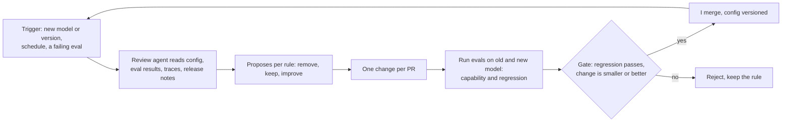

# 12. Every harness and skill rule is a bet about what the model cannot do, so a model change triggers a review that runs my evals, removes what is no longer needed and updates the rest

> Anthropic, OpenAI and the researchers agree on the loop: change one thing, run evals, keep or remove, version it. They differ on how much of it an agent may do alone, from Anthropic's human-run ablations to OpenAI's auto-merged cleanup agents to self-modifying research agents. I automate the review and keep the promotion with me.

Related: [W2L1 16 Evals for agent changes](../Week2_Lecture_1_Agent_Primitives/16_Evals_For_Agent_Changes.md) · [W2L1 23 Self-configuring harness](../Week2_Lecture_1_Agent_Primitives/23_Self_Configuring_Harness.md) · [W2L1 05 Instructions and enforcement](../Week2_Lecture_1_Agent_Primitives/05_Instructions_Five_Parts_And_Enforcement.md) · [Lecture 2: 7 Skill shaper](../Lecture_2_Context_Agents_md_Skills_Tools/7_skill_shaper_how_to_improve_skills.md) · [Lecture 5: 5 Agents maintain the tools I review](../Lecture_5_Workflows_not_tool_sets/05_Agents_Maintain_The_Tools_I_Review.md) · [W2L2 23 Wake and reflect agents](../Week2_Lecture_2_Building_an_Agent/23_Wake_And_Reflect_Agents_On_The_Market.md) · [10 Instruction precedence and tool pollution](10_Sys_Prompt_vs_Skills_Content_And_Threats.md) · [11 Relocating instructions between layers, skills, code and tools](11_How_To_Adjust_System_Prompt_And_Make_It_Flexible.md)

Source: S02E03 lesson, "Personalization", figure 2. Anthropic and OpenAI engineering posts and docs, Google DeepMind's AlphaEvolve post, arXiv abstracts, repository docs and vendor blogs, read on 2026-11-25. See [Fact-check](#fact-check).

## Glossary

| Term | What it means here | Same thing elsewhere | Not to be confused with |
|---|---|---|---|
| Periodic review | A scheduled or event-driven pass over my harness configuration | Harness upkeep, doc gardening | A one-time setup |
| Load-bearing | A rule or step the agent still needs on the current model | Scaffolding that earns its place | A rule that is merely old |
| Ablation | Remove one component and measure the result | Leave-one-out test | A rewrite |
| Capability eval | A hard case the agent mostly fails today | Hill to climb | Regression eval |
| Regression eval | A case that must keep passing | Safety net | A benchmark to maximize |
| Self-evolution | The agent changes its own prompt, skills or code from feedback | Self-improvement | An unreviewed self-edit |

## 1. The problem

The lesson says harness personalization is a loop. **What do the labs and researchers say about reviewing a harness and its skills when the model changes, driven by evals, and how far should an agent run that review itself?**

## 2. The figure

Source: S02E03 lesson, figure 2. Lesson caption: "Harness personalization is a loop, not a one-time setup. Each periodic review improves the configuration or removes what is not needed anymore."

- **Story:** a change in the model or harness starts a review, and the review may delete as well as add.
- **Important:** the red "remove" branch and the schedule. Most setups only add.
- **Not important:** the box names. The instruction in the configuration box is an example.

## 3. What the labs say

| Who | Statement | Type |
|---|---|---|
| Anthropic | "Every component in a harness encodes an assumption about what the model can't do on its own", and those "can quickly go stale". After Opus 4.5 the author dropped context resets, after Opus 4.6 the sprint construct. A radical cut failed, so he removed one component at a time. "When a new model lands, it is generally good practice to re-examine a harness" (2026-03-24) | Engineering post |
| Anthropic | A new model: run the suite to see which bets paid off. Capability evals graduate into the regression suite. Teams with evals upgrade "in days" (2026-01-09) | Engineering post |
| Anthropic | Migration: reduce guidance that pushed thoroughness or tool use. On Opus 5, remove verification instructions. Skills: write evals before docs, test with Haiku, Sonnet and Opus, and build my own runner | Docs |
| OpenAI | A roughly 100-line `AGENTS.md` as a map. A recurring doc-gardening agent opens fix-up PRs. "Golden principles" with background cleanup tasks, many auto-merged. The post says it may not generalize (2026-02-11) | Post |
| OpenAI | On migrating, revisit instructions such as "be concise". Evals: run them on every change. The Evals platform is read-only from 2026-10-31 and shuts down 2026-11-30 | Docs |
| OpenAI | A self-evolving cookbook (archived): a metaprompt agent rewrites a prompt until graders pass a threshold or retries run out, and engineers are alerted | Cookbook |
| Google DeepMind | AlphaEvolve: an evolutionary coding agent steered by automatic evaluators. Works where solutions can be verified. Reported 0.7% of Google's compute recovered (2025-05-14) | Blog |

## 4. What researchers and practitioners add

| Work | Idea | Result |
|---|---|---|
| GEPA (ICLR 2026) | Reflect on trajectories, evolve prompts | 6% over GRPO on average, up to 35 times fewer rollouts |
| ACE (ICLR 2026) | Evolving playbooks of context | +10.6% on agent tasks |
| Darwin Gödel Machine | An agent edits its own code, each change tested | SWE-bench 20.0% to 50.0%, run with sandboxing and human oversight |
| HarnessEvo (preprint) | Evolve four harness slots | No significant overall gain, value sits in the reflection slot, task-dependent |
| CASD (preprint) | One offline pass of rule distillation | Beats GEPA on 3 of 4 benchmarks, about $1.60 |
| Strong harness (preprint) | Harness against model size | The weakest model with the full pipeline beats the strongest alone, 0.948 to 0.806, on one task |
| LangChain | Trace, change the harness, rerun evals | Browser tool change cut median time from 182 s to 124 s |
| Hermes Agent | DSPy and GEPA evolve skills, each change a human-reviewed PR | Skills implemented, the rest planned (README) |
| Letta Mods | The agent changes its own harness | Mods can be disabled, no review gate stated |
| Manus | "Rebuilt our agent framework four times" | Blog |

## 5. Where they agree and differ

- **Agree:** evals drive the change. One change at a time. Remove as well as add. Keep versions and a way back.
- **Differ:** who promotes a change. OpenAI auto-merges cleanup PRs, Hermes requires human review, Letta states no gate, and research agents modify themselves inside sandboxes.
- **Tension:** the prompting guide says to dial back emphatic words, while the skills guide suggests "MUST filter" when a rule is missed. Both depend on the model, so I test it.
- **Evidence:** most results are benchmarks, preprints or vendor posts. The harness-value and CASD results are single studies.

## 6. My loop (my reasoning)

- **Assumption register:** each rule, hook, skill step and threshold states the weakness it compensates for and its eval. A rule can be removed when an ablation on the new model shows no loss. This is the lecture's "reason behind the principle" turned into a record.
- **Review scope:** instructions, hooks, skills, tool descriptions, step limits, retry code, compaction thresholds and model routing.
- **Guards:** the review agent cannot edit what guards it (W2L1 23). Evals are gates, not a score to maximize (Hermes' own rule). Size and purpose-drift limits, and a cost cap.
- **Order:** read-only review first, then proposals, then automated PRs, with the merge staying mine.

## Cautions

- Vendor posts describe their own systems. Results from ALFWorld or SWE-bench may not transfer to my agent.
- A self-modifying loop widens the attack surface. DGM ran in a sandbox with oversight.
- An eval set that is too small or stale lets a harmful removal pass.

## Summary

Every rule bets on a model weakness, and a new model can make the bet stale. The labs agree on a loop of one change, evals, keep or remove, and versioning. I schedule the review, let an agent propose, and keep the merge.

## Open questions

- Which of my rules state the weakness they cover, and which have an eval?
- Do I run the review on every model bump, on a schedule, or both?
- How large must my regression suite be before I let an agent open PRs?
- Where would the OpenAI Evals shutdown leave my eval runner?

## Fact-check

| # | Claim | Verdict | Source |
|---|---|---|---|
| 1 | Harness components encode assumptions, re-examine on a new model, remove one at a time | agrees | [Anthropic, 2026-03-24](https://www.anthropic.com/engineering/harness-design-long-running-apps) |
| 2 | New model: run the suite. Capability evals graduate. Upgrade in days | agrees | [Anthropic, 2026-01-09](https://www.anthropic.com/engineering/demystifying-evals-for-ai-agents) |
| 3 | Skills: evals first, test on three models, no built-in runner | agrees, docs undated | [Skill best practices](https://platform.claude.com/docs/en/agents-and-tools/agent-skills/best-practices) |
| 4 | Migration: reduce thoroughness guidance, remove Opus 5 verification instructions | agrees, docs undated | [Prompting best practices](https://platform.claude.com/docs/en/build-with-claude/prompt-engineering/claude-prompting-best-practices) |
| 5 | A 100-line map, doc-gardening agent, golden principles, auto-merge | agrees | [OpenAI, 2026-02-11](https://openai.com/index/harness-engineering/) |
| 6 | Revisit "be concise" on migration. Evals shut down 2026-11-30 | agrees, time-sensitive | [GPT-6.2 guide](https://developers.openai.com/api/docs/guides/latest-model/gpt-6.2-astra.md), [Evals best practices](https://developers.openai.com/api/docs/guides/evaluation-best-practices) |
| 7 | Cookbook loop with graders and retries | agrees. Rollback and approval advice from a summary. Archived | [Cookbook](https://developers.openai.com/cookbook/examples/partners/self_evolving_agents/autonomous_agent_retraining) |
| 8 | AlphaEvolve, 0.7% of compute | agrees, vendor blog | [DeepMind](https://deepmind.google/discover/blog/alphaevolve-a-gemini-powered-coding-agent-for-designing-advanced-algorithms/), [arXiv 2506.13131](https://arxiv.org/abs/2506.13131) |
| 9 | GEPA, ACE and DGM results | agrees, abstracts | [2507.19457](https://arxiv.org/abs/2507.19457), [2510.04618](https://arxiv.org/abs/2510.04618), [2505.22954](https://arxiv.org/abs/2505.22954) |
| 10 | HarnessEvo, CASD and the strong-harness result | agrees, preprint abstracts | [2609.02889](https://arxiv.org/abs/2609.02889), [2609.26261](https://arxiv.org/abs/2609.26261), [2610.19999](https://arxiv.org/abs/2610.19999) |
| 11 | LangChain trace, change, eval loop | agrees, blog | [LangChain, 2026-11-03](https://www.langchain.com/blog/how-we-optimized-browser-use-for-deep-agents) |
| 12 | Hermes guardrails and phases | agrees as the README's claim, code not read | [Hermes self-evolution](https://github.com/NousResearch/hermes-agent-self-evolution) |
| 13 | Letta Mods have no review gate. Manus rebuilt four times | agrees, blogs | [Letta](https://www.letta.com/blog/introducing-mods/), [Manus](https://manus.im/blog/Context-Engineering-for-AI-Agents-Lessons-from-Building-Manus) |
| 14 | A Claude Code team statement on removing scaffolding. LangChain and Letta posts I was told of | not found, not cited | searched 2026-11-25 |

## Sources

- The pages linked above. Sections 5 and 6 are my own reasoning.
