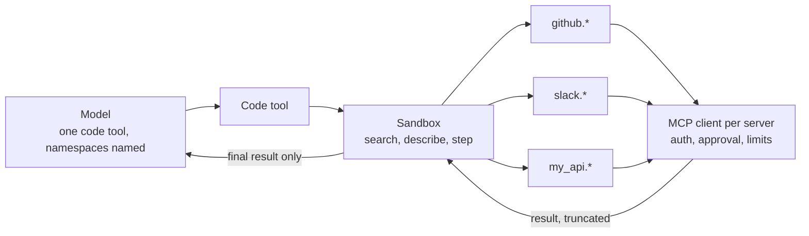

# 13. MCP has no lazy loading of its own, so "enabled" does not mean "loaded": with many servers the host defers tool definitions, a gateway hides them behind meta-tools, or code mode moves discovery into a sandbox

> The protocol lists tools and the host decides what reaches the model. Enabled-only stops scaling at around 30 to 50 tools. Past that, 2026 practice is three layers: an allowlist, deferred loading with a few always-on tools, and search and execute for API-sized or data-heavy servers, with writes kept as direct calls.

Related: [W2L1 08 Tool search instead of many tools](../Week2_Lecture_1_Agent_Primitives/08_Tool_Search_Instead_Of_Many_Tools.md) · [W2L1 09 Tool search and proxy gateway](../Week2_Lecture_1_Agent_Primitives/09_Tool_Search_And_Proxy_Gateway.md) · [W2L1 25 Tool execution instead of tool calls](../Week2_Lecture_1_Agent_Primitives/25_Tool_Execution_Instead_Of_Tool_Calls.md) · [W2L2 12 Sandbox for agent code](../Week2_Lecture_2_Building_an_Agent/12_Sandbox_For_Agent_Code_Pi_And_Search_Execute.md) · [05 Where the sandbox attaches](05_Where_The_Sandbox_Attaches_Tool_Node_Backend_Or_Run_Config.md) · [11 Sys prompt vs skills content and threats](11_Sys_Prompt_vs_Skills_Content_And_Threats.md)

Source: S02E03 lesson ("MCP", the 2,500-tool remark and code mode). Cloudflare's blog posts, repository and Agents docs (the X post could not be read, HTTP 402), the MCP spec 2026-07-28 and the Primitive Grouping working group, Anthropic and OpenAI docs, three gateway vendor blogs, read on 2026-11-25. See [Fact-check](#fact-check).

## Glossary

| Term | What it means here | Same thing elsewhere | Not to be confused with |
|---|---|---|---|
| Enabled | The tools my agent is allowed to use | Allowlist | Loaded |
| Loaded | The tool definitions actually sent to the model | In context | Enabled |
| Deferred loading | A definition is sent only after a search finds it | `defer_loading` | Disabled |
| Meta-tools | Two or three tools that find and run the real ones | `search` and `execute`, `get_tool` and `invoke_tool` | The real tools |
| Connector | One MCP server exposed as a namespace in code mode | `github.list_pull_requests()` | A transport |

## 1. The problem

I put only the enabled tools into the context. The number grows, and search plus execute and code mode change the picture. **What does the protocol do, and what is recommended in 2026 for several MCP servers without polluting the context?**

## 2. What the protocol does and does not do

- `tools/list` supports pagination and caching (`ttlMs`, `cacheScope`, definitions on a page I did not read). The set "MUST NOT vary per-connection" but "MAY vary by the authorization presented on the request", so a tenant can get a different list. Servers SHOULD return a deterministic order, which helps the host's prompt cache. Changes arrive as `notifications/tools/list_changed` on a `subscriptions/listen` stream.
- The pages I read contain no tool search, lazy loading or guidance that a client should not load everything. "Enabled" is a host concept. The protocol defines no such thing.
- Work is under way outside the spec. The Primitive Grouping interest group says its repository is experimental and "does not represent official MCP specifications". An open issue from a 70,000-tool catalog proposes that `tools/list` be non-exhaustive and a `tools/resolve` method fetch full definitions. I could not find SEP-1821 or SEP-1888, so I do not cite them.

## 3. Where enabled-only stops

- Anthropic's five-server example (GitHub 35 tools, Slack 11, Sentry, Grafana, Splunk) is about 55K tokens before the first message, and it has seen 134K. It says tool choice "degrades once you exceed 30–50" tools.
- With tool search on its MCP evals, Opus 4 went from 49% to 74% and Opus 4.5 from 79.5% to 88.1%. Both are Anthropic's own numbers.

## 4. Three ways to load less

| Layer | What the model sees | Numbers and limits | Cache |
|---|---|---|---|
| Deferred search (Anthropic, OpenAI, Claude Code) | A search tool, 3 to 5 always-loaded tools, names or a namespace line | Anthropic: 77K to 8.7K tokens, up to 10,000 deferred tools. OpenAI: keep each namespace under 10 functions | Anthropic keeps deferred tools out of the prefix. OpenAI: changing the loaded set "will break the model's cache from that point" |
| Gateway meta-tools (Solo agentgateway) | `get_tool` and `invoke_tool` in place of the upstream list | 10,877 to 970 prompt tokens, one prompt and one run | Fixed small list |
| Code mode (Cloudflare, Anthropic) | `search` and `execute` that take a `code` string | Cloudflare: about 1,000 tokens against 1.17 million for 2,594 tools, measured with tiktoken. Results capped near 6,000 tokens. Anthropic: 150,000 to 2,000, no method | Fixed small list |

Docker's MCP Gateway documents dynamic discovery of upstream tools, not a model-facing meta layer.

## 5. Code mode with several servers

- **Cloudflare's server** gives the model two core tools. `search` runs JavaScript against the OpenAPI spec, so "the full OpenAPI spec never enters the model context", and `execute` runs JavaScript in an isolate with no file system, no environment variables and fetch off by default. Its README says nothing about aggregating several servers. The blog lists that as future work, and `?codemode=false` exists to compose it with another code-mode system.
- **Cloudflare's Agents SDK** does the multi-server part: each `McpConnector` becomes a namespace, names must be unique, a collision throws, and `search(query)` and `describe(target)` run inside the sandbox. It offers `requiresApproval` pauses, `maxExecutions` of 50 by default and no outbound network by default. It is marked experimental.
- **Anthropic's variant:** servers become files under `./servers/<server>/`, discovered by listing, or by a `search_tools` call with a detail level.
- **Discovery moves, it does not vanish.** OpenAI's programmatic tool calling cannot see deferred tools in a running program, so the model loads them first. Writes and approval-sensitive actions stay direct calls "to preserve a clear authorization boundary".

## 6. What I would do (my reasoning)

| Situation | Strategy |
|---|---|
| Up to roughly 20 tools, all used often | Enabled equals loaded |
| Dozens of tools or several servers | Allowlist, then defer by server, keep 3 to 5 tools always loaded |
| An API-sized server, or large results, or three or more dependent calls | Search and execute behind a sandbox |
| Writes, payments, anything needing approval | Direct calls, never inside the program |

- Keep the allowlist as the policy layer and add a loading layer under it. Order tools deterministically and append loaded ones late, so the cache holds.
- In code mode a third party's descriptions reach the model as search results, so as tool results and not as tool definitions. Under note 11's reading, that gives them less authority. This is my reasoning.
- Measure before adopting: the same task set loaded flat, deferred and in code mode, scoring tool-selection correctness, tokens and time.
- The sandbox, its wall and the tenant-bound bridge are in notes 04, 05 and 07.

## 7. A correction to the lesson

The lesson says code mode makes it possible to load 2,500 tools. In Cloudflare's design the endpoints are not loaded as tools: the model sees two tools, and the spec is searched in a sandbox. Cloudflare's native alternative would be 2,594 tools and 1,170,523 tokens.

## Cautions

- Cloudflare, Solo and bex numbers are vendor measurements. Solo's is one prompt per mode, and bex's table is secondhand.
- Multi-server code mode is experimental in Cloudflare's SDK.
- Not read: Speakeasy's dynamic toolsets, the MCP security best-practices, pagination and caching pages, the X post.

## Summary

The protocol lists tools and leaves loading to the host. I keep my allowlist, defer definitions behind it, and use search and execute for API-sized servers. Writes stay direct, and I measure each layer on my own tasks.

## Open questions

- How many tools and servers do I enable today, and what do their definitions cost in tokens?
- Does my host defer MCP tools, and which of my servers are API-sized?
- Does my stateless server return per-tenant lists, and what does that do to the cache?

## Fact-check

| # | Claim | Verdict | Source |
|---|---|---|---|
| 1 | `tools/list` paginates and caches. The set may vary by authorization. Deterministic order. `list_changed` | agrees | [Tools spec 2026-07-28](https://modelcontextprotocol.io/specification/2026-07-28/server/tools) |
| 2 | No tool search or lazy loading in the spec pages read | agrees, by absence. Three pages unread | same page, [spec index](https://modelcontextprotocol.io/specification/2026-07-28/) |
| 3 | The working group is experimental. Issue 18 proposes `tools/resolve` | agrees | [progressive-disclosure-wg](https://github.com/modelcontextprotocol/progressive-disclosure-wg), [issue 18](https://github.com/modelcontextprotocol/progressive-disclosure-wg/issues/18) |
| 4 | SEP-1821 and SEP-1888 | not found, not cited | [SEP index](https://modelcontextprotocol.io/seps/) |
| 5 | 55K tokens for five servers, 30 to 50 tool degradation, 49% to 74% and 79.5% to 88.1% | agrees, Anthropic's own | [Anthropic, 2025-11-24](https://www.anthropic.com/engineering/advanced-tool-use) |
| 6 | Up to 10,000 deferred tools, kept out of the prefix, 3 to 5 always loaded | agrees | [Tool search tool](https://platform.claude.com/docs/en/agents-and-tools/tool-use/tool-search-tool) |
| 7 | Namespaces under 10 functions, loaded set changes break the cache | agrees | [OpenAI tool search](https://developers.openai.com/api/docs/guides/tools-tool-search) |
| 8 | Deferred tools unavailable to a running program, writes as direct calls | agrees | [OpenAI programmatic tool calling](https://developers.openai.com/api/docs/guides/tools-programmatic-tool-calling) |
| 9 | Two core tools, about 1,000 tokens against 1.17 million, tiktoken, isolate, OAuth 2.1 | agrees, vendor blog, 2026-02-20 | [Cloudflare](https://blog.cloudflare.com/code-mode-mcp/) |
| 10 | 2,594 tools, 1,170,523 tokens, 6,000-token result cap, `?codemode=false` | agrees | [cloudflare/mcp](https://github.com/cloudflare/mcp) |
| 11 | One namespace per connector, collisions throw, approval pause, 50 executions, experimental | agrees | [Agents Code Mode](https://developers.cloudflare.com/agents/tools/codemode/) |
| 12 | 150,000 to 2,000 tokens with filesystem discovery | agrees as a claim, no method | [Anthropic, 2025-11-04](https://www.anthropic.com/engineering/code-execution-with-mcp) |
| 13 | 10,877 to 970 prompt tokens in Search mode | agrees, vendor blog, one run | [Solo](https://www.solo.io/blog/keeping-context-and-tokens-low-with-progressive-disclosure-in-agentgateway) |
| 14 | Docker's gateway has no documented model-facing meta layer | agrees, by absence | [docker/mcp-gateway](https://github.com/docker/mcp-gateway) |
| 15 | The lesson's "load 2,500 tools" | differs: the endpoints are searched, not loaded | Cloudflare blog and README |
| 16 | The tiers, the authority reading and the measurement plan | lecture-independent, my reasoning | |

## Sources

- The pages linked above. Section 6 is my own reasoning.
