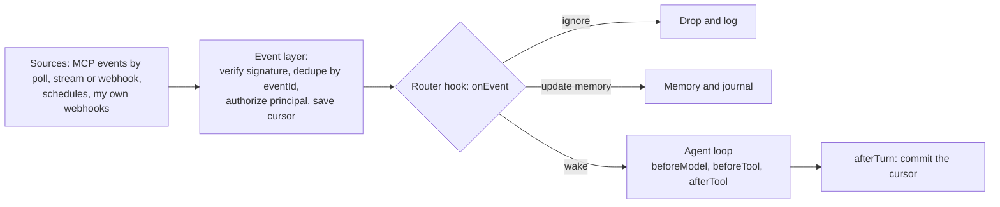

# 14. MCP Events let a server push upstream occurrences to an agent by poll, stream or webhook, and my hooks can be organized around them if events are the input and hooks stay the control point

> Events is a Beta extension: a server lists event types, a client subscribes, and the model sees only the events that arrive. How an event reaches the agent is left to the harness, so a layer that verifies, dedupes, authorizes and routes events before they wake the loop is where my lifecycle hooks and external events meet. Support is early: ChatGPT takes webhooks, Claude Code has a separate channels feature, and both SDKs have only open pull requests.

Related: [W2L1 20 Loop hooks declared](../Week2_Lecture_1_Agent_Primitives/20_Loop_Hooks_Declared.md) · [Lecture 2: 3 Lifecycle hooks](../Lecture_2_Context_Agents_md_Skills_Tools/3_lifecycle_hooks.md) · [W2L2 16 Memory-centric approach with events](../Week2_Lecture_2_Building_an_Agent/16_Memory_Centric_Approach_With_Events.md) · [W2L2 22 Long-horizon runs and watchers](../Week2_Lecture_2_Building_an_Agent/22_Long_Horizon_Runs_Concurrency_Durability_Watchers.md) · [Lecture 3: 12 Knowledge update triggers](../Lecture_3_Simplify_Codebase_&_Knowledge_Base/12_Knowledge_Event_&_Triggers.md) · [07 Sandbox against jailbreak and prompt injection](07_Sandbox_Against_Jailbreak_And_Prompt_Injection_Per_Tenant.md) · [11 Sys prompt vs skills content and threats](11_Sys_Prompt_vs_Skills_Content_And_Threats.md) · [16 MCP events in real systems](16_MCP_Events_In_Real_Systems.md)

Source: S02E03 lesson (the "Events (draft)" link in the MCP section). The design sketch (draft proposal, 2026-02-19, last part read through a summary), the working-group repository, SEP-3415, the extensions overview and client matrix, ChatGPT's MCP events page, Claude Code's MCP and channels docs, SDK pull request titles, read on 2026-11-25. See [Fact-check](#fact-check).

## Glossary

| Term | What it means here | Same thing elsewhere | Not to be confused with |
|---|---|---|---|
| Event | `{eventId, name, timestamp, data, cursor}` that happened in an upstream system | Webhook payload | A `notifications/*` message |
| Subscription | `(name, arguments)` the client wants, with a server-granted lifetime | Webhook registration | A resource subscription |
| Cursor | An opaque position the client stores to resume | Offset, watermark | A page token |
| Channel | Claude Code's research-preview way for a server to push messages into a session | Push connector | MCP Events |
| Hook | A deterministic callback at a fixed point that can block or change | Lifecycle hook | An event source |

## 1. The problem

I thought of MCP as tools my agent calls. Events make a server something that tells the agent. **What is it, how well is it supported, and can my hooks be organized around it?**

## 2. What Events is

| Mode | Method | When | Notes |
|---|---|---|---|
| Poll | `events/poll` with a cursor | Stateless or serverless servers, clients behind NAT | Returns `nextPollMs`. The model runs only when `events[]` is not empty |
| Push | `events/stream`, a long-lived request | Low latency, stdio or Streamable HTTP | Heartbeats carry the cursor |
| Webhook | `events/subscribe` with a URL and secret | Remote servers | A 2xx means accepted. Retries are bounded |

- `events/list` returns each event type with a name, description, delivery modes, an input schema and a payload schema. Replay is optional per type, `eventId` is for dedup, and webhook delivery can arrive out of order.
- A subscription has a server-granted lifetime: the client suggests `ttlMs`, the server answers `refreshBefore`.
- Existing notifications "carry no parameters", "need a live connection" and "cannot be resumed". Events add parameters, cursors and replay.

## 3. Status, in layers

- **Design sketch:** a draft proposal dated 2026-02-19.
- **Repository:** an incubation space for the Triggers and Events Working Group, "exploratory" and "not official".
- **SEP-3415** "Events Extension": Final, Extensions Track, created 2026-10-05, for protocol revision 2026-07-28 and later.
- **The extension:** `io.modelcontextprotocol/events`, stage Beta, "destination not yet stated". Breaking changes "are expected to be rare".

## 4. Security the sketch asks for

- Unauthenticated servers may offer poll and push, not webhooks.
- Webhooks use Standard Webhooks signing (HMAC-SHA256, a `whsec_` secret, a five-minute freshness window), https callbacks, SSRF checks, no redirects and a verification handshake.
- "Event payloads ... untrusted data with the same injection considerations as tool results." "Receipt of an event does NOT constitute authorization to act."

## 5. Support today

| Where | Status |
|---|---|
| ChatGPT | Webhook only, no polling or streaming. The event arrives in the subscribed chat, which follows the user's instructions. Bodies up to 256 KiB, out-of-order possible, missed events not recoverable without replay |
| Claude Code | No Events found. A separate research-preview channels feature lets a server push messages into a session, and "events only arrive while the session is open" |
| TypeScript SDK | Open pull requests #3209 (Events extension) and #3203, from 2026-11-18 and 19 |
| Python SDK | Open pull request #3822, poll and webhook, from 2026-11-05 |
| Codex, VS Code, Goose, Pi | Not searched |

Neither released SDK README mentions Events, and the repository lists no reference implementation yet.

## 6. Hooks around events (my idea)

| | Lifecycle hook | Event |
|---|---|---|
| Direction | Control inside a turn | Input that starts or informs a turn |
| Timing | Synchronous | Asynchronous, possibly late or repeated |
| Can block | Yes | No, it can be ignored |

- The sketch says "the client SDK chooses the mode and runs the loop. The model sees only the events that arrive", and leaves open how an event reaches the agent: as context, as a new turn or queued. My harness decides, and the router hook is that decision.
- The cursor is the durable part: I save it after the turn, so a restart resumes (W2L2 22). The event list feeds the journal (W2L2 16).
- I found no hook for MCP events in Claude Code. The layer would be my own code.

## 7. Is it worth building on now, and what follows

| Case | Build on MCP Events now? | Why |
|---|---|---|
| My agent reacts to my own systems (my webhooks, my schedules) | No: build the event layer, shaped like MCP events | The extension adds nothing there, and the shape makes a later mapping cheap |
| I consume a third-party MCP server that offers events | Yes, through a host that supports them (ChatGPT, by webhook) | The host does the subscription |
| I run a stateless MCP server with an upstream source worth exposing | Not yet: no released SDK support. Poll mode would fit | Wait for the SDK pull requests |
| My users run Claude Code | Use channels for pushes, a separate feature | Claude Code has no Events |
| I need guarantees across restarts | Only with replay | Replay is optional per event type |

| | Build the event layer now | Wait for the SDKs | Avoid events |
|---|---|---|---|
| Behavior | The agent reacts to the world | It stays pull-only until then | It stays pull-only, with cron polling that costs calls and delay |
| Work | I own verification, dedupe, cursor, loop guard and coalescing | None yet | None |
| Security | A new untrusted input channel, with the cost of gating it | None | None |
| Migration | A mapping, if inputs have the event shape | Build from scratch later | Not applicable |
| Stability | Beta extension, breaking changes "expected to be rare" | Waits out the churn | Not applicable |

Real systems, the market and the failure modes are in [16 MCP events in real systems](16_MCP_Events_In_Real_Systems.md).

## Cautions

- The extension is Beta and the sketch is a draft. The last part of the sketch and parts of the SEP came through summaries.
- ChatGPT's page names the callback error `-32015`, the spec text `-32027`, and the sketch calls its numbers provisional.

## Summary

Events turn an MCP server into a source that informs the agent, with three delivery modes, cursors and signed webhooks. Support is early. I organize hooks around it by putting an event layer in front of the loop that verifies, dedupes, authorizes and routes, and keeping lifecycle hooks as the control points inside the turn.

## Open questions

- Which of my MCP servers have an upstream source worth exposing as an event?
- Where does my harness save cursors, and who commits them?
- Do I build my own event layer now, or wait for the SDKs?

## Fact-check

| # | Claim | Verdict | Source |
|---|---|---|---|
| 1 | The extension is `io.modelcontextprotocol/events`, Beta, destination not yet stated | agrees | [Extensions overview](https://modelcontextprotocol.io/extensions/overview) |
| 2 | SEP-3415 is Final, Extensions Track, created 2026-10-05 | agrees, partly from a summary | [SEP-3415](https://github.com/modelcontextprotocol/modelcontextprotocol/blob/main/seps/3415-events-extension.md) |
| 3 | The sketch is a draft proposal. The repository is experimental | agrees | [Design sketch](https://github.com/modelcontextprotocol/experimental-ext-triggers-events/blob/main/docs/design-sketch-proposal.md), [ext-events](https://github.com/modelcontextprotocol/ext-events) |
| 4 | Methods, delivery modes, cursors, ttl and the event shape | agrees. The last part of the sketch came from a summary | same pages, [events spec](https://github.com/modelcontextprotocol/ext-events/blob/main/specification/beta/events/events.mdx) |
| 5 | Signing, unauthenticated servers, untrusted payloads, receipt is not authorization | agrees, partly from a summary | design sketch |
| 6 | Events differ from notifications and Tasks | agrees. The Tasks part is from a summary | SEP-3415 |
| 7 | ChatGPT supports webhook delivery only | agrees | [ChatGPT MCP events](https://developers.openai.com/plugins/build/mcp-events) |
| 8 | Claude Code has channels, no Events found | agrees, MCP page partly summarized | [Channels](https://code.claude.com/docs/en/channels), [MCP docs](https://code.claude.com/docs/en/mcp) |
| 9 | Open SDK pull requests | agrees from titles. I did not open them | [typescript-sdk](https://github.com/modelcontextprotocol/typescript-sdk), [python-sdk](https://github.com/modelcontextprotocol/python-sdk) |
| 10 | Which error code number is current | unverified | rows 3 and 7 |
| 11 | The event layer, the router hook, the cursor commit, and the cases and consequences in section 7 | lecture-independent, my reasoning | |

## Sources

- The pages linked above. Sections 6 and 7 are my own reasoning.
