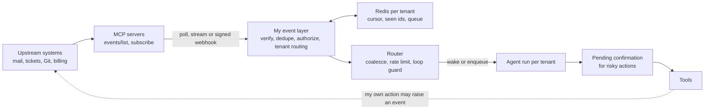
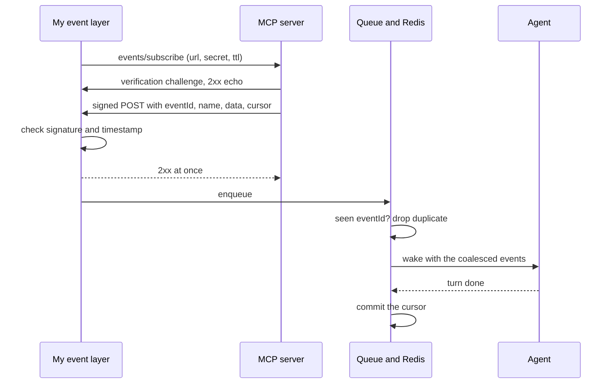

# 14. Event-driven agents already ship without MCP Events, so its value is a standard way to discover and subscribe, while the hard parts stay mine: duplicates, disorder, loops, injection and cost

> Google, Cloudflare, LangChain, Claude Code and ChatGPT each wake an agent from an external event in their own way, and webhooks bring known problems: duplicates, no ordering, short timeouts. MCP Events adds discovery of event types, per-principal subscriptions and optional replay behind one interface. It does not remove the work of verifying, deduping, coalescing, guarding against loops and treating payloads as untrusted.

Related: [13 MCP events and lifecycle hooks](13_MCP_Events_And_Lifecycle_Hooks.md) · [16 Human confirmation across AG-UI, A2A and MCP channels](16_Human_Confirmation_Across_AG-UI_A2A_And_MCP_Channels.md) · [20 Sandbox against jailbreak and prompt injection](20_Sandbox_Against_Jailbreak_And_Prompt_Injection_Per_Tenant.md) · [W2L2 16 Memory-centric approach with events](../Week2_Lecture_2_Building_an_Agent/16_Memory_Centric_Approach_With_Events.md) · [W2L2 22 Long-horizon runs and watchers](../Week2_Lecture_2_Building_an_Agent/22_Long_Horizon_Runs_Concurrency_Durability_Watchers.md)

Source: first-party docs and posts read on 2026-11-25: LangChain's ambient agents post (2025-01-14), Google ADK's ambient agents page, Cloudflare Agents, Inngest, Claude Code channels and GitHub Actions, ChatGPT's MCP events page, Microsoft Copilot Studio's overview, Stripe, GitHub and Standard Webhooks, CloudEvents. Not covered: Codex automations and GitHub's Copilot coding agent (the fetch was denied), Bedrock AgentCore, Gemini Enterprise, LangGraph's cron and webhook docs. See [Fact-check](#fact-check).

## 1. The problem

Note 13 explains MCP Events. **Where does an event source pay in a real system, what does the market already do, and what must I build regardless?**

## 2. Where it pays

| Event | The agent does | Human gate | Main risk |
|---|---|---|---|
| `incident.created` (the sketch's PagerDuty example) | Gathers context, proposes runbook steps | Destructive steps (note 16) | Acting on a stale or duplicate alert |
| `email.received`, `ticket.created` | Triages, drafts a reply | The send | The body is attacker-written text |
| Push, pull request, CI failure | Reviews, explains the failure | Merge | An agent action that triggers the next event |
| `order.status_changed`, stock below a threshold | Proposes an exchange or a reorder | The commit | Duplicates and reordering change the decision |
| Anomaly in a metric | Investigates, writes to memory | None for reads | Cost: one model turn per event |
| Calendar or location change (ambient assistant) | Adjusts or notifies | Notify, ask or review | Waking too often |

## 3. A real system

## 4. One event's life

## 5. What goes wrong, and what I do

| Problem | What the sources say | What I do |
|---|---|---|
| Duplicates | Stripe: the same event "more than once". Standard Webhooks: use `webhook-id` as an idempotency key, "save the IDs in redis for 5 minutes". MCP: `eventId` for dedup | A seen-ids set per subscription with a TTL longer than the retry window |
| Disorder | Stripe: no ordering guarantee. MCP: webhook deliveries may arrive out of order | Never trust arrival order. Read current state with a tool before acting |
| Slow handler | GitHub: respond in 10 seconds. Standard Webhooks senders time out in 15 to 30 seconds | Acknowledge at once, then queue |
| Downtime | Stripe retries for up to three days. Replay is optional per MCP event type. ChatGPT cannot recover missed events of non-replay types | Persist the cursor, reconcile by polling or a tool call |
| Loops | Claude Code Actions reject bot actors unless allowed. GitHub's page says nothing on loops | Tag my own actions and drop the events they cause |
| Floods and cost | Claude Code channels deliver together on the next turn. ChatGPT may batch events into one run | Coalesce, rate limit per tenant, cap turns per hour |
| Injection | Claude Code: "An ungated channel is a prompt injection vector". MCP: receipt of an event is not authorization | Gate by sender id, treat data as untrusted, authorize each action apart |
| Open approval path | Claude Code: "Anyone who can reply through the channel can approve or deny tool use" | No approvals over a channel that others can write to |
| Secrets | Standard Webhooks signatures allow key rotation. Stripe rolled secrets live up to 7 days | Support two secrets during rotation |

## 6. What the market does

| Who | How an event reaches the agent | Note |
|---|---|---|
| LangChain ambient agents (2025-01-14) | An event stream, mostly cron checks in LangGraph Platform. Human patterns: notify, question, review in an Agent Inbox | No delivery semantics described |
| Google ADK | Pub/Sub push and Eventarc CloudEvents to trigger endpoints, off by default. A new session per event, 200 acknowledges, 500 redelivers, 10-minute ack deadline | No discovery or cursor |
| Cloudflare Agents | Schedules in SQLite that survive restarts, a webhook handler that verifies and routes to an entity's agent, inbound email routing | Dedup is user code |
| Inngest, Temporal | `step.waitForEvent` pauses a run until a match, and sees only events sent after it starts listening. Temporal Signals not read | |
| Claude Code | Channels push into a live session (research preview), and GitHub Actions react to mentions, pull requests and cron, with write-access and human-actor checks | Channels are not MCP Events |
| ChatGPT | MCP Events by webhook into subscribed chats | The first host support I found |
| Microsoft Copilot Studio | Triggers (preview), and Hooks that run at lifecycle points such as session start | Triggers and hooks are separate, as in note 13 |
| Standards | CloudEvents describes the envelope. Standard Webhooks describes signing and retries | Neither describes subscription |

None of these pages describes event-type discovery, per-principal subscriptions, cursor replay or three delivery modes. That is what MCP Events adds. The market confirms the shape (event, queue, agent run), the human patterns and the failure modes, and MCP Events does not change them.

## 7. What I would build, in order (my reasoning)

1. The event layer: verify, acknowledge fast, queue, dedupe, save the cursor.
2. The router: coalescing, per-tenant rate limits, a loop guard.
3. The confirmation path for risky actions (note 16), and sender gating for anything a person can write to.
4. A polling reconciliation job, even where webhooks exist.
5. A mapping to MCP Events once the SDKs ship, because the inputs already have its shape.

## Cautions

- The market rows come from vendor docs, several undated. Cloudflare's dates are 2026-10-27 and 29, and Copilot Studio's 2026-11.
- Codex automations and GitHub's Copilot coding agent are unchecked.
- AWS's event-storm page returned no readable text.

## Summary

Agents woken by events are already normal, and the work is the same everywhere: verify, acknowledge fast, dedupe, coalesce, guard loops, treat payloads as untrusted and keep a cursor. MCP Events standardizes discovery and subscription, so I build the layer once in its shape.

## Open questions

- Which of my events would flood the agent, and what is my coalescing window?
- How do I recognize the events caused by my own actions?
- What does reconciliation read when a webhook was missed?

## Fact-check

| # | Claim | Verdict | Source | Checked |
|---|---|---|---|---|
| 1 | Ambient agents listen to an event stream. LangGraph Platform has cron. Patterns: notify, question, review | agrees, 2025-01-14 | [LangChain](https://www.langchain.com/blog/introducing-ambient-agents) | 2026-11-25 |
| 2 | ADK triggers: Pub/Sub, Eventarc, off by default, new session per event, 200 and 500, 10-minute deadline | agrees, page undated | [ADK ambient agents](https://adk.dev/runtime/ambient-agents/) | 2026-11-25 |
| 3 | Cloudflare schedules, webhooks, email routing | agrees | [Cloudflare Agents](https://developers.cloudflare.com/agents/) | 2026-11-25 |
| 4 | `waitForEvent` sees only later events. Delivery semantics not stated | agrees | [Inngest](https://www.inngest.com/docs/features/inngest-functions/steps-workflows/wait-for-event) | 2026-11-25 |
| 5 | Channels: capability, batching, sender gating, injection warning, permission relay warning, research preview | agrees | [Channels](https://code.claude.com/docs/en/channels), [reference](https://code.claude.com/docs/en/channels-reference) | 2026-11-25 |
| 6 | GitHub Actions triggers and guards | agrees | [Claude Code GitHub Actions](https://code.claude.com/docs/en/github-actions) | 2026-11-25 |
| 7 | ChatGPT takes webhook events, may batch | agrees | [ChatGPT MCP events](https://developers.openai.com/plugins/build/mcp-events) | 2026-11-25 |
| 8 | Copilot Studio has triggers (preview) and lifecycle Hooks | agrees in part, overview only | [Copilot Studio](https://learn.microsoft.com/en-us/microsoft-copilot-studio/agents-experience/overview) | 2026-11-25 |
| 9 | Stripe: retries up to three days, duplicates, no ordering, respond fast, queue | agrees, partly from a summary | [Stripe](https://docs.stripe.com/webhooks) | 2026-11-25 |
| 10 | GitHub: 10 seconds, redelivery, delivery id. Loops not covered | agrees | [GitHub](https://docs.github.com/en/webhooks/using-webhooks/best-practices-for-using-webhooks) | 2026-11-25 |
| 11 | Standard Webhooks: signing, `webhook-id` as idempotency key, retry schedule, 15 to 30 second timeout. At-least-once not stated | agrees | [Standard Webhooks](https://github.com/standard-webhooks/standard-webhooks/blob/main/spec/standard-webhooks.md) | 2026-11-25 |
| 12 | CloudEvents describes the envelope only | agrees | [CloudEvents](https://cloudevents.io) | 2026-11-25 |
| 13 | None of the pages read has discovery, per-principal subscriptions, replay or three modes | agrees, by absence | rows 1 to 12 | 2026-11-25 |
| 14 | Codex automations, the Copilot coding agent, AgentCore, Gemini Enterprise, LangGraph cron docs | not covered | | 2026-11-25 |
| 15 | The use cases, the architecture and the build order | lecture-independent, my reasoning | | 2026-11-25 |

## Sources

- The pages linked above. Sections 2, 3, 4 and 7 are my own reasoning.
