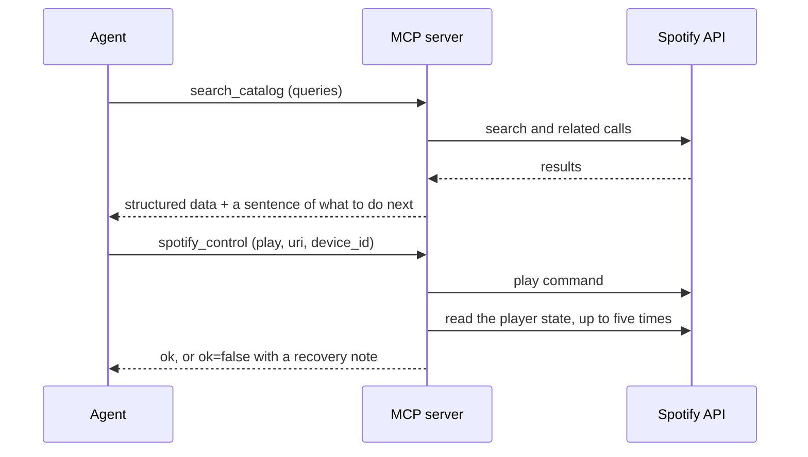
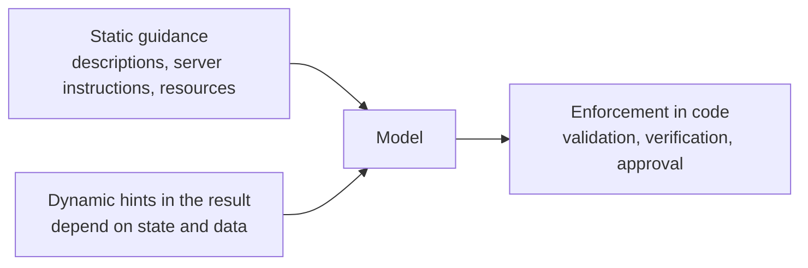

# 17. A tool result that says what can be done next is hypermedia for agents: the Spotify server does it in prose and keeps correctness in code, and it works when hints are options, depend on state and never include an approval

> HATEOAS means the server's response carries the next legal moves, so the client needs no prior map. In MCP the same idea fits as hints in a tool result. The lecturer's figure shows a `hints` array and a general `api` tool, while his published server delivers the idea with a sentence for the model, recovery notes and usage notes, and verifies playback in code. Evidence for the pattern is opinion and one small self-run test.

Related: [13 MCP tools loading and code mode with many servers](13_MCP_Tools_Loading_And_Code_Mode_With_Many_Servers.md) · [15 MCP server instructions and harness support](15_MCP_Server_Instructions_And_Harness_Support.md) · [09 Human confirmation across channels](09_Human_Confirmation_Across_AG-UI_A2A_And_MCP_Channels.md) · [11 Sys prompt vs skills content and threats](11_Sys_Prompt_vs_Skills_Content_And_Threats.md) · [W2L2 15 Tool navigation and flexibility](../Week2_Lecture_2_Building_an_Agent/15_Tool_Navigation_And_Flexibility.md)

Source: S02E03 lesson, figure 9 and its closing line ("MCP is not just an interface... but also a way to shape that interaction"). The lecturer's Spotify MCP server (README, output schemas, search tool, playback doc, matches for hints in the other tool files; not every file). Fielding (2008), Fowler (2010), Siren, OpenAPI Links and Arazzo, Anthropic's tool-writing article, four commentary posts, read on 2026-11-25. See [Fact-check](#fact-check).

## Glossary

| Term | What it means here | Same thing elsewhere | Not to be confused with |
|---|---|---|---|
| HATEOAS | The response carries the next available transitions | Hypermedia controls (Richardson level 3) | Documentation |
| Affordance | An option the result shows: what can be done and how | Link, Siren action | A command |
| Hint | A short line in a tool result naming a next call | `hints[]`, `_msg` | Enforcement |
| Escape hatch | One general tool that keeps the rest of the API reachable | `api({ method, path, body })` | A curated tool |

## 1. The problem

The lesson's Spotify example returns an answer plus how to continue. **Is this HATEOAS, what do others say, and how would I use it in real systems?**

## 2. The figure

Source: S02E03 article, figure 9. Caption: "One MCP tool calls three API endpoints and joins their results. The result tells the agent what it can do next, and a general tool keeps the rest of the API open." The query, tracks, cursor and `api` tool are example values.

- **Story:** three calls become one, and the result adds what to do next.
- **Important:** the red `hints` and the general tool. **Not important:** the sample tracks.

## 3. The figure against the published server

| In the figure | In the repository (README, schemas, search tool, playback doc) |
|---|---|
| One `search` tool | Five tools: `player_status`, `search_catalog`, `spotify_control`, `spotify_playlist`, `spotify_library`, each taking a batch |
| A `hints` array | Not found. Each result has `_msg`, a sentence for the model, plus structured data. A comment says `player_status` writes "what is playing where, or what to do next" |
| A general `api` tool | Not found in the files I read |
| A `next` cursor | Not in the output schema I read, offset and limit are inputs |
| (not shown) | Usage notes in tool descriptions ("Use `player_status` first to get a `device_id`") and recovery notes on failures |
| (not shown) | `play` and `transfer` are checked by reading the player state back up to five times, and the command is never resent |

So the idea reaches production as prose, notes and server-side verification. Next-step knowledge lives in the server.

## 4. Is it HATEOAS?

| Source | What it says | Fit |
|---|---|---|
| Fielding (2008) | A client is "entered with no prior knowledge beyond the initial URI", and transitions are "driven by client selection of server-provided choices that are present in the received representations" | Partial. The agent knows the tools in advance, and the hints are choices among them |
| Fowler (2010), level 3 | "The point of hypermedia controls is that they tell us what we can do next" | Close |
| Siren | Links are "navigational transitions", actions carry a name, href, method and fields | A hint is a light action: a name, an argument shape and no method |
| OpenAPI Links and Arazzo | Design-time links between operations and workflows. OpenAPI contrasts them with "dynamic links (i.e. links provided in the response payload)" | The runtime counterpart |
| MCP itself | Tool results can carry resource links, list results page with `nextCursor` | Native hypermedia pieces |

The honest label is hypermedia controls for an agent that already knows the vocabulary. A hint also tells the model nothing about which option makes sense, a point one commentator makes against calling it a full answer.

## 5. How guidance and state fit together

The split: static text for what never changes, hints for what depends on this result, code for what must hold.

## 6. Is it worth it, and what follows

| Case | Use result hints? | Why |
|---|---|---|
| The next step depends on data or state (a cursor, a URI, a device) | Yes | Only the result knows it |
| A multi-step flow over many tools | Yes, short | It replaces a long skill with steps the server owns |
| One-shot tools | No | The description is enough |
| An approval or confirmation | No: never as a hint | A hijacked model could take it (note 09) |
| A rule that must hold | No: code | A hint can be ignored |

| | With hints | Without |
|---|---|---|
| Behavior | Fewer wrong or aimless calls. One self-run test of 10 runs on a 7-tool flow went from 3.5 errors to 0.0 | The model plans from descriptions and its own memory |
| Tokens | A few lines per result | None |
| Security | Text from the server inside a tool result. A general `api` tool widens the reach | Less surface |
| Maintenance | Hints must match the tools and the current state | None |
| Control | The server owns the workflow and can change it without prompt edits | The workflow lives in prompts and skills |

## 7. What others say

- **Standards lineage:** Fielding, Fowler, Siren, OpenAPI Links and Arazzo describe the idea for humans and clients.
- **Anthropic:** "If you choose to truncate responses, be sure to steer agents with helpful instructions", errors should be actionable, and consolidated tools beat many endpoint tools. Its guide on injection says "Don't put your own instructions in tool results", which is about the application's own commands, so hints stay options.
- **Commentary:** Nordic APIs (2025-09-25) argues HATEOAS suits agents and gives no data, and admits it adds complexity. A 2026-04-04 post tested state-guided tools with GPT-4o-mini over 10 runs: 0.0 against 3.5 errors on a 7-tool flow, 0.0 against 0.1 on a 15-tool flow, and the author found the links approach "clunky" and moved to filtering tools by state. A project, `hateoas-agent`, shows only valid actions per state, has no measurements, and says its transition checks are opt-in.
- **Nothing rigorous found.** Two Medium posts were unreadable.

## 8. In my system (my reasoning)

- One `actions` list per result, `{ id, label, tool, args, requiresHuman }`: my React card renders buttons from it, and the model sees only the entries that do not need a human.
- Pagination cursors and continuation for my OData reads become hints with the next call written out.
- A general escape hatch only behind approval, and never over a tenant boundary (note 07).

## Cautions

- I read the README, output schemas, search tool, playback doc and matches in the other tool files, not every file, so "not found" means not found there.
- The one experiment is self-designed. The `hateoas-agent` claim "wrong choice impossible" is stronger than its own README supports.

## Summary

Hints in a tool result are hypermedia controls for an agent. They pay when the next step depends on state or data, they are options and never approvals, and correctness stays in server code, as the Spotify server's playback check shows.

## Open questions

- Which of my tools return a result where the next call depends on it?
- Should my `actions` list drive both the card and the model hints?
- Do I need an escape hatch at all?

## Fact-check

| # | Claim | Verdict | Source |
|---|---|---|---|
| 1 | The server has five batch tools and results with `_msg` and structured data. No `hints` or `api` found | agrees in the files read | [Spotify MCP server](https://github.com/iceener/spotify-streamable-mcp-server) |
| 2 | Playback is verified by reading state back up to five times | agrees | repository `docs/playback.md` |
| 3 | Fielding's rules on entry and transitions | agrees, the post's first part verbatim | [Fielding, 2008](https://roy.gbiv.com/untangled/2008/rest-apis-must-be-hypertext-driven) |
| 4 | Level 3 hypermedia controls tell us what we can do next | agrees | [Fowler, 2010](https://martinfowler.com/articles/richardsonMaturityModel.html) |
| 5 | Siren links and actions | agrees | [Siren](https://github.com/kevinswiber/siren) |
| 6 | OpenAPI links are design-time. Arazzo describes call sequences | agrees, Arazzo detail from a summary | [OpenAPI](https://spec.openapis.org/oas/latest.html#link-object), [Arazzo](https://spec.openapis.org/arazzo/latest.html) |
| 7 | Steer with instructions on truncation, actionable errors, consolidated tools | agrees | [Anthropic, 2025-09-11](https://www.anthropic.com/engineering/writing-tools-for-agents) |
| 8 | 10-run test: 0.0 against 3.5 errors, 0.0 against 0.1 | agrees as reported, self-designed, one cheap model | [Ganz, 2026-04-04](https://thecout.com/blog/mcptooling/) |
| 9 | `hateoas-agent` shows only valid actions and has no benchmarks | agrees | [hateoas-agent](https://github.com/coloradored13/hateoas-agent) |
| 10 | HATEOAS gives allowed actions, not which makes sense | agrees as one commentator's argument | [DEV article](https://dev.to/sreeni5018/stop-sending-every-decision-to-an-llm-code-vs-jev-vs-claude-32e4) |
| 11 | The hype claim that HATEOAS solves tool selection | unverified, opinion only | [Nordic APIs](https://nordicapis.com/hateoas-the-api-design-style-that-was-waiting-for-ai/) |
| 12 | Two Medium posts on patterns and tool bloat | not read, HTTP 403 | |
| 13 | The case table, the `actions` list and the layering | lecture-independent, my reasoning | |

## Sources

- The pages linked above. Sections 3 to 6 and 8 are my own reading and reasoning.
