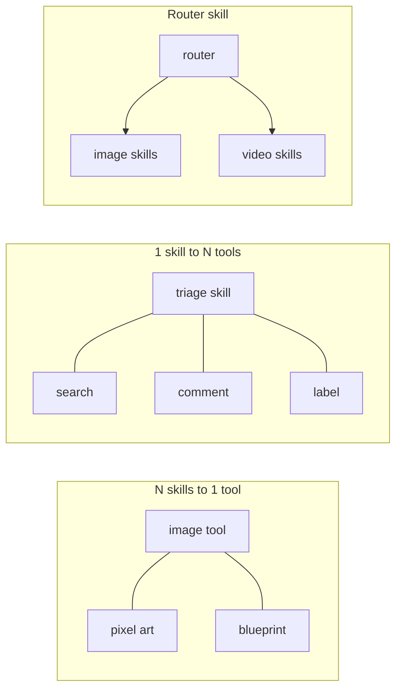

# 18. A tool is a capability and a skill is how to use it well: the Skills extension serves both but links them only by convention, so I map them by what the model cannot guess, make the tool work alone, and pilot it on one tool

> The MCP Skills extension (SEP-2640, Final, spec at Beta) lets a server serve skills next to tools, and a host lists their names and descriptions. The spec has no field that ties a skill to a tool, so the link is text on both sides. The lecturer's own small test suggests the link decides whether the agent loads the skill, and independent evals show skills often go unloaded. Host support is real but beta, so the tool must still work without the skill.

Related: [02 MCP resources and plugins](02_MCP_Resources_Plugins.md) · [11 Sys prompt vs skills content and threats](11_Sys_Prompt_vs_Skills_Content_And_Threats.md) · [12 How to adjust the system prompt and make it flexible](12_How_To_Adjust_System_Prompt_And_Make_It_Flexible.md) · [15 MCP server instructions and harness support](15_MCP_Server_Instructions_And_Harness_Support.md) · [13 MCP tools loading and code mode with many servers](13_MCP_Tools_Loading_And_Code_Mode_With_Many_Servers.md) · [Lecture 1: 12 MCP resources and skills](../Lecture_1_Mechanics_Behind_Generative_AI/12_mcp_resources_and_skills.md) · [19 Router skill across MCP, MCP skills and the harness](19_Router_Skill_Across_MCP_Server_Skills_And_Harness.md) · [20 Search over skills](20_Search_Over_Skills_Instead_Of_Listing_Them.md)

Source: S02E03 lesson, "Skills & Tools" (figures 10 to 12). The lecturer's `tool-skill-links` example (README read, code not run). The Skills extension overview, the `ext-skills` repository and SEP-2640, the client matrix, Anthropic, OpenAI and Agent Skills docs, Claude Code skills docs, read on 2026-11-25. See [Fact-check](#fact-check).

## Glossary

| Term | What it means here | Same thing elsewhere | Not to be confused with |
|---|---|---|---|
| Tool | A capability the server runs | MCP tool | A skill |
| Skill | Instructions, and files, for using capabilities well | `SKILL.md` folder | A tool that returns text |
| Link | Text that makes the pair findable from either side | Tool-skill link | A protocol field |
| Router skill | A skill that points to other skills | Index skill | A tool router |

## 1. The problem

My team resists adding skills to MCP servers, and I think it may pay. **How do I map skills and tools, and what is the case for a pilot?**

## 2. The two figures

Source: S02E03 article, figures 10 and 11.

- **Story:** the client shows both, a skill loads only when chosen, and the two name each other so either entry finds the other.
- **Important:** the red "not loaded" line and the two red arrows. **Not important:** the style names.

## 3. What the extension specifies

- **Host handling:** a tool is a schema and a callback that runs on the server, with its definition up front or deferred (note 13). A skill runs nowhere, shows its name and description up front and its body on demand, and sits below the system prompt (note 11).
- **Methods:** a server declaring `io.modelcontextprotocol/skills` implements `skills/list` and `skills/get`. Files come through `resources/read`. `skills/list` returns each skill's URI, frontmatter and a manifest of files with digest and size. A skill may hold up to 512 files and 16 MiB.
- **Hosts:** "Host applications determine how skills are exposed to the model and user." Reading `SKILL.md` does not activate it. Same-name skills must not replace each other silently. Code execution and `allowed-tools` need per-skill user approval, and digests are unsigned and come from the same server.
- **No tool link:** I found no field that lets a skill require tools or a tool name a skill. The stated use is "reusable workflows that combine several tools".
- **SEP-2640:** Final, created 2026-04-23, merged 2026-09-13. Its motivation: fragmented distribution, instruction size limits (an 875-line skill) and ad-hoc solutions.

## 4. Support

| Host | Status |
|---|---|
| Claude Code | Beta since v2.1.331, server skills run as `/<server>:<skill>` with per-version approval. Its docs say it ignores `allowed-tools` and `hooks` for MCP skills |
| VS Code | Beta, on by default since 1.147, with per-server consent |
| ChatGPT, Codex | Planned. The client matrix marks ChatGPT "Partial" |
| SDKs | TypeScript and C# v2.4.0 beta, Python merged and unreleased, Go in progress |

The host rows come from a community-maintained list, and the client matrix shows blanks for Claude Code and VS Code, so the two disagree.

## 5. Mapping skills and tools

| Content | Where it belongs |
|---|---|
| A parameter's type and range | The tool schema and its validation |
| What the tool does and when to use it, and which skill pairs with it | The tool description |
| Order across tools, in a few lines | Server instructions (note 15) |
| House style, exact presets, long workflows, what the model cannot guess | The skill |
| Reference text | A resource (note 01) |
| A rule that must hold | Code |

- **Link both ways in text**, as the figure shows: the tool names the skill, and the skill names the tool with a fully qualified name (`Server:tool_name`, Anthropic's advice) and its arguments.
- **Do not force the link.** The lecturer's tool description says a plain image needs no skill.
- **The tool works alone.** Hosts without skills support still get the tool, and the skill only adds quality.
- **Ship them together** in one server version, so a skill cannot outlive the tool it describes.
- **Who owns what:** the server's skill says how the tool works well, and my agent-side skills hold how I like things done.

## 6. What the lecturer's test shows

- **Setup:** an image tool and three style skills with exact arguments the model cannot guess (96 by 96 and 12 colors for pixel art). Five requests, default OpenAI model, effort `low`.
- **Without links:** 0 of 3 styled images passed in 8 of 8 runs, because the agent never looked for a skill. **With links:** 3 of 3 in 4 of 4 runs. A plain photo and a question passed in both modes. One pass of both modes cost about $0.0011 (estimated).
- **Limits:** with the skill list in the instructions, the model loaded the right skill in both modes in 2 of 2 runs. The word "paint" made the linked agent skip the skill in 6 of 6 runs.
- **Note:** the example serves skills through `list_skills` and `load_skill` tools, not through the extension. The runs are small and the lecturer's own.

## 7. Industry adoption and standards

The standard exists and is backed by the maintainers. The evidence that skills get loaded when needed is weak, and none of it tests the tool-to-skill link.

| Position | Who, when | What the source says |
|---|---|---|
| For | MCP Skills-over-MCP working group, SEP-2640 Final 2026-09-13 | Leads from Nordstrom and Bloomberg, members from Google, GitHub, AWS, Databricks, Stacklok, Arcade. The charter says it documents patterns and does not require client behavior |
| For | Anthropic, 2025-10-16 | Skills complement MCP servers by teaching complex workflows over external tools |
| For, with a limit | OpenAI | A skill may require an MCP server, but a dependency "does not replace clear workflow instructions" |
| For | Speakeasy, 2026-02-19 (sells MCP infrastructure) | "Skills teach agents how to do things. MCP servers give agents the ability to do things." |
| For, on maintenance | Ronacher, 2025-12-13 | He moved his MCPs to skills, because MCP servers change tool descriptions at will. A practitioner view, not a measurement |
| Against | Vercel, 2026-01-27 | In 56% of cases the skill was never invoked. Pass rate: none 53%, skill 53%, skill with explicit wording 79%, always-present `AGENTS.md` index 100%. Next.js docs, not MCP |
| Against | LlamaIndex, 2026-02-03 | Skills "were rarely invoked". For fast-changing docs they chose MCP as the single source |
| Against | arXiv 2604.04323, 2026-04-06 (abstract only) | Skill benefits "are fragile" with 34k skills to choose from |
| Caution | Cloud Security Alliance, 2026-09-29 | Instructions in a skill can persuade an agent to run bad code. A cited study of 3,984 skills found 534 with critical issues and 76 malicious |
| Caution | Speakeasy | Skills are "invisible to your central systems", unlike logged MCP calls |

**Where the lecturer goes past the industry (to revisit):**
- **Link as the fix.** Vercel and LlamaIndex show skills often go unloaded, and always-present context did better. His own run with the skill list in the instructions agrees. A tool description that names the skill is one more way to make it visible, and I found no vendor recommending it.
- **Evidence size.** His 0-to-3 result is small, on one default model, and the example serves skills through tools, not the extension.
- **Exact arguments in a skill.** I found no vendor or study on putting preset arguments for a tool in a skill instead of its schema.

## 8. Worth a pilot, and the resistance

| Objection | Answer |
|---|---|
| One more artifact to maintain | It ships in the same server version, and a test pairs it with the tool |
| Hosts do not support it | Partly true. Claude Code and VS Code have beta support, and the tool works alone. Check my hosts |
| Instructions from a server are a risk | The spec needs per-skill approval, ignores `allowed-tools` by default and digests are unsigned. Treat it as supply chain (note 11) |
| Put it in the tool description | Descriptions are cut (Claude Code at 4,096 and 16,384 characters), and a skill loads only on demand |
| Skills drift from the tool | Same repository, same release, same eval |

**Pilot (my reasoning):** one tool with arguments the model cannot guess, two or three skills, links both ways, and a deterministic grader like the lecturer's. Measure the pass rate with and without links, tokens, and behavior on each host. Stop if hosts ignore the skills or the pass rate does not move.

## Open questions

- Which of my tools has arguments the model cannot guess?
- Which of my hosts load server skills today?
- Who approves a skill that a server serves?

## Fact-check

| # | Claim | Verdict | Source |
|---|---|---|---|
| 1 | SEP-2640 is Final, the spec is Beta, with `skills/list`, `skills/get`, limits and host duties | agrees | [Skills overview](https://modelcontextprotocol.io/extensions/skills/overview), [ext-skills](https://github.com/modelcontextprotocol/ext-skills) |
| 2 | No field links a skill and a tool | agrees, by absence, spec read in part | same pages |
| 3 | Reading does not activate. Same-name rule. `allowed-tools` needs approval. Digests unsigned | agrees, `allowed-tools` part from a summary | same pages |
| 4 | Implementations: Claude Code and VS Code beta, ChatGPT and Codex planned | unverified, community list | [implementations](https://github.com/modelcontextprotocol/ext-skills/blob/main/docs/implementations.md) |
| 5 | The client matrix lists only ChatGPT, fast-agent and the Inspector as Partial | agrees. It conflicts with row 4 | [Client matrix](https://modelcontextprotocol.io/extensions/client-matrix.md) |
| 14 | Vercel figures, Ronacher, Speakeasy, LlamaIndex, CSA, working group members | agrees, read 2026-11-25. Ronacher and Speakeasy are opinion, Vercel's model is not named | [Vercel](https://vercel.com/blog/agents-md-outperforms-skills-in-our-agent-evals), [Ronacher](https://lucumr.pocoo.org/2025/12/13/skills-vs-mcp/), [Speakeasy](https://speakeasy.com/blog/skills-vs-mcp), [LlamaIndex](https://www.llamaindex.ai/blog/skills-vs-mcp-tools-for-agents-when-to-use-what), [CSA](https://cloudsecurityalliance.org/blog/2026/09/29/from-models-to-mcp-servers-skills-and-plugins-rethinking-trust-in-the-ai-supply-chain), [charter](https://modelcontextprotocol.io/community/working-groups/skills-over-mcp) |
| 15 | arXiv 2604.04323 skill benefits are fragile | agrees from the abstract, paper not read | [arXiv](https://arxiv.org/abs/2604.04323) |
| 6 | Claude Code ignores `allowed-tools`, `hooks` for MCP skills | agrees | [Claude Code skills](https://code.claude.com/docs/en/skills) |
| 7 | Skills complement MCP. Fully qualified `ServerName:tool_name`. OpenAI `dependencies.tools` | agrees | [Anthropic, 2025-10-16](https://www.anthropic.com/engineering/equipping-agents-for-the-real-world-with-agent-skills), [best practices](https://platform.claude.com/docs/en/agents-and-tools/agent-skills/best-practices) |
| 8 | The Agent Skills spec has no MCP field. `allowed-tools` is experimental | agrees | [agentskills.io](https://agentskills.io/specification) |
| 10 | 0 of 3 in 8 of 8 runs against 3 of 3 in 4 of 4 runs, about $0.0011 | agrees as the lecturer's README, not run | [tool-skill-links](https://github.com/MEGA-DOT-DEV/examples/tree/main/examples/tool-skill-links) |
| 11 | The example serves skills through tools, not the extension | agrees | same README |
| 12 | OpenAI rolled back skill import in November 2026 | unverified, community claim | implementations list |
| 13 | The mapping table, the pilot and the ownership split | lecture-independent, my reasoning | |
