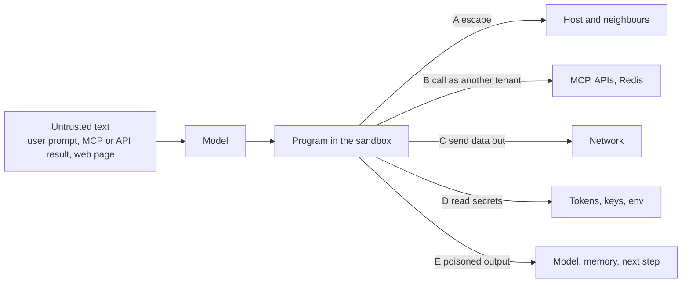
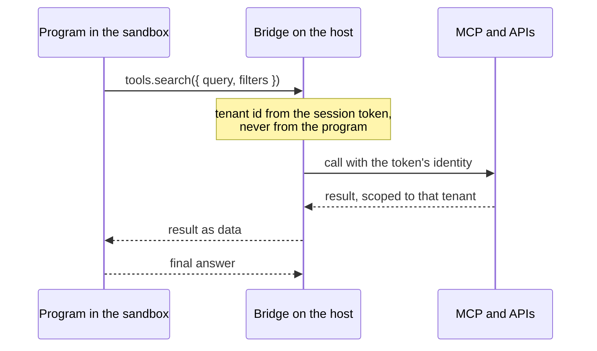

# 20. No sandbox can promise that jailbreaks and prompt injection fail, so the guarantee I can give is structural: a tenant-bound bridge, a per-tenant wall with no secrets and no egress, and tests that assume the model is already compromised

> OWASP, Anthropic and Simon Willison all say injection cannot be fully prevented, so "the system cannot be compromised" is not a promise I can make for the model. I can make a narrower one: a fully hijacked model and program still cannot reach another tenant's data, because identity, authorization and the network are enforced outside both.

Related: [W2L2 17 Auto penetration testing of my agent](../Week2_Lecture_2_Building_an_Agent/17_Auto_Penetration_Testing_Of_My_Agent.md) · [W2L1 04 HITL and execution isolation](../Week2_Lecture_1_Agent_Primitives/04_HITL_And_Execution_Isolation.md) · [17 Workspaces and code sandboxes in frameworks](17_Workspaces_And_Code_Sandboxes_In_Frameworks.md) · [18 Where the sandbox attaches](18_Where_The_Sandbox_Attaches_Tool_Node_Backend_Or_Run_Config.md) · [W2L2 12 Sandbox for agent code](../Week2_Lecture_2_Building_an_Agent/12_Sandbox_For_Agent_Code_Pi_And_Search_Execute.md) · [Lecture 2: 9 Tools and prompt injection](../Lecture_2_Context_Agents_md_Skills_Tools/9_tools_prompt_injection.md) · [W2L1 25 Tool execution instead of tool calls](../Week2_Lecture_1_Agent_Primitives/25_Tool_Execution_Instead_Of_Tool_Calls.md) · [10 Instruction precedence and tool pollution](10_Sys_Prompt_vs_Skills_Content_And_Threats.md)

Source: my setup as I describe it (tenant id taken from the token and used in Redis keys, tenant id enforced behind MCP and the APIs). OWASP LLM Top 10 2025 and Agentic Top 10 2026, Anthropic's sandboxing article (2025-10-20) and Claude Code security docs, Simon Willison (2025-06-16), the CaMeL and design-patterns papers (abstracts), gVisor, Firecracker, Docker and Kubernetes Agent Sandbox docs, read on 2026-11-23. Nothing was run.

## Glossary

| Term | What it means here | Same thing elsewhere | Not to be confused with |
|---|---|---|---|
| Jailbreak, prompt injection | The user's prompt, or instructions hidden in data (tool result, web page, file), change what the model does | Direct and indirect injection (OWASP LLM01) | Sandbox escape |
| Sandbox escape | Code breaks out of the wall into the host or a neighbour | Container escape (OWASP ASI05) | The first two |
| Blast radius | What a compromised model or program can reach | Impact scope | Probability of compromise |
| Tool bridge | Host-side code that lets the program call tools and adds identity | Programmatic tool calling bridge | The sandbox |
| Egress | Traffic leaving the sandbox, DNS included | Outbound network | Ingress |
| Lethal trifecta | Private data, untrusted content and external communication in one agent | Rule of Two (not read) | A vulnerability |

## 1. The problem

I want to give my agent code execution in a sandbox. **Can I guarantee that nothing is compromised and that no tenant's data reaches another tenant, on top of the tenant id I already take from the token for Redis and for MCP and the APIs?**

A jailbreak or an injection changes what the model does, and an escape changes what the code can reach. A sandbox addresses the escape and limits the damage of the other two. It does not stop them.

## 2. What the sources say can be promised

| Source | Statement |
|---|---|
| OWASP LLM01:2025 | "It is unclear if there are fool-proof methods of prevention for prompt injection." Measures only mitigate impact |
| Claude Code security docs | "No system is completely immune to all attacks" |
| Simon Willison (blog) | "We still don't know how to 100% reliably prevent this." Avoid the lethal trifecta entirely |
| CaMeL (paper, abstract) | Untrusted data "can never impact the program flow", with policies enforced at tool calls. 77% of AgentDojo tasks solved with provable security against 84% undefended |
| Design patterns paper (abstract) | Agents with "provable resistance" by constraining what untrusted input can trigger. I did not read the patterns |
| gVisor docs | "A sandbox is not a substitute for a secure architecture" |

So I assume the model is already hijacked and ask what it can reach. CaMeL is research with a cost of about 7 points of task success.

## 3. The paths an attacker uses

| Path | Control that blocks it | Enforced where |
|---|---|---|
| A escape | A strong wall per tenant, never root, patched host | Platform |
| B other tenant | Identity from the token on the host, authorization behind MCP and the APIs | Host and services |
| C exfiltration | Default-deny egress, DNS included | Outside the sandbox |
| D secrets | None inside the sandbox | Host |
| E poisoned output | Treat output as untrusted data, validate before it reaches memory or tools | Host |

## 4. My two layers, and what code execution changes

Tenant id from the token in Redis keys, and tenant id behind MCP and the APIs, are the right base. OWASP calls the same idea complete mediation: authorization downstream, not decided by the model. What changes is the caller: a program the model wrote.

- The sandbox gets no Redis address, no credentials and no bearer token. It reaches data only through the bridge.
- The tools it sees have no `tenantId` parameter, so the program cannot ask for another tenant.
- Every call still passes the same authorization as a direct call. The program has no extra rights.

## 5. How strong the wall must be

| Wall | What the docs state | Fit for tenants |
|---|---|---|
| Docker container | Default capabilities and mounts "may provide incomplete isolation... in combination with kernel vulnerabilities" | Weakest. Kernel is shared |
| gVisor | A user-space kernel, no system call goes straight to the host. No protection against hardware side channels | Stronger. Host still matters |
| Firecracker microVM | Built to run different customers on one machine. One process per tenant. Disable SMT where tenants are separated, patch the host. No egress filtering, so filter on the host | Designed for it, with operator duties |
| Kubernetes Agent Sandbox | Orchestrates gVisor or Kata pods. Default network policy blocks private ranges and the metadata endpoint, no service account token. Its threat model lists gaps | A way to run the above |
| Hosted providers | The vendors' own claims | Not verified |

For hostile multi-tenant code I would pick a microVM or gVisor per tenant (my reasoning, not a vendor rating).

## 6. Rules I would hold

| # | Rule | Why |
|---|---|---|
| R1 | One sandbox per tenant, ephemeral per task or thread, nothing persists between tenants | Persistent sandboxes accumulate state (Deep Agents, CrewAI) |
| R2 | Identity comes from the token on the host, and the bridge adds it | OWASP LLM06 complete mediation |
| R3 | No secrets, Redis access or token in the sandbox | Deep Agents: "Never put secrets inside a sandbox" |
| R4 | Default-deny egress, DNS included, enforced outside the sandbox | Anthropic: both filesystem and network isolation are needed |
| R5 | Never root, one working directory, data passed in as files | OWASP ASI05 |
| R6 | Output is untrusted: size-limited, validated, never written to memory unchecked | OWASP LLM05 |
| R7 | Limits on CPU, memory, time, processes and output, and short-lived task-scoped permissions | Resource exhaustion, OWASP ASI03 |
| R8 | Writes and approvals stay direct calls, outside the program | W2L1 25 |
| R9 | Log every program, bridge call and egress attempt with the tenant id | Incident tracing |
| R10 | No egress removes the "communicate externally" leg of the trifecta | Willison |

## 7. What I would test

- A canary in another tenant's Redis keys and API data, and a program that tries to read it. An injected tool result that tells the program to call as another tenant.
- Egress over HTTP, DNS and the metadata address. Secrets in the environment, files and process list. Resource exhaustion, and state left for the next tenant.
- These extend W2L2 17 with synthetic tenants and canaries. Running them needs my explicit yes.

## 8. Cautions

- Escapes and hardware side channels exist. gVisor and Firecracker both say they do not fully cover them.
- A hosted provider sees my code and my tenants' data, so only an approved one is allowed. A hijacked program can still give a wrong answer inside its own tenant.
- Meta's "Rule of Two" was not found, and the six patterns of the design-patterns paper were not read.

## Summary

I cannot guarantee that injection fails. I can guarantee a smaller thing by design: the program has no identity, secrets or network of its own, it runs in a per-tenant wall, and every call passes the same tenant checks as today. Then I test with canaries.

## Open questions

- Which wall and provider fit, who approves it, and can my LangGraph bridge give the program tools without exposing the token?
- Who writes the program's output to Redis memory, and with which checks? Is one tenant check behind MCP enough, or does each API need its own?

## Fact-check

| # | Claim | Verdict | Source |
|---|---|---|---|
| 1 | Prevention of prompt injection is not guaranteed | agrees | [OWASP LLM01](https://genai.owasp.org/llmrisk/llm01-prompt-injection/) |
| 2 | "No system is completely immune" | agrees | [Claude Code security](https://code.claude.com/docs/en/security) |
| 3 | The lethal trifecta and the advice to avoid it | agrees, a blog | [Willison](https://simonwillison.net/2025/Jun/16/the-lethal-trifecta/) |
| 4 | CaMeL: provable security, 77% against 84% on AgentDojo | agrees, abstract only, research | [arXiv 2503.18813](https://arxiv.org/abs/2503.18813) |
| 5 | Design patterns give provable resistance | abstract only, patterns not read | [arXiv 2506.08837](https://arxiv.org/abs/2506.08837) |
| 6 | Both filesystem and network isolation are needed | agrees | [Anthropic sandboxing](https://www.anthropic.com/engineering/claude-code-sandboxing) |
| 7 | Complete mediation, least privilege, output handling | agrees | OWASP [LLM06](https://genai.owasp.org/llmrisk/llm062025-excessive-agency/), [LLM05](https://genai.owasp.org/llmrisk/llm052025-improper-output-handling/) |
| 8 | Sandboxed containers, never root, working directory only. Task-scoped, time-bound permissions | agrees | OWASP [ASI05](https://genai.owasp.org/agentic-applications-2026/asi05-unexpected-code-execution-rce/), [ASI03](https://genai.owasp.org/agentic-applications-2026/asi03-identity-and-privilege-abuse/) |
| 9 | Firecracker: one tenant per process, disable SMT, filter egress on the host | agrees | [Firecracker production setup](https://github.com/firecracker-microvm/firecracker/blob/main/docs/prod-host-setup.md) |
| 10 | gVisor: no host system calls directly, not a substitute for a secure architecture, no side-channel protection | agrees | [gVisor security model](https://gvisor.dev/docs/architecture_guide/security/) |
| 11 | Docker: incomplete isolation with kernel vulnerabilities | agrees. The page does not call containers unfit for hostile code | [Docker security](https://docs.docker.com/engine/security/) |
| 12 | Agent Sandbox: default network policy and no token, with listed gaps | agrees | [Threat model](https://github.com/kubernetes-sigs/agent-sandbox/blob/main/docs/security/threat_model.md) |
| 13 | Deep Agents: never put secrets in a sandbox | agrees, partly from a summary | [Deep Agents sandboxes](https://docs.langchain.com/oss/python/deepagents/sandboxes) |
| 14 | DNS is an exfiltration path, per-tenant egress policy | unverified: vendor blogs | search results, 2026-11-23 |

## Sources

- The pages linked above. Sections 4 to 8 and the rules are my reasoning. Vendor blogs on multi-tenant practice are secondary.
