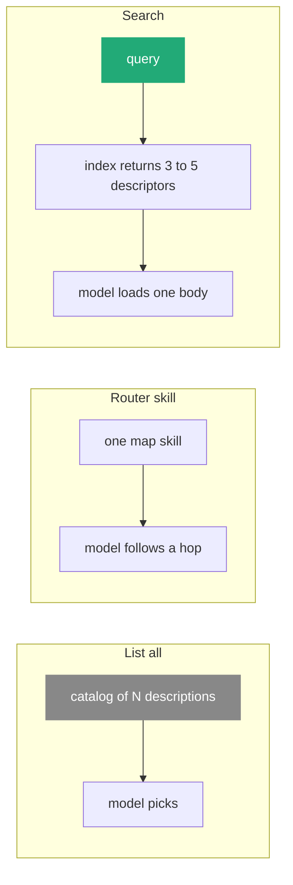

# 20. Search over skills is the tool-search idea applied to skills: it fits past the catalog budget, no vendor ships it for skills yet, and over MCP it needs a tool because the extension has no search method

> A host can list every skill's name and description each turn, route through a router skill, or let the agent search a skill index and load only the hits. For tools, search has documented thresholds. For skills, vendors document none: Claude Code caps the listing and drops descriptions, a request for skill search was closed unshipped, and the research is at abstract level. Over MCP, search means a server tool beside the Skills extension.

Related: [19 Router skill across MCP, MCP skills and the harness](19_Router_Skill_Across_MCP_Server_Skills_And_Harness.md) · [18 MCP skills and tools](18_MCP_Skills_And_Tools.md) · [13 MCP tools loading and code mode with many servers](13_MCP_Tools_Loading_And_Code_Mode_With_Many_Servers.md) · [15 MCP server instructions and harness support](15_MCP_Server_Instructions_And_Harness_Support.md) · [W2L1 08 Tool search instead of many tools](../Week2_Lecture_1_Agent_Primitives/08_Tool_Search_Instead_Of_Many_Tools.md)

Source: my follow-up to note 19, linking it to search plus execute (note 13). Anthropic tool search docs, Spring AI's tool search guide, Claude Code skills and settings docs, a Claude Code feature request, four arXiv abstracts, read on 2026-11-25. See [Fact-check](#fact-check).

## Glossary

| Term | What it means here | Same thing elsewhere | Not to be confused with |
|---|---|---|---|
| Catalog listing | Name and description of every skill, shown each turn | Skill listing | The skill bodies |
| Skill search | A query over a skill index that returns descriptors, then bodies of the chosen ones | Skill retrieval, selective skill exposure | A router skill |
| Deferred loading | A definition enters context only after a search finds it | `defer_loading` | Disabled |
| Descriptor | Name, description and URI of one skill | Frontmatter entry | The body |

## 1. The problem

I do not want to load every enabled skill and its description. I want to search over them, like search plus execute does for tools. **When is that viable, how many tools and skills does it take, and what does the industry say?**

## 2. Three ways to expose skills

| | List all | Router | Search |
|---|---|---|---|
| Who finds the skill | The model, from the catalog | The model, from a hand-written map | A retriever over the index |
| Context cost | Grows with N, capped by the host | One entry, if children are hidden (note 19) | The search tool, results only |
| Failure | Descriptions dropped over budget | A wrong map misroutes | A weak query finds nothing |
| Upkeep | Sharp descriptions | The map | The index and its quality |

## 3. Tool search sets the pattern

- **Mechanism (Anthropic):** `defer_loading` controls what enters the context, not what is sent. Deferred tools load when Claude discovers them. Keep "3 to 5" tools non-deferred. Search returns up to 5 matches. The maximum is 10,000 deferred tools.
- **Same shape for skills:** a search tool returns descriptors, then the body loads only for the chosen skill. This is my mapping of the tool pattern, and the Anthropic page does not mention skills.
- **Code mode connection:** note 13's `search` runs inside a sandbox over a spec. A `search` over a skill index could run the same way, so descriptors reach the model as a result and not as a standing catalog (my reasoning).

## 4. How many, by the numbers

| Source | Tools | Skills |
|---|---|---|
| Anthropic tool search docs | Use at 10 or more tools, over 10k tokens of definitions, or 200+ tools across servers. Selection "degrades once you exceed 30 to 50" | Not covered |
| Spring AI guide | Use at 20+ tools or over 5K tokens. Stay with the default under 20 | Not covered |
| Claude Code docs | MCP tools defer by default (note 13) | The listing is capped at 1% of the context window, 1,536 characters per entry. Names stay, least-used descriptions drop |
| Agent Skills spec | | About 100 tokens of metadata per skill |
| Claude Code feature request | | 81+ listed skills, about 4 to 5K tokens estimated. Another user: 47 skills and 11 subagents, about 10K tokens per turn |
| Anthropic best practices | | A description selects "from potentially 100+ available Skills" |

- **Derived rule (my reasoning, not a vendor figure):** the default budget at a 200K window is about 2,000 tokens, which is about 20 skills at 100 tokens each. Past that the host starts dropping descriptions, and `/doctor` shows my real cost. Real entries are longer than 100 tokens, so the point comes sooner.
- **Tools and skills add up.** A catalog of 50 skills sits beside 30 tools, and each pool crosses its own limit.

## 5. What the industry says about skill search

| Source | What it says | Status |
|---|---|---|
| Claude Code request (opened 2026-04-05) | Asks for a skill search like tool search, with name-only listing and on-demand descriptions | Closed "as not planned" 2026-06-05, locked 2026-08-08. No shipped search in the thread |
| Claude Code docs | Names always listed, descriptions dropped over budget, `name-only` overrides | Shipped, the opposite of search |
| SkillBrowser, arXiv 2610.23554 (2026-10-16) | Selective exposure beats static retrieval and LLM selection on SRA-Bench. Limits: under-invocation and latency | Abstract only, unverified |
| SkillSight, arXiv 2607.18785 (2026-07-21) | Retrieval calibration: Recall@10 up to 20.21 points, up to 1,248 times faster than a reranker | Abstract only, unverified |
| arXiv 2604.04323 (2026-04-06) | With 34k skills, gains are fragile. Refinement lifted Opus 4.6 on Terminal-Bench 2.0 from 57.7% to 65.5% | Abstract only |

No vendor documents a threshold for skills, and the research does not state a pool size in its abstracts.

## 6. Over MCP

- **The extension has no search.** It defines `skills/list` and `skills/get`, and I found no search method (note 18).
- **So search is a server tool.** The lecturer's own example serves skills through `list_skills` and `load_skill` tools. A `search_skills` tool beside them returns descriptors, and the host loads the body through its skill path (note 18).
- **Consent still applies.** A skill reached through search is still a skill from a server, so activation needs its approval (note 19).
- **Poisoning surface.** Search results are tool results, which carry less authority than a skill body (note 11). Descriptions from a third-party index are still text I must trust.

## 7. Viable when

| Situation | Choice |
|---|---|
| Fewer than about 20 skills, catalog under budget | List all |
| Catalog over budget, one family | `name-only` overrides, sharper descriptions, maybe a router |
| Dozens of skills across servers | Search, with 3 to 5 always listed |
| 100+ skills or third-party indexes | Search with a measured grader, since retrieval gains are fragile |
| A rule that must hold | Code, not either |

| | Search | List all |
|---|---|---|
| Tokens | Small standing cost | Grows with N |
| Misses | A skill the query never finds | A skill whose description was dropped |
| Latency | One extra call | None |
| Host support | A custom tool over MCP | Built in |

## 8. In my system (my reasoning)

- Measure first: `/doctor` shows what the listing costs and which skills dominate.
- If I add search, I keep a few skills always listed and run the lecturer's style of grader on retrieval: did the right skill load, did the tool still work.
- Search over tools and skills can share one `search` meta-tool, so one query returns both.

## Open questions

- How many skills and tools do I run per session today?
- Does any host ship skill search or hide children?
- Does one `search` over tools and skills beat two?

## Fact-check

| # | Claim | Verdict | Source | Checked |
|---|---|---|---|---|
| 1 | Tool selection degrades past 30 to 50 tools. Use search at 10+ tools, 10k tokens, 200+ across servers. `defer_loading`, 3 to 5 non-deferred, 5 results, 10,000 max | agrees | [Anthropic](https://platform.claude.com/docs/en/agents-and-tools/tool-use/tool-search-tool) | 2026-11-25 |
| 2 | Spring AI: 20+ tools, 5K tokens, under 20 stay default | agrees | [Spring AI](https://docs.spring.io/spring-ai/reference/guides/dynamic-tool-search.html) | 2026-11-25 |
| 3 | Claude Code listing: 1% of the window, 1,536 characters, names kept | agrees | [settings](https://code.claude.com/docs/en/settings-reference), via Context7 | 2026-11-25 |
| 4 | Feature request numbers and closed unshipped | agrees, read in full | [issue 43816](https://github.com/anthropics/claude-code/issues/43816) | 2026-11-25 |
| 5 | The second request page I found did not resolve | not read | | 2026-11-25 |
| 6 | SkillBrowser, SkillSight, 2604.04323 findings | agrees from abstracts, papers not read | [2610.23554](https://arxiv.org/abs/2610.23554), [2607.18785](https://arxiv.org/abs/2607.18785), [2604.04323](https://arxiv.org/abs/2604.04323) | 2026-11-25 |
| 7 | About 100 tokens of metadata per skill | agrees | [Agent Skills](https://agentskills.io/specification) | 2026-11-25 |
| 8 | The extension has `skills/list` and `skills/get` and no search | agrees by absence | [overview](https://modelcontextprotocol.io/extensions/skills/overview) | 2026-11-25 |
| 9 | The 20-skill point, search over skills as a tool, shared `search` | lecture-independent, my reasoning, verify before presenting | | |

## Sources

- The pages linked above. Sections 2, 3 (skills mapping), 4 (derived rule), 6, 7 and 8 are my own reasoning.
